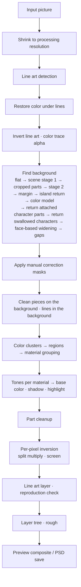

# Illustracy — Illustration Layer Separator

[한국어](README.md) | **English**

A program that takes a single finished illustration and **splits it back into many transparent layers**, the way it was painted, and saves them as a Photoshop file (PSD).

> [!IMPORTANT]
> This program was made for cases where drawn layers were merged by mistake and can no longer be separated, or where an image was exported as a single file and the original file could not be saved.
>
> Never use this program on images you did not create.

- No installation, no internet connection, no cost.
- Your image never leaves your computer.
- Resolving power: **6.14× version 0.1** (0.49, 95% CI 4.50–8.91×; measured by the rate of wrongly separated character · background on 185 pictures with ground truth. 177 of the 185 are synthetic, so the gain on real pictures is much smaller; in the blind test on 60 real pictures it is slightly lower than 0.48, 11).
- Weaknesses and a call for help: the weaknesses found in the background, body, base colors, faces, and objects, and a request for help with them, are in [10.6](#106-weaknesses-seen-through-the-five-targets-and-a-call-for-help-039).

---

## Contents

1. [Quick start](#1-quick-start)
2. [Principles](#2-principles)
3. [How it works](#3-how-it-works)
4. [Algorithms and formulas](#4-algorithms-and-formulas)
5. [Correspondence with the physical world](#5-correspondence-with-the-physical-world)
6. [System (program structure)](#6-system-program-structure)
7. [Issues and fixes](#7-issues-and-fixes)
8. [Optimization](#8-optimization)
9. [Strengths](#9-strengths)
10. [Limitations](#10-limitations)
11. [Verification](#11-verification)
12. [Release history](#12-release-history)
13. [References](#13-references)

---

## 1. Quick start

### What is this?

When you paint on a computer, you usually stack several sheets of transparent paper.
You put the colors on the bottom sheet, the shadows on the sheet above it, the shiny highlights above that, and the lines on top.
But once the finished picture is merged and saved as one image, those sheets are gone and only one sheet remains.

Illustracy looks at the merged picture and splits it back into sheets in the order the picture was painted.
Stacking the split sheets again looks the same as the original picture, so close that the eye cannot tell them apart.

### What does it split into?

The program's screen and the layer names in the PSD are in Korean. The Korean names are given in parentheses.

| Layer | What it holds |
|---|---|
| Rough (`러프` folder: `러프 1 (컨셉)` · `러프 2 (다듬기)`) | Two underdrawings. Rough 1 is the crude rough an artist dashes off the moment an idea comes, and rough 2 refines it and matches the composition to the original. They are not in the original picture, so they are a guess, and they start hidden |
| Line art (`선화`) | The lines of the picture |
| Color trace (`색 트레이스`) | The parts of the lines whose color differs (lines catching light, colored lines) |
| Base color (`밑색`) | The single flat color painted per part, such as hair, skin, clothes |
| 1st · 2nd shadow (`1차 그림자` · `2차 그림자`) | Darker areas laid over the base color. The 2nd is darker than the 1st |
| Highlight (`하이라이트`) | Areas painted brighter than the base color (hair sheen, etc.) |
| Shading · gradient (`명암` · `그라데이션`) | Areas that darken smoothly |
| Reflected light · rim light (`반사광` · `림라이트`) | Areas that brighten again inside a shadow, light along the edge of the body |
| Light · sparkle (`빛` · `반짝임`) | Glowing effects, sparkles in the eyes, stars |
| Background · background FX (`배경` · `배경 효과`) | The background behind the character, flecks of light floating over the background |
| Outer glow (`외곽 글로우`) | A neon band drawn around the character (only in pictures that have one) |

Each part gets its own folder, and the folder holds that part's base color · shadows · highlights (choosing **per-stage folders** in the settings turns this around: the parts sit inside [Base color] · [1st shadow] · [2nd shadow] · [Highlight] folders).
If the program finds a face in the picture (also in PNGs with a transparent background), it names folders **eyes · skin · hair** (`눈` · `피부` · `머리카락`) from the colors around the face; the other folders are named by color (blue `파랑`, black `검정` …).

### What do I need?

- A browser (Chrome, Edge, Firefox, Safari)
- Nothing else: no internet, installation, account, or cost.

### How to use it

1. Download [`illustracy.html`](illustracy.html) and open it in a browser. This single file also contains the help.
2. Drag an image onto the window, click the box at the top left to choose one, or paste a copied image with `Ctrl+V`.
   To try it first, click **Sample image** (`예제 그림`).
3. Wait a few seconds and the layer list appears on the right.
   - Circle button: turn that layer on or off
   - Click a layer name: change the blend mode and opacity, save only that layer as an image file
   - Double-click a layer name: rename it
   - **Eye button** above the list: clicking the open eye turns all layers and folders off at once and the icon changes to a closed eye. Clicking the closed eye restores the state from before.
     After turning everything off, turning one layer on also turns on the folders that contain it, so only that layer shows; turning a folder on shows the layers inside it.
4. Click **PSD download** (`PSD 다운로드`) to save a file you can open in Photoshop. Names, opacities, and on/off states you changed in the list are saved as they are.

Zoom the picture in the middle with the mouse wheel and drag to move it.
The **도움말** (help) button at the top right opens, in a new window, a help page (in Korean) on how to use the program, how to fix wrongly split parts and how it works; your result stays as it is. To read only the help, download [`illustracy-help.html`](illustracy-help.html) and open it.
The theme switch next to it sets the screen colors to follow the system, light or dark. The choice is shared by the app and the help, and changing it in one updates the other if it is open.
With the buttons at the top you can switch between **Composite** (`합성`, the split layers stacked) · **Original** (`원본`) · **Selected layer** (`선택 레이어`, only the chosen layer) · **Difference ×8** (`차이 ×8`, places that differ from the original, emphasized 8×).

### Fixing wrongly split areas

Automatic splitting sometimes leaves a background object on the character side, or sends part of the character to the background.

- **Send to background** (`배경으로 보내기`): turn it on, then click or rub the object to move (table, chair, etc.) and it moves to the background. It does not drag neighboring parts across a line.
- **Return to character** (`캐릭터로 되돌리기`): rub a part that wrongly went to the background (a cropped hat, a sleeve, a leg) and it comes back to the character, and the picture is split again (a few seconds).
- For a large area, draw a **loop around** the part to move (end near the starting point) and the inside is handled at once. If the inside of the loop fills faintly, it was recognized as a loop.
- To undo, use the `↶` button or `Ctrl+Z`.
- While these two tools are on, pan the view with the right mouse button.

Your fixes remain when you change settings and split again, and are cleared when you open a new picture. Fixing does not change the stacked result, which stays identical to the original picture.

### Renaming layers in old PSDs

PSDs saved up to 0.34 have the line-color layer named `색트레스`. Drag such a PSD onto the window like a picture, or choose it with the top-left box (several at once also work),
and a PSD with the layer renamed to `색 트레이스` is saved right away under the same file name. Pixels · layer order · folders · clipping stay as they are, and the file never leaves the browser.
PSB files and files converted to 16 · 32 bits also work. If the file is already fixed, the program tells you there is no layer name to fix.

### Settings

| Setting | Meaning |
|---|---|
| Processing resolution | Shrinks the long side of the picture to this size for processing (default 2048px). Larger is more detailed but slower |
| Split large pictures at a reduced size · method · target size | Off by default (method · size stay disabled while off). When on, pictures whose long side is larger than the target size (default 1200px) are split at a reduced size. Turning it on or changing the method shows that method's explanation and verification results, and confirming splits again right away.<br>**Reduce everything**: all stages at the reduced size (the PSD too). Results are similar to the original size in about half the time.<br>**Find only background · faces at reduced size**: background · faces are found in the reduced picture and the layers are made at the processing resolution. Not recommended, since more pictures lose more of the character (11) |
| Line sensitivity | Higher treats fainter lines as lines too |
| Maximum line width | Dark areas thicker than this are treated as painted surfaces, not lines (0 measures the line width from the picture automatically; the chosen value and the measured width are shown next to it) |
| Line color | Line art + color trace (default) / original line colors in one layer / a single black |
| Number of color clusters | How many colors to split the picture into at first |
| Base color merge strength | Higher groups more colors that differ only in brightness into the same part |
| Shadow threshold | Higher sends faintly darkened areas to the shadow layer too |
| Maximum sparkle size | Bright dots smaller than this are treated as sparkles (0 sets it automatically for the resolution) |
| Maximum number of parts | Maximum number of part folders (default 32). Small parts that overflow go into the "small parts" folder |
| Split painting by part (`채색을 파츠별로 나누기`) | When off, base color · shadows · highlights become one layer each, without separating parts |
| Folder layout (`폴더 나누는 방식`) | **Per-part folders** (`파츠별 폴더`, default): in each of [Skin] [Hair] … folders, base color · 1st · 2nd shadow · highlight.<br>**Per-stage folders** (`단계별 폴더`): in each of [Base color] [1st shadow] [2nd shadow] [Highlight] folders, one layer per part (3.12). Available only when splitting by part; no clipping is used |
| Clip shadows · highlights to the base color | Keeps shadows and highlights from going outside the base color |
| Automatic flat background separation | Turns background detection on and off |
| Neural-network assist | On by default. At the end of background detection, of the color regions left on the character side, only those that both a statistical formula and a small neural network call background are sent to the background (12 in 3.5). Turned off, results are the same as 0.48 |
| Tilted picture (`기울어진 그림`) | Off by default. Turn it on for pictures that are strongly tilted overall (more than 45°) or lying on their side: faces are searched at several angles (0 · ±30 · ±60 · ±90°) and names · character folders · background rules follow the most face-like angle. The chosen tilt appears in the result line as "tilt N°".<br>On upright pictures it finds slightly fewer faces and slightly more fake faces (82 ground-truth pictures: real faces 29/35 → 26/35, fake faces 15 → 17), so it is better left off for pictures that are not tilted.<br>Pictures saved rotated, whose four corners are white · one color · transparent, are recognized without turning it on |
| Generate rough sketch · rough color | Whether to make the two rough layers (rough 1 · rough 2), and in what color to draw them |

### Pictures that work well, pictures that are hard

- **Works well**: anime-style pictures with lines and colors painted as clearly divided flat areas (cel shading)
- **Hard**
  - Pictures without lines, pictures with many brush strokes
  - Backlit · dark scenes, faces hidden by hands · objects, small pictures (long side under 900px)
  - Pictures whose background objects are drawn with lines as strong as the character's (snacks on the floor, props, etc.)
  - Pictures where character and background have almost the same color (black clothes + black background, white clothes · pale hair + white background, etc.)
  - Group pictures with many people, pictures with several panels in one image
  - Pictures strongly tilted (more than 45°) while filling the whole canvas with no corners: turn on the "Tilted picture" setting to improve faces · names · character folders. Around 45° it is often about the same with it on
- When a face is found, the eye · skin · hair parts get those names, and the other parts are named by color (blue, black …). Meanings such as "clothes" or "ribbon" are not known.

### Settings are chosen by measuring the picture

When you open a picture, the program measures the line (pen) width, and raises the **maximum line width** only for pictures whose lines the default value cannot hold.
For example, for a small picture drawn with thick lines it widens the line detection window. Ordinary pictures use the default values as they are.
The chosen value and the measured width appear next to the setting, like "Auto · 8 px (this picture 13 px)", and moving the slider changes it to that value.
The other settings were also tried as measured-from-the-picture values, but results got worse or did not improve, so they use defaults tuned on many pictures (7.5).

---

## 2. Principles

### 2.1 Follow the order in which artists stack layers

A cel-shading work file is usually stacked in this order.

| From the top | Layer | What it does |
|---|---|---|
| 1 | Line art | the lines, on top |
| 2 | Light · sparkle | effects added brighter |
| 3 | Shading | soft shading |
| 4 | Highlight | surfaces brighter than the base color |
| 5 | Shadow | laid over the base color, darker |
| 6 | Base color | one color per part |
| 7 | Background | at the bottom |

Each layer has a different **blend mode**.

- **Normal**: the upper color covers what is below (base color, highlight, line art).
- **Multiply**: darkens what is below, like stacked colored cellophane (shadow, shading).
- **Screen**: brightens what is below, like switching on another lamp (light, sparkle, rim light, reflected light).

Illustracy splits the picture so that the resulting file follows this structure.

### 2.2 Solve backwards so that the stack gives back the original

Every blend mode is a simple formula. So if you know "the color of the original picture" and "the base color · shadow color",
you can solve backwards, pixel by pixel, **what the remaining layers must contain for the original picture to come out**.

Countless layer structures produce the same picture. Among them, we pick one an artist would plausibly make.

- The base color is one color per part
- The shadow is also one color per part (1st, and a 2nd if needed)
- Only the difference that this one color cannot explain goes into the shading · light layers

Because even the last remaining difference goes into a layer, stacking the split result gives back the original.
The only error is the rounding when the file stores colors as integers 0–255.

### 2.3 A line is "something thin and darker than its surroundings"

Make a picture with the dark thin structures erased (filled with the bright colors around them) and compare it with the original: only the lines remain.
Thick dark surfaces (black clothes) are not erased, so they are not picked up as lines.

### 2.4 Guess the color hidden under a line from its surroundings

The color that would have been painted under a line is guessed by filling inward, one ring at a time, from the color just outside the line.
Knowing the color below, we can compute "at what opacity the line color covered it", so even the soft edge of the line (anti-aliasing) is expressed as transparency.

### 2.5 The background is separated with seven cues

1. **Connected to the border**: the background touches the picture border and continues without crossing the character's outline.
2. **Many or few lines**: characters and props are drawn with lines, while the background is often painted without lines.
3. **Sharpness**: the background is often painted blurred as if out of focus, so dark, crisp lines are rare.
4. **Color difference**: in pictures whose background is also drawn with lines, the background colors and the character colors are learned per picture to tell them apart.
5. **Crisp color edges**: arms · hands · sleeves painted softly without lines are still in-focus objects, so the color around them changes sharply.
   A piece that went into the background because it has few lines is returned to the character if it is cut off by such an edge, attached to the character, and its color is on the character side.
6. **Faces**: an anime-style face has two dark round eyes side by side with bright, even skin below. Finding a face tells roughly where the head and body are.
   Only places outside the head · body zones, clearly on the background side by color, and connected without a line to background already found are added to the background.
   The character is surrounded by its outline, so this does not spill into hair tips or sleeves whose color is close to the background.
   Conversely, if a clear face zone has become background, the character was swallowed whole by the background (pictures where the outline has the same color as the hair · background and cannot be seen),
   so background pieces inside that head · body zone are returned to the character.

7. **Enclosed by lines**: a character is surrounded on all sides by outline · clothing folds · hair strands, so even white clothes · skirts · flat-colored hair with no lines inside soon hit a line in any direction.
   The background is open to the outside of the picture without lines in at least a few directions. A place blocked by lines in almost every direction is not treated as background even if lines are sparse.
   However, on white · flat backgrounds, the background seen between the arm and the body or between strands of hair (gaps) is also surrounded by outlines; such places have exactly the background color
   and only lines and background around them, so they can be told apart from the character's white clothes (which touch shadows · shading around them) and are sent to the background.

The bottom border of the picture often cuts through the character (bust-up pictures), so it is not used as a starting point for finding the background.

### 2.6 Material boundaries have lines; shadow boundaries do not

In cel shading, a line is drawn between hair and skin, but not between the lit side of the hair and its shadow.
So areas that touch without a line and share a color family are treated as shading of the same material, and areas blocked by a line as different materials.

In brush-painted pictures, brush marks · hair strands are sometimes picked up as lines. Such strands are drawn over one color, so the color on both sides of the line is the same.
If most of the picture's lines are such strands, the strands are not treated as material boundaries. In line-art pictures, materials with nearly the same color, such as pale skin and pale hair, are also separated by lines, so lines are treated as boundaries as they are.

### 2.7 The widest color within a material is the base color

When the colors within one material are split again into a few tones, the tone painted over the widest area is the base color.
Tones clearly darker than it are shadows; clearly brighter ones are highlights.
How many times darker the shadow tone is than the base color, per channel, is exactly the **multiply color** of the shadow layer.

### 2.8 Brightened areas are classified by position and shape

Areas that are brighter than the base color · shadow can explain are split like this.

- Small, very bright, isolated dots → **sparkle**
- Light concentrated only along the edge of the character silhouette → **rim light**
- Areas that brighten again inside a shadow → **reflected light**
- The rest, widely spread brightening → **light**

### 2.9 The rough is guessed backwards from the finished picture

The rough no longer exists in the original picture, so it cannot be restored.
Instead the program guesses backwards "what rough would the artist have drawn to end up with this line art" and draws two underdrawings.
An artist first dashes off rough 1, then refines rough 2 over rough 1, and draws the line art over rough 2. The guess is built so that this order holds backwards too.
Rough 2 holds almost every line the line art is traced from, and rough 1 is a cruder reduction of it to the big masses · long lines · marks such as eyes · mouths.
The only things recognized are the big masses (the part map) and found faces (construction lines). What is not recognized, such as eyes · hands · props, is not turned into symbols (ellipses etc.) but traced from the line art.

- **Rough 1 (concept)**: the crude rough an artist dashes off the moment an idea comes. The big masses are lumped together and drawn quickly with long strokes 2–3 times over, the face construction lines are dark, and the long lines and short marks in places that are sparse on a wider view (eyes · mouths · fingers) are traced.
  The composition is slightly off from the original (the whole is turned a few degrees, scaled a few percent, and smoothly warped by about 3.5% of the character size), because a hurried first rough rarely matches the finished picture exactly.
- **Rough 2 (refined)**: rough 1 traced over and refined, with the composition matched to the original. Outlines where line art exists are redrawn from the line art, and mass outlines remain only where there is none.
  Even faint and short lines are traced, but dense patterns · hatching · lettering added when finishing and small repeated loops (sweater patterns · snowflakes · petals · railing cells) are left out.
  The lines of the background picture have moved to the background layer, so the long brightness edges of the background are drawn faintly to catch the background composition and character parts wrongly split into the background (skirts · arms).
- **Faces**: inside a found face area (from eyebrows to chin), the eyes · nose · mouth of the line art are redrawn darker with less wobble. Thick, round painted shapes such as painted irises would become a dot if thinned to a line, so their outer contour is traced.
  Where no face was found, the inside of a skin-colored mass is taken as the face area.
- **Strokes**: a new stroke starts at each bend (rough 2 lifts the pencil only at sharp bends and turns corners within one stroke), gentle curves are fitted in between, and long curves are split into 2–3 slightly overlapping strokes.
  Each stroke is drawn 1–3 times slightly off, and imitating pen pressure it is thin and light at its start · end and dark in the middle. Rough 2 is the settled line, so it is a little thicker and darker and its ends taper less.
- Coverage is computed from the distance between each pixel center and the stroke, so edges have no staircase. Pencil grain is only a soft grain 2–3px in size.

### 2.10 Adapt to the picture only when the defaults cannot cope

An artist draws lines with the same pen, so counting line widths concentrates on one width. Measuring this "pen width" tells the size of the window that holds the lines, regardless of the picture size.
However, the other stages of this program (such as the line density used by background detection) are tuned to the default window, so the value is changed only when the measurement clearly exceeds the default.

---

## 3. How it works



### 3.1 Preparation

The picture is shrunk to the **processing resolution** (default long side 2048px), and the computation runs in a browser **Web Worker** (a computing thread separate from the screen).
Where workers are unavailable, the computation runs on the screen side as is.

If the maximum line width is automatic (0), the picture is measured first. The pen width is found by counting the distribution of line widths along the center lines of thin structures darker than their surroundings,
and if the default window chosen from the resolution cannot hold these lines, the window is widened (4.3).

### 3.2 Line art detection

Applying a **closing** (a maximum filter followed by a minimum filter) to the brightness image fills dark structures thinner than the line width with the surrounding bright colors.
$`\text{closing} - \text{original}`$ (the **black top-hat**) is the depth of the line. Starting from pixels with a large depth, slightly weaker pixels are joined (**hysteresis**), and pieces that are too small are discarded.
Dark blobs wider than the closing window, such as crossings where lines meet, are filled by continuing from the lines, but dark surfaces that continue beyond the line width (black clothes) are not filled.

**Note** — **Why**: A line is "darker than its surroundings and thinner than the pen", so only dark structures below that width are picked (formulas in 4.3). **How it works**: Closing fills dark valleys narrower than the window with the surrounding light values, so closing − original (the black top-hat) keeps only thin dark structures. Hysteresis, starting from a high threshold and linking down to a low one, is the method of Canny edge detection. **References**: [R15 Soille 2003](#r15) · [R18 Canny 1986](#r18)

Lines that are dark and whose depth drops a lot when slightly blurred are marked separately as **crisp lines**. They are used to tell character lines from blurred background marks when separating the background.

### 3.3 Restoring the color under lines

The lines and their 1px edge are set as "unknown pixels" and filled ring by ring from the outside with the average of neighboring known pixels (onion-peel inpainting).

### 3.4 Line art and color trace

The median color of pixels almost fully covered by lines is the **base line color**.
For each pixel, $`\text{original} = \text{line alpha} \times \text{line color} + (1 - \text{line alpha}) \times \text{color below}`$ is solved for the alpha,
and where the base line color does not reproduce the original (lines catching light, colored lines), the actual line color at that place is found separately and put into the **color trace** layer.
The color trace is clipped to the line art, so it only changes the line color within the line art's alpha.

**Note** — **Why**: Separating the line-art layer requires knowing how much the line covers each pixel (alpha) (formulas in 4.4). **How it works**: The standard compositing formula $`O = aK + (1 - a)U`$, opaque ink covering a share 𝑎 of the pixel, is solved for 𝑎. Knowing the line color 𝐾 and the color beneath 𝑈 fixes 𝑎, and the actual line color is found separately only where the base line color fails to reproduce the original. **References**: [R1 Porter · Duff 1984](#r1) · [R2 Smith 1995](#r2)

### 3.5 Finding the background

Several methods are used in turn, and the backgrounds found are merged.
If a thin border line (a frame) runs around the edge of the picture, background detection cannot start from the border, so while the background is being found, the outside up to the frame's thickness is
filled with the color just inside it (4.5). This solved pictures with a thin border, such as character sheets and cards on white backgrounds, where the background could not be found.
For pictures saved tilted so that the canvas grew and the four corners are filled with one color (white, etc.) or transparency (**rotated canvas**), the fill is recognized,
the fill and 3px around it are filled with the value of the nearest picture content only while the background is being found, and at the end the fill is set as background (4.5, 0.37).
Even when the corners are transparent, the picture is not treated as a transparent-background picture, and the background is searched for. The straight edges of the fill also tell how many degrees the picture is tilted,
so faces are searched for at that tilt (4.5) and the bottom-border · upper-corner rules follow the actual bottom of the picture as determined by the faces.

1. **Flat · gradient background**: starting from the most common color on the border, it spreads to similar colors without crossing lines. It also follows gradients whose color changes gradually along the border.
   It spreads first from the top · left · right borders, and places reached only from the bottom border are set as background only when they are almost one color (white clothes · skirts reaching the bottom edge of the picture have shading even if they are as white as the background).
   The threshold for the color change between neighboring pixels was tuned on pictures with a long side of 1200px, and is reduced in proportion to size for larger pictures (because the color change across the same edge is split over more pixels; the same holds for margin widening in 5).
   If the reduced threshold finds too little background, it is redone with the original threshold.
   A **floor** whose color differs from the wall (a line-drawn room) is looked for separately (4.5, 0.40). A band of one color other than the main background color that touches the left, right and bottom borders and whose top edge is a straight line (where wall and floor meet) is added to the background.
   Clothes · hair crossing the bottom edge of the picture have a curved top edge like a shoulder line and are not taken.
   When the character hides much of the floor so that the line where wall and floor meet shows only in places, the line passing through the most visible columns with almost no column sticking out above it is tried instead (4.5, 0.43).
   If the background found is bright and almost one color (white backgrounds · pale flat backgrounds), narrow gaps are closed and it is filled once more. Within 2px (for a 1200px long side) of lines and edges where the color changes sharply,
   the fill is not allowed through, so it does not get inside white clothes · pale hair through breaks in a pale outline, and after filling it is restored toward the edges by that much (4.5, 0.34).
2. **Scene background stage 1**: places with low line density (line pixels widely blurred) that are connected to the top · left · right borders.
   However, places enclosed by lines (15 or more of 16 directions blocked by a line within 25% of the long side, 4.5) are excluded even if lines are sparse.
   The widely blurred line density drops as low as the background in the middle of lineless white clothes · skirts · flat-colored hair, but the degree of enclosure does not drop.
   Pictures where excluding enclosed places leaves the scene background below the area criterion (5 below) (pictures drawn densely with lines over the whole screen) are redone through 1–5 without excluding enclosed places.
   The scene background does not cross places at the edge of the flat background (1 above) where the color changes sharply (4.5, 0.37). When black stockings · black clothes · dark hair,
   whose outline has the same color as the clothes and so is not picked up as a line, touch a white background, the scene background following places with few lines used to get right inside them.
   Even without a flat background, it does not take a step where the color changes sharply into a dark place (lightness $`L^*`$ 35 or less) (4.5, 0.42). This stops blurred scene backgrounds from spreading into black legs · clothes.
   This blocking is widened to two steps back (3px) and the scene background is searched once more; places that only the first scene background took (except the flat background · gaps) are kept on the character side when the background stages end (4.5, 0.43).
   This stops the scene background from getting past black clothes · legs whose soft edge is painted more than 2px wide.
3. **Picking out cropped character parts**: walking along the border, a piece wedged between background pieces with a crisp outline in between, and clearly different in color from its neighbors on both sides, is taken as a character part cropped by the frame (hat, sleeve) and returned.
4. **Scene background stage 2**: it widens into places with no crisp lines but dense faint marks (blurred shelves, writing, patterns).
5. **Margin**: the margin around the character is widened, without crossing lines, as far as the color continues smoothly. It does not widen into places enclosed by lines.
   Then swallowed characters are returned (8 below), and it is used as scene background only if the remaining area is 2–90% of the picture.
   **Returning islands in the scene background** (4.5, 0.38): in pictures with a flat background (1 above), the program checks whether each lump of the scene background whose color differs from the flat background (an island)
   touches the top · left · right borders. An island that does not touch them is a place the scene background entered only through the flat background — lineless clothes · legs · hair that leaked
   out through weak edges at the flat background's edge. Such an island is returned to the character if it is connected to a large lump on the character side (at least a quarter of the largest lump) or contains a face.
   Text · emblems · sparkles floating apart from the character form small lumps and remain in the background.
6. **Color model**: for pictures whose background is also drawn with lines (fireworks, food stalls, graffiti), the picture is split into small color regions,
   the color distributions of "the background found so far" and "the character core dense with crisp lines" are learned, and regions are separated (<mark>graph cut</mark> in the <mark>GrabCut</mark> style).
   It is skipped for pictures whose colors overlap a lot and for pictures whose background was already fully found, and it only adds to the background found so far, never removes. Regions enclosed by lines are not added.
7. **Returning attached character parts**: the background found in 1–5 (before returning in 8 below) is cut at crisp color edges and lines into pieces.
   Pieces that do not touch the top · left · right borders, have 80% or more of their perimeter touching the character, and whose color is closer to the character than to the rest of the background are
   returned to the character (arms · hands · sleeves · wings painted without lines). The color model is computed with the background before returning, and the returned parts are also removed from the background added by the color model.
   A piece touching the border is also returned if more than half of it lies in the head · body zone of a sure face (4.5), its area is at most 6% of the whole, 75% or more of its perimeter touches the character, and its color is closer to the character (hair tips · sleeves · arms cut off by the frame, 0.41).
   **Dark character parts** (4.5, 0.43): black hair · skirts · legs on a dark background have outlines as dark as the background, so they are not picked up as lines and the flat · scene background fills take them whole.
   So the same background is also cut at faint color edges ($`\Delta E`$ 5), and pieces that do not touch the border, are dark (mean $`L^*`$ 35 or less) and have colors rare in the border-side background are returned repeatedly when they attach to the character
   (or to pieces already returned; legs → skirt → body). Dark background objects such as furniture · floors sometimes come back too, but with character loss weighed 3 times it is still a gain on real pictures (0.43 in 12).
8. **Returning swallowed characters**: if more than a quarter of the face zone or the crown cell of a high-scoring face (4.5) is background, the background has swallowed whole a character whose outline cannot be seen
   (black hair · clothes whose outline has the same color as the hair, dark outlines on a dark background). The background is cut at crisp color edges and lines, and pieces that
   lie at least half inside that face's head · body zone, do not touch the top · left · right borders, and whose color is rare in the border-side background are returned to the character.
   If a swallowed face still remains (hair almost the same color as the background), it is split once more with fainter color edges, and if it still remains, with even fainter edges and finer color bins (0.34).
   This is done twice: in the scene background stage (after 5) and after the color model (after 7).
   Even if a face is intact, background pieces that lie at least half inside the body zone below it are returned first (white clothes · skirts on a white background connected with the background down to the bottom border).
   Here the color does not need to be rare, but pieces whose color is far more common in the rest of the background than in the character (background seen between a skirt and a sleeve, text boxes) are kept.
9. **Face-based widening**: when anime-style faces are found in the picture (4.5), the places where the head and body should be for each face are set as "probability of being character", and the same region <mark>graph cut</mark> as the color model is run again.
   Of the regions that end up on the background side, only those whose color is clearly on the background side, that are outside the head · body zones, and that connect to background already found only through lineless boundaries (at least half of the shared length is not a line)
   are added to the background. Parts returned in 7 · 8 and regions enclosed by lines are not taken, and background already found is never removed. It is skipped for pictures where no face was found.
   Whether the color is on the background side is checked both with the relearned color distributions and with the initial ones (head · body zones vs background already found) (0.42), because while relearning, rarely seen dark colors (black legs · clothes) drifted to the background side and often became sure background.
   It is also skipped if the background already found is almost one color (white backgrounds · flat backgrounds, 60% or more of background pixels similar to the median color). A background made of two colors, wall and floor, compares the wall side and the floor side each with its own median color (0.40).
   Such backgrounds were already almost fully found by 1–8, and widening took same-colored character parts (white dresses, black hair) more often (0.27 in 12).
10. **Background seen between character parts (gaps)**: if the background found is almost one color (white backgrounds · flat backgrounds), pieces left on the character side whose color is almost the same as the background (within $`\Delta E`$ 5) are examined.
   Pieces surrounded only by lines · background (10% or less of the perimeter touching other paint), outside the head zone of faces, and at most 2% of the picture are the background seen between the arm and body · between strands of hair · between the legs,
   so they are sent to the background. Such places have outlines on every side, so 1–9 cannot reach them, and they were deliberately protected because they are enclosed by lines (0.31).
   White clothes · white hair touch shadows · shading and remain. It is skipped for pictures where qualifying pieces exceed 5% of the character's paint (white-paint monochrome line art, white clothes on a white background)
   and for pictures where 30% or more of the character-side pixels are lines (particles · halftone dots picked up as lines) (4.5).
11. **Rectangular background objects drawn with lines** (4.5, 0.43): finally, axis-aligned rectangular pieces enclosed by lines that remain on the character side (window panes · shelves · books · frames) are sent to the background
   when at least half of their surroundings is background, they lie outside the faces' head · body zones, and they do not touch the border. In a window made of same-colored panes, panes hidden by the character so that they are no longer rectangles are also sent if they have the same color.
12. **Neural-network-assisted removal** (4.5, 0.49, setting "Neural-network assist"): finally, each color region left on the character side that covers at least 0.2% of the picture is put to two judges.
   It is sent to the background only when a statistical score over 45 region features (color · position · face-relative coordinates · surroundings · hair texture) passes its threshold and the region mean of the character score
   from a small convolutional neural network, written and trained from scratch for this program and looking at the whole downscaled picture, is also below its threshold. Line pixels are left as they are, and nothing is returned to the character.
   If only one judge says background, nothing is removed; this cuts wrong removals of the character at the cost of removing only part of the remaining background (0.49 in 12).

Faces are also searched for in pictures where the background was not searched (background separation off, transparent-background PNG) or not found, and are used for part names and character splitting.
For transparent-background pictures, transparent places are treated as background and the "face-like position" condition of 4.5 is checked.

When "Find only background · faces at reduced size" of the setting "Split large pictures at a reduced size" is on, 1–9 and face finding run on the picture with the long side reduced, and the background found · returned parts · faces are enlarged back to the original size (4.5).

Then the corrections the user painted (send to background / return to character) are applied with priority over the automatic decisions.
For pictures where no background was found, a background layer appears only once send-to-background is painted.

### 3.6 Cleaning pieces on the background and lines in the background

- Small pieces surrounded by background (particles, fragments of light rays) are not character parts; the background color below is guessed from the surroundings and they are split into **background + background FX (screen)**.
  Character parts returned from the background and parts the user returned to the character are not put here even if small.
- Faint marks absorbed into the background, lines of the background picture far from the character (window frames, clouds), and "lines" of the background color (background gaps seen between light rays) are removed from the line art and left in the background picture.

### 3.7 Region splitting and material grouping

The picture with the color under lines restored is split into a few colors (default 18) with **<mark>k-means</mark>** in Lab color space, and connected lumps of the same color become **regions**.
Regions that are too small or thin (edge bleeding) are discarded and filled from nearby regions.
Places set as character by background detection that are more than 2.5px away from the background do not take a background label and are filled from nearby character regions
(on textured paper · fine brush strokes, colors broke into small pieces so wide paint was discarded whole and background labels spread in, turning the character into background).
Background sent as gaps (10 in 3.5) lies in the middle of the character, so its label can spread far into the character along lines. Line · crumb pixels whose nearest background is a gap
get a nearby character label instead of the background label if they are more than 2.5px away from the gap (both regions and tones, 4.6).
For each pair of touching regions, the boundary length blocked by lines and the length open are counted to build an **adjacency graph**,
and if the boundary is mostly open and the colors are in a shading relationship of the same material, they are grouped into one material.
In pictures where brush strands are picked up as lines (more than half of the lines have the same color on both sides), line boundaries with the same color on both sides are counted as open boundaries (4.6).

### 3.8 Tones and base color

Each material is split again into tones (up to 6) with <mark>k-means</mark>. The bright-side average of the widest tone (the brighter one if areas are similar) is the **base color**.
In a colored material whose widest tone is a shadow (cloaks · clothes · hair painted mostly in shadow), the brighter tone from which that shadow can be made by multiply becomes the base color.
Same materials separated by a line (front hair / back hair) have their base colors matched to each other.
Strongly colored tones inside a material whose base color is white · gray are not that material's shading but another material (a red tail joined to a white body without a line, an orange pattern on white fur), so they are split off and given their own base color.

### 3.9 Part cleanup

The number of parts is reduced, like a real work file.

1. Nearly identical base colors become one part
2. A darker surface across a line is merged if it is plausible as the shadow of the brighter part (a pale purple strand next to white hair).
   A shadow cannot be brighter than the lit surface in any channel, and if the lit surface has a hue, the shadow must be near that hue (apricot skin next to gray clothes, pink skin next to cream clothes are not merged)
3. Small pieces go to a neighboring part of similar color. If no part has a similar color, only very small pieces (under 0.01% of the picture) are merged into the longest-touching part;
   larger ones such as pupils · hair ties · buttons are kept separately with their own base color (into the **small parts** folder of 4 if the number of parts is exceeded)
4. If parts exceed the **maximum number of parts**, the smallest are merged into a neighbor of similar color first, and if there is no similar neighbor, into the **small parts** folder
5. **Naming**: for each character face, the face frame finds the parts occupying the bridge of the nose · cheeks (skin), the bangs (hair, above it if the forehead is exposed), and the two eye cells (eyes), and gives them those names (4.8).
   The remaining parts are named by the color name of the base color (black, white, blue …). "Skin" is given only to parts confirmed by a face; other skin-toned parts are called "beige · apricot" even in pictures where no face was found.
6. **Splitting off detached hair pieces**: a part collects the same base color from the whole picture, so skirts · legs · sleeves · props · background pieces with the same color as the hair are also in the "hair" part.
   Only places connected along the same part from the head zone of a face, and pieces close to it (within 2.5 times the distance between the two eyes of the face), stay "hair",
   and the rest are split off into a separate part of the same color (color name). Long hair · twin tails broken by arms · sleeves stay because they are close, while ties · ribbons · legs in the middle of the body are split off even if close.
   Skin is not split, since detached skin pieces are mostly real hands · arms · legs. The layer pixels do not change; only the part layers are divided (4.8).

### 3.10 Shadow levels and highlights

Tones clearly darker than the base color are shadows. The shadow tones are lined up by brightness and split into **1st / 2nd** where the gap opens wide.
One multiply color is chosen per level (the 2nd is a color multiplied once more on top of the 1st).
Tones clearly brighter than the base color are highlights (normal layer), and small tone pieces that are almost white and much brighter are sparkle candidates.

### 3.11 Inversion: splitting shading and light

For each pixel, the color painted up to $`\text{base color} \times \text{1st} \times \text{2nd} \to \text{highlight}`$ is compared with the restored color under the lines.

**Note** — **Why**: The remaining difference between the color made by base and shadow layers and the original goes into multiply and screen layers, so combining all layers restores the original (formulas in 4.9–4.11). **How it works**: Shadows are multiplies, so the base is multiplied by the first and second shadow colors in turn, and highlight tones cover it with their color. The remaining darkening is found by inverting multiply, brightening by inverting screen. **References**: [R1 Porter · Duff 1984](#r1) · [R3 ISO 32000-1 2008](#r3)

- If darker, the remaining **darkening** is split into a widely laid part (**gradient**) and the rest (**shading**). Both are multiply, so multiplying them gives the original darkening.
- If brighter, the remaining **brightening** is peeled off in the order sparkle → rim light → thin sparkle → reflected light → light. It is split so that the screens stacked together equal the original brightening.

Layers with almost no content are not made (for example, the gradient in cel-shaded pictures). Their share is left in shading · light.

### 3.12 Line art layer, check, layer tree, rough

After making the line art · color trace layers, all layers are composited again **with the exact 8-bit values that will be saved** and compared with the original (reproduction <mark>PSNR</mark>, shown at the top right of the screen).
The layers are grouped into the tree of a work file, and two roughs are made and hidden in a [Rough] folder at the very top.

```
[Rough]
  Rough 2 (refined)               normal 45%, hidden
  Rough 1 (concept)               normal 45%, hidden
[Character]
  [Line art]
    Color trace                   normal, ↳clipping
    Line art                      normal
  [Effects]
    Sparkle                       screen
    Light                         screen
  [Painting]
    Rim light                     screen
    Reflected light               screen
    Shading                       multiply
    Gradient                      multiply
    [Skin] [Hair] [Purple] …      part folders (eyes · skin · hair, the rest named by base color)
      Highlight                   normal, ↳clipping
      2nd shadow                  multiply, ↳clipping
      1st shadow                  multiply, ↳clipping
      Base color #7B56B5          normal
    [Small parts (n)]             small parts with no neighbor of similar color
    Silhouette (for selection)    normal, hidden
[Background]
  Background FX                   screen
  Outer glow                      normal (only pictures with a neon band around the character)
  Background                      normal
```

For opaque pictures with no background, [Line art] · [Effects] · [Painting] come at the top without the [Character] · [Background] folders.

Choosing **per-stage folders** under the setting **Folder layout** (0.48) turns the part-folder section inside [Painting] around as below. Each stage folder holds one layer per part, base color layers carry the color code after the name,
and small parts with no neighbor of similar color are gathered into [Small parts (n)] inside each stage folder (a stage folder with no parts is not made).

```
  [Painting]
    Rim light · Reflected light · Shading · Gradient   (as above)
    [Highlight]                   one per part (normal)
    [2nd shadow]                  one per part (multiply)
    [1st shadow]                  one per part (multiply)
    [Base color]                  Skin #F2D3C4, Hair #7B56B5 … (normal)
    Silhouette (for selection)    normal, hidden
```

Since base colors and shadows sit in different folders, no clipping is used. Parts do not overlap and each layer is painted only where its part is, so for opaque pictures the result of stacking the layers again is the same as with per-part folders
(the app's composite is pixel-identical on the example picture · a real picture · a transparent-background picture · two synthetic pictures with several characters, and psd-tools re-renders of the two layouts agree at PSNR 99 dB).
Transparent-background pictures with semi-transparent edges come out the same as per-part folders with clipping off, so they differ from clipped per-part folders only in the semi-transparent edge pixels (0.83% of the whole on a test picture with blurred edges).

**With several characters**, instead of [Character], folders [Character 1] · [Character 2] … are made from the left, each containing the same [Line art] · [Effects] · [Painting] as above.
Characters are determined from the faces found. Faces of similar size and height that lie outside each other's body zone are taken as characters (fake faces found on knees · shoes are left out),
and pixels are divided starting from each face's head · body zone, using outlines as walls (4.8). The composited result of the layers is the same as with one folder.

### 3.13 Preview and PSD saving

The preview stacks the layers with the blend modes of the browser canvas (`multiply`, `screen`) and imitates clipping the same way Photoshop does.
The PSD is written directly without external libraries (RGB 8-bit, folders, clipping, blend modes, Korean layer names, merged image).

### 3.14 Manual correction

- **Send to background**: within the part the stroke touched and parts of almost the same color, places where the color continues without crossing a line are chosen
  and moved into the background layer with the original color as is, and erased from the character-side layers. So the composite equals the original without splitting again.
- **Return to character**: places connected in the background without crossing a line are marked "this is character" and the picture is split again.
- Both corrections remain as marks (masks) the size of the picture, and are applied before the automatic decisions even when options are changed and the picture is split again.
- When splitting again after a correction, the automatic background decision (background finding · face finding, usually 2–4 seconds per picture) is not redone; the saved result is used.
  This stage does not depend on the corrections and does not change the lines · restored colors, so the result is byte-for-byte the same as computing from scratch. Changing the picture or the line settings (line width · sensitivity · line color method · background separation) recomputes it.

---

## 4. Algorithms and formulas

This section has many formulas, so it is split into four documents. GitHub renders only about 1,200 formulas per document, so with everything in one document the later formulas would not render.

- **[(1/4) Notation · color spaces · basic operations · line art](docs/4-1-basics.en.md)**: [4.0 Notation](docs/4-1-basics.en.md#40-notation) · [4.1 Color space](docs/4-1-basics.en.md#41-color-space) · [4.2 Basic operations](docs/4-1-basics.en.md#42-basic-operations) · [4.3 Line art detection](docs/4-1-basics.en.md#43-line-art-detection) · [4.4 Line alpha and line color](docs/4-1-basics.en.md#44-line-alpha-and-line-color)
- **[(2/4) Background](docs/4-2-background.en.md)**: [4.5 Background](docs/4-2-background.en.md#45-background)
- **[(3/4) Regions · materials · tones · parts · inversion · storage · verification](docs/4-3-regions-layers.en.md)**: [4.6 Regions and materials](docs/4-3-regions-layers.en.md#46-regions-and-materials) · [4.7 Tones, base color, shadow, highlight](docs/4-3-regions-layers.en.md#47-tones-base-color-shadow-highlight) · [4.8 Part cleanup](docs/4-3-regions-layers.en.md#48-part-cleanup) · [4.9 Per-pixel inversion](docs/4-3-regions-layers.en.md#49-per-pixel-inversion) · [4.10 Gradient and shading](docs/4-3-regions-layers.en.md#410-gradient-and-shading) · [4.11 Splitting brightening](docs/4-3-regions-layers.en.md#411-splitting-brightening) · [4.12 Minimum-alpha storage](docs/4-3-regions-layers.en.md#412-minimum-alpha-storage) · [4.13 Reproduction check](docs/4-3-regions-layers.en.md#413-reproduction-check)
- **[(4/4) Rough · PSD · preview · manual correction](docs/4-4-rough-psd-tools.en.md)**: [4.14 Rough generation](docs/4-4-rough-psd-tools.en.md#414-rough-generation) · [4.15 PSD format](docs/4-4-rough-psd-tools.en.md#415-psd-format) · [4.16 Preview compositing](docs/4-4-rough-psd-tools.en.md#416-preview-compositing) · [4.17 Manual correction algorithms](docs/4-4-rough-psd-tools.en.md#417-manual-correction-algorithms)

---

## 5. Correspondence with the physical world

The layer structure of a picture imitates the properties of light and paint, and Illustracy's computation stands on the same correspondence.

| Physical phenomenon | Picture layer | Computation |
|---|---|---|
| **Absorption of light**: light passing through a color filter (cellophane, glazed transparent paint) is reduced per channel by its transmittance, and two filters give the product of transmittances (<mark>Beer–Lambert</mark> law) | Shadow, shading, gradient (multiply) | $`x \cdot g`$, 1st shadow multiplied by 2nd shadow = two filters |
| **Adding light**: switching on another lamp brightens without exceeding white. The name comes from projecting several slides onto one screen together, and the formula has the same form as "the probability that at least one of two lights arrives" | Light, sparkle, rim light, reflected light (screen) | $`1 - (1 - a)(1 - b)`$ |
| **Covering**: opaque ink covers 𝑎 of the pixel's area. The soft edge of a line (anti-aliasing) is a partly covered pixel | Line art, base color, highlight (normal) | $`aK + (1 - a)U`$ |
| **Ink lines**: thin material that absorbs light | Line art | thin dark structure = $`\text{closing} - \text{original}`$ |
| **Form shadow and occlusion**: surfaces facing away from light are dark, and folds · contacts are darker as even ambient light is blocked | 1st / 2nd shadow | split tones into two levels at a brightness gap |
| **Specular reflection**: smooth surfaces (eyes, hair, metal) reflect the light source small and bright | Highlight, sparkle | small, very bright pieces, white top-hat |
| **Backlight and grazing angles**: at an object's edge the surface is almost parallel to the line of sight, so light from behind looks strong (Fresnel reflectance grows at grazing angles) | Rim light | weighted by distance from the silhouette |
| **Indirect light**: light bounced off the floor · surroundings brightens the inside of shadows again | Reflected light | brightening inside shadow pixels |
| **Distance and diffuse reflection**: on wide surfaces, illumination changes slowly with distance · angle | Gradient | low-frequency component (erosion + blur envelope) |
| **Depth of field**: out-of-focus objects spread by the circle of confusion and look blurred | Background painted blurred | presence of "crisp lines" (lines that weaken a lot when slightly blurred) |
| **Human color perception**: the eye is most sensitive to green, and feels color differences as brightness and hue | All color comparisons | brightness weights 0.299 · 0.587 · 0.114, Lab and $`\Delta E`$ (about 2.3 is a just-noticeable difference → part merge threshold 2.5) |

**Note** — **Why**: Mapping layer blend modes to physical phenomena explains why each blend formula fits its layer and predicts how editing the layer will look. **How it works**: Multiply $`x \cdot g`$ is light passing a filter of transmittance 𝑔, and two filters multiply their transmittances (under the Beer–Lambert law absorbances add, so transmittances multiply). Screen $`1 - (1 - a)(1 - b)`$ has the form of "the probability that at least one of two lights arrives", so it never exceeds 1. Normal blending $`aK + (1 - a)U`$ is opaque ink covering area 𝑎. 2.5 is a threshold matched to a just-noticeable CIELAB difference (about 2.3). **References**: [R12 Beer 1852](#r12) · [R1 Porter · Duff 1984](#r1) · [R3 ISO 32000-1 2008](#r3) · [R8 Mahy et al. 1994](#r8)

Multiply · screen are computed on **gamma-encoded sRGB values**, like Photoshop.
It is not physically exact linear-space compositing, but Photoshop composites a PSD with the same formulas when it is opened, so the original is reproduced as it is.
Only color comparisons (<mark>k-means</mark>, $`\Delta E`$) are done in Lab space, after linearization.

---

## 6. System (program structure)

### 6.1 Files

The program contains the following.

| Component | What it does |
|---|---|
| Screen | settings on the left, preview in the middle, layer list on the right |
| `IllustracyCore()` | the whole splitting algorithm. Closed in one function, so it moves to a worker as is via `toString()` |
| Worker connection | runs the core in a Blob URL worker and receives the result layers' buffers without copying (transferable). If it fails, runs on the page |
| `PSD.write()` | PSD file writer |
| `PSD.rename()` | fixing layer names of PSDs saved by older versions (4.15) |
| Compositor | preview, difference view, PNG save, PSD merged image |
| Correction tools | send to background, return to character, loop, undo stack |
| Sample picture | a cel-shaded picture drawn directly on a canvas |
| Help | a page on usage · principles · formulas · validation. Its source is kept inside the app file and opens in a new window from the help button in the header; the help's own button closes that window and returns to the app (a help page opened on its own opens `illustracy.html`) |

### 6.2 Data flow

```
input picture ─(shrink to processing resolution)→ ImageData ─(sent to worker)→ IllustracyCore.process
  → per-channel Float32Array (R, G, B, A, restored color U, line alpha, line color, masks …)
  → buildLayers: per layer, an RGBA Uint8ClampedArray cropped to the rectangle with content { x, y, w, h, data }
  → layer tree + statistics (time, number of parts, reproduction PSNR)
← buffers moved from the worker to the page
  → a canvas per layer → preview composite / layer list / PSD writing
```

### 6.3 Layer objects

```
{ name, kind, blend, opacity, visible, clipping, x, y, w, h, data }   // pixel layer
{ name, kind: 'group', group: true, blend: 'pass', open, children }  // folder
```

`kind` is `line`, `trace`, `flat`, `shadow`, `shadow2`, `highlight`, `gradient`, `shade`, `reflect`, `rim`, `effect`, `sparkle`, `bg`, `bgfx`, `glow`, `silhouette`, `rough`.
The correction tools and the PSD writer recognize a layer's role by this value.

### 6.4 State and undo

- Screen state: original, picture for processing, current result, selected layer, view mode, zoom · position, and the per-layer · per-folder visibility just before everything was turned off with the eye button. Turning a layer on also turns on its folders so it actually shows.
- Correction masks `forceBg`, `forceChar`: byte arrays of the processing picture's size. They are passed to the core along with the options when splitting again after changing options.
- Undo stack: stores what is needed among the rows of changed layer rectangles, the whole background layer, the previous mask state, and the result before splitting again.
- A request to split again while splitting is not discarded; it runs once more after the current one finishes.

### 6.5 Determinism

All random numbers use a <mark>mulberry32</mark> generator with fixed seeds (12345 for the main process, 777 for the region graph shared by the color model · face stages). Face finding uses no random numbers.
The same picture with the same settings always gives the same result, and fixing one stage does not disturb the random number streams of other stages.

---

## 7. Issues and fixes

Problems that came up while verifying with real pictures during development, and how they were solved.

**Note** — **Why**: The numbers in this section (𝑝, intervals, counts better · worse) are computed with the formulas of 11.1 rather than restated for each problem. **How it works**: Intervals for shares are Wilson intervals, comparisons of the same pictures under two versions use McNemar or sign tests (binomial tests on the discordant pictures only), and small tables use Fisher's exact test. The grading criteria themselves (no major loss and so on) are in 11.1 and 11.15. **References**: [R56 Wilson 1927](#r56) · [R72 McNemar 1947](#r72) · [R63 Fisher 1922](#r63) · [R85 Dixon · Mood 1946](#r85)

### 7.1 Split quality

| Problem | Cause | Fix |
|---|---|---|
| Light purple shadow strands next to white hair became separate parts | the shadow surface is separated by lines, so the "lineless boundary" rule does not apply | merge when the darker surface across the line is mostly surrounded by the lighter part and the brightness ratio · saturation are in a shadow relation (2 of 4.8) |
| Parts multiplied to dozens | in pictures with many colors, every small color piece became a part | maximum number of parts + merging only into neighbors with similar colors + the "small parts" folder |
| Hair grain · bright skin surfaces were picked up as sparkles | only the size of the brightening was looked at | only pale colors that stand out from their surroundings in the picture itself are accepted (white top-hat + minimum channel condition) |
| Small pictures drawn with thick lines had almost no lines found (12px lines at 800px: 1% of lines found) | the line detection window was set by resolution only | measure the pen width from the picture and widen the window when the default is too small (4.3). 92% on the same picture |
| Colors of 1–2px gaps between lines were off | inpainting mixes from the lines on both sides | solve the line alpha by <mark>least squares</mark>, and reproduce mismatched places exactly with a minimum-alpha color trace |
| Rough lines broke into dashes (unusable as a guide for line art) | faint or thin lines become small after blurring and break wherever they fall below the final threshold. Small marks from color boundaries and sparkle crumbs also remained as dots | lay the center line of each line under the strokes at a minimum darkness, and remove crumbs and color-boundary marks not connected to center lines. The over-drawn pencil feel stays. Pieces per 1000px of line 16–35 → 3.6–5.4 |
| Changing the rough to an even single center line looked artificial, like a machine tracing outlines | a person's rough varies in width · darkness from line to line and is smudged by drawing over several times | the even single-line approach was dropped and reverted to soft strokes following the original line width + drawing three times (only the break prevention added). 0.44 uses center lines again but draws each stroke differently (next row) |
| (0.44) The rough did not look drawn by a person: a stroke was not drawn two or three times, staircases showed, and there was no pen pressure | it was a blurred line warped by noise and stacked three times, so it had no strokes, and per-pixel random grain made the edges jittery. Width followed only the line width, so stroke ends did not taper | center lines are split into strokes of a person's drawing length, each drawn 2 or 3 times slightly off, with pen pressure thinning · lightening the ends and coverage-based <mark>anti-aliasing</mark> (4.14). Length · width · darkness differ per stroke, so it does not become an even single line. Blind paired grading, overall: 51 : 9 on the 60 pictures, 34 : 6 on 40 unseen pictures (0.44 in 12) |
| (0.45) Rough details broke down: eyes · mouths · fingers · ribbons turned into lumps · bead-like knots | Short face strokes (eyelash tips · nose · mouth corners) were trimmed as spurs, thick lines were drawn at their full width so small shapes became lumps, and shifted later passes covered small shapes | In face areas small strokes are kept and drawn darker with less wobble, the original lines are laid underneath at 45%, and the stroke radius is capped at 2.5px (4.14). Artist-style reference roughs on 18 crops: F 0.714 → 0.740; blind test on 40 unseen pictures, detail 36 : 0 (0.45 in 12) |
| (0.46) The rough looked traced from the line art: not an underdrawing the artist would have drawn before the line art, but a copy down to signatures · lettering · halftone dots · background texture | The center lines of the line art were redrawn | Instead of following the line art, guess backwards "what rough led to this line art": two roughs that first block in big masses · face construction · features (2.9, 4.14). In a blind test on 40 unseen pictures rough 2 beat 0.45 on plausible-origin 29 : 11 and drawn-by-hand 34 : 6 (0.46 in 12) |
| (0.47) Rough 2's form broke down: eyes became glasses-frame rings · flower-like clusters of circles, skirts · arms split into the background and the background composition were missing, and thin, chopped lines blurred faces · hands | Irises were "recognized" and replaced by ellipses (ellipses around whole eyes · highlight ellipses), the line-art map holds only character lines, and strokes lifted at every bend with very thin ends | Recognize only the big masses and found faces and trace eyes · hands · props from the line art (painted shapes by their contour), redraw outlines from the line art where it exists, add the long brightness edges of the background faintly, and lift the pencil only at sharp bends with slightly thicker, darker strokes (2.9, 4.14). In blind tests on four rounds of unseen pictures (40 each), each fix beat the previous version, and the last round beat the round before on form 12 : 0 (0.47 in 12) |
| "Hair" names from faces were also put on black dresses · white clothes | parts are split by color, so clothes of the same color as the hair are one part | colors covering 25% or more of the torso center are not called hair. Colors that received both the skin vote and the hair vote are not named either |
| Choosing hair around the bangs (including side hair) picked collars · hats · background | the side-hair area is occupied by clothes · hats · background depending on the picture | look only at the bangs just above the forehead, counting without the exposed forehead (skin) |
| A pale skin part merged with white clothes into one color became "skin" | the part occupying the cheeks · nose bridge has the same color as the clothes | "skin" only for warm colors that are not too white |
| Faces · hands with pale skin (brightness 85% or more, saturation 3–7%) had no "skin" name at all (pixiv pictures, 0.23) | saturation under 7% might be white clothes, so it was not called skin | pale skin is accepted only when the part's area is about that of a face · hands · limbs (at most $`12d^2`$ of the largest face, at most 13% of the picture) (7 of 4.8). Newly named in 14 pixiv pictures: 12 correctly on faces · hands, 2 mixed |
| In pictures with no face found, "skin" was put on blond hair · a sunflower field · a room · snacks (pixiv pictures, 0.24) | the color name of a flesh-toned base color was "skin" (renamed "beige · apricot" only in pictures with a face found) | flesh-tone color names are always "beige · apricot", and "skin" only for parts confirmed by a face (10 of 4.8). "Skin" removed from 43 pictures (the 10 that had it correctly also got color names) |
| Background gaps seen between light beams were picked up as line art | a dark gap between bright beams also counts as "something thin and dark" | line pieces almost surrounded by background and of the same color as the background are removed from line art |
| With hair exposing the forehead, an unrelated part became "hair" (café and mascot picture) | if the whole bangs cell is forehead there are no candidates, yet the first part with 0 votes was chosen | choose only parts with votes, and if the forehead is exposed, choose from the cell above |
| A light purple shadow on the white of the eye became "hair 2" (sample picture) | in this drawing style the found eye position is 0.22𝑑 too low, so the white of the eye reaches into the bangs cell | parts with area under $`0.3d^2`$ and pupils are removed from hair candidates |
| "Hair" · "skin" · "eyes" on clothes · ribbons · hair pieces (black dress, teal apron, yellow clothes, ribbon) | fake faces of knees · hands · clothing patterns also gave votes | only character faces give votes |
| The hair of a second, lower-scoring character had no name (the witch in the autumn leaves picture) | with vote weight $`(\text{score} - 10)^2`$ it had 26% of the strongest face | all character faces have the same weight |
| A second character with a small head lost names · folders (synthetic two-person picture) | a face with more than 30% background in its head ellipse ($`4.4d \times 4d`$) was treated as fake | kept unless the face ellipse (eyes · cheeks) is on background |
| A pale face and light hair in one part was called "skin" | the skin part was excluded when counting the bangs cell | no name if the skin part covers almost all of the bangs cell and the cell above |
| Skirts · legs · sleeves · props · background pieces of the same color as the hair got the "hair" name (pixiv pictures, 0.27) | a part gathers the same base color across the whole picture, and names are given per part | only pieces connected to or near (within $`2.5d`$) the head zone of a face keep the name; the rest are split off as color-named parts (9 of 4.8). Wrong spots 339 → 292, pictures without wrong names 410 → 437 (of 666) |
| In brush paintings, the blue hair part swallowed pale skin · whites of the eyes · pupils · a jacket | for two colors with only one achromatic, the achromatic one was treated as a "white highlight" whenever it was more than 8 brighter. Pale skin with saturation under 12 could be the highlight of any dark color | if the achromatic side has a recognizable hue (saturation 4 or more), the hues must match (4.6). Part purity in synthetic brush paintings 85% → 99% |
| Desaturated shadows (the gray side darker) became separate materials | with only one side achromatic, only bright highlights were accepted | accepted as shadow if the hue matches and it is 4 or more darker (brightness 30 or more only) |
| Apricot skin next to a gray dress, and pink skin next to cream clothes, became one part | the "shadow surface across a line" rule of part cleanup barely looked at color for low-saturation pairs | a shadow is not brighter than the lit surface in any channel, and within 50° if the lit surface has a hue (2 of 4.8) |
| Brush grain · hair grain picked up as lines split hair into several parts | line-blocked boundaries were treated as material boundaries | if most lines in the picture are grain with the same color on both sides, grain becomes an open boundary (4.6). Share of hair in one part in synthetic brush-grain pictures 36–54% → 97–100% |
| Long blond hair · the leg skin of full-body pictures got no names | no name if more than half of the part was outside $`6d`$ from the face | excluded only when more than two thirds are outside |
| Light-catching brown hair merged into the skin part, and both skin and hair names were lost (synthetic two-person picture) | the "shadow surface across a line" rule of part cleanup treated brown (saturation 30) of the same hue as a shadow of pale skin (saturation 16) (brightness ratio 0.52) | surfaces with brightness ratio under 0.6 that are 1% or more of the picture are not merged as shadows (2 of 4.8). In 25 real pictures · 48 synthetic pictures, this was the only case caught by the condition |
| Transparent-background PNGs and pictures with background separation off had no part names · character folders | faces were searched only in pictures where the background was found | always search faces, and filter fake faces treating transparent areas as background. In 8 synthetic transparent-background pictures, faces 0 → 14 (of 14), character folders 0 → 5 pictures (of 5) |
| A red tail joined to a white body without a line, an orange pattern on white fur, yellow trims between white clothes became white · gray in the base color layer (pixiv pictures, 0.38) | when only one side is achromatic, material grouping treats the white side as a highlight if it is more than 8 brighter and groups them into one material, whose base color is its widest white tone | tones with chroma 25 or more are split off materials with an achromatic base color into new materials (4.7). The tone map is unchanged, so background · character maps are identical for all 642 pictures |
| Small colored areas such as pupils · hair ties · ties vanished from the base color layer and took the skin · hair color (0.38) | part cleanup 3 merged pieces under 0.15% of the picture into the longest-touching part even without a similar-colored neighbor | if no part has a similar color, only pieces under 0.01% are merged and the rest are kept (3 of 4.8). "Small parts" rose from 1.8 to 4.2 per picture on average, and highlight pieces such as the glossy band on black hair can also be kept separately |
| The base color of cloaks · clothes · hair painted mostly in shadow was the shadow color (0.38) | the base color is the widest tone (the brightest within 75% of its area) | in colored materials, if there is a brighter tone with the same hue and at least 35% of the area from which the current base color can be made by multiply, that tone becomes the base color (4.7) |

### 7.2 Background decisions

| Problem | Cause | Fix |
|---|---|---|
| Sleeves · skirts cut off at the bottom of the screen became background | the background was filled from the bottom border too | the bottom border is not used as a starting point. The floor is filled from the sides · top if connected to the background there |
| Hats · sleeves cut off at the top · sides became background | they touch the border and have few lines inside | walking along the border, pieces squeezed between crisp outlines and different in color from both sides are returned (4.5) |
| Room corners · pillars were mistaken for cut-off parts | one corner pixel is not background, so the piece looks squeezed between borders | pieces touching within 5% of the two upper corners are excluded |
| Blurred shelves · writing stayed as character | high line density | stage 2 expansion to "places with no crisp lines and only dense blurred marks" |
| Fireworks · food stall · graffiti backgrounds were not found | the background is also drawn with lines, so line density cannot separate it | color model <mark>graph cut</mark> (4.5). Boundary overlap <mark>IoU</mark> 0.72 → 0.90 (graffiti), 0.71 → 0.79 (fireworks) |
| The color model took black clothes · dark hair into the background | no visible line between black background and black clothes, and the same color | near-black achromatic colors are not added; not done if the background already surrounds 90% of the border |
| The color model took the school uniform of a watercolor-style picture into the background | uniform and wall · desk colors are similar | not done if the color distributions of the character core and background overlap 0.3 or more |
| The color model took away props like books · hats | line-blocked boundaries are cheap to cut | new background is accepted only if connected to the existing background without crossing crisp lines |
| Arms · hands · sleeves · wings painted softly without lines became background | low line density lets the background fill run along lineless boundaries | split the background into pieces at crisp color edges, and return pieces attached to the character whose color is on the character side (4.5) |
| The middle of white clothes · skirts · flat-colored hair without lines inside became background (the most common cause of major losses up to 0.30) | line density is blurred widely, so in the middle of wide surfaces it drops as low as the background, and margin widening follows the color across faint outlines | places where rays in 16 directions on the line map hit lines in almost every direction (enclosed places) are not taken by the scene background · margin widening · color model · face-based widening (0.31, 4.5) |
| Small returned parts (cat ears) became background again | connected to the character only by a thin band, so they look like "small pieces floating on the background" | returned parts are removed from the background-effect candidates |
| Returning changed even the color model result | the background colors the color model learns changed | the color model is computed with the background before returning, and only the returned parts are removed afterwards |
| Pictures where background and character are drawn with the same colors · same lines (autumn leaves · lanterns · kitchen) do not work with the color model | no cue tells what is the character | find anime-style faces (two eyes), keep head · body zones on the character side, and add only sure background outside them (4.5) |
| Face-based widening took canes · skirt ends · arms · sleeves into the background | they are outside the head · body zones and similar in color to the background | accepted only when connected from the existing background through "lineless boundaries". The character is surrounded by outlines, so it is not crossed |
| In a picture where a swallowed character was returned, another character's hair stayed in the background (a three-person selfie among the pixiv pictures, 0.19) | the returned character's jacket color entered the character-side color distribution, and the color likelihood ratio of the middle person's purple hair piece dropped 1.39 → −0.38 | returning attached parts decides with the background before returning swallowed characters (4.5). This picture's background 40% → 34%; other pictures · synthetic pictures unchanged |
| Flat-colored characters whose outline has the same color as hair · background (black hair the color of the outline, purple hair · clothes on a dark background) became background entirely | the scene background treats places with sparse lines as background, and with no visible outline it crosses straight into lineless hair · clothes. Returning attached parts only considers pieces with 80% of their perimeter touching the character, so hair · clothes whose outer perimeter is all background could not be returned | if the face · crown zone of a face scoring 13 or more is background, background pieces in its head · body zones that do not touch the border and whose color is rare in the border-side background are returned (4.5). Character kept in synthetic pictures 81.1% → 97.6% |
| No background found at all for a flat-colored black-haired character in front of a gradient sky | the scene background swallowed the character too, exceeded 90% in area, and was discarded entirely | measure the area after returning the swallowed character (background found 0% → 100%) |
| Black hair of almost the same color as the background ($`\Delta E`$ around 9) mixed into a bokeh background | no crisp color edge ($`\Delta E \ge 20`$), so no pieces were split | if swallowed faces remain after returning, split once more with $`\Delta E \ge 8`$ edges (character kept 59% → 98%). Hair in front of a flat background with an outline of only $`\Delta E`$ 6 remains (10) |
| Knees · hands · bowls · clothing patterns · background decorations were seen as faces | two round dark dots + a bright surface below | fake faces only protect their place and add no background, while missed faces cannot protect the character, so the threshold is set on the side of not missing |
| Knees · cushions were seen as faces 3–4 times the size of real faces, and their "head · body zones" blocked half the background of a window-side picture | the bigger a fake face, the wider the place it protects | faces whose head ellipse goes more than 20% outside the picture or contains more than 30% already found background are dropped (the top-scoring face is kept). Window-side picture background 52% → 56% |
| Skirt folds · collars · ribbons · two dots on the moon's surface were caught as faces | they look similar under the eye · skin rules alone | correlation with the average face pattern (×3) · sparkle in the eyes (×2) were added to the score, and the top-scoring pairs have their eye positions refined to the face pattern and are measured again |
| In unseen pictures, fake faces on clothes · props · text · snacks gave "hair" · "skin" names and split one-person pictures into two folders (pixiv pictures, 0.21) | about one fake face per picture, and names · folders trusted high-scoring faces as they were | faces whose scores are adjusted by whether a mouth is visible, whether eye contrast · lower eyelids are too bright, and whether the skin area is white paper are used only for names · folders (4.5). Fakes 310 → 232, pictures with the right folder count 229 → 232 |
| White shirts · school uniforms · skirts on a white background became background down to the bottom edge (pixiv pictures, 0.20) | the flat background fill also started from the bottom border and spread through lineless boundaries into white clothes reaching the bottom edge | places reached only from the bottom border become background only when almost one color (under 5% of pixels off the reference color) (4.5). Clothes have shading · folds, while floors · margins are one color |
| The face stayed but white clothes · skirts · coat hems below it became background | returning swallowed characters only acted when the face zone was background | background pieces in the body zone of an intact sure face are also returned, but pieces whose color is much more common in the rest of the background than in the character ($`\bar \ell < -2`$) remain (4.5) |
| White dresses · black hair · legs on white · flat backgrounds became background entirely through face-based widening (pixiv pictures, 0.26) | the earlier stages found almost all the background, leaving little to find, and the color model saw character parts of the background's color as background | widening is not done if 60% or more of the already found background is within $`\Delta E`$ 10 of its median color (4.5). Of the 133 changed pictures, better 22 · worse 5, character without loss 87 → 104 (of 650) |
| In pictures with textured paper · fine brush marks, character edges · light paint became background, and a 0.1% change in the background decision shook the result by 3% | when region splitting discards broken-up paint and fills it with nearby numbers, the background number spreads into the character | character pixels more than 2.5px from the background are filled with character region numbers (4.6) |
| In large pictures (long side 2048px), the background leaked into hair tips · hems · sleeves · object edges (0.29) | the flat background fill and the margin widening of the scene background stop at the color difference of one neighboring pixel (0.035, 0.03), but in large pictures the same boundary spreads its color change over several pixels and the one-step difference falls below the threshold | for pictures with a long side over 1200px, both thresholds are multiplied by 1200/long side (4.5). If the background found with the reduced thresholds fails the area criterion, it is redone with the original thresholds. Of 115 high-resolution pictures, among 80 re-graded: better 33 · worse 7 |
| On white · flat backgrounds, background seen between arm and body · between hair strands · between legs stayed in the character layer (increased from 0.31) | outlines all around keep the background fill from reaching it, and as an enclosed place the color model · face-based widening do not take it either (0.31) | if the background is almost one color, pieces within $`\Delta E`$ 5 of the background with only lines · background around them are sent to the background (4.5). The background number is kept from spreading along lines (4.6). Blind grading of 50 changed pictures: better 17 · worse 6 |
| On flat-background pictures, clothes · legs · hair painted without lines went into the scene background (0.38) | the scene background fills along places with sparse lines, and when it crosses into weak spots of the flat background's edge (faint gradients, blurred edges) it spreads into lineless paint. The edge barrier of 0.37 blocks only crisp color edges | islands of the scene background that do not touch the top · side borders (entered only through the flat background) are returned when they join a large character-side component or hold a face (4.5). On the 319 hold-out pictures, no major loss: gained 11 · lost 0 |

### 7.3 Correction tools

| Problem | Cause | Fix |
|---|---|---|
| Clicking a table dragged the whole character along | it spread without limit through lineless places | brush-width band + only within the same part |
| A skirt touching the table came along | parts with the same brightness and only slightly different hue ($`\Delta ab = 10.6`$) were treated as "similar colors" | generous on brightness difference ($`\Delta E < 12`$), narrow on hue difference ($`\Delta ab < 9`$) |
| Rubbing a chair leg dragged the stockings along | the stroke end touched the stockings, and the stockings and the chair wood were the same part | fills do not start within 12px of stroke ends, and only fills the middle of the stroke passed through for 10px or more are accepted |
| Clicking on a line chose the wrong side | the two sides of the line are different things | if the two sides differ, nothing is chosen and the user is told to click inside |

### 7.4 Files · screen

| Problem | Cause | Fix |
|---|---|---|
| In some PSD parsers, the information after the layer name was misaligned | the 4-byte alignment of the Pascal name was computed from the wrong position | the alignment base was fixed to the start of the extra info |
| Clipping compositing in the preview differed from Photoshop (37.6 dB) | clipping layers were cut one by one | blend everything over the opaque base layer and cut once by the base layer's alpha |
| Korean layer names were garbled | Pascal names are ASCII | write the `luni` Unicode name too, and put the English name of the layer kind in the Pascal name |
| On screen, opaque pictures with no background found got an empty "background" layer and [Background] · [Character] folders (10 of the new 342 pictures without background) | the screen passes correction masks even with nothing painted, and the core made an empty background map whenever a mask existed. Verification run directly in code had no masks, so it did not show | the background map is made only when there are painted pixels (0.26). Other layers' pixels are unchanged |

### 7.5 Methods tried but not adopted

| Method | Result |
|---|---|
| Enlarging small pictures 2× to split, then shrinking the character map back to the original size | Of 126 pictures with a long side under 900px, enlarging with <mark>Lanczos</mark> changed the character map by more than 1% in 119, and of 18 re-graded, worse 10 · better 1 (<mark>sign test</mark> $`p = 0.012`$), at 4.4× the time. Enlarging pixels 2× as they are (no interpolation) also gave worse 5 · better 1 of 12. Enlarging with <mark>DCCI</mark>, which keeps outlines from blurring (directional cubic convolution interpolation: between original pixels, interpolates $`(-a + 9b + 9c - d)/16`$ along the diagonal · horizontal · vertical direction with the smaller change, blending by $`1/(1 + d^5)`$ when the change ratio of two directions is within 1.15), still gave worse 11 · better 2 of 27 ($`p = 0.022`$) at 3.5× the time, and 17 of 18 pictures graded together with <mark>Lanczos</mark> got the same verdict. <mark>DCCI</mark> restores a picture halved and enlarged back 1–2 dB closer to the original (than a cubic spline), so blurred outlines were not the cause. The cause was the values set in pixels (10): in the enlarged picture, the found lines fell from 17.1% → 8.5% of the picture area, and scene background stage 1 · margin widening and the flat background fill entered clothes · hair. On 40 pictures, matching the line window · color step threshold · crisp-line blur to the enlargement factor reduced pixels disagreeing with the original-size result from 1.24 million → 0.54 million |
| Enlarging only the faces of small pictures 2× to find them | In 74 pictures whose faces changed, 18 real faces newly found · 12 lost (net +6), and fake faces net +37. Fake faces make names · folders wrong, so not adopted |
| Halving large pictures (long side 2048px) to split, then mapping back | 102 of 115 changed by more than 1%, but 18 re-graded showed better 2 · worse 2, no difference, while the time went from a median of 18.0 s → 5.6 s. Results did not improve, so the default processing resolution stays; to see results quickly, choose 1024px as the processing resolution in the settings |
| (0.28) Detaching separated pieces for "skin" too | Skin pieces were detached in 48 of the 111 pictures named skin, but in 12 looked at at random, the detached pieces were mostly real hands · arms · legs (only cut off by the face and clothes). Only hair is detached |
| (0.28) Keeping only hair connected to the head zone (without keeping nearby pieces) | Even with the head zone widened 1.5×, 8 of 61 re-graded pictures lost the names of long hair · twin tails · drill hair cut off by arms · sleeves · ribbons. Changed to keep nearby pieces |
| (0.28) Only character faces as anchors | In 15 of 198 changed pictures, the hair names of a second person not in the character group · a second appearance of the same person · a detached ponytail were lost (pictures with hair "mostly" named 94 → 87, $`p = 0.039`$). Also using faces scoring 11 or more as anchors gives 94 → 91 ($`p = 0.45`$), at the cost of pictures without wrong names 443 → 437 |
| Splitting background pieces at narrow necks (outline gaps) to decide cut-off legs separately | Even backgrounds like city night views were split and returned to the character. Not adopted |
| Detecting outer glow automatically by edge strength by distance around the character | The difference between pictures with and without glow was not clear. Switched to the share of fluorescent colors in the border band and adopted (4.5) |
| Finding outer glow by "the width of the lineless band between background and outline" or "colors running long along the boundary" | Ordinary pictures (band 54%) came out higher than glow pictures (29%, 18%), or glow pictures came out 0%. Not separable |
| Outer glow as a screen layer (only the brightening over the background color) | A green glow over a pink background cannot express channels darker than the background, so the glow stayed in the background layer. Made an opaque normal layer |
| Treating the rainbow border of a yukata picture as glow too | Only 19% of the background was found, so the boundary did not follow the border, and the found "glow" was mostly fireworks · lantern pieces. Used only when it surrounds 35% or more of the boundary, so not done for this picture |
| Protecting the character by skin color | Wood · beige walls · cushions are also skin-colored, so 10–50% are background pixels depending on the picture. Not adopted |
| Stopping the background fill itself at crisp color edges | Backgrounds with many crisp edges like the moon's surface · gardens · gold ornaments returned entirely to the character (one picture's background 7% → 0%). The fill is kept as is and decisions are made per piece |
| Deciding by the length connected to the character without lines (smooth contact) | Sky pieces also connect smoothly to the margin around the character, so they cannot be told apart. Decided by the share of contact length and color |
| Measuring line sensitivity from the picture too (threshold at the top 25% of line darkness) | In pictures with faint lines, grain · small marks also became lines, raising the line density used for background finding. Café interior background 41% → 32%, three pictures reduced by 3–4%p. Default kept |
| Always changing the line detection window to the pen width (including shrinking) | Even ordinary pictures had the window change by 1px, shaking background · parts (café interior background 41% → 33%). Widened only when the default window is too small |
| Setting base color merge strength · shadow threshold at the valley of the distribution (<mark>Otsu</mark>) | The distributions have only one peak, so almost every picture went to the end of the range (merge 0.3, shadow 0.2). The only improvement on synthetic pictures was "collar and whites of the eyes merged into one part". Defaults kept |
| Increasing the number of color clusters · maximum number of parts in pictures with many colors | Parts were only split differently among the same color names (skin 1–12, red 1–13), with no improvement, and some pictures got more small parts. Defaults kept |
| Reducing the number of color clusters in simple pictures | With 10 colors, purple hair split into two parts; with 12 colors, the whites of the eyes merged with the collar. 14 colors is the same as the default. Default kept |
| Setting the sparkle size from the size of small bright dots (90th percentile of white top-hat piece radii) | Pictures with large stars and ordinary pictures had almost the same value (13.1 vs 11.9, mostly eye sparkles). Catching the large stars was luck near the threshold, and the 2048px enlargement, unlike the 800px original, sent eye sparkles to the sparkle layer. Default kept |
| Using the "line share" of region perimeters as evidence in both directions | Shadow boundaries inside the character (no lines) were pushed to the background side, making results much worse. Used only as character-side evidence |
| Separating character and background by color distribution alone | Even using the character · background color distributions learned from the ground-truth outlines as they are, pictures with the same colors on both sides (red ribbon and autumn leaves, black hat and a shaded shrine) got only 76–86% of regions right. Grouping neighbors (<mark>graph cut</mark>) raised it by only 1–4%p |
| Separating character lines and background lines by line style (line color · darkness · width) | In pictures with background drawn with the same lines as the character, only 1–7%p better than calling "all lines character". Clear only in a kitchen picture with fluorescent background lines |
| Blur (focus): ratio of fine-scale to coarse-scale gradients | The character and background distributions were almost the same. Even at its best, majority-vote level |
| Rules on position relative to faces (torso below the face is character, above the head is background) | Hats · large hairstyles above the head were seen as background. Widening by color alone without position made half of the two characters in the autumn leaves picture background. Changed to probabilities that add only sure places, and adopted (4.5) |
| Face-based widening without the outline condition (color and zone only) | Finds more on the 8 ground-truth outline pictures (overall accuracy +1.8%p), but in other pictures the magical girl's cane · skirt end and the classroom girl's arms · skirt became background. Adopted with the lineless boundary condition |
| Excluding places dense with crisp lines from face-based widening | In pictures with background also drawn with lines, the found background disappeared too, losing the gain (8-picture mean +0.9%p → +0.1%p) |
| Low-scoring faces only protecting their place and excluded from color learning (two-level threshold) | Worse than one threshold (8-picture mean 0.4–1.2%p lower) |
| Letting face-based widening cross blurred (non-crisp) lines | In pictures with blurred character outlines, the classroom girl's arms · skirt, the hair of the silver-haired girl · the beret girl, and the magical girl's cane became background (10% in the classroom picture) |
| Lowering the color confidence threshold far from head · body zones, and accepting very clear colors even inside zones | 8-picture mean +0.5%p, but the golden dancer's translucent sleeves · hair, the crêpe the crêpe girl holds, the bead ornament of the close-up girl, and the wings of a full-body picture became background |
| Crossing pieces that are blocked by lines but never touch character-side regions (detached objects like window frames · shelves) | 8-picture mean +0.3%p, but the classroom girl's skirt that looks detached behind a desk (4.9% of the picture) and the beret girl's hair became background. Occluded character parts also look like detached pieces |
| Changing the size of head · body zones and the color confidence threshold | 8-picture mean difference within ±0.3%p (zone width 1.0𝑑 · head 1.8𝑑, threshold 0.7, zone probability 0.4, etc.) |
| Excluding parts with more than half of their pixels around the eyes ($`\lvert u\rvert \le 1,\ -0.6 \le v \le 0.4`$) from hair candidates | Shadows on the whites of the eyes drop out, but real bangs hanging near the eyes (beret · two-person full body · Miku pictures) dropped out too. Changed to an area condition |
| Always choosing from the cell above when no hair can be chosen in the bangs cell | Correct for the Miku bust, but in the two-person full-body picture with bangs split into three colors, the hat was called "hair". Only when the forehead is exposed |
| Letting fake faces vote with a low weight (up to 0.17) | 7 more names than with character faces only, 6 of them wrong (clothes · ribbon · ear ornament · stockings). The only correct one was the leg skin of the window-side picture |
| Treating a line as an open boundary in any picture when both sides have the same color | Good for synthetic brush-grain pictures, but in real pictures pale skin and light hair · white clothes, and neck · shirt · tie became one part (the line was the only boundary). Only when most lines in the picture are grain |
| Including white · gray in the comparison of colors on both sides of lines | Shadows of many materials become the same gray, joining shirt · skin shadow · tie. Only colors with saturation 12 or more |
| Separating line-art pictures and brush paintings by "the share of clearly different color boundaries that have lines" | Overlaps: synthetic brush-grain pictures 45–59%, real pictures 44–83%. Separated by the share of lines with the same color on both sides (synthetic 86–88%, real 4–31%) |
| With only one side achromatic, also accepting the brighter side when "the hue is the same and only brightness differs" | The gray shadow of a hand (brightness 66) became the lit surface of a dark red jacket (brightness 24), making the jacket and hand one part. On the bright side, only highlights over brightness 70 |
| Desaturated shadows without a darkness limit | Black gloves · hair pieces became one material with a dark green jacket, turning the jacket's base color into light gray-green. Only brightness 30 or more |
| Making face finding left-right symmetric (average face pattern averaged with its mirror, eye refinement done twice, left eye first · right eye first, taking the better) | Scores became exactly the same when flipped (maximum difference 1.24 → 0), and 60 of 62 faces in original · flipped pictures were found (59 before). But character face selection was right only 40 of 48 times (42 before), names in real pictures got worse (hair names in the qipao · gothic lolita pictures, skin in the close-up, hair · skin names of the golden dancer mostly lost, and the girl on the dark background got her hair name on something else), and the character folders of the window-side picture went 89% → 61%. The average pattern was made from these pictures' faces, so it is tuned to the original orientation. On flipped pictures alone the two were equal (20 of 24) |
| Face pattern correlation as the larger of the pattern and its mirror | Symmetric, but fake faces increased 49 → 58, and in the checked-shirt picture a large fake frame below the face (score 14.0) hid the real face, which was missed |
| Color clusters (<mark>k-means</mark>) from a histogram of Lab color bins instead of pixel samples (independent of pixel order) | In the synthetic naming pictures, hair split into two parts of almost the same color, and hair <mark>recall</mark> went 84.8% → 65.4%. The name overlap under left-right flipping stayed almost the same (background fill · material grouping · part cleanup also merge greedily in pixel order) |
| Narrowing or widening the seed zones of character splitting (head ellipse 0.7–1×, body column width 0.8–1.2𝑑, widening 0.1–0.35) | No difference: 4 real two-person pictures 93.6–93.8%, 10 synthetic pictures with two or more people 98.6–98.8%. The errors are at the seam where two characters touch (one hair strand wide), a matter of line strength along the spreading path, not the seeds |
| Loosening the height condition of character face selection (within 3𝑑 vertically in each other's face frame) to 5𝑑, measuring in the mean direction of the two face frames, or removing it. Score threshold 11.5 → 11 | With the faces of 0.20, group pictures in the 300 pixiv pictures (11) got 1–3 more right, but one-person pictures split into two or more by fake faces rose from 13 to 17–32. After fake faces were reduced in 0.22, widening to 4𝑑 was adopted (0.24) |
| (0.24) Height condition 5𝑑 · removed, character face score threshold 11 · 11.25 · 12 · 12.5, size ratio 0.4–2.5 | All had fewer or equal pictures with the right folder count than 4𝑑 (5𝑑: group pictures +1 · one-person pictures −2; threshold 12.5: one-person pictures +6 · group pictures −6) |
| (0.24) Minimum eye distance 16 → 14 · 12px (at a long side of 800px) to find very small faces | No more real faces found (200 → 199 · 198), only more fakes (458 → 493 · 523, threshold 11, before the face-likeness filter) |
| (0.24) Accepting pale skin without the area condition | 29 pictures got new names, but in 8 the whole of white-clothed · white-haired characters, manga panels and even glass boxes became "skin" |
| Not filling the flat background from the bottom border at all | 45 pixiv pictures changed: 25 better but 13 worse (white floors · margins · patterned backgrounds at the bottom edge stayed on the character side). Adopted as making places reached only from the bottom border background when they are almost one color |
| Filtering places reached only from the bottom border by line density or face zones when returning them | Line density (0.4 or more) filtered only one black-and-white landscape and missed water reflections · mascot patterns. Filtering by face zones dropped the two biggest improvements (the white shirt of a girl with closed eyes, the black clothes · legs of two people) because they had no sure face |
| Returning body-zone pieces without a color condition | Background holes seen between skirt and sleeve became character (found background of the 8 outline pictures 56.79 → 56.26% in pixel total), and so did a black text box next to a character. Adopted with color log-likelihood ratio −2 or more |
| Fixing the smearing of background numbers up to the border touching the background | 205 pixiv pictures changed, mostly 1–2px edges, and on the 8 outline pictures the found background went 56.79 → 56.66% and kept character 96.03 → 96.06% in pixel total. Adopted leaving the inner 2.5px |
| Using the face score adjustment (mouth · eye contrast · eyelids · white skin) for the faces of background decisions too | On 300 pixiv pictures, real faces found 193 → 199 and fakes 310 → 249, but 86 backgrounds changed, and of 27 looked at among the 56 changed by more than 0.5%, 4 were better · 11 worse. When fake faces disappear, face-based widening turns off and curtains in pictures of rooms without people stay on the character side, or legs · hair that fake faces had protected go to the background. Used only for names · character folders (4.5) |
| Also refining the positions of the top 40 pairs by adjusted score when choosing naming faces | Real faces rose 196 → 202 but fakes also 232 → 258. In the autumn leaves picture, the witch's face was pushed out by a pair refined off to the side (score 12.2), and the face in place (12.0) was lost |
| Rebuilding the face pattern from faces of unseen pictures | A pattern made from half the pictures and used on the other half found fewer faces than the original pattern at the same number of fakes (correlation 0.93 with the test-picture pattern) |
| Trusting face zones and returning color regions of head · body zones taken by the scene background whose color is on the character side (character color from the character remaining in the zone, background color from the background outside the zone) | 75 pixiv pictures changed; of 18 looked at among the 47 changed a lot, 1 better, 15 worse. What came back was mostly background objects overlapping behind the character (railings, flower bushes, waves, water, floors). Background behind the character often has colors absent from the background outside the zone, so color cannot separate it |
| Not searching faces in opaque pictures with no background found (as in 0.18) | Among the 5 such pictures in the 300 pixiv pictures, 1 picture had its character split by a fake face, but 1 picture also lost a wrong "skin" color name and newly got a correct hair name. Faces are always searched for the gain in transparent-background pictures (11) |
| (0.25) Not merging the color region occupying the cheek · nose bridge cells of a character face with the color region occupying the bangs cell (color difference $`\Delta E`$ 6 or more) in material grouping · part cleanup | Tried because nearly half of the faces without hair names were cases where the skin part covered the bangs too. 28 pixiv pictures changed and more pictures got hair · skin names, but one by one, 5 were better · 10 worse. Detached hair grouped with logs · lanterns · leaves of the same color became "hair", or names went on faces · hats · tablecloths. Material grouping merges greedily, so blocking one pair changes the following merges in a chain, and even with the same background decision the tones differed, slightly shifting the character · background boundary of 9 pictures |
| (0.25) Doing the separation above only in the part cleanup stage | The character · background maps stayed the same and only the names of 21 pictures changed, but 6 were better (hair · skin · eyes of pale skin + light hair, green hair) · 6 worse (logs · trees · tablecloths · hat brims) |
| (0.26) Filtering out only character pieces by statistics among the pieces face-based widening (9 of 3.5) adds to the background | Looking one by one at the 398 added pieces (0.1% of the picture or more) in the 91 pictures that the face stage made worse or mixed: background 131 · character 191 · ambiguous 76. The discriminating power of 19 cues (color log-likelihood ratio, face zone probability, crisp edge share, contact length with background · character and its line share, distance to the face, area, color difference with surrounding character · background, color difference with the hair color, inner sharpness and its ratio, dark lines on the boundary, color spread, brightness) was <mark>AUC</mark> 0.41–0.63 (0.5 is chance), and a <mark>logistic regression</mark> combining 11 non-overlapping ones gave <mark>AUC</mark> 0.51 under picture-level <mark>10-fold cross-validation</mark> (even the best 0.63 was a value high by chance among many). Filtering half of the character pieces also catches 48% of the background pieces, losing as much background as is filtered. White dresses and white walls, black hair and dark backgrounds take the same values on color · line · position cues, so adding formulas brings no information to separate them |
| Setting only an upper limit on the brightness difference for merging shadow surfaces | Small surfaces now merged as shadows (60–330 pixels, window-side · café interior · autumn leaves · bench · night view pictures) also include brightness differences of 35–44 and were blocked too. Checked together with area (1% of the picture) to block only wide surfaces comparable in size to the lit surface |
| (0.29) Making the three size-sensitive values (line detection window · color step threshold · crisp-line blur) proportional to a long side of 1200px at every size | Line detection window $`\max(1, \mathrm{round}(4s))`$ (removing the floor of 3), the pen width measured on brightness scaled to a long side of 1200px and mapped back, color step threshold $`\times 1200/\text{long side}`$, crisp-line blur $`\sigma = 1.5 \times \text{long side}/1200`$. The 24 pictures of 1200px were unchanged, 275 of 283 other-sized pictures changed, and re-grading the 248 changed by more than 0.2% gave better 61 · worse 77. Pictures with a long side under 900px got better 19 · worse 57 ($`p < 0.0001`$) and no major loss 57 → 38 ($`p = 0.0005`$), so overall no major loss fell 384 → 367 (better 12 · worse 29, $`p = 0.012`$) (10) |
| (0.29) Making the three values proportional one at a time in pictures smaller than 1200px | Changing only the line detection window changed 78 of 168 pictures by more than 5% and made 61% of the difference pixels of the row above (pictures where the window made more than 70% of the difference: better 10 · worse 37). The window shrank from 3–5px to 2px, fewer lines were found, line density inside the character fell, and the scene background entered clothes · hair (the same cause as <mark>DCCI</mark> enlargement). The color step threshold alone (larger in small pictures) 23% (better 1 · worse 6), the crisp-line blur alone 24% (better 4 · worse 6) |
| (0.29) Making the crisp-line blur proportional for large pictures too (𝜎 1.5 → 2.6) | Of 16 pictures where the blur made more than 70% of the difference, better 7 · worse 3 · similar 6 ($`p = 0.34`$); the evidence was weak, so it was left as is |
| (0.29) Measuring the pen width of large pictures on brightness shrunk to a long side of 1200px | 2 of the 4 pictures whose line detection window changed got worse (the picture with window 10 → 8 found no background at all, the one with 8 → 12 went from 70% → 14% found background) |
| (0.29) Reducing the color step threshold of large pictures without falling back | 2 pictures that had found background found none (the background spread with the reduced threshold fell short of the 3% · 5% area criteria). With the fallback, these two pictures became the same as 0.28 |
| (0.29) Making the three values proportional in small pictures and also matching the line density criteria to size | On copies of 60 pictures of 1200px shrunk to a long side of 540px, the values best reproducing the scene background candidates of the original-size result were found (crisp line density multiplier 0.25 → 0.15, blurred line density threshold 0.085 → 0.06, color model crisp line density multiplier 0.25 → 0.15 · character core 3 → 4, joined by powers between 1200px and 540px) and run on 168 pictures smaller than 1200px. Re-graded side by side with 0.29: better 26 · worse 60 ($`p = 0.0003`$), no major loss 84 → 69 (gained 6 · lost 21, $`p = 0.006`$). Slightly better than the version without matched line density (84 → 63), but worse than 0.29. On the shrunk copies, background pixels disagreeing with the original-size result were also fewest with the current pixel-based values at 9.0%; line detection window proportional alone 10.4% · color step threshold alone 9.9% · crisp-line blur alone 10.3% · all three 11.4% · all three + line density 11.6%, all disagreeing more |
| (0.29) Enlarging pictures smaller than 1200px with <mark>DCCI</mark> to split at a long side of 1200px (the size the rules are tuned to), then mapping back | Enlarged 2× at a time past 1200px (twice for 540px pictures) and fitted to 1200px with <mark>Lanczos</mark>, and the character · name maps mapped back to the label with the largest area average. 165 of 168 changed by more than 0.2%, and re-graded side by side with 0.29: better 42 · worse 52 · similar 63 ($`p = 0.35`$), no major loss 84 → 82 (gained 15 · lost 17), character without loss 20 → 27 (11 · 4, $`p = 0.12`$), perfect separation 7 → 4. 540px pictures better 32 · worse 44 (no major loss 57 → 51), 900–1200px pictures better 10 · worse 8 (27 → 31); neither clear. Enlarging keeps more blurred edges as character but also sends more lineless clothes · hair to the background, cancelling out. Processing time per picture under 900px 2.6 s → 7.9 s |
| (0.29) Enlarging only pictures with a long side of 900–1200px with <mark>DCCI</mark> to split at 1200px | 42 real 900–1200px pictures and, to enlarge the sample, copies of 90 pictures of 1200px shrunk to 900–1199px (88 changed) were placed side by side with the original-size result without knowing which side was enlarged (left/right at random) and re-graded. Enlarged better 23 · original size better 33 · similar 74 ($`p = 0.23`$), no major loss 84 → 80 (gained 6 · lost 10, $`p = 0.45`$), character without loss 26 → 27. Real pictures alone: enlarged better 7 · original size better 14. Pixels disagreeing with the 1200px original's result on the shrunk copies also showed no difference: original size 5.20% · enlarged 5.45%. Splitting time alone 8.4 s → 10.3 s (<mark>DCCI</mark> time excluded) |
| (0.29) Shrinking pictures larger than 1200px to a long side of 1200px (<mark>Lanczos</mark>) to split, then mapping back | 114 of 115 high-resolution pictures changed and were re-graded placed left/right at random with 0.29 (original size), without knowing which was shrunk. Shrunk better 25 · original size better 29 · similar 60 ($`p = 0.68`$), no major loss 65 → 57 (gained 5 · lost 13, $`p = 0.10`$), no background found 1 → 4. Splitting time halves 17.4 s → 9.1 s, but results did not improve, so it is not the default; added in 0.30 as a setting ("Reduce everything") |
| (0.30) Finding only the background · faces of large pictures at 1200px and making layers at the original size | 114 of 115 high-resolution pictures changed and were graded blind against the original size: shrunk better 14 · original size better 51 · similar 49 ($`p < 0.0001`$), no major loss 66 → 58. Enlarging the reduced maps puts their boundaries out of line with the original-size line · color edges, and later stages (pieces on the background · line cleanup) widen the mismatch. The background stage is about 1/3 of the total time, so only 5% faster, 17.4 s → 16.6 s. Kept only as a setting, not recommended (11) |
| (0.31) Excluding enclosed places only in scene background stage 1 | Blocking only stage 1, which fills places with low line density, lets the following margin widening (widening into places where color continues smoothly) take lineless white clothes · skirts as before. The version blocking stage 1 · color model · face-based widening was better 22 · worse 11 than 0.30 in 45 blind pictures, and the version also blocking margin widening (adopted) was better 18 · worse 3 than that version in 26 blind pictures |
| (0.31) Enclosure threshold 0.8 (13 of 16 directions) | Graded blind against 0.9 (15 directions) on 20 random pictures of the 361 changed: better 8 · worse 8 · similar 4, no difference, and one picture found no background at all (the found scene background fell short of 5% area) |
| (0.31) Treating the bottom border as a wall too when measuring enclosure (characters cut off at the bottom of the screen) | Graded blind against the 0.9 version on 12 random pictures of the 167 changed: better 6 · worse 5 · similar 1, no difference. As much bottom floor · grass stays on the character side as cut-off skirts · legs are kept |
| (0.32) In pictures searched again without enclosure, also running the color model · face-based widening without enclosure | Differs only in pictures where the scene background without enclosure fell short, and 5 of 666 changed (one picture's background 8.8% → 14.7%). Some pictures lost more character clothing pieces, so the color model · face-based widening still block enclosed places |
| (0.33) Releasing enclosure protection only in pictures that got worse in 0.31 | Comparing pictures where 0.30 was better and where 0.31 was better in the 0.31 blind grading (89 · 243 pictures where places only 0.30 saw as background exceeded 1% of the picture) on 13 values (share of enclosed places, line share, share of protected places that are enclosed · outside face zones, enclosure of the border band, flat background area, etc.), the discriminating power was <mark>AUC</mark> 0.34–0.61 (0.5 is chance). That 90% of protected places are enclosed was also the same on both sides (medians 0.905 · 0.896). Counting only long line pieces (3% · 8% of the long side or more) as walls reduced protection equally on both sides (0.70 · 0.71 at 3%), so pictures could not be told apart |
| (0.33) Loose gaps (no limit on the piece sum, pieces up to 5% of the picture) | Changed 161 of 666 pictures by more than 0.05%; one by one: exactly removed gaps only 85 · visibly lost character 20 · mixed 15 · almost nothing 41. The losses were black-and-white line art filled with white, and white stockings · white ribbons · white clothing pieces (sum 5–30% of the character's paint), so limiting to a 5% sum · 2% pieces reduced losses to 10 with 74 exact (4.5) |
| (0.33) Undoing numbers smeared from gaps on the non-gap background side too | In 3 test pictures the character layer grew 4–12%, mostly lines · patterns of the background picture coming to the character, so only places whose nearest background is a gap are undone (4.6) |
| (0.34) Light · sparkle painted over lines as a layer above line art | Treating line pixels brighter and more saturated than the surrounding paint as light over lines was right on synthetic pictures (light stroked over lines), but found something in 574 of 666 pictures, mostly color trace (lines tinted with the paint color). Color trace and "black line + screen light" cannot be told apart from one pixel's color, and adding connectivity to neighboring lines as a condition also removed the gain on synthetic pictures |
| (0.34) Faint glow spreading outside the outline | Inpainting the background far from the character inward to guess the background's own color, and treating the outline surroundings as glow if tinted with one color more strongly than that color and fading with distance from the line (hue concentrated on one side 0.7 or more, near/far difference ratio 1.5 or more, edge continuing smoothly into the surroundings, surrounding 35% or more of the boundary within 3px). Synthetic glow <mark>recall</mark> went 6.8% → 27.0% (<mark>precision</mark> 100%), but all 24 pictures where glow was newly found among the 666 were fake (bands around characters on yellow flat backgrounds, underwater scene pieces, edge stripes). Many pictures (gradients · lighting) have far-background inpainted colors that differ from the actual color of the near background |
| (0.34) Calling the part in the torso cell "clothes" | Called the widest part in the face frame's torso cell ($`\lvert u\rvert \le 0.8,\ 2 \le v \le 3.5`$) "clothes" (excluding skin · hair) when the cell was more than half painted. Of all 62 named pictures: only on clothes 33 · mixed 12 · mostly not clothes 17 (hair strands, floor · curtains left in the character layer, frames of misdetected faces). Filtering by share inside the body column · share above the eyes · whether both skin and hair were found for that face still left 9 wrong of 44 and lost 4 correct. What is clothes cannot be decided by color and position |
| (0.34) Erasing small dot marks of the rough (pieces under $`(6s)^2`$ not connected to other strokes) | In 12 pictures (10 random + 2 test pictures), only 0–67 pixels were erased per picture. The marks left around lace · patterns are mostly short strokes over 100 pixels, so erasing small pieces does not reduce them |
| (0.34) Mirror-agreed faces for background decisions too | The background took character parts (legs, hair) that fake faces had protected, and major losses rose by 4 among pictures whose character map changed. Used only for names · folders (10 of 4.5) |
| (0.34) Drawing color cluster samples in color order instead of pixel position, and ordering material grouping by boundary length · area instead of region number (so the same parts come out when flipped) | Used for all color clusters, left-right name overlap on 25 real pictures rose for hair 47 → 57% · skin 53 → 65% but fell for eyes 59 → 35%, and the background stage's color model changed too, changing the character map in more than half the pictures (an effect of different samples, not an improvement). Used only for part · tone clusters, it was lower: hair 40% · skin 50% · eyes 48% |
| (0.34) The third return pass split by faint edges ($`\Delta E \ge 5`$) only for pieces touching the character | Of the 11 pictures the third pass changed, the background smudges of the 3 where the old version was better were partly removed, but kept character on 6 synthetic dark-background pictures went back 100% → 90.1% (black hair pieces have the same shape as background-side smudges). The same when narrowed to head zones only |
| (0.34) Closing narrow gaps on dark one-color backgrounds · all backgrounds too | In 3 night scenes · dark backgrounds, background objects · dark pieces came back to the character side (2.7–10.3% of the picture). On scene · patterned backgrounds, single-step color differences become walls and the fill breaks up here and there. Done only on bright, almost one-color backgrounds (4.5) |
| (0.34) Walls for closing narrow gaps from lines only (without sharp color boundaries) | Only 3 of 17 major-loss pictures of white clothes · light hair on white backgrounds changed. Faint outlines are often not caught as lines and remain only as color boundaries |
| (0.34) Sending back to the background flat pieces of the background's color (90% or more within $`\Delta E`$ 3) among pieces that became character through gap closing | The area of such pieces was the same in the 63 pictures where the new version was better and the 48 where the old was better in blind grading (0.52% · 0.45% of the picture), so they could not be told apart |
| (0.34) Height condition of character folders (within 4𝑑 vertically in each other's face frame) at 5𝑑 · 6𝑑 · removed, score threshold 11.5 → 11 | Simulated on 436 pictures with mirror-agreed faces: group pictures with two or more folders rose 31 → 32–44, but one-person pictures split in two also rose 6 → 7–21, worsening as much as improving |
| (0.37) Treating only the single nearest side as "bottom", only when tilted more than 60° | Tried to undo the scene background spreading less at 45° because two sides were caught as bottom, but in 17 blind cases where the result changed: better 6 · worse 8 · same 3 ($`p = 0.79`$). Rotated canvases at 45° were better 4 · worse 1, but 45 · 60° with the "Tilted picture" setting were better 1 · worse 6 |
| (0.37) Widening the black-clothes barrier to everything within 7 steps of the flat background shrunk by 3px | Blocked the hair leaking on dark-background synthetic pictures (10), but blind review of the 27 changed real pictures gave better 14 · worse 7 · same 6 ($`p = 0.19`$). On the same 27, the adopted method was better 21 · worse 3, and 5 flipped from "adopted method better" to "0.36 better" |
| (0.37) Comparing colors for the black-clothes barrier with the original colors instead of 𝑈 (lines filled in) | The leaking area of 4 dark-background synthetic pictures stayed the same (the leak entrance is on the shadow side, not line pixels) |
| (0.38) Returning all islands in the scene background unconditionally | Blind review of the 137 changed among 323 development pictures: returning better 66 · 0.37 better 28 · same 43 ($`p = 0.0001`$). The 28 worse were cases where text · spray · emblems · glitter floating apart from the character came back to the character, and cases where background shapes attached to the character (panels · circles · stripes · floors inside a border) came back. For floating things, the character component holding the island was 4% or less of the largest component, so returning was changed to only when it is a quarter or more, or holds a face (in the 60 changed, the changed version was better 47 · worse 9 · same 4, $`p < 0.0001`$) |
| (0.38) Adding "the share of flat background around the island" or "the color difference of the flat background touching the island" to island selection | Tried to filter out attached background shapes too, but on the 319 hold-out pictures, the medians for the 52 where 0.37 was better and the 55 where 0.38 was better were the same: perimeter share 0.51 · 0.51, color difference (channel maximum) 0.058 · 0.060, so they could not be told apart |
| (0.39) When merging small pieces, prefer a neighbor · large part with a close color ($`\Delta E < 12`$) first | The base-color resolving power of the ground-truth pictures rose 1.17× (whites of the eyes · collars into white parts), but in a blind review of 36 pixiv development pictures, keeping the previous rule was better 5 · the new one better 2 · same 29 ($`p = 0.45`$). The gain on ground-truth pictures did not carry over to real pictures |
| (0.39) Applying the lit-side base color choice to white · gray materials too | In development pictures, gray clothes · gray hair grouped with white clothes got a nearly white base color, so it is used only for colored materials (this variant was not reviewed blind) |
| (0.46) Drawing rough 2 only with straight segments (a polygon cut at every bending vertex) | In previews it looked like a machine-cut polygon rather than a rough drawn by a person, so strokes now break only at sharp corners with gentle curves in between |
| (0.46) Rough 2's inner lines from color boundaries (only those with line art under them) | In a blind test on 40 unseen pictures, graders kept noting that the inside of complex pictures became a cell-like polygon mesh, so inner lines now come from the long lines of the line art (on the next 40 pictures the changed rough won on form 21 : 10, $`p = 0.071`$) |
| (0.46) Capping the total length of inner color boundaries at a multiple of the silhouette length | On 16 pictures, the values of good pictures (1.6–2.6×) and of pictures that became a cell mesh (1.3–7.0×) overlapped and could not be separated |
| (0.47) Tracing every line of the line art in rough 2 (down to short closed loops · contours of thick painted shapes outside faces) | In a blind test on 40 unseen pictures it lost heavily to 0.46's rough 2 on plausible origin 3 : 22 and by hand 2 : 28, with no difference on form 9 : 10. Notes gathered on "patterns traced as small closed loops look mechanical", so repeated small loops are left out and contours of painted shapes are taken only inside face areas |
| (0.47) Finding irises by color and drawing them as ellipses (blobs that are neither white of the eye nor skin around found eye points) | Some eyes in development pictures were right, but cheek blush · parts of eyes were often taken as irises; above all, recognizing eyes and turning them into symbols was dropped in favor of tracing the line art |
| (0.48) Naming faces: finding closed · smiling eyes as short dark arcs (scored separately by trough depth · width · skin below the eye) | On the 88 development pictures for decisions, faces found +0, and +1 with fakes +1 after widening the arc candidates (acceptance: found +2 or more with fakes +1 or less). Arc candidates appear, but closed-eye faces miss the open-eye cues (sparkle · eye pattern), leaving too few cues to tell them from fakes |
| (0.48) Naming faces: mean patterns per eye type (real faces split into 1 · 2 · 3 · 4 clusters, per-cluster mean face · eye patterns), a chroma face pattern | In two-fold cross-validation on the 117 development pictures for choosing, all 24 variants found as many or fewer faces than the current patterns (55) at the same number of fakes (49–53). The chroma pattern separated real from fake with an AUC of only 0.52 · 0.59 |
| (0.48) Naming faces: accepting smaller faces (eye distance 16 → 12 px on the 800 px grid) · more tilted faces (eye line ±38.7° → ±50.2°) | The 14 · 4 new detections were all fakes (text · clothing ornaments · sparkles of large eyes). The missed small · tilted faces score low on other cues too and do not come back |
| (0.48 cycle 1) Face score threshold 13 → 11 in restoring swallowed character parts | The 185-picture BER improved (×0.974), but in 8 blind rounds (new graders each round) on the 97 of 400 hold-out pictures that changed: candidate 34 · 0.47 40 · ties 23 ($`p = 0.56`$). With only 8 real pictures with ground truth, the 185 pictures do not catch such a regression |
| (0.48 cycle 2) Line-ratio threshold 0.3 → 0.4 in the gap rule between characters (only on non-white backgrounds) | Development screening better 3 · worse 2 · similar 3 (lost white stockings · a white skirt); only 1 of 400 hold-out pictures changed (candidate 1 : 0, $`p = 1`$) |
| (0.48 cycle 3) Treating the bottom border as a wall too in the line-enclosure check | 185-picture BER ×1.016 (worse); 272 of 400 hold-out pictures changed, and in the blind test of 128: candidate 50 · 0.47 68 · ties 10 ($`p = 0.12`$). What it returned was mostly floor · background at the bottom |
| (0.48 cycle 4) Keeping scene-background filling out of the head zone of naming faces (score 12 or more) | 185-picture BER ×1.007; only 4.6% of development pictures changed. On 26 of 400 hold-out pictures: candidate 16 · base 9 · ties 1 ($`p = 0.23`$). Blocking with every found face let fake faces (blurred light circles) in posed synthetic pictures block wide background (185-picture BER ×1.13) |
| (0.48 cycle 5) Piece-splitting boundary $`\Delta E`$ 20 → 12 in restoring attached parts | 185-picture BER ×1.000; development screening better 8 · worse 6. On 113 of 400 hold-out pictures: candidate 49 · base 52 · ties 12 ($`p = 0.84`$). Finer pieces increase both what is returned and what is removed |
| (0.48 cycle 6) Stopping scene filling at a sharp color change ($`\Delta E \ge 20`$) in front of bright pixels ($`L^* \ge 70`$), the counterpart of the dark-area block | 185-picture BER ×1.017; 51% of development pictures changed, screening better 6 · worse 8. On 236 of 400 hold-out pictures (128 in the blind test): candidate 60 · base 47 · ties 21 ($`p = 0.25`$). Pictures where bright clothes are kept and pictures where bright background stays are mixed |
| (0.48 cycle 7) Finding the scene inside a wide frame margin around the picture (filling the margin with inner values and using it as the picture border) | 0 of 185 changed; only 1.5% of development pictures (4: better 3 · similar 1). Only 1 of 400 hold-out pictures changed, so even 7 rounds for the candidate and 1 tie give $`p = 1`$ at the picture level |
| (0.48 cycle 8) More look-back steps, 3 → 5 · 8, in the dark-area block (scene filling stops in front of dark pixels) | It returns black sleeves · legs · hats but also night skies · dark cities · walls. 8 steps: 185-picture BER ×0.994 but development screening better 5 · worse 9; 5 steps: ×1.000 · 3 : 3. The 5-step version went to 8 blind rounds over the 131 of 400 hold-out pictures that changed: candidate 42 · base 58 · ties 28 ($`p = 0.13`$). One block cannot tell dark clothes from dark backgrounds |
| (cycle 9 after 0.48) Region vote: at the end of background detection, a weighted sum of 40 region features per color region (fitted on the synthetic ground-truth set) + a graph cut, adding and returning | The 185-picture resolving power rose to 9.67× version 0.1 (synthetic pictures), but in 8 blind rounds on the 400 hold-out pictures: candidate 53 · 0.48 69 · tie 6 ($`p = 0.17`$). On real pictures it sent character edges (hair tips · ornaments · edges of white clothes) to the background |
| (cycle 10 after 0.48) Region vote with thresholds only · protecting character tips (no adding for regions under 1% of the picture or in head zones) · returning only | 39 · 42 · 50 · 48% in development screening by graders (bar 60%), all short. The candidate with tip protection: on the 400 hold-out pictures candidate 53 · 0.48 54 · tie 1 ($`p = 1.0`$) |
| (0.49 preparation) Returning by instability across repeated runs (background stage rerun mirrored · at 0.7 · 0.85 · 1.15×, counting removals per region) | AUC 0.55 · 0.63 for background vs character on the development region ground truth; the interval of the area-weighted loss difference crosses 0, worse pictures 26 > better 11 |
| (0.49 preparation) Protecting hair by hair texture alone (structure-tensor orientation coherence and 4 more) | Hair vs background AUC 0.78, short of the preset bar 0.80. The texture features are used inside the 0.49 statistical formula |
| (0.49 preparation) Treating pictures without faces as pictures without characters and removing more | Of 36 development pictures without a found face, only 5 really had no character (precision 0.14) |
| (0.49 preparation) Removing remaining background by the region-feature formula alone · by the network score alone | On 5-fold out-of-fold scores of the development region ground truth, 74.5% · 72.1% of the removed area was background, short of the 80% goal (75% breaks even when character loss counts 3×) |
| (0.49 preparation, cycle 11) Removing by one formula mixing the network score with the region features | 75.9% out of fold and 83 : 51 pictures looked better, but in 8 blind rounds on the 400 hold-out pictures: candidate 57 · 0.48 70 · tie 1 ($`p = 0.29`$). "Removes more background but cuts off pieces of hair · ornaments · clothes · wings" |
| (0.49 preparation) Returning already removed regions whose network score is high | Out of fold: better pictures 28 · worse 49 |

**Note** — **Why**: Methods not adopted must be measured by the same standard to show why the current method stayed. The 𝑝 values in the table are sign-test or exact-test values from paired gradings (formulas in 11.1). **How it works**: The line-detection window $`\max(1, \mathrm{round}(4s))`$ was an attempt to make the 4px window at a 1000px long side proportional to the size ratio 𝑠 without the floor of 3. On small pictures the window shrank to 2px, fewer lines were found and results got worse. **References**: [R85 Dixon · Mood 1946](#r85) · a rule set by this program

---

## 8. Optimization

| Target | Method | Effect |
|---|---|---|
| Dilation · erosion | 1D sliding max/min split into rows · columns, monotonic deque | $`O(1)`$ per pixel regardless of radius |
| <mark>Gaussian blur</mark> | 3 box blurs, cumulative sums | $`O(N)`$ regardless of radius |
| Spreading computations (fills, distances, inpainting) | <mark>breadth-first search</mark> over the front only, visiting in distance order | each pixel visited once |
| Background color model | <mark>graph cut</mark> on regions (thousands) instead of pixels, <mark>Dinic maximum flow</mark> | solving thousands of regions instead of millions of pixels stays light even repeated 4 times |
| <mark>k-means</mark> | at most 50,000 samples (40,000 for the color model), <mark>k-means++</mark> initialization, early stopping | clustering cost independent of picture size |
| Layer storage | stored cropped to the rectangle with content, empty layers not made | saves memory and PSD size |
| PSD compression | PackBits RLE per channel row | layers with large transparent areas become very small |
| Where computation runs | Web Worker, result buffers moved (no copy) | the screen does not freeze during computation |
| Rough | thinning repeats while removing deleted pixels from the candidate list; each stroke segment computes only the pixels in its bounding box, and each pass stacks only the pixels it touched | thinning looks again only around lines each iteration; drawing is proportional to stroke length × width (two roughs: median of 12 pictures, measured after one warm-up run, 0.63 + 0.64 s (0.46) → 0.74 + 0.90 s) |
| Color conversion | 256-entry table for sRGB linearization | skips power computations |
| Preview | caches the opaque copy of clipping base layers, rebuilds canvases only for layers changed by corrections | turning layers on/off · corrections are reflected immediately |
| Correction undo | stores only the rows of the changed rectangle | undo memory stays small even for large pictures |
| Stage isolation | fixed random seeds per stage, immediate return outside the operating condition | new stages do not change results of existing pictures (regression checks can compare bytes) |
| Re-splitting after corrections | the automatic background result (background · returned-part marks, faces) is kept in the worker and reused when the picture content hash and line settings are the same | core computation per correction median 8.0 → 5.1 s, on screen 10.0 → 8.3 s (17–35% faster on three test pictures). Only two picture-sized byte maps are stored |

**Note** — **Why**: Processing large pictures in seconds in a browser needs methods whose cost does not grow with radius or picture size. **How it works**: $`O(1)`$ means constant work per pixel regardless of radius, and $`O(N)`$ means work proportional to the pixel count 𝑁. Sliding max/min with a monotonic deque needs only a few comparisons per element, and a box blur with running sums needs one addition and subtraction regardless of window size. **References**: [R16 Lemire 2006](#r16) · [R17 Wells 1986](#r17) · [R27 Dinic 1970](#r27)

---

## 9. Strengths

- **A split that returns to the original**: stacking the split layers gives back the original (reproduction <mark>PSNR</mark> 49–65 dB). Splitting into layers does not damage the picture.
- **The same structure as an artist's work file**: base color folders per part, clipped 1st · 2nd shadows and highlights, multiply shading, screen light effects, line art + color trace.
- **Lightly painted layers**: multiply · screen layers are stored with the smallest possible alpha, so they look like layers an artist painted lightly and are easy to keep working on.
- **Many cues for background decisions**: border connection, line density, how much lines enclose a place, sharpness (focus), color distributions learned per picture, and face positions are used in turn, and cut-off character parts are picked out. At the end, remaining background is removed further only when a statistical formula and a small neural network agree (0.49). Faces are found with rules and averaged patterns, without a trained model.
- **Precise manual correction**: a brush and loop that do not cross lines and part boundaries. Even after corrections, the composite stays identical to the original.
- **Offline, free**: no installation · server · external libraries · paid services. The picture never leaves the computer.
- **A PSD writer built from scratch**: folders, clipping, blend modes, Korean names, merged image. Verified with two independent PSD parsers.
- **Deterministic results**: the same picture with the same settings always gives the same result.
- **Fast**: usually 4–9 seconds for pictures with a long side around 1200px, around 15 seconds for 2048px pictures (on the computer used for verification).

---

## 10. Limitations

### 10.1 Picture types · lines · effect layers

- These are mostly image-processing rules; the only learned parts are the statistical formula and the small neural network at the end of background detection (0.49, written and trained from scratch for this program). It works best on **cel shading with lines**; pictures without lines or with many brush strokes can have the base color split into several tones or much of the shading pushed into the shading layer.
  Brush grain is ignored only when most lines in the picture are grain, so hair drawn with grain in only part of a line-art picture can be split into several parts along the grain.
- The roughs are not in the original, so they are **estimated sketches**. They guess the underdrawing the artist would have drawn, so they can differ from the artist's real rough.
  In a blind test on 40 unseen pictures rough 2 was judged more plausible as the artist's underdrawing (27 : 11) and more hand-drawn (30 : 10) than 0.45, but on form (shape and place of faces · hands · props) 0.45 is still ahead (22 : 6, 0.47 in 12).
  0.45 traces the line art thickly over a faint copy of the original, so its shapes read well but it was judged "copied"; rough 2 is the opposite, so form and underdrawing-likeness still trade off. Rough 1 offsets the composition on purpose, so its form does not match the original.
  In pictures with complex scenes or small figures, or with many brush strokes, short broken lines can split like a net or nearly miss the figures, and figures whose face was not found can get scattered eyes · mouths.
- The color under lines is a guess from the surroundings. Errors can remain in places like 1–2px gaps between two lines (reproduction is matched exactly by the color trace).
- Light · sparkle layers are placed below the line art. In pictures with light painted over lines, that part goes into the color trace.
  Color trace (lines tinted with the paint color) and "light over black lines" cannot be told apart from one pixel's color, and a method separating light over lines treated color trace as light in 574 of 666 real pictures (7.5).
- Fluorescent glow around a character is split into the "Outer glow" layer only in pictures where it surrounds the character widely and the background is separated (the silver-haired gothic lolita among the test pictures). The faint outermost rim of the glow stays in the background layer.
  Only bright, very saturated fluorescence ($`L^* > 60,\ C^* > 45`$) counts as glow, so light teal, faint pink spreading over a dark background, and thin orange glows are not split and stay in the background layer (only 1 of 5 synthetic glow pictures is split, 11).
  Finding faint glow outside the outline by "tint stronger than the background's own color, fading with distance from the line" was right on synthetic pictures, but all 24 pictures newly found among real ones were bands · scene pieces on flat backgrounds (7.5).
  White sticker borders, and borders of pictures where little background is found (the rainbow border of the two-person yukata picture), cannot be split and stay on the character or background side.
  - **Note** — **Why**: This explains the limitation that the strict glow condition leaves faint glows in the background layer (formulas in 4.5, outer glow). **How it works**: $`L^*`$ is lightness and $`C^* = \sqrt{a^{*2} + b^{*2}}`$ chroma, so only bright, vivid colors passing both thresholds count as fluorescent. **References**: [R7 CIE 2004](#r7)

### 10.2 Separating background and character

- In characters painted without lines, if only the hair grain is caught as lines, background finding (which treats places with sparse lines as background) can take the lineless face · clothes into the background (synthetic brush-grain picture).
  In a synthetic picture with no lines at all, scene background stage 1 takes 88% of the character, and 28% remains in the background even after the color model (character kept 70.5%).
  The face is found (12.3 points) but is below the threshold for returning swallowed characters (13 points), so it is not returned. Lowering the threshold returns the background around fake faces to the character.
- Few pictures have every last piece of the character in the character layer. Measured strictly, only 13% (95% 11–16%) of 650 pictures mixed with unseen ones
  keep everything down to hair tips · fingers · props in the character layer, and 4% (2–5%) also separate the background completely (11). Most pictures need touching up with **Return to character** · **Send to background**.
- Background objects drawn the same way as the character (dark lines + paint), such as snacks · props on the floor, tables · chairs, stay on the character side. Move them with **Send to background**.
- When arms · hands · sleeves painted softly without lines get dragged into the background, they are returned automatically, but parts touching the top · side borders come back only inside the head · body zone of a sure face (0.41).
  Those in pictures without a found face or far from the face (hat brims, the ends of cut-off sleeves) and
  parts similar in color to the background (a white skirt in front of sky · clouds) can stay in the background. Painting along them with **Return to character** brings them back (one stroke mostly does for one arm).
  Conversely, small background pieces touching the character (grass · lantern pieces, a cup on the floor) sometimes come to the character side. Move them with **Send to background**.
- Scenes drawn densely with lines across the whole screen, with similar character and background colors, may have no background found automatically. Drawing around the background two or three times with the **Send to background** loop creates the background layer.
  Such pictures can be separated only by recognizing what is a hat and what is a maple leaf, so rules like color · lines · blur have limits (7.5, 11).
- Splitting the 666 pictures by detailed conditions, even with other conditions matched, pictures without lines · with faces hidden · low resolution (long side under 900px) · dark scenes · backlight
  more often lose large parts of the character (<mark>odds ratio</mark> 0.39–0.55), and faces with closed eyes or winks · flat · black-and-white · sketch · thick paint · oblique faces are found less (<mark>odds ratio</mark> 0.29–0.53, 11).
  Only 5 of 24 backlit pictures had no major loss.
- Where colors are almost the same, like dark clothes in front of a dark background, the background is taken conservatively so the clothes do not leak into it.
- Places enclosed by lines are not treated as background (0.31), so background enclosed by the character with an empty middle (background seen between skirt and arm, between hair strands) and
  background props · text boxes drawn with lines stay on the character side slightly more often. From 0.33, gaps of the background's color are sent to the background on white · flat backgrounds,
  but gaps in scene · patterned backgrounds, gaps slightly different in color from the background because of shadows, and gaps in pictures with dense lines remain.
  Conversely, white character parts surrounded only by lines (one cell of white stockings · white ribbon) are sometimes sent as gaps. Move them with **Send to background** · **Return to character**.
- The neural-network assist of 0.49 removes only where the statistical formula and the network agree, but it can still remove the character. On the region ground truth of development pictures (5-fold out-of-fold scores) about 20% of the removed area was character,
  and in the blind test on the fixed 60 pictures it removed a second figure almost entirely in 1 picture and one clump of twin-tail hair in another (0.49 in 12). With the setting **Neural-network assist** off, pictures are split as in 0.48.
- Background left in the character layer is mostly a result of taking the background **conservatively**. In 120 random pictures with characters (0.32), 17 (14%) had no background left in the character layer,
  38 had only small pieces left, 30 had visible background left, and 35 had it left widely (more than 10% of the picture or most of the background) (11).
  Common in the 65 with visible · wide leftovers were props · objects drawn with lines (31), blurred scene pieces (26), text · logos · frames (26), floors · ground (16), and whole scenes (13).
  What is the character's object and what is the background's is hard to separate by color · line · blur rules alone, so move them with **Send to background**.
  The more background left, the less often large parts of the character are lost (7 of the 17 with no background left · 5 of the 35 with wide leftovers), so the two errors trade off against each other.
- 5 of 633 pictures with characters have no background found at all (0.32, 11). A photo-like classroom picture and landscapes where sky · water fill most of the screen
  have a found scene background over 90% of the picture (the figure is very small or blurred) and it is discarded, and gothic ornaments · stained glass · four panels drawn side by side
  have lines and ornaments dense from the border to the character, leaving almost no place with sparse lines. Surrounding with the **Send to background** loop creates the background layer.
- In pictures of white clothes · light hair drawn on a white or light background, large parts of the clothes · hair easily go to the background. With few lines inside the clothes, the scene background (places with sparse lines)
  crosses the faint outline. In 65 of 300 pixiv pictures (22%), large parts of the character went to the background, and 43 of them were this case (11).
  From 0.31, places enclosed by lines on all sides are not taken into the background, which reduced this a lot (11), but clothes with broken outlines open on one side, and clothes the flat fill takes directly from a white background
  (white sleeves · skirt ends connected to the background without outlines) can still stay in the background.
  From 0.34, on bright flat backgrounds the flat fill does not cross outline gaps of 2px or less (at a long side of 1200px), and among 160 changed pictures major losses were resolved in 27 and arose in 12 (11).
  In exchange, white background narrowly open between character parts (between arm and body, between hair) stays in the character layer more often (among 30 changed of 120 random pictures, more leftover background in 7 · less in 2).
  For characters with a found face, background pieces in the body zone are returned too (8 of 3.5), but when the face is not found (eyes closed, tilted face) or the clothes spread far beyond the body zone,
  paint them with **Return to character**.
- Conversely, patterned · textured backgrounds touching the bottom edge of the picture (bushes in a black-and-white landscape, water reflections, mascot patterns in the background) are not one color like clothes, so they can stay on the character side
  (visibly in 3 of 300 pixiv pictures). Move them with **Send to background**.
- Wide flat-colored hair · clothes without lines inside can be taken by background finding (which treats places with sparse lines as background). Characters with a found face are returned (8 of 3.5),
  but characters whose face is not visible can stay in the background. Black flat hair of almost the same color as the background ($`\Delta E`$ 6–9) is split once more with fainter edges and returned from 0.34 (8 of 3.5),
  but in some pictures dark background smudges around the face zone come to the character too (3 of 11 changed pictures were better before, 11). Hair matching the background below $`\Delta E`$ 5 remains.
- Because of the black-clothes barrier (0.37), 1–4% of the character goes to the background in 4 synthetic pictures with dark hair · clothes on dark flat backgrounds (character kept on 57 ground-truth pictures 99.4 → 98.9%).
  Without the barrier, the hair · clothes went entirely into the background and came back through the face; with it, only part goes in and does not reach the threshold of face-based returning (8 of 3.5).
  Blocking more widely resolves these pictures but made real pictures worse, so it was not added (7.5).
- Synthetic pictures whose black stockings · black clothes have the same color as the lines keep only 83% of the character on average even with the barrier (bare legs 97%). When the outline has the same color as the clothes, places remain that are caught neither as lines nor as color edges.
- Returning islands in the scene background (0.38) also returns background shapes drawn attached to the character (picture panels · frames inside white margins, circles · stripes behind, floors, paper texture) to the character side.
  So in the changed pictures character losses fell sharply, but "perfect separation" fell 4 → 1 on hold-out pictures and 3 → 1 on development pictures, and side-by-side preference was about even: 0.37 better 52 · 0.38 better 55 · same 7
  (judgments choosing the side with less background left concentrated on 0.37's side, 11). It was added because leftover background pieces are easier to fix than lost character.
  The flat background share · color difference around islands could not separate attached background shapes from clothes (7.5).

### 10.3 Faces · names · character folders

- Part names are color names except for eyes · skin · hair recognized from faces; meanings such as "clothes" or "ribbon" are not known.
  Calling the widest part in the torso zone below the face "clothes" put the name mostly on non-clothes (hair strands, floor · curtains left in the character layer) in 17 of 62 named pictures, so it was not added (7.5).
- Character folders separate only characters with faces showing both eyes. Characters in profile · seen from behind, and characters with very small faces, go into the folder of a nearby character.
  Where two characters overlap (arms around each other, touching legs), the split follows the outlines, but where lines are weak a few % can go to the neighboring character's folder.
- Faces are found only for anime-style faces with both eyes visible. Profiles, faces with one eye visible or eyes closed, and very small faces (eye distance under 16px at a long side of 800px) are not found,
  and even with both eyes visible, faces in a drawing style different from the test pictures used to build the average face pattern are easily missed. On the test pictures it finds 30 of 31,
  but on 300 unseen pixiv pictures it found only 189 of 355 (53%), with about one fake face per picture (11).
  On 342 new pictures not used for tuning the rules, it was similar: 204 of 356 (57.3%). Pictures with no face found also more often lose large parts of the character to the background,
  but the difference stays the same with the face-based background stages turned off, so it is because pictures where faces are not found are hard to split to begin with (11).
  Nearly half of the missed faces had their in-place candidate just below the threshold (11), but lowering the threshold increases fake faces much faster, so it was kept (lowering to 10.5: +29 faces found, +163 fakes).
  In pictures with no face found at all, face-based widening is not done. Knees · hands · bowls are sometimes seen as faces, and are then used to protect their surroundings for the character
  and to widen the background outside them. Face-based widening adds only sure places, but comparing with the face stage turned off on 666 pictures, it took character parts similar in color to the background
  (black hair · white dresses · legs · gloved hands · small figures within the picture) entirely and made major losses in 11 pictures, while preventing major losses in 5 (11).
  The gain of finding more background (115 pictures better with it on · 48 worse) is larger, so it stays.
  These losses are concentrated on white · flat backgrounds, though, so from 0.27 widening is not done when the background is almost one color (7 of 650 pictures with characters escaped major losses, 11).
  It can still happen on patterned · scene backgrounds.
- When a fake face (snack · flower · sleeve · pattern) is chosen as a character face, the clothes · props around it get "hair" · "skin" names, or a one-person picture is split into two character folders.
  Names · folders use faces chosen separately with a score that filters fakes (9 of 4.5), reducing fake faces 310 → 232, but 8 of 235 one-person pictures are still split in two (11).
  From 0.34, only faces also found in the left-right flipped picture are used for names · folders (10 of 4.5), reducing naming faces on 666 pictures 1046 → 755 and resolving 6 one-person pictures (and 1 picture without people) that had been split into two character folders.
  In exchange, real faces that fall below the threshold when flipped (oblique faces, half-hidden faces) also drop out: of the 89 pictures whose names changed, 27 were better before, and 5 pictures of two or three people lost one folder (11).
  From 0.48, head-structure cues (skin continuing in one blob down to the cheeks, a red · yellow cast of the skin) are added for the faces for names · folders (9 in 4.5); on 88 development pixiv pictures not used for choosing, faces found went 40 → 44 and fake faces 57 → 47 (neither significant).
  In exchange, on 120 posed synthetic pictures, whose skin is even and wide, fakes on hands · legs · one eye with a cheek went 11 → 38 (0.48 in 12).
- Pictures with several people rarely get the right number of character folders (11 of 65 pixiv pictures, 7 of 61 in the new 342). Not all faces are found, and characters at different face heights,
  such as front and back rows · several panels, are not grouped as characters of the same picture. Relaxing the height condition increases one-person pictures split by fake faces, so it was kept (7.5).
- Faces with dark skin may not be found (face finding uses "dark eyes on bright skin" as a cue). In synthetic pictures, faces are found up to skin brightness 77;
  at 57 the score falls just short of the threshold (10.6), and at 34, where the eyes are brighter than the skin, even the eye candidates are not found.
  The real face pair at skin brightness 57 scores 10.6, but a fake pair around the whites of the eyes · lashes scores 11.8 and is chosen first, so even relaxing the skin brightness term (real pair 11.6) leaves the fake ahead.
  This cannot be solved within a scoring frame that uses "bright skin" as a cue.
- When bangs are finely split into several colored parts, the hair name may not be given (Miku bust).
- Clothes · props of the hair's color are still called "hair" if they connect to the face's head zone without lines or are near it (within 2.5 times the face's eye distance) (a ribbon at the neck).
  Conversely, the hair of people whose face is not found, and long hair tips far from the head, can drop to color names (6 of 198 changed pictures, 11).
- Lying faces are rarely found even with both eyes visible (synthetic pictures with the face found correctly: lying, seen from above 1.7%, lying on the side 0.0%, lying on the stomach 0.0%, standing 46.7%; 11).

### 10.4 Parts and base colors

- Parts are split by color, so clothes of the hair's color · floors or food of the skin's color go into the part with that name (e.g. black hair + black clothes, a floor lit with skin-colored light).
  Pale skin merged into one color with white clothes, and pictures with wide clothes of the hair's color, get color names instead of names.
- Different materials with almost the same color, such as skin and hair, merge into one part, and that part gets no name (pale skin + light blond · silver hair).
  Nearly half of the characters whose real face was found but who have no hair name in the pixiv pictures are this case. Methods keeping the two materials apart damaged other places more and were left out (7.5).
- When strong light dapples, like sunlight through leaves, fall on the character, base color parts easily break into pieces (the dapples themselves go to the light layer).
- Base colors sit on materials divided by color, so pictures full of scenery · props and brush · watercolor pictures get finely broken base colors (40 of 68 pixiv development pictures),
  and skin with white clothes · pale hair of similar color easily share one base color (27). This remains in 0.39 (11).
- Materials painted with more shade than lit area take the shade color as their base color (hair and shoes with wide shadows, buttons in shade, back hair showing above the shoulders).
  In the synthetic pictures, adding wide shadows drops the base-color good rate from 38.2% to 5.3% (11).

### 10.5 Size · tilt · stability

- Background finding uses hard thresholds on area · color distribution overlap (5% · 90% · 0.3), so pictures right next to a threshold find or miss the background under noise as small as re-saving as JPEG
  (4 of the new 342). The same file always gives the same result (11).
- Some values are set in pixels instead of in proportion to picture size, so the same picture gives different results at different sizes. This was found by enlarging 126 pictures with a long side under 900px 2× (<mark>DCCI</mark>), splitting, mapping back, and comparing with the original-size results.
  - **Line detection window**: the window is $`\max(3, \mathrm{round}(4 \times \text{long side}/1000))`$px, so small pictures hit the minimum of 3px, and automatic line width measurement does not count widths under 1.8px, so it misses the 1–2px lines of small pictures,
    measures thicker dark shapes (median 6.7px), and raises the window to 5px. Enlarging the same picture 2× measures the actual pen (3.4px at original size) and the window becomes 2px at original size, so the found lines fall from 17.1% → 8.5% of the picture area,
    the line density inside the character falls, and the scene background enters clothes · hair.
    - **Note** — **Why**: This explains the limitation that the line-detection window hits its minimum on small pictures. **How it works**: The window $`\max(3, \mathrm{round}(4 \times \text{long side}/1000))`$ scales a 4px length at a 1000px long side with size but never goes below 3px. On small pictures the 3px floor exceeds the actual pen, so dark shapes that are not lines get measured too. **References**: [R15 Soille 2003](#r15) · a rule set by this program
  - **Color step threshold**: the flat background fill and the margin widening of the scene background stop at the color difference of one neighboring pixel (0.035, 0.03); enlarging a picture spreads the same boundary's color change over several steps, so the one-step difference shrinks and the boundary is crossed.
    From 0.29, pictures with a long side over 1200px reduce this threshold in proportion to size (4.5).
  - **Crisp line decision**: only lines losing more than 25% of their depth when blurred by 1.5px are crisp, so the thickened lines of an enlarged picture are judged less crisp.
  - In 40 pictures, the enlarged pictures lost 840,000 character pixels relative to the original-size results, and the stages that first made them background were the scene background's margin widening 31% · scene background stage 1 28% · flat background fill 16% · color model 11%.
    Matching only the line window 2× gives 470,000 (−44%), only the color step threshold halved 720,000 (−15%), only the crisp-line blur 2× 810,000 (−5%), and all three 260,000 (−69%) (7.5).
  - In 85 high-resolution pictures with known original canvas sizes (canvas long side median 3400px, 2076–5151px), the outline width (90th percentile of line widths measured on brightness enlarged 2× with <mark>DCCI</mark>) was a median of 1.5‰ of the long side (half within 1.2–2.2‰);
    the larger the canvas, the thicker the lines in pixels (<mark>Spearman</mark> $`\rho = 0.62,\ p < 0.0001`$), but the ratio to the long side was unrelated to canvas size ($`\rho = -0.09,\ p = 0.44`$).
    Artists choose their pen for the canvas size, so the typical width lives as a ratio to picture size, not in pixels. At this ratio, lines are 0.8px in a picture with a 540px long side and 1.8px at 1200px,
    so the smaller the picture, the less fully pixel-based rules see its lines.
    - **Note** — **Why**: This checks whether line width grows with canvas size; the values are skewed and the relation need not be a straight line, so ranks are used. **How it works**: Spearman's 𝜌 is the Pearson correlation of the two values after each is replaced by its rank, so it only asks whether one rises as the other rises (a monotone relation) and is not swayed by a few large values. 𝑝 is the probability of a 𝜌 this large if the correlation were 0. Line widths are measured on lightness enlarged 2× with <mark>DCCI</mark> (directional cubic interpolation), which does not blur outlines. **References**: [R82 Spearman 1904](#r82) · [R49 Zhou et al. 2012](#r49)
  - So in 0.29 the three values were changed to ratios relative to a long side of 1200px (the size the rules are tuned to) and verified on 666 pictures. For large pictures, making the color step threshold proportional helped, so only that was added;
    for small pictures, making them proportional shrinks the line detection window to 2px and loses more character (no major loss under 900px 50% → 33%), so they stay in pixels (7.5).
    Pen widths cluster as a ratio to picture size, but in small pictures the generous pixel window also catches dark patterns · hair grain outside the outlines as lines (found lines a median of 12.3% of the picture area in 24 random pictures under 900px, 8.4% with a proportional window),
    raising line density inside the character, and that was keeping the scene background from entering the character. Matching the window to the ratio removes this protection.
    Even matching the following line density criteria to size, small pictures were worse than 0.29 (7.5), and on copies of 1200px pictures shrunk to 540px, the values best reproducing the original-size result were also the current pixel-based ones.
    In small pictures, a 0.8px outline blurs into a single pixel and a proportional window does not catch it properly, while the generous pixel window makes up for that loss. So small pictures keep the pixel-based values.
    Enlarging to 1200px with <mark>DCCI</mark> to split and mapping back also made no difference from 0.29 (better 42 · worse 52) while tripling the time, so it was not added.
    Enlarging only 900–1200px pictures also made no difference in 130 blind-graded pictures (enlarged better 23 · original size better 33) (7.5).
    Conversely, shrinking pictures larger than 1200px to 1200px to split also made no difference in 114 blind-graded pictures (shrunk better 25 · original size better 29), so it is kept only as a setting for speed (7.5, 0.30).
- Merely flipping the same picture left-right changes the result slightly. The background is 98.7% the same and the character count is the same in 24 of 25 pictures, but the named regions overlap the original only about halfway (11).
  The average face pattern of face finding is not left-right symmetric (the average of 31 test faces), and background fill · material grouping · part cleanup merge greedily in pixel order.
  Making face finding exactly left-right symmetric made names worse, so it was kept (7.5).
  Drawing color cluster samples in color order regardless of pixel position and ordering material grouping by boundary length · area instead of region number raised the overlap of hair · skin names
  but lowered the overlap of eye names and shook the character map in more than half the pictures, so it was kept (7.5). The faces used for names · folders, mirror-agreed since 0.34, are the same when flipped,
  but parts are grouped differently with each flip, so the overlap of named regions stays almost the same: hair 46 → 47%, skin 53 → 53%.
- Whether a picture is tilted is recognized only from the corners (white · one color · transparent) created by saving it rotated. For pictures tilted strongly while filling the whole canvas without corners, faces · names · folders improve only with the "Tilted picture" setting on,
  and around 45° it is about the same with it on (of 30 real faces in the ground-truth pictures, 0.36 finds 12–16, 18–20 with it on; blind better 7 · worse 5 · same 6, 11).
- Pictures on a canvas rotated 45° keep faces and characters but find less background than upright pictures (background found on 8 ground-truth outline pictures 12.9–15.4%, upright 44.8%).
  Even with a band filled around the corner fill, the scene background spreads less at the oblique picture edges.
- A picture filling the canvas tilted 45° agrees with the same picture upright on only 76.1% of the character map's pixels (character <mark>IoU</mark> 69.5%; rotated with white corners 87.5%, flipped only 97.5%; 1440 real pictures, 11).
- The boundaries splitting parts change when the picture is flipped or rotated (median <mark>IoU</mark> of the part overlapping most with the reference part: flipped 0.49, rotated 0.25–0.34, 11).

### 10.6 Weaknesses seen through the five targets, and a call for help (0.39)

Two kinds of pictures were used to measure in which cases 0.39 separates the background, body, base colors, faces, and objects correctly and in which it goes wrong (method and per-case tables in 11.13).

- **10,080 synthetic pictures with ground truth**: the figure of the posed synthetic pictures was drawn in every combination of 6 backgrounds × 4 base-color cases × 6 faces × 5 objects × 14 poses, and each target was scored by "good" criteria fixed before looking at results.
- **666 real pictures without ground truth**: each result became one grading sheet, shuffled together with the sheets of 168 synthetic pictures, and each target was graded blind as "no problem" (good · small problem) or "large problem" (large problem · not found).
  The eye grades of the 168 mixed-in synthetic pictures were checked against their ground-truth scores, and 67 real sheets were renumbered, reshuffled and graded again to measure how much the grading wavers.

| | Background | Body | Base colors | Faces | Objects |
|---|---|---|---|---|---|
| Synthetic: good | 77.8% | 72.0% | 23.6% | 42.6% | 79.5% |
| Synthetic: good, 95% CI | 76.9–78.6% | 71.1–72.8% | 22.8–24.5% | 41.6–43.6% | 78.6–80.4% |
| Synthetic: good, 80% CI | 77.2–78.3% | 71.4–72.5% | 23.1–24.2% | 42.0–43.2% | 78.9–80.1% |
| Real: no problem | 47.6% | 75.4% | 10.9% | 45.8% | 52.8% |
| Real: no problem, 95% CI | 43.8–51.5% | 71.9–78.5% | 8.8–13.6% | 42.0–49.7% | 47.7–57.8% |
| Real: no problem, 80% CI | 45.2–50.1% | 73.2–77.5% | 9.5–12.6% | 43.3–48.3% | 49.5–56.1% |
| Pictures (synthetic · real) | 10,080 · 657 | 10,080 · 650 | 10,080 · 650 | 10,080 · 644 | 8,064 · 373 |

Intervals are <mark>Wilson intervals</mark> (z = 1.96 · 1.2816). Objects are counted only on the 8,064 synthetic pictures that have one, and real pictures without the target (no background to remove, no visible face, and so on) are left out.
The synthetic pictures are not a random sample but every combination of fixed levels, so their intervals are the <mark>precision</mark> of the rates within this design.

The weaknesses found are below. Real-picture counts are the numbers of grading sheets given that type (small problems included).

| Weakness | Evidence |
|---|---|
| **Base colors**: Materials painted with more shade than lit area take the shade color as their base color | Synthetic: adding wide shadows drops good from 38.2% to 5.3%; every button material is wrong |
| **Base colors**: Different materials share one base color, and scenery · brush paintings break into patchwork | Real: "different materials in one color" 577, "patchwork" 467 (of 650) |
| **Faces**: Lying and face-down faces | Synthetic: lying, seen from above 1.7%, lying on the side 0.0%, lying on the stomach 0.0%, face down on a desk 8.3% |
| **Faces**: Dark skin, head turned 60° | Synthetic: dark skin 0.0%, head turned 60° 14.4% |
| **Faces**: Missed and false faces | Real: missed 423, false 255 |
| **Background**: A room drawn with lines (furniture, window frames) stays on the character side | Synthetic: good 0.0% (background found averages 51.8%) |
| **Background**: Scenery, text, and effects stay on the character side | Real: scenery 417, text · signature 200, effects · light 145 |
| **Body**: Dark hair, clothes, and shoes in front of a dark flat background go to the background | Synthetic: body good 11.4% (head lost in 52%, feet in 88%, skirt in 24% of the pictures) |
| **Body**: Hair, clothes, and white parts are lost | Real: hair 161, clothes 147, white · pale areas 72 |
| **Objects**: A box on the floor beside the character stays on the character side | Synthetic: good 37.1%; real: loose items kept with the character 208 |
| **Objects**: A background-colored bag in front of a dark flat background | Synthetic: good 6.0% |

In 0.40, the floor of line-drawn rooms is found, so on the 1,680 synthetic room backgrounds the mean background found went 51.8 → 76.3% and body good 93.3 → 100.0%.
The windows (the glass inside the window frames) remain, so background good on this background is still 0% (0.40 in 12).

#### Help wanted

We are looking for people to help solve these weaknesses. Anyone who knows image processing or how illustrations are painted is welcome.

- Send pictures that split wrongly (counterexamples), analyses of causes, or fixes as issues or pull requests.
- Changes are measured with the same tests as section 11 (ground-truth scoring and blind grading) and go in only when they improve results.
- Constraints kept: running only in the browser, splitting without external libraries or other people's pretrained models (the small neural network of 0.49 was also written and trained from scratch for this program).

---

## 11. Verification

For every picture, the PSD was recomposited with **psd-tools** (Python) and compared with the original, and its structure was read with **ag-psd** (JavaScript) to check that the layer · folder counts match the program.
Checks of the layer structure (names, blend modes, clipping bases, empty layers, canvas bounds) found 0 problems, and splitting the same picture twice gave byte-identical pixels in every layer.
It was also run with all external network requests from the browser blocked (0 external requests).

**Note** — **Why**: This gathers in one place which formulas produce the statistics in this section (shares, intervals, 𝑝, odds ratios, 𝜅, resolving power). **How it works**: All values come from the formulas of 11.1: reconstruction accuracy is PSNR (4.13), separation accuracy is the BER and its reciprocal, the resolving power (11.14), intervals for shares are Wilson intervals, and intervals between versions use a paired picture-level bootstrap. **References**: [R55 Huynh-Thu · Ghanbari 2008](#r55) · [R56 Wilson 1927](#r56) · [R80 Efron 1979](#r80)

In this section:

- [11.1 Formulas used for evaluation](#111-formulas-used-for-evaluation)
- [11.2 The 25 test pictures](#112-the-25-test-pictures)
- [11.3 57 synthetic ground-truth pictures (0.19)](#113-57-synthetic-ground-truth-pictures-019)
- [11.4 300 unseen pictures (0.20–0.22)](#114-300-unseen-pictures-020022)
- [11.5 666 test pictures (from 0.25)](#115-666-test-pictures-from-025)
- [11.6 Verification on the new 342 alone (0.26)](#116-verification-on-the-new-342-alone-026)
- [11.7 Base colors of brush paintings (synthetic pictures)](#117-base-colors-of-brush-paintings-synthetic-pictures)
- [11.8 Base colors (0.39)](#118-base-colors-039)
- [11.9 Tilted pictures (0.37)](#119-tilted-pictures-037)
- [11.10 Black-clothes barrier (0.37)](#1110-black-clothes-barrier-037)
- [11.11 12-category blind test · reverse verification (0.37)](#1111-12-category-blind-test--reverse-verification-037)
- [11.12 Returning islands in the scene background (0.38)](#1112-returning-islands-in-the-scene-background-038)
- [11.13 Five-target classification by case (0.39)](#1113-five-target-classification-by-case-039)
- [11.14 Resolving power by version](#1114-resolving-power-by-version)
- [11.15 Blind test (0.1 · 0.47 · 0.48 · 0.49)](#1115-blind-test-01--047--048--049)

### 11.1 Formulas used for evaluation

- **Intervals**: "95% CI" (also "95% interval") and "80% CI" in this document are confidence intervals at that level, and the method used is given where each appears (formulas below).
- **Reproduction <mark>PSNR</mark>**: the formula of 4.13. The <mark>PSNR</mark> recomposited with psd-tools is measured with the same formula.
- **Comparison with pixel ground truth**: with 𝐶 the pixels the program put on the character side, 𝐺 the ground-truth character, and 𝐼 the area excluding a 3px band around the ground-truth boundary (for real pictures with drawn outlines, the difference between the ground truth dilated 3 times and eroded 3 times;
  for synthetic pictures, excluding places where the ground-truth map changes dilated 3 times; the background ground truth of synthetic pictures also excludes glow places),

  $`\displaystyle \mathrm{IoU}=\frac{|C\cap G|}{|C\cup G|},\qquad \text{character kept}=\frac{|C\cap G\cap I|}{|G\cap I|},\qquad \text{background found}=\frac{|\bar C\cap\bar G\cap I|}{|\bar G\cap I|}`$

  "Pixel total" divides the sums of numerators and denominators over several pictures, and "mean" is the mean of per-picture values. "In 24-color regions, area-weighted" counts the color model's regions weighted by area instead of pixels.
  - **Note** — **Why**: This is the basic measure for comparing a split with ground truth pixel by pixel. Measuring character kept and background found separately catches results that are good on only one side. **How it works**: IoU (the Jaccard index) is the intersection area over the union area. Character kept is the share of true character placed on the character side (recall of the character), background found the share of true background placed in the background. The 3px band 𝐼 around the true boundary is excluded because hand-drawn ground-truth outlines themselves wander by a few pixels. Pixel totals weight large pictures more; means weight each picture equally. **References**: [R52 Jaccard 1912](#r52) · a rule set by this program
- **<mark>Precision</mark> · <mark>recall</mark>**: with found 𝑃 and ground truth 𝑇, <mark>precision</mark> $`\lvert P \cap T\rvert/ \lvert P\rvert`$ and <mark>recall</mark> $`\lvert P \cap T\rvert/ \lvert T\rvert`$. Lines count as correct within 1px of a ground-truth line, and names are counted in pixels excluding a 3px band at material boundaries.
  In synthetic pictures, a face counts as found if there is a found face within $`0.35d`$ of the midpoint of the ground-truth eyes with a size ratio of 0.6–1.6.
  - **Note** — **Why**: The share of found items that are right and the share of true items that are found measure different failures (false finds, misses). **How it works**: Precision $`|P \cap T|/|P|`$ is the share of found items that are true, recall $`|P \cap T|/|T|`$ the share of true items that are found. A face counts as the same if within $`0.35d`$ (35% of the eye distance) of the true eye midpoint and similar in size. **References**: [R53 van Rijsbergen 1979](#r53) · [R51 Manning et al. 2008](#r51)
- **Coverage · purity** (base colors of brush paintings): the mean over materials 𝑚 of the share taken by the dominant part $`\max_k \lvert m \cap k\rvert/ \lvert m\rvert`$ (coverage), and over parts 𝑘 of the share of the dominant material $`\max_m \lvert m \cap k\rvert/ \lvert k\rvert`$ (purity).
  - **Note** — **Why**: This measures how well base colors split materials in brush-painted pictures, in two directions: fragmentation (coverage) and mixing (purity). **How it works**: Coverage is, per material, the share held by its largest part, so it drops when a material splits into several parts; purity is, per part, the share of its largest material, so it drops when materials mix in one part. **References**: a rule set by this program
- **Colorfulness** (of test pictures, <mark>Hasler–Süsstrunk</mark>): on 0–255 values of the picture shrunk to a 300px long side, with $`\mathrm{rg} = R - G,\ \mathrm{yb} = (R + G)/2 - B`$,

  $`\displaystyle M=\sqrt{\sigma_{rg}^2+\sigma_{yb}^2}+0.3\sqrt{\mu_{rg}^2+\mu_{yb}^2}`$

  Dull · medium · colorful were divided at the tertiles of 𝑀 over the added 342 pixiv pictures (33.4, 52.2).
  - **Note** — **Why**: Splitting test pictures into dull and colorful ones to see results by condition needs one number that matches the human sense of "colorful". **How it works**: $`rg = R - G`$ and $`yb = (R + G)/2 - B`$ approximate the red–green and yellow–blue opponent axes of human vision in RGB. Colorfulness 𝑀 adds the standard deviations of both axes (how varied the colors are) and their mean (how far the whole leans to one color) with weight 0.3, a formula fitted to correlate well with human ratings of colorfulness. **References**: [R11 Hasler · Süsstrunk 2003](#r11)
- **Spread of a proportion**: if 𝑘 of 𝑛 pictures pass, $`p = k/n`$, per-picture standard deviation $`\sqrt{p(1 - p)}`$, standard error $`\mathrm{SE} = \sqrt{p(1 - p)/n}`$, margin of error $`z \cdot \mathrm{SE}`$ (𝑧 is 1.645 · 1.960 · 2.576 for 90 · 95 · 99%).
  - **Note** — **Why**: A pass share alone hides the uncertainty from the number of pictures, so spread and margin of error are given too. **How it works**: Each picture is a Bernoulli variable, pass (1) or fail (0), with standard deviation $`\sqrt{p(1 - p)}`$; the standard error of a mean over 𝑛 pictures divides by $`\sqrt{n}`$. By the central limit theorem the share is approximately normal, so the margin of error multiplies the standard error by the normal quantile 𝑧 (1.96 at 95%). **References**: [R78 Agresti 2013](#r78)
- **<mark>Wilson score interval</mark>**:

  $`\displaystyle \frac{p+\frac{z^2}{2n}}{1+\frac{z^2}n}\ \pm\ \frac z{1+\frac{z^2}n}\sqrt{\frac{p(1-p)}n+\frac{z^2}{4n^2}}`$
  - **Note** — **Why**: When 𝑝 is near 0 or 1 or 𝑛 is small, the interval $`p \pm z\cdot\mathrm{SE}`$ can go below 0 or above 1 and under-covers. The Wilson interval works well in these cases too. **How it works**: It solves $`|p - \pi| \le z\sqrt{\pi(1 - \pi)/n}`$ as a quadratic inequality in the true share 𝜋. Because the unknown 𝜋, not the observed 𝑝, is in the standard error, the center is pulled toward $`1/2`$ and the interval always stays within 0–1. **References**: [R56 Wilson 1927](#r56) · [R78 Agresti 2013](#r78)

- **<mark>Clopper–Pearson exact interval</mark>** (confidence level $`1 - \alpha`$): an interval inverting the <mark>binomial distribution</mark>, wider than the <mark>normal approximation</mark>, whose actual coverage never falls below $`1 - \alpha`$. $`B(q; a, b)`$ is the 𝑞 quantile of the beta distribution.

  $`\displaystyle p_L=B\!\left(\tfrac{\alpha}2;\,k,\,n-k+1\right)\ (0\text{ if }k=0),\qquad p_U=B\!\left(1-\tfrac{\alpha}2;\,k+1,\,n-k\right)\ (1\text{ if }k=n)`$

  The **one-sided 95% lower bound** is $`B(0.05; k, n - k + 1)`$, and **<mark>Bonferroni</mark>** uses a $`1 - 0.05/3 \approx 98.3\%`$ interval per criterion so that the three criteria together hold at 95% overall.
  - **Note** — **Why**: Used when it must be guaranteed without approximation that the true share lies outside the interval with probability at most 𝛼 (small samples, lower-bound claims). **How it works**: It finds the 𝜋 at which the binomial cumulative probability is exactly 𝛼/2, which, by the identity between binomial and beta cumulative distributions, comes directly from beta quantiles. Because the distribution is discrete, coverage is conservatively at least 1 − 𝛼. Bonferroni cuts each criterion's error to 0.05/3 when three are claimed together so the total error stays below 0.05 (the union bound). **References**: [R57 Clopper · Pearson 1934](#r57) · [R58 Dunn 1961](#r58)
- **<mark>𝑡 interval of a mean</mark>**: from the mean $`\bar x`$ of per-picture values $`x_1 \dots x_n`$ and the sample standard deviation $`s = \sqrt{\sum(x_i - \bar x)^2/(n - 1)}`$, $`\bar x \pm t_{n-1}(1 - \alpha/2) \cdot s/\sqrt n`$ ($`t_{n-1}(q)`$ is the 𝑞 quantile of the 𝑡 distribution with $`n - 1`$ degrees of freedom; capped at 100%).
  - **Note** — **Why**: This is an interval for the mean of per-picture values (e.g. % character kept). Because the standard deviation is estimated from the sample, a 𝑡 quantile is used in place of the normal one. **How it works**: The sample standard deviation divides by $`n - 1`$ because estimating the mean uses up one degree of freedom (unbiased variance). Estimating the standard deviation adds uncertainty, so the quantile of Student's 𝑡 distribution, with heavier tails, is used. For large 𝑛 the 𝑡 quantile approaches the normal 1.96. **References**: [R59 Student 1908](#r59)
- **<mark>Chi-square test of independence</mark>**: in a 2×2 table of two groups × (pass / other) (e.g. two pixiv groups × no major loss, face found · not found × no major loss),
  the 𝑝 value of $`\chi^2 = \sum(\lvert O - E\rvert - 0.5)^2 / E`$ (1 degree of freedom) with expected counts $`E = \text{row sum} \times \text{column sum}/\text{total}`$ and <mark>Yates</mark>' continuity correction.
  𝑝 is the probability that the two groups differ this much or more by sampling error alone when their true proportions are equal; below 0.05 it was written as "hard to see as chance", above it as "no evidence of a change".
  The effect size is the phi coefficient $`\varphi = \sqrt{\chi^2/n}`$ ($`\chi^2`$ without continuity correction).
  - **Note** — **Why**: When two groups pass at different rates, this checks whether sampling error can explain the gap. **How it works**: If two variables are independent, each cell's expected count is row total × column total / grand total. The sum of squared observed-minus-expected over expected is approximately chi-squared with 1 degree of freedom. Yates's correction (−0.5) keeps 𝑝 from being too small when discrete counts are approximated by a continuous distribution. The phi coefficient is the size of the association (0–1) independent of sample size. **References**: [R60 Pearson 1900](#r60) · [R61 Yates 1934](#r61) · [R62 Yule 1912](#r62)
- **<mark>Fisher's exact test</mark>**: in the same 2×2 table with row and column sums fixed, the probability that the top-left cell is 𝑎, $`P(a) = C(a + b, a) C(c + d, c) / C(n, a + c)`$, is used,
  and 𝑝 is the sum of 𝑃 over all tables no more probable than the observed one (two-sided). It is exact without approximation even with small expected counts.
  - **Note** — **Why**: This is the exact test used when expected counts are small (under 5) and the chi-squared approximation fails. **How it works**: With row and column totals fixed, the top-left cell 𝑎 follows a hypergeometric distribution with probability given by the ratio of binomial coefficients $`\binom{a + b}{a}\binom{c + d}{c}/\binom{n}{a + c}`$. Summing the probabilities of all tables no more likely than the observed one gives the two-sided 𝑝. **References**: [R63 Fisher 1922](#r63)
- **Difference · ratio · <mark>odds ratio</mark> of two proportions**: if group 1 passes $`k_1`$ of $`n_1`$ and group 2 passes $`k_2`$ of $`n_2`$, the 95% interval of the difference $`p_1 - p_2`$ is the Newcombe interval combining the two <mark>Wilson intervals</mark> $`[l_1, u_1],\ [l_2, u_2]`$,
  and the intervals of the ratio $`\mathrm{RR} = p_1/p_2`$ and <mark>odds ratio</mark> $`\mathrm{OR} = k_1(n_2 - k_2) / ((n_1 - k_1)k_2)`$ are <mark>normal approximations</mark> on the log scale.

  $`\displaystyle \bigl[(p_1-p_2)-\sqrt{(p_1-l_1)^2+(u_2-p_2)^2},\ (p_1-p_2)+\sqrt{(u_1-p_1)^2+(p_2-l_2)^2}\bigr]`$

  $`\displaystyle \mathrm{RR}\cdot e^{\pm1.96\sqrt{\frac1{k_1}-\frac1{n_1}+\frac1{k_2}-\frac1{n_2}}},\qquad \mathrm{OR}\cdot e^{\pm1.96\sqrt{\frac1{k_1}+\frac1{n_1-k_1}+\frac1{k_2}+\frac1{n_2-k_2}}}`$
  - **Note** — **Why**: This shows "how much" two shares differ, as a difference, ratio and odds ratio with intervals, since a test's 𝑝 alone says nothing about the size of the difference. **How it works**: Newcombe's interval builds the difference interval from the square root of summed squared distances to each share's Wilson limits, behaving well near 0 and 1. Ratios and odds ratios live on a multiplicative scale, so their logs are nearly normal; intervals use the log-ratio variance $`1/k_1 - 1/n_1 + 1/k_2 - 1/n_2`$ (Katz) and the log-odds-ratio variance $`\sum 1/\text{cell}`$ (Woolf) and are then exponentiated. **References**: [R64 Newcombe 1998](#r64) · [R65 Katz et al. 1978](#r65) · [R66 Woolf 1955](#r66)

- **Comparison with matched conditions (<mark>Mantel–Haenszel</mark>)**: dividing pictures into strata 𝑖 by the value of one condition (e.g. no occlusion · face occluded · body occluded) and the source, with a 2×2 table $`a_i, b_i, c_i, d_i`$ (sum $`n_i`$) per stratum,

  $`\displaystyle \mathrm{OR}_{MH}=\frac{\sum_i a_i d_i/n_i}{\sum_i b_i c_i/n_i},\qquad \chi^2_{CMH}=\frac{\bigl(\bigl|\sum_i a_i-\sum_i E[a_i]\bigr|-0.5\bigr)^2}{\sum_i \mathrm{Var}(a_i)}`$

  with $`E[a_i] = (a_i + b_i)(a_i + c_i)/n_i`$, $`\mathrm{Var}(a_i) = (a_i + b_i)(c_i + d_i)(a_i + c_i)(b_i + d_i) / (n_i^2(n_i - 1))`$ (1 degree of freedom). The interval of the <mark>odds ratio</mark> uses the <mark>Robins–Breslow–Greenland</mark> variance.
  Strata where an empty cell makes the table undefined are excluded. Within a stratum the condition is the same, so apparent differences caused by differences in the condition are filtered out.
  - **Note** — **Why**: A difference between groups may really come from a different mix of conditions (occlusion, source), so results compared only within matching conditions are pooled. **How it works**: Summing $`a_id_i/n_i`$ and $`b_ic_i/n_i`$ separately over the strata and dividing gives a common odds ratio, a weighted average of the per-stratum odds ratios. The test statistic sums observed minus expected for cell 𝑎 in every stratum (with the hypergeometric mean and variance) and standardizes it, so only within-stratum comparisons are pooled. **References**: [R67 Mantel · Haenszel 1959](#r67) · [R68 Robins et al. 1986](#r68)
- **Logistic regression**: pass/fail $`y \in \lbrace0, 1\rbrace`$ is modeled as $`P(y = 1) = 1 / (1 + e^{-x\beta})`$, with 𝑥 containing the factor of interest (face found · group) together with all conditions (0/1 for each value of number of people · occlusion · focus · tilt · pose · colorfulness · image quality, source, log of the long side).
  𝛽 is fitted by <mark>iteratively reweighted least squares</mark> $`\beta \gets \beta + (X^{\mathsf T}WX)^{-1}X^{\mathsf T}(y - p)`$, $`W = \mathrm{diag}(p(1 - p))`$; the factor's <mark>odds ratio</mark> is $`e^\beta`$, its interval $`e^{\beta \pm 1.96 \mathrm{SE}}`$ ($`\mathrm{SE}`$ from the diagonal of $`(X^{\mathsf T}WX)^{-1}`$), and 𝑝 is the two-sided Wald $`z = \beta/\mathrm{SE}`$.
  - **Note** — **Why**: Measuring the effect of one factor (e.g. face found) with all other conditions held fixed, across pictures where conditions are mixed, requires regression. **How it works**: Modeling the pass probability with the logistic function makes the log odds $`\ln(p/(1 - p)) = x\beta`$ linear in the factors, so the exponential $`e^\beta`$ of a coefficient is the odds ratio with the other factors held fixed. Maximum likelihood is solved by Newton's method, which is iteratively reweighted least squares with weights $`W = \mathrm{diag}(p(1 - p))`$. $`(X^{\mathsf T}WX)^{-1}`$ is the inverse Fisher information, so its diagonal gives coefficient variances, and the intervals are Wald approximations. **References**: [R69 Cox 1958](#r69) · [R70 McCullagh · Nelder 1989](#r70) · [R71 Wald 1943](#r71)
- **Paired comparison (<mark>McNemar</mark>)**: when the same pictures are judged by two methods, with 𝑏 pictures passing only on one side and 𝑐 only on the other, $`\chi^2 = (\lvert b - c\rvert - 1)^2 / (b + c)`$ (1 degree of freedom);
  when $`b + c`$ is small, the two-sided exact 𝑝 of $`b \sim \mathrm{Binomial}(b + c, 1/2)`$ is used.
  - **Note** — **Why**: Paired data, the same pictures graded under two methods, are not independent, so the comparison uses only pictures where the two methods disagree. **How it works**: Pictures graded the same by both methods carry no information about the difference. With no real difference, the 𝑏 + 𝑐 discordant pictures split evenly, so 𝑏 follows a binomial $`\mathrm{B}(b + c, 1/2)`$; for large counts the chi-squared approximation (continuity correction −1) is used. **References**: [R72 McNemar 1947](#r72)
- **Discriminating power (<mark>AUC</mark>)**: the probability that, drawing one from each of two groups (e.g. background pieces 𝑏, character pieces 𝑐), the cue value is larger on the 𝑏 side, $`\mathrm{AUC} = P(x_b > x_c) + P(x_b = x_c)/2`$. 0.5 is the same as a coin toss; the closer to 1 or 0, the better it separates.
  Models combining several cues are measured by **<mark>cross-validation</mark>**, splitting pictures into 10 groups, fitting on 9 and measuring on the remaining 1, repeated 10 times (so pieces of the same picture are never in both fitting and measuring).
  - **Note** — **Why**: This measures in one number how well a cue separates two groups (background pieces, character pieces), before any threshold is chosen. **How it works**: AUC is the area under the ROC curve (true-positive rate against false-positive rate over all thresholds) and equals the probability that one draw from each group is ordered correctly (the normalized Mann–Whitney statistic); ties count half. Measuring a multi-cue model on the pictures it was fitted to overstates it, so 10-fold cross-validation measures it on pictures not used for fitting. **References**: [R73 Hanley · McNeil 1982](#r73) · [R74 Stone 1974](#r74)
- **Correction for multiple tests (<mark>Benjamini–Hochberg</mark>)**: ordering the 𝑝 values of 𝑚 conditions, each tested against the remaining pictures by <mark>Fisher's exact test</mark> on one metric, as $`p_1 \le \dots \le p_m`$,
  $`q_k = \min_{j \ge k} m\,p_j/j`$. Choosing only conditions with $`q < 0.05`$ keeps the share of chosen conditions that truly have no difference at 5% or less on average.
  Conditions with fewer than 5 pictures measurable on that metric are excluded from testing.
  - **Note** — **Why**: Testing many conditions at once produces some with 𝑝 < 0.05 by chance, so the share of false discoveries among those chosen must be controlled. **How it works**: Sorting the 𝑝 values and multiplying the 𝑘-th by $`m/k`$ gives thresholds that control the false discovery rate (FDR), based on 𝑝 values being uniform when all null hypotheses are true. Taking the minimum over later ones makes 𝑞 monotone. It is less conservative than Bonferroni, so fewer real differences are missed. **References**: [R75 Benjamini · Hochberg 1995](#r75)
- **Ridge <mark>logistic regression</mark>**: putting many overlapping conditions in together makes coefficients unstable, so $`-(\lambda/2)\lVert \beta \rVert^2`$ (the sum of squared coefficients except the intercept, $`\lambda = 1`$) is added to the log likelihood.
  With Λ as $`\lambda I`$ with only the intercept cell 0, $`\beta \gets \beta + (X^{\mathsf T}WX + \Lambda)^{-1}(X^{\mathsf T}(y - p) - \Lambda\beta)`$ is repeated, and the intervals and 𝑝 use the diagonal of $`(X^{\mathsf T}WX + \Lambda)^{-1}`$ as $`\mathrm{SE}^2`$.
  - **Note** — **Why**: When conditions overlap (e.g. head count and occlusion), fitting them together makes coefficients swing widely or run to infinity, so coefficients are pulled slightly toward 0 for stability. **How it works**: Subtracting $`(\lambda/2)\lVert\beta\rVert^2`$ from the log-likelihood adds $`\lambda I`$ to the Newton matrix, so the inverse always exists and conditioning improves. It equals maximum a posteriori estimation with a normal prior of mean 0 and variance $`1/\lambda`$ on the coefficients. The intercept is not shrunk. **References**: [R76 Hoerl · Kennard 1970](#r76) · [R77 le Cessie · van Houwelingen 1992](#r77)
- **Comparing mean counts** (number of fake faces): from the totals $`x_1,\ x_2`$ of two groups and picture counts $`n_1,\ n_2`$, if the rates are equal then $`x_1 \sim \mathrm{Binomial}(x_1 + x_2, n_1/(n_1 + n_2))`$, and its two-sided exact 𝑝 is used.
  - **Note** — **Why**: This compares mean counts per picture (0, 1, 2… fake faces) between two groups. **How it works**: If counts are Poisson and the per-picture rates of the two groups are equal, then given the total $`x_1 + x_2`$, group 1's share is binomial with probability $`n_1/(n_1 + n_2)`$, the share of pictures (the conditional Poisson test). Hence the exact binomial test. **References**: [R78 Agresti 2013](#r78)
- **Agreement between gradings (<mark>Cohen's kappa</mark>)**: over 𝑚 pictures graded twice, with agreement share $`p_o`$ and pass shares $`p_1,\ p_2`$ of the two gradings, chance agreement $`p_e = p_1p_2 + (1 - p_1)(1 - p_2)`$ and $`\kappa = (p_o - p_e)/(1 - p_e)`$.
  - **Note** — **Why**: This measures how well two gradings of the same pictures agree, after removing agreement expected by chance. **How it works**: Two unrelated gradings with these pass shares would still agree $`p_1p_2 + (1 - p_1)(1 - p_2)`$ of the time by chance. Kappa subtracts that from the observed agreement and divides by the maximum possible, so 0 is chance level and 1 perfect agreement. **References**: [R79 Cohen 1960](#r79)
- **Share counting only passes in both gradings**: the first-grading share 𝑝 multiplied by $`r = \text{both}/\text{first passes}`$, the share of first-grading passes that also passed the second grading in the re-graded sample, $`p \cdot r`$.
  The 95% interval is by <mark>bootstrap</mark>: the 2.5 · 97.5 percentiles of $`p^* r^*`$ over 20,000 draws of $`p^* = \mathrm{Binomial}(n, p)/n`$, $`r^* = \mathrm{Binomial}(\text{number of first passes}, r)/\text{number of first passes}`$ (random seed 0).
  - **Note** — **Why**: For statistics such as a product of two shares, whose distribution has no simple formula, the interval is found by resampling. **How it works**: The <mark>bootstrap</mark> redraws binomial samples at the observed shares, recomputes the statistic 20,000 times, and takes the 2.5 · 97.5 percentiles of that distribution as the interval (percentile method). Redrawing the two shares independently combines the uncertainty of the product automatically. **References**: [R80 Efron 1979](#r80) · [R81 Efron · Tibshirani 1993](#r81)

### 11.2 The 25 test pictures

| Picture | Features | Parts | Reproduction <mark>PSNR</mark> | Time |
|---|---|---|---|---|
| Sample picture (800×800) | cel shading, flat background | 6 | 65.1 dB | 4 s |
| Girl on a dark background (2000×1125) | white hair, thin lines, light-beam effects | 17 | 53.8 dB | 10 s |
| Magical girl (1200×800) | colored lines (color trace), curtain background, glitter | 26 | 60.2 dB | 6 s |
| Classroom (800×1200) | low-saturation watercolor style, classroom background, props | 15 | 57.8 dB | 6 s |
| Tea party on the moon (1200×675) | space · Earth · lunar surface background, two figures | 29 | 53.7 dB | 6 s |
| Café and mascot (961×1200) | blurred café background, mascot, parfait | 19 | 60.9 dB | 6 s |
| Crêpe on a rainy street (959×1200) | bokeh light background, backlight, long hair | 28 + small 1 | 56.5 dB | 7 s |
| On the bench (961×1200) | sunlight dapples through leaves, paving blocks | 31 + small 8 | 54.5 dB | 8 s |
| Café interior, full body (800×1200) | finely drawn interior background (blurred texture + sharp furniture) | 28 + small 3 | 51.8 dB | 7 s |
| Two people in the kitchen (1200×930) | kitchen drawn with lines, paint-splatter border effect | 32 + small 23 | 53.7 dB | 9 s |
| Beret and book (930×1200) | beret cut off at the top, blurred garden background | 32 + small 1 | 52.5 dB | 7 s |
| Silver-haired girl in a classroom (936×1200) | jacket · skirt cut off at the bottom, classroom background | 29 + small 3 | 53.5 dB | 8 s |
| Two people, full body (1200×936) | full body down to the floor, wings · tails | 26 | 51.0 dB | 7 s |
| Silver-haired gothic lolita (930×1200) | neon outer glow, graffiti alley background | 30 + small 3 | 49.4 dB | 8 s |
| Two people in yukata (930×1200) | fireworks · food stall background | 31 + small 6 | 58.0 dB | 8 s |
| Two people at a party (1200×930) | balloons · snacks, sitting poses | 30 + small 3 | 59.6 dB | 7 s |
| Two people before a night view (1200×930) | neon lighting, cat ears, fishnet stockings | 27 + small 7 | 52.0 dB | 8 s |
| Two people at the window (1200×930) | city night view, long hair overlapping the background | 31 + small 10 | 58.9 dB | 7 s |
| Close-up of a girl in a hat (1200×800) | chin in hand, blurred forest · sky background, handwriting | 21 | 57.8 dB | 6 s |
| Witch and shrine maiden before autumn leaves (1200×1097) | autumn leaves · shrine building background, witch hat | 30 + small 3 | 53.2 dB | 9 s |
| Golden dancer card illustration (960×1200) | background full of gold ornaments · clouds, glitter | 31 + small 7 | 53.9 dB | 9 s |
| Qipao card illustration (960×1200) | plum branches · red lantern background | 32 + small 6 | 54.1 dB | 9 s |
| Miku bust (822×1200) | background close to a flat sky color, hair blowing in the wind | 30 + small 3 | 54.9 dB | 6 s |
| Woman in a checked shirt with manga panels (829×1200) | indoor floor · wall, two small manga panels | 28 | 49.9 dB | 6 s |
| Elf in a flower field (1200×630) | sky · clouds · flower field background, scattered petals | 23 | 64.2 dB | 4 s |
| Others | 2048px enlargement, noisy JPEG, transparent-background PNG | | 55–60 dB | |

Times are the splitting time at processing resolution 2048px with default settings, measured one picture at a time in sequence on one computer, and differ between computers.
Measured alternately with 0.11 on the same computer, face finding · face-based widening take −0.1–2.4 s (median 0.6 s) more per picture. Face finding itself takes 0.4–0.6 s.
Measured alternately with 0.16, 0.17 takes a median of +1% (−12 to +15%), similar to the variation between measurements.

**<mark>PSNR</mark> recomposited with psd-tools**: 48–57 dB.

Of the last five pictures, the two card illustrations have only a little background separated (background 7%, 21%). The gold ornaments · clouds · lanterns of the background are drawn with the same dark, crisp lines as the characters,
and the background colors overlap the character colors (blond hair · skin, red clothes) a lot (color distribution overlap 0.67, 0.51), so the color model stage does not act, per its safeguard.
The qipao picture's background became 15% → 21% with face-based widening (the pillar on the left · clouds on the floor).
The other three have sky · floor · wall · flower field separated as background (36%, 31%, 63%).
**Witch and shrine maiden before autumn leaves** is the same case as the card illustrations (background 11%). The autumn leaves · shrine buildings are drawn with the same lines as the characters, and the leaf colors overlap the red clothes · blond hair (color distribution overlap 0.66).

#### Returning attached character parts (7 of 3.5)

Parts painted softly without lines that had gone into the background came back to the character.

| Picture | Parts that came back | Background |
|---|---|---|
| Silver-haired girl in a classroom | pink sleeve of the arm against the face | 22.9% → 18.0% |
| Two people, full body | outstretched hand, wing pieces, top of the head, the other figure's fingers | 38.4% → 36.0% |
| Close-up of a girl in a hat | the arm resting the chin | 34.9% → 32.1% |
| Classroom | sleeve resting on a book | 54.0% → 53.0% |
| Witch and shrine maiden before autumn leaves | hand holding the hat | 11.4% → 11.0% |
| Two people before a night view | two cat ears | 35.0% → 34.4% |
| Others | flying hair tips, skin between skirts, hems | 0.1–0.4%p each |

In exchange, a few small background pieces touching the characters came to the character too (one firework piece, a clump of grass, a lantern piece, a gap in a manga panel, two cups on the floor; each 0.1–0.7% of the whole).
The other 15 pictures are byte-identical. Overlap (<mark>IoU</mark>) is 0.791 → 0.791 for the two people in yukata and 0.768 → 0.762 for the two people before a night view
(the reference outline was drawn without the cat ear tips and counts the cups as background).

Parts touching the border stay as they are: close-up of a girl in a hat (hat brim, sleeve end), Miku bust (the shoulder at the right of the screen), elf in a flower field (white skirt).
Painting once along the arm with **Return to character** was confirmed to bring 90% of the arm area that had gone into the background back to the character.

#### Background decisions

Overlap (<mark>IoU</mark>) with the character regions confirmed by a person.

| Picture | Before the color model stage | After |
|---|---|---|
| Silver-haired gothic lolita | 0.72 | 0.90 |
| Two people in yukata | 0.71 | 0.79 |
| Two people at a party | 0.58 | 0.63 |
| Two people before a night view | 0.68 | 0.77 |
| Two people at the window | 0.69 | 0.69 |

The color model stage acts only in pictures with backgrounds drawn with lines (the five above and the kitchen picture).
For the other pictures, results were compared and confirmed to be **byte-identical** to having no such stage.

#### Verifying automatic settings

Variants of the sample picture were made by redrawing it in code with different line widths · line colors · resolutions · star sizes,
and the same picture was also drawn with "lines only in black" as the ground-truth lines. The share of found line pixels that are ground truth (1px tolerance) is <mark>precision</mark>, and the share of ground truth found is <mark>recall</mark>.

| Variant | Default <mark>precision</mark> / <mark>recall</mark> | Automatic <mark>precision</mark> / <mark>recall</mark> | Value chosen automatically |
|---|---|---|---|
| 800px, 5px lines (the sample as is) | 0.998 / 0.993 | 0.998 / 0.993 | default kept |
| 800px, 2px lines | 0.991 / 1.000 | 0.991 / 1.000 | default kept |
| 2000px, 5px lines | 0.988 / 1.000 | 0.988 / 1.000 | default kept |
| 800px, 12px lines | 0.898 / 0.010 | 0.991 / 0.924 | line width 3 → 8 (measured pen width 13px) |
| 500px, 9px lines | 0.990 / 0.304 | 0.974 / 0.986 | line width 3 → 7 (10px) |

Variants with faint lines (gray-purple) or colored lines (reddish brown) are the same with default · automatic (<mark>recall</mark> 0.015, 0.605). Where lines are brighter than the paint, they are not "dark thin structures" and are not found.
All 28 test pictures are fine with the default window, so automatic settings also give **byte-identical** results (measured pen width 4.7–9px, 12.3px for the 2048px enlargement).
Measuring the picture takes about 0.3 s per picture, similar to the variation between measurements.

#### Limits of separating background by meaning

In pictures with characters and background drawn with the same colors · same lines, character outlines were drawn by hand as ground truth, and it was measured how far various methods can separate them.
Values are "share of background found / share of character kept" (in 24-color regions, area-weighted); the outlines were drawn roughly by hand, so there is an error of a few %p.

| Picture | 0.11 | 0.13 (face finding + sure places only) | Eye positions marked by a person + widening only when confident (without the outline condition) | Upper bound (colors learned from ground truth + face-based position) |
|---|---|---|---|---|
| Witch and shrine maiden before autumn leaves | 34% / 94% | 37% / 94% | 51% / 93% | 76% / 93% |
| Two people in the kitchen | 5% / 99% | 5% / 99% | 9% / 99% | 60% / 95% |
| Qipao card illustration | 26% / 93% | 37% / 92% | 39% / 90% | 79% / 95% |
| Two people at the window | 52% / 92% | 56% / 92% | 71% / 91% | 86% / 99% |
| Silver-haired gothic lolita | 84% / 100% | 86% / 100% | 81% / 99% | 80% / 100% |

The upper bound knows the ground truth in advance, so it cannot actually be reached. Knowing the eye positions finds a little more background, but the same method without eye positions sends half of the two characters in the autumn leaves picture to the background.
0.13 has the program find the eyes instead of a person (fake faces mixed in) and adds only "places connected without lines to existing background" so as not to lose character parts, so it finds less than with person-marked eyes.
Averaged over the 8 outline pictures (the five above and the yukata · party · night view pictures), background found is 49.9% (0.11) → 51.9% (0.12) → 52.5% (0.13), character kept 96.7% → 96.5% → 96.5%, and the share of regions entirely right 79.8% → 80.4% → 80.7%.
The character lost is mostly in the qipao picture (92.6% → 91.5%): gold cloud ornaments at the bottom edge of the screen and branch · floor pieces that were inside the roughly hand-drawn outline.

#### Face finding

A person marked eye positions for the 31 faces showing both eyes in the 24 test pictures, and it was measured with the average pattern built from the other pictures (leaving one picture out at a time).
At threshold 11, 30 of 31 were found (the one missed was the face in the backlit picture, score 10.4), and non-faces were also seen as faces, 2 per picture on average (knees, hands, bowls, clothing patterns, background decorations).
Raising the threshold to 12 more than halves the fakes but finds only 26 of 31, and characters with missed faces leak into the background (character kept: autumn leaves picture 94% → 81%, qipao picture 93% → 86%), so it stays at 11.
With the average pattern in the program (built from all 31), 1–6 faces were found in the 27 pictures excluding the transparent-background PNG.

#### What face-based widening changed

For pictures without drawn character outlines, results were placed side by side with the previous ones and each newly background place was looked at.
Two people, full body (buildings behind, background 36% → 42%), elf in a flower field (sky · flower field pieces, 59% → 63%), and magical girl (curtain seen between hair, 58% → 59%) separated more background without touching the characters.
The other pictures lost small background pieces around them (window frames, leaves, wall pieces) by 0.1–0.9%. The character-side loss was a few shirt-hem pieces already surrounded by background in the Miku bust (under 0.1%).
In 0.12, the sample · party · night view · window pictures and the 2048px enlargement found faces but had no background to add, so the results were **byte-identical**.
When 0.13 filtered fake faces, the window picture (city night view · curtain behind, background 23.8% → 25.8%) and the yukata picture (18.7% → 19.5%) separated further,
and the tea party on the moon · café interior · close-up · autumn leaves pictures changed within 0.1–0.3%p (in the tea party on the moon, one small piece of the left figure's collar came off too).
Transparent-background PNGs do not get background finding, but from 0.19 their faces are found and named (transparent-background sample: "purple" → "hair", "blue" → "eyes"; pixels identical).

#### Part names (eyes · skin · hair)

Naming was re-verified in 0.18.

*Synthetic pictures with ground truth*: 48 pictures were made by redrawing the sample picture in code with 10 hair colors, 4 skin colors, 4 sizes · positions, tilts of ±15°–45°, hair exposing the forehead, long hair,
clothes of the hair's color, white clothes + pale skin, flesh-colored props, no lines · colored lines · thin lines, dark · gradient · flesh-colored backgrounds, landscape · portrait pictures, and two people (different hair colors · same hair color · different sizes),
and material maps were drawn with the same shapes as ground truth. Counted in pixels excluding a 3px band at material boundaries.

| | Hair <mark>precision</mark> / <mark>recall</mark> | Skin <mark>precision</mark> / <mark>recall</mark> | Eyes <mark>precision</mark> / <mark>recall</mark> | Pictures with wrong names |
|---|---|---|---|---|
| 0.17 | 98.3% / 73.5% | 90.1% / 92.7% | 100% / 51.0% | 11 |
| 0.18 | 99.7% / 81.2% | 97.3% / 93.7% | 100% / 52.3% | 1 (dark skin: the face was not found and only a fake face remained) |
| 0.19 | 99.7% / 85.8% | 97.3% / 97.6% | 100% / 53.9% | 1 (the same) |

There were six causes of wrong names in 0.17: choosing a part with 0 votes as "hair" for hair exposing the forehead; choosing a shadow on the white of the eye as "hair"
(in this drawing style the found eye position is 0.22𝑑 too low, so the white of the eye reaches into the bangs cell; for the 30 faces in real pictures it is −0.07 to +0.07𝑑); filtering the face of a second character with a small head as fake;
treating two characters with a size ratio slightly over 1.8 as one character; calling a pale face + light hair in one part "skin"; and a fake face on a collar giving the clothes "skin".
Eye <mark>recall</mark> is low because only the pupil parts that get the name are counted, while the whites of the eyes become one part with collars · shirts.

*25 real pictures*: 24 pictures got meaning names (skin 21, hair 23, eyes 3; 62 parts in all). Painting the named parts over the pictures and looking at all of them,
all 4 eyes were eyes, and for skin · hair too, roughly 9 out of 10 parts were mostly what their names said.
Of those wrong in 0.17, the black dress of the neon alley picture ("hair"), the teal apron of the kitchen picture ("hair"), the yellow clothes of the close-up ("skin"), the skirt of the night view picture ("hair"),
the ribbon of the window picture · the hair piece of the autumn leaves picture ("eyes"), the eye-white shadow of the sample picture ("hair"), and the white part of the café and mascot picture ("hair", the 0-vote defect) are gone,
and the witch's blond hair in the autumn leaves picture (a lower-scoring second character) newly got "hair". The leg skin of the left girl in the window picture lost its name, which a fake face had given it.
The remaining errors are where a part is grouped in one color with another object: the pinkish white hair of the backlit picture (one part with "skin"), and the notebook in the classroom picture (the same cream color as the hair).
In the café and mascot picture, the pale face and blond hair are one part, so no name is given. The Miku bust and the left figure of the two people, full body picture have bangs split into several colored parts, so they have no hair name.
Layer pixels · layer counts · reproduction <mark>PSNR</mark> are unrelated to the naming rules (in 0.18 the only picture whose pixels changed was the tea party on the moon, with a fake face removed), and both PSD parsers read the Korean names.

*Left-right flipping*: splitting the left-right flipped picture, flipping the name map back, and overlapping it with the original (area-weighted <mark>IoU</mark>), only 42% of hair, 61% of skin, and 48% of eyes overlap (0.17 also 41%, 59%, 42%).
Face scores change by up to ±1 from flipping alone (the witch's face in the autumn leaves picture is not found when flipped), and whether materials of very similar colors (white hair and pale skin, $`\Delta E`$ around 5) become one part
changes with the color cluster samples. This is a stability problem of face finding and part splitting, not of the naming rules (10).
In 0.19 the causes were separated. Over all 25 pictures, the background is the same for 98.7% on average (lowest picture 92.8%), and the character count is the same in 24.
The difference in face scores comes from the average face pattern not being left-right symmetric and from the eye refinement starting with the left eye. Making both symmetric brings the score difference to 0,
the background to 99.2% (lowest picture 97.7%) and the same character count in 25, but the name map overlaps fall to 34 · 52 · 34% and names in the original orientation get worse, so it was kept (7.5).
Making color clusters independent of pixel order (color bin histogram) leaves name overlaps almost the same at 43 · 58 · 43%. Background fill · material grouping · part cleanup all merge greedily in pixel order.

#### Character folders

All 7 test pictures with two people were split into [Character 1] · [Character 2], and the other 18 stayed in one [Character] folder
(0 cases of one-person pictures gaining characters through fake faces of knees · shoes · clothing patterns; the profile figure with closed eyes in the tea party on the moon and the small figures in the manga panels of the checked-shirt picture are not split off).
In the four pictures with person-drawn character outlines, the share of pixels inside only one of the two characters' outlines that went to the right character folder is yukata 99.2%, party 93.2%, night view 98.1%, window 96.3%.
The first method (spreading only from small seeds at the face centers) gave 90.0–94.1%, and raising the line cost 5–13× made even clothing pattern · hair grain lines walls, worsening it to 80–93%.
The composite (reproduction <mark>PSNR</mark>, preview) is the same as with one folder for every picture, and in two-person pictures too, send to background · return to character · undo work as before.
In 0.19 the four pictures' results are byte-identical to 0.18, and all wrong pixels were at the seam where the two characters touch (a band one hair strand wide). Changing the size of the seed zones made no difference (7.5).
With background separation off, the character count was the same in all 25 pictures (up to 0.18, faces were not searched, so there were no folders · names).

#### Outer glow

The share of fluorescent colors in the border band was 23% for the silver-haired gothic lolita (4.7% inside) and 30% for the two people in yukata (4.6% inside); the other 23 pictures were under 15% or similar to the inside (elf in a flower field 30% vs 10% inside).
For the silver-haired gothic lolita, the neon band around the character came off into the "Outer glow" layer (5.0% of the whole), and 3 glow pieces scattered as small parts on the character side disappeared.
The two people in yukata surround only 26% of the boundary, so it was not done. The other 27 pictures are byte-identical.
In 5 synthetic glow pictures (green · pink · teal · yellow · thin orange, blur radius 4–12px), only the green glow on a flat background was split (37% of the glow core).
The rest did not meet the fluorescence condition ($`L^* > 60,\ C^* > 45`$) (teal $`C^*`$ 40, pink spread on a dark background $`L^*`$ under 60) or had a band fluorescence share just below the threshold (yellow 17.9%).
In 52 synthetic pictures without glow, wrongly split glow was 0. In real pictures without glow, the fluorescence share of the character-side band also rises to 35% (kitchen 35%, yukata · elf in a flower field 30%),
so the fluorescence condition was not widened (10).

**Note** — **Why**: This shows which condition excluded the synthetic glows that were not separated. **How it works**: Fluorescence must exceed both $`L^* > 60`$ (lightness) and $`C^* > 45`$ (chroma), so teal at chroma 40 and pink below lightness 60 drop out (4.5, outer glow). **References**: [R7 CIE 2004](#r7)

### 11.3 57 synthetic ground-truth pictures (0.19)

The figure of the sample picture was redrawn in code, drawing ground truth for the character region · character number · glow · eye positions together.
6 backgrounds (flat, gradient, dark flat, a room drawn with lines (window · shelves · flower pots · wooden floor), stripes, bokeh) × 6 figures (purple hair, black flat hair of the outline's color,
black hair · purple hair with grain strokes, two people (purple + blond, black + pink)), 5 glow pictures, 5 skin colors, left-right mirroring, tilt ±30°, size 0.4–1.2×,
three people · two overlapping people, 2 figures without lines, 1 with colored lines. Counted excluding a 3px band at the character boundary.

| | 0.18 | 0.19 |
|---|---|---|
| Background found | 90.3% | 93.2% |
| Character kept | 81.10% | 97.62% |
| Faces found (of 73) · fake faces | 57 · 7 | 70 · 8 |
| Pictures with the right character count among 15 with two or more people | 10 | 15 |
| Share of character pixels going to the right character folder | 95.5% | 99.8% |
| Hair · skin name <mark>precision</mark> | 99.3% · 80.6% | 99.5% · 92.3% |

In 0.18, black flat-haired characters whose outline had the hair's color became background entirely in two-person pictures (flat · gradient · stripes · bokeh backgrounds) and on the room background drawn with lines,
no background at all was found in front of the gradient sky, and in front of the dark flat background the purple hair · clothes became background (8 of 3.5, 7.2).
Returning swallowed characters alone brought character kept to 95.8%; also returning before the scene background's area check found the background of the two gradient-sky pictures, bringing background found to 93.2%;
and splitting once more with fainter edges to return the black hair in front of bokeh brought it to 97.6%. What remains is three pictures of black hair in front of an almost black flat background (outline $`\Delta E`$ 6 from the background),
and one where a fake face on bangs over a lineless face scores slightly higher than the real face. On the room background drawn with lines, window · shelves · flower pots · wooden floor stay on the character side and about half the background is found (10).
Faces were all found at tilt ±30°, size 0.4–1.2×, mirroring, and skin brightness up to 77; skin brightness 57 · 34 and one lineless picture were missed.
In 8 transparent-background PNGs made from the same pictures, all 14 faces were found and the characters of all 5 pictures with two or more people were split (0.18: 0 faces, 0 folders).
The PSDs of the 25 real pictures are byte-identical to 0.18 (no swallowed faces, so returning does not act).

### 11.4 300 unseen pictures (0.20–0.22)

To see how it does outside the test pictures used to build the rules and average patterns, illustrations marked all-ages · lowest sensitivity were picked at random from pixiv's daily · weekly · monthly · rookie rankings (August–September 2026),
then looked at one by one, excluding manga · text-centered pictures and pictures with exposure, to collect 300.
They mix human characters, animals · robots · monsters, landscapes, snack pictures, character sheets, group pictures, and black-and-white · watercolor · brush paintings (long side around 1200px).
There are no ground-truth outlines, so each result was placed next to the original and graded by a person per picture (number of faces showing both eyes and how many were found, number of fake faces, background, names, number of character folders).

| Item | 0.21 result (0.20) |
|---|---|
| Errors · hangs | 0 (in 0.20, median 6.6 s per picture, longest 14 s. Reproduction <mark>PSNR</mark> lowest 47.7 dB · median 55.2 dB) |
| Faces showing both eyes | 189 of 355 (53%) found. Found in 96 of 148 one-person pictures. 294 fake faces (about one per picture). Same as 0.20. Naming · folder faces of 0.22 below |
| Background | character intact with most of the background removed 104 (102), character intact with background visibly left 118 (117), parts of the character (hair tips · hands) missing 6 (6), large parts of the character missing 65 (68), no background found 5 (5), pictures without characters 2 (2) |
| Names (147 pictures with real faces found) | Hair: mostly named 38 (37) · partly 55 (48) · none 50 (58). Skin: mostly 41 (43) · partly 11 (13) · none 93 (89) |
| Wrong names | 133 places in 107 pictures (0.20: 132 places in 104 pictures; "hair" · "skin" on clothes · ribbons · props · background). In the 0.20 grading, at least 47 places were named by fake faces |
| Number of character folders | right in 232 of 300. 221 of 235 one-person (or faceless) pictures, 11 of 65 pictures with two or more people. Same as 0.20. 0.22: 236, 0.24: 238 (below) |

Face finding, much lower than on the test pictures (30 of 31 faces), almost decides the name · folder results. 114 of the 166 missed were in pictures with two or more people
(93 of 207 found in such pictures, 96 of 148 in one-person pictures), and many were missed especially in group pictures and multi-panel pictures with many small faces.
Missed faces in one-person pictures included glasses, bangs covering the eyes, strongly tilted or lying faces, faces tinted by blue · red lighting, and dark skin.
In 0.20, 46 of the 68 pictures with large parts of the character missing had white clothes · light hair touching a white · light background, and looking at eight stage by stage, the scene background (places with sparse lines) entered the clothes in all of them (10).
In 0.21, three of them improved, making 43 of 65 (below).
Tests changing the height condition of character face selection were also done on these 300 (7.5).

*Compared with 0.18*: the same 300 were also split with 0.18 and the character · name maps compared. 288 had the same results and 12 differed.
Two were better (three-person selfie: jacket · shoulders that had gone to the background came back; two-person character sheet: the wrong "skin" color name on ribbons · skirts was removed and a hair name given),
two were worse (an opaque picture with no background found split one person into two folders through a fake face; a flame-effect stream at the left of the screen came to the character side (5% of the picture)),
and the other eight only changed small pieces · names, neither better nor worse. The three-person selfie first got worse in 0.19 when the middle figure's hair went to the background,
and 0.20 fixed the cause (7.2). After the fix, the results of the 25 test pictures · 65 synthetic pictures are byte-identical to 0.19.

*Compared with 0.20 (0.21)*: the three fixes for the white clothes · white background problem (the bottom border of the flat background, body-zone pieces, smearing of background numbers) were run on these 300 one at a time,
and every picture whose character map changed was graded side by side with 0.20. The first two changed 61 pictures: 22 better (white shirts · uniforms · skirts, coat hems, black skirts · jackets · legs came back),
8 worse (bushes of a black-and-white landscape, water reflections, a mascot in the background, the gold-trimmed corner of a card, the floor under a table came to the character; teal hair flowing down went to the background; the outline surroundings of two textured pictures went to the background),
and 31 with only small pieces changed. For the two pictures whose outline surroundings went to the background, the cause was smearing of background numbers in region splitting (the background decision was almost the same as 0.20),
and fixing it made the white-haired picture better than 0.20 (hair · coat edges came back), while in the textured purple-background picture the hair · arm edges came back but background pieces also came to the character side, a mix of better and worse.
The smearing fix changed 148 pictures; of the 12 changed a lot, 4 were better (the body of a white cat, the hair of two people in blue light, the outline borders of three people in a character sheet, the edges of white hair),
2 worse (tree pieces of a landscape, night sky pieces), and the rest were 1–2px edges. Faces · character folders are the same for all 300.
Name maps differed in 146 pictures as regions changed, and re-grading the 37 changed by more than 5%, 8 were better and 9 worse, about even (names · wrong names in the table above).
On the 25 test pictures, the black dress · sleeves of the "girl on a dark background" came back (background 53.7 → 51.6%), and the rest changed at edges by around 0.1%p.
Averaged over the 8 outline pictures, background found 52.41 → 52.36% and character kept 96.11 → 96.14%, and the scores of the 65 synthetic pictures are all the same per picture.
Measured alternately with 0.20 on the same 10 pictures, it takes 1–4% longer.

*Face marking and 0.22*: to fix face finding, in the 213 pictures with faces showing both eyes, the 413 faces found by 0.21 were cut out one by one and marked real · fake,
and in the 107 pictures with missed faces, all candidates scoring 7 or more were drawn to classify where the 163 missed faces dropped out.
75 had an in-place candidate scoring 9–11, just below the threshold; 24 scored 7–9; 6 crossed the threshold but were dropped by the face-likeness filter (8 of 4.5); 1 was dropped by overlap removal.
57 had no candidate in place (11 very small faces, 2 very large faces, and the rest faces lying sideways · glasses · bangs covering the eyes · lighting · thick-line drawing styles).
With the 298 real faces of known position as ground truth, how well various candidate features separate real from fake (<mark>AUC</mark>) was measured to choose the mouth · eye contrast · lower eyelid · white skin adjustments (9 of 4.5),
and splitting the pictures alternately into two halves improved both in the same direction (faces found 95 → 97, 97 → 102, fakes 160 → 131, 144 → 118, measured on candidates before the face-likeness filter). Measuring the final results by matching positions (centers within $`0.5d`$, size 0.5–2×), the naming · folder faces are

| | Real faces found (of 355) | Fake faces | Pictures with the right folder count |
|---|---|---|---|
| 0.21 | 193 | 310 | 232 |
| 0.22 | 196 | 232 | 236 |

(folders by human grading: 6 one-person pictures that had been split into two folders by fake faces became one folder, and 2 two-person pictures merged into one folder; 227 of 235 one-person pictures, 9 of 65 with two or more people).
Placing the 52 pictures whose name maps changed next to 0.21, 24 were better ("hair" · "skin" on clothes · props · text · weapons removed, and correctly put on blond hair · black hair · faces),
12 worse (newly put on wings · clothes · furniture · background pieces, or a correct hair name lost), and 16 neither.
Background decisions keep using the original faces, so the character regions of the 300 · 25 test pictures · 65 synthetic pictures are byte-identical to 0.21.
On the 25 test pictures, fake faces 35 → 27, faces found stay 30 of 31, and the folder accuracy of the four two-person pictures with drawn outlines is the same except 99.2 → 99.1% (yukata).
On the synthetic pictures, fake faces 8 → 5, on the 8 transparent-background pictures 2 → 1, and the other scores are the same.

*0.24*: the whole frames (position · direction · size · score) of the naming · folder faces were saved for all 300 pictures, and the character face selection rules were varied, comparing folder counts with the face counts counted by a person
(folder counts simulated from the saved faces match the actual results for all 300). The height condition $`4d`$ matched most (all 5 changed pictures moved toward the counted number), and two two-person pictures were split correctly, making 238 pictures with the right folder count.
Splitting why the cheek · nose-bridge parts did not become "skin" in pictures without any skin name, 64 of the 147 pictures with faces found failed the color condition (pale skin with saturation under 7%).
Accepting pale skin together with the area condition newly named 14 pictures: 12 correctly on faces · hands, 2 mixed (without the area condition, 8 of 29 extended even to white clothes · the whole character).

*0.25*: looking again at all 300 name maps of 0.24 next to the originals, 43 of the 85 pictures where no naming · folder face was found at all had "skin".
It was a color name given to flesh-toned base colors, not a name confirmed by a face (from "skin" up to "skin 11" in one picture), and of the 43 only 10 had it correctly on faces · hands,
7 had it mixed over skin and hair · clothes, and 24 were wrong (blond · light brown hair, a sunflower field, a room, a city night view, robots · raccoon dogs · monsters, snacks · chocolate, a mailbox).
The other 2 were small, hard-to-recognize pieces. Changing the flesh-tone color name to "beige · apricot" removed "skin" from all 43,
and the character · background maps and reproduction of all 85 are the same as 0.24. Pictures with faces found already had "skin" only on parts confirmed by faces, so they do not change.
The results (including name maps) of the 25 test pictures · 65 synthetic pictures · 48 naming ground-truth synthetic pictures and the 28 PSDs saved from the actual screen are also byte-identical to 0.24.
Two methods separating skin and bangs to increase faces with hair names were also tested on these 300, but improvements and regressions were about even or regressions dominated (7.5).

### 11.5 666 test pictures (from 0.25)

The 24 of the 25 test pictures above excluding the code-drawn sample picture, the 300 unseen pixiv pictures,
and 342 more pixiv pictures are used as one set. The added 342 are only all-ages illustrations that reached the top 50 of the daily · weekly · monthly · rookie rankings from January 2024 to September 2026
(88 in the top 10, 209 in the top 25); all artists are different, and they do not overlap the earlier 300. At most 6 pictures of the same work · tag were included.
966 candidates were looked at one by one, excluding manga · text-centered pictures and pictures with exposure, and chosen so that the conditions below are mixed evenly.
For quality, 114 pictures each were taken at the original size (long side 2000–7378px) · a 1200px version · a 540px low-quality version (the program's default processing resolution is a long side of 2048px).
A person marked the conditions for all 666, and colorfulness was split into three bins by the colorfulness metric (<mark>Hasler–Süsstrunk</mark>). The pictures are not in the repository.

| Condition | Pictures |
|---|---|
| Number of characters | one 406 · two or more 212 · no character (landscape · objects · animals) 48 |
| Occlusion | none 553 · face occluded (back view · hand · mask) 57 · body occluded (objects · other characters · effects) 56 |
| Focus | on the character 639 · character blurred 27 |
| Tilt | upright 451 · right 83 · strong (45° or more · sideways · upside down) 82 · left 50 |
| Pose | face · upper body 196 · standing 170 · other (floating · jumping · crouching) 144 · sitting 115 · lying 41 |
| Colorfulness | colorful 235 · medium 230 · dull 201 |
| Quality (long side of the input file) | 2000px or more 115 · 900–2000px 431 · under 900px 120 |

Splitting all 666 with 0.25 gives no errors · hangs, with reproduction <mark>PSNR</mark> lowest 44.6 dB · median 54.9 dB (running 4 at a time, median 8.6 s per picture, longest 41 s).
By condition, looking only at the automatic values before human grading (the share of pictures where at least one face was found · at least one "eyes · skin · hair" name was given),

| | Pictures | Face found | Name given |
|---|---|---|---|
| All | 666 | 75% | 61% |
| Character blurred | 27 | 41% | 30% |
| Face occluded | 57 | 63% | 47% |
| Floating · jumping · crouching | 144 | 59% | 48% |
| Strongly tilted | 82 | 70% | 52% |
| Dull colorfulness | 201 | 74% | 52% |
| No character | 48 | 44% | 25% |

"Faces" found in pictures without characters are all fake, so these values include fake faces. Faces are found less on blurred characters · occluded faces · tilted bodies
because face finding uses two crisp eyes and faces with the two eyes almost level (that score is 0 at a tilt of about 35°) as cues (4.5, 10).

*Background separation rate (0.25)*: every background result of the 666 was placed next to the original and graded by a person (the 300 pixiv pictures reuse the 0.21 grading; the background maps of 0.21 and 0.25 are the same for all 300).
On the 650 excluding the 16 without characters, for a proportion 𝑝 the per-picture standard deviation is $`\sqrt{p(1-p)}`$, the standard error $`\sqrt{p(1-p)/n}`$, the margin of error $`z \times \text{standard error}`$,
and the confidence interval the <mark>Wilson score interval</mark> (𝑧 is 1.645 · 1.960 · 2.576 for 90 · 95 · 99%).

**Note** — **Why**: These formulas attach the uncertainty from the number of pictures to the background separation rate (same as 11.1). **How it works**: The margin of error is 𝑧 times the standard error, the per-picture standard deviation $`\sqrt{p(1 - p)}`$ divided by $`\sqrt n`$, and the interval is the Wilson interval, valid near 0 and 1 too. **References**: [R56 Wilson 1927](#r56) · [R78 Agresti 2013](#r78)

| Grade | Pictures | Share | Standard deviation | Standard error | 95% margin · interval | 90% | 99% |
|---|---|---|---|---|---|---|---|
| Character intact + most background separated | 186 | 28.6% | 45.2%p | 1.77%p | ±3.5%p · 25.3–32.2% | 25.8–31.6% | 24.3–33.4% |
| Character intact (even with background left) | 387 | 59.5% | 49.1%p | 1.93%p | ±3.8%p · 55.7–63.2% | 56.3–62.7% | 54.5–64.4% |
| No major loss (up to hair tips · hands) | 450 | 69.2% | 46.2%p | 1.81%p | ±3.5%p · 65.6–72.7% | 66.2–72.1% | 64.4–73.7% |
| Large parts of the character went to the background | 188 | 28.9% | 45.3%p | 1.78%p | ±3.5%p · 25.6–32.5% | 26.1–31.9% | 24.6–33.7% |
| No background found | 12 | 1.8% | 13.5%p | 0.53%p | ±1.0%p · 1.1–3.2% | 1.2–2.9% | 0.9–3.8% |

It differs greatly by source. "No major loss" is 23/24 for the test pictures (95.8%, 95% interval 79.8–99.3%), 76.5% (71.4–81.0%) for the 300 pixiv pictures,
and 60.7% (55.3–65.8%) for the 342 pixiv pictures that deliberately include difficult conditions evenly; the difference between the two pixiv sets is hard to see as chance (<mark>chi-square</mark> $`p < 0.0001`$).
So the overall rates above are values for this 666-picture composition and change with how pictures are chosen. Grading was done by one person and inter-rater agreement was not measured,
so the confidence intervals show sampling error only.

For pictures with pixel ground truth, the mean · standard deviation of per-picture values and the 𝑡-distribution confidence interval (excluding the 3px boundary band) are

| | Pictures | Mean | Standard deviation | 95% confidence interval |
|---|---|---|---|---|
| Real pictures: character <mark>IoU</mark> | 8 | 74.4% | 10.1%p | 66.0–82.8% |
| Real pictures: character kept | 8 | 96.6% | 3.2%p | 93.9–99.2% |
| Real pictures: background found | 8 | 53.6% | 26.8%p | 31.2–75.9% |
| Synthetic pictures: character kept | 65 | 97.9% | 8.0%p | 96.0–99.9% |
| Synthetic pictures: background found | 65 | 93.8% | 16.5%p | 89.7–97.9% |

The character is mostly kept, while the amount of background found varies greatly from picture to picture (the 8 real pictures are a small sample, so the intervals are wide).

*Strict separation rate*: the grading above looked at one overlay image and misses small losses. So all 186 "complete separation" and 264 "background left · small loss" pictures were looked at again with sheets drawing the character layer alone (background area in magenta) · the background layer alone (character area in green)
separately at large size. Only a 1–2px rim at the outline edge was allowed, and any hair tip · finger · prop · hem in the background layer counted as a loss.
Looking again, 162 of the 186 "complete separation" pictures had losses or leftover background, and 24 of them (13% of the original grading) and 49 graded "small loss" actually had large parts of the character in the background layer.
Rates are over the 650 pictures with characters, and intervals are <mark>Clopper–Pearson exact intervals</mark>, wider than the <mark>normal approximation</mark> (<mark>Bonferroni</mark> gives 95% overall when the three criteria are viewed together).

| Criterion | Pictures | Share | Standard deviation | Standard error | 95% | 99% | 99.9% | One-sided 95% lower bound | <mark>Bonferroni</mark> (98.3%) |
|---|---|---|---|---|---|---|---|---|---|
| Perfect separation (no loss + no leftover background) | 24 | 3.7% | 18.9%p | 0.74%p | 2.4–5.4% | 2.1–6.0% | 1.7–6.8% | 2.6% | 2.1–5.9% |
| Character without loss (background may remain) | 87 | 13.4% | 34.0%p | 1.34%p | 10.9–16.2% | 10.1–17.2% | 9.4–18.3% | 11.2% | 10.4–16.9% |
| No major loss (up to small pieces lost) | 377 | 58.0% | 49.4%p | 1.94%p | 54.1–61.8% | 52.9–63.0% | 51.5–64.3% | 54.7% | 53.2–62.6% |

The wavering of grading was also measured. Re-grading 48 random pictures without looking at the previous grading, "no major loss" agreed 90% ($`\kappa = 0.56`$),
but "character without loss" agreed 81% ($`\kappa = 0.29`$), so the grading itself wavered (whether a small piece is a loss or an outline rim), and no picture passed "perfect separation" both times.
Counting only pictures passing both times, "character without loss" is $`13.4\% \times 3/9 \approx 4.5\%`$ (<mark>bootstrap</mark> 95% 0–9.0%), and "no major loss" $`58.0\% \times 39/40 \approx 56.5\%`$ (51.7–61.1%).
By condition, the lowest "no major loss" is for pictures with occluded faces and occluded bodies (56 each, 41.1%, 95% 28.1–55.0%),
and the lowest "character without loss" is occluded bodies 3.6%, left-tilted pictures 4.0%, low quality 7.0%. By source: test pictures 79.2% · 300 pixiv 61.4% · 342 pixiv 53.4%.
In 0.27: perfect separation 20 (3.1%), character without loss 104 (16.0%), no major loss 384 (59.1%; 300 pixiv 62.4% · 342 54.6%) (*0.27* below).
In 0.29: perfect separation 19 (2.9%), character without loss 104 (16.0%), no major loss 390 (60.0%, 95% 56.1–63.8%; 300 pixiv 62.4% · 342 56.4%) (*0.29* below).
In 0.31, the 563 changed pictures were re-graded blind against 0.30, and among the 633 judged to have characters, no major loss went 351 (55.5%) → 445 (70.3%, 95% 66.6–73.8%)
(values from the same grader looking at both versions together with the same method; this grading was stricter than the separate grading of 0.29 at 60.0%, so the 0.30 side came out at 55.5%; *0.31* below).
Measuring pictures with pixel ground truth by "character kept 99% or more and background found 90% or more", 51 of 65 synthetic pictures (78.5%, 95% 66.5–87.7%)
and 0 of the 8 real pictures with drawn outlines (95% 0–36.9%) pass.

### 11.6 Verification on the new 342 alone (0.26)

The 24 test pictures and the 300 pixiv pictures are pictures whose results were looked at while refining the rules · thresholds, so their scores may come out favorably.
So the 342 pixiv pictures never used while fixing the rules were verified separately (composition in the table above; grading by one person, inter-rater agreement not measured).

*Actual screen*: all 342 were loaded in the browser screen (external requests blocked), split, saved as PSD, then recomposited with psd-tools and read with ag-psd.

| Item | Result |
|---|---|
| Errors · external requests | 0 pictures (page errors · console errors · external requests all 0) |
| Layer structure checks (names · blend modes · clipping bases · empty layers · bounds) | 0 pictures after the fix (2 before the fix: below) |
| Reproduction <mark>PSNR</mark> (8-bit values to be stored) | lowest 42.6 dB, median 54.2 dB |
| <mark>PSNR</mark> composited with the screen compositor | lowest 42.5 dB, median 52.8 dB |
| PSD: psd-tools | all 342 open. Embedded merged image <mark>PSNR</mark> lowest 42.5 · median 52.8 dB, layers recomposited 42.4 · 51.3 dB. Layer · folder counts all match the screen |
| PSD: ag-psd | all 342 read. Merged images 342, Korean layer names 342, layer counts all match the screen |
| Splitting time on screen · PSD size | median 10.2 s per picture · longest 44.6 s (4 at a time), PSD median 8.6 MB · largest 45.6 MB |
| Determinism (the same picture twice in new pages) | all 12 (4 per quality) byte-identical. The re-split cache after corrections also fine |

In two opaque pictures with no background found, an empty "background" layer and [Background] · [Character] folders appeared. The screen always passes correction masks (even with nothing painted),
and the core made an empty background map just from the masks. Verification run directly in code had no masks, so it did not show.
It was fixed to make the background map only when there are painted pixels (0.26); after the fix, the two pictures have [Painting] · [Effects] · [Line art] at the top and no empty layers.
The pixels of the other layers are the same as before the fix.
There were 10 opaque pictures with no background found in all; the other 8 ran after the fix and had no empty layers from the start.

Screen verification used files shrunk to a long side of 2048px or less and re-saved as JPEG (quality 95), while verification run directly in code used the shrunk lossless pixels.
That compression noise alone decided whether the background was found in 4 of the 342 (one, whose original transparency remained only on one side, counted separately), all right next to a threshold
(scene background area 6.0% vs 4.5% (threshold 5%), 89.3% vs 91.0% (threshold 90%), color distribution overlap 0.27 vs 0.38 · 0.25 vs 0.33 (threshold 0.3)).
Only 87 of the 342 had the same number of parts, so results change slightly even with small noise on the same picture (the same input always gives the same result).

*Faces · names · folders*: all 342 were graded by the same criteria as the 300 of 11 (number of human faces showing both eyes and how many were found, fake faces, hair · skin names, wrong names, number of character folders).
Intervals are <mark>Clopper–Pearson</mark> 95%.

| Item | New 342 (0.25 · 0.26) | Reference: 300 (0.21 grading) |
|---|---|---|
| Faces showing both eyes found | 204 of 356 (57.3%) | 189 of 355 (53%) |
| In pictures with one face, that face found | 103 of 180 (57.2%, 49.6–64.6%) | 96 of 148 |
| Fake faces | 326 (0.95 per picture), in 186 pictures (54.4%, 48.9–59.8%) | 294 (about one per picture) |
| Hair names (150 pictures with real faces found) | mostly 43 · partly 59 · none 48 → named 68.0% (59.9–75.4%) | 93 of 147 (63%) |
| Skin names (the same 150) | mostly 82 · partly 11 · none 57 → named 62.0% (53.7–69.8%) | 52 of 147 (35%) |
| Pictures without wrong names | 214 of 342 (62.6%, 57.2–67.7%). 188 wrong places in 128 pictures | 193 of 300 (133 places in 107 pictures) |
| Right number of character folders | 277 of 342 (81.0%, 76.4–85.0%) | 232 of 300 (238 in 0.24) |
| 　One-person (or no two-eyed face) pictures | 270 of 281 (96.1%, 93.1–98.0%). 11 split into two or more by fake faces | 221 of 235 |
| 　Pictures with two or more people | 7 of 61 (11.5%, 4.7–22.2%). All 54 others have too few folders | 11 of 65 |
| Right folders + no wrong names | 179 of 342 (52.3%, 46.9–57.7%) | |

Skin names increased a lot because these are results after 0.22 (fake face filtering) · 0.24 (pale skin) (the 300 grading is 0.21).

Both sets were pictures that version had never seen, so the differences were tested (<mark>Yates chi-square</mark> · <mark>Fisher's exact test</mark>, Newcombe interval for the difference, formulas above).
The new 342 deliberately included more occluded faces · tilted bodies · several people · low quality, so the odds ratios of a <mark>logistic regression</mark> including the conditions (number of people · occlusion · focus · tilt · pose · colorfulness · quality · long side) are also given.

| Item (per picture) | 0.21 · 300 | 0.26 · new 342 | Difference (95%) | <mark>Yates</mark> $`\chi^2`$ · 𝑝 | Condition-adjusted <mark>odds ratio</mark> (95%) · 𝑝 |
|---|---|---|---|---|---|
| Skin names (pictures with faces found) | 52/147 (35.4%) | 93/150 (62.0%) | +26.6%p (+15.3 to +37.0) | 20.01 · < 0.0001 | 6.33 (3.00–13.38) · < 0.0001 |
| Hair names (pictures with faces found) | 93/147 (63.3%) | 102/150 (68.0%) | +4.7%p (−6.0 to +15.4) | 0.54 · 0.46 | 1.67 (0.81–3.47) · 0.17 |
| Right number of character folders | 232/300 (77.3%) | 277/342 (81.0%) | +3.7%p (−2.6 to +10.0) | 1.09 · 0.30 | 1.76 (0.89–3.46) · 0.10 |
| No wrong names | 193/300 (64.3%) | 214/342 (62.6%) | −1.8%p (−9.1 to +5.7) | 0.14 · 0.70 | 0.72 (0.46–1.13) · 0.15 |
| In pictures with one face, that face found | 96/148 (64.9%) | 103/180 (57.2%) | −7.6%p (−17.9 to +3.0) | 1.68 · 0.19 | 1.06 (0.54–2.10) · 0.86 |
| No fake faces | 143/300 (47.7%) | 156/342 (45.6%) | −2.1%p (−9.7 to +5.6) | 0.19 · 0.66 | 0.79 (0.50–1.24) · 0.30 |

The only improvement hard to see as chance is skin names (35.4% → 62.0%, 1.75×). All the others have $`p > 0.05`$, so there is no evidence they changed.
The share found counted per face (53% → 57.3% in the table above) also has <mark>Fisher</mark> $`p = 0.29`$, and fake faces went 0.98 → 0.95 per picture (exact $`p = 0.75`$).
The lower share found in pictures with one face disappears with matched conditions (<mark>odds ratio</mark> 1.06), so it is because the new pictures have many difficult conditions.

Wrong names were mostly cases where fake faces (stickers · dolls · hands · clothing patterns) were chosen as character faces and names were put around them, and cases where skin · hair parts merged with clothes · props · background of the same color.

By condition, faces were found less on blurred characters (2 of 8 faces), sitting poses (46.0%), and bodies tilted right · strongly (47%), and the pictures chosen as two or more people in the condition table (125; 60 of them have two or more faces showing both eyes, and the rest are back views · profiles where one folder is correct)
had the lowest share of right folders at 53.6% (44–63%).
Differences by colorfulness · quality overlapped within the intervals (faces 54–61%, folders 75–87%).

*Pictures with faces found and background results*: pictures with faces found also have better background results. Among pictures with faces showing both eyes, "no major loss" of the strict separation rate is

| Set | Face found | Two-eyed face present but not found | Difference (95%) · ratio · <mark>odds ratio</mark> | <mark>Yates</mark> $`\chi^2`$ · 𝑝 · <mark>Fisher</mark> 𝑝 |
|---|---|---|---|---|
| New 342 | 100/150 (66.7%, 58.5–74.1%) | 41/91 (45.1%, 34.6–55.8%) | +21.6%p (+8.7 to +33.7) · 1.48× (1.15–1.91) · 2.44 (1.43–4.16) | 10.03 · 0.0015 · 0.0012 |
| 300 (0.21 grading) | 95/147 (64.6%) | 33/66 (50.0%) | +14.6%p (+0.4 to +28.4) · 1.29× · 1.83 (1.01–3.29) | 3.48 · 0.062 · 0.050 |
| Combined | 195/297 (65.7%) | 74/157 (47.1%) | +18.5%p (+9.0 to +27.8) · 1.39× (1.16–1.68) · 2.14 (1.45–3.18) | 13.84 · 0.0002 · 0.0002 |

and pictures where large parts of the character went to the background are, in the new 342, 52.7% not found → 31.3% found ($`p = 0.0016`$). Pictures without a face showing both eyes are 34 of 87 (39.1%) in the new 342.
This could be because pictures with faces found cluster in easy conditions (one person, no occlusion, upright pose, high quality), so it was measured again with matched conditions,
but the <mark>Mantel–Haenszel</mark> odds ratios stratified by one condition at a time were 2.10–2.28 (number of people · occlusion · focus · tilt · pose · colorfulness · quality · source, all $`p \le 0.0004`$),
and a <mark>logistic regression</mark> with all conditions and the long side together gave 2.16 (1.41–3.31, $`p = 0.0004`$), unchanged. This difference is not explained by chance or by the graded conditions.

But this difference was not made by the face-based background stages (8 · 9 of 3.5). All 666 were run again with a core that passes no faces to those two stages
(an empty face list for the returning of 8, 9 skipped; part names · folders unchanged). Pictures whose character map changed were 390 of the 650 with characters,
and the 253 pictures where the pixels the faces protected as character were 0.1% or more of the character (pictures that might have escaped a major loss only with faces on),
or major-loss pictures where the pixels the faces sent to the background were 0.1% or more of the picture (pictures whose major loss might disappear only with faces off), were all re-graded with on · off side by side.
For the other pictures, the changes were smaller than that, so their grades were treated as unchanged.

| Pictures with characters | Face stages on | Face stages off | Passed thanks to faces · failed because of faces | <mark>McNemar exact</mark> 𝑝 |
|---|---|---|---|---|
| All 650 | 377 (58.0%) | 383 (58.9%) | 5 · 11 | 0.21 |
| Face found 297 | 195 (65.7%) | 196 (66.0%) | 4 · 5 | 1.00 |
| Two-eyed face present but not found 157 | 74 (47.1%) | 75 (47.8%) | 1 · 2 | 1.00 |
| No two-eyed face 172 | 89 (51.7%) | 93 (54.1%) | 0 · 4 | 0.13 |

Even with the face stages off, the difference between found · not found remains at 66.0% vs 47.8% (+18.2%p, $`\chi^2 = 13.43,\ p = 0.0002`$).
So the better background of pictures with faces found is not thanks to the face stages; pictures where faces are easy to find are also easy to separate from the background.
It remains even with the graded conditions (number of people · occlusion · focus · tilt · pose · colorfulness · quality · size) matched, so which other property separates both together has not been measured yet.
Only 16 pictures had "no major loss" changed by the face stages, and more were taken (black hair · white dresses · legs · gloved hands · whole small figures within the picture) than protected (bangs · flaming sword · jacket · other).
5 of these 16 (3 protected · 2 taken) are borderline cases where it is unclear whether the loss is major, so protected can be seen as 2–5 and taken as 9–11.

What the face stages actually do is find more background. The places the faces sent to the background were 1% or more of the picture area in 222 pictures and 5% or more in 60,
and summed over pixels, this stage found 3.3% of the final background (character protected: 0.34% of the final character).
Comparing the 253 re-graded pictures by eye, the side with the face stages on was better in 115, worse in 48, mixed in 56, and almost no difference in 34,
so the better side is more numerous than chance would explain (<mark>sign test</mark> $`p < 0.0001`$). In pictures with faces found it is 62 vs 20 ($`p < 0.0001`$),
but in pictures where the real face was not found or there is no two-eyed face (fake faces used), it is 46 vs 28 ($`p = 0.047`$), barely across the threshold.
"No major loss" over the whole new 342 is 175 of 328 (53.4%, 47.8–58.9%).

*Results by detailed condition (0.29)*: the condition table above was assigned from thumbnails when choosing pictures, so it is coarse. The 666 were looked at again at original size and the conditions re-marked in 12 fields.
Some fields allow several values per picture (occlusion location · what occludes · effects · props).

| Field | Values |
|---|---|
| Number of people · size | number of characters (0–5 or more), the largest character as face close-up · upper body · above the knees · full body · small figure (under 1/3 of the picture height) |
| Face | direction (front · oblique · profile · back view · not a human face), eyes (both open · both closed · wink · hidden) |
| Occlusion | where (face · top (head · shoulders) · middle (torso · arms) · bottom (below the waist)), by what (hand · hair · prop · other character · effect · light · object in front · text · frame) |
| Focus | on the character · foreground blurred · focus behind (character blurred) · all blurred |
| Tilt | what tilts (none · character only · background only · whole picture), how much (10–45° · over 45° · sideways · upside down), direction (head to the left · right) |
| Pose | standing · sitting · kneeling · lying · lying face down · floating · jumping · crouching · face · upper body only, waist (bent · straight · leaning back), viewpoint (eye level · from above · from below) |
| Drawing style | paint (cel · soft digital · thick paint · brush · watercolor · pastel · black and white · manga · sketch · flat), lines (dark lines · colored lines · no lines · thick outlines) |
| Background | white · flat · gradient · pattern · scene drawn with lines · painted scene · blurred scene · dark flat · several panels, whether some places have colors similar to the character |
| Hair | color (black · white · silver · gold · brown · chromatic), length (waist · shoulder · short) |
| Effects | light · glow · glitter · speed lines · text · logo · frame · card border · texture overlay · chromatic aberration |
| Lighting | normal · dark scene · backlight · strong shadows · light dapples · colored lighting |
| Props · appearance | weapons · umbrella · instrument · animal ears · tail · horns · wings · robot · armor · non-human character |

Looking again, 15 of the 27 marked "character blurred" when choosing had the focus on the character. There were no pictures with only the background tilted, and the one 3D · semi-realistic picture was left out of the table.

The values below are results of 0.29 (faces · folders are the same as 0.26; background re-graded for pictures changed in 0.27 · 0.29, names for pictures changed in 0.27 · 0.28 · 0.29). Quality is the long side of the input file.
For the background result that changed greatly in 0.31 ("no major loss"), see the per-condition table of *0.31* below.
In parentheses is the number of pictures on which the metric can be measured (face found: pictures with faces showing both eyes; hair · skin names: pictures with real faces found; background: pictures with characters).
Below 10 pictures it is written as (pass / total). **▲ ▼** means the difference between pictures with that condition and the rest has $`p < 0.05`$ in <mark>Fisher's exact test</mark> and stays $`q < 0.05`$ after <mark>Benjamini–Hochberg</mark> correction for testing many conditions at once
(hard to see as chance); **△ ▽** means $`p < 0.05`$ but it disappears after correction. The formulas are above.

| Condition | Pictures | Face found | Hair name | Skin name | No wrong names | Right folders | No major loss | Character without loss |
|---|---|---|---|---|---|---|---|---|
| **All** | 666 | 67.6% (478) | 71.8% (323) | 57.3% (323) | 65.2% | 79.9% | 60.0% (650) | 16.0% (650) |
| **Quality** · high (long side 2000px or more) | 115 | 57%▽ (75) | 74% (43) | 53% (43) | 66% | 87%△ | 57% | 10% |
| medium (900–2000px) | 425 | 71%△ (315) | 75% (224) | 58% (224) | 65% | 78% | 64%△ | 19%▲ |
| low (under 900px) | 126 | 64% (88) | 57%▽ (56) | 55% (56) | 64% | 81% | 50%▽ | 10% |
| **Colorfulness** · colorful | 235 | 74%△ (174) | 82%▲ (128) | 61% (128) | 63% | 81% | 65% | 19% |
| medium | 230 | 66% (167) | 71% (110) | 65% (110) | 67% | 78% | 56% | 14% |
| dull | 201 | 62% (137) | 58%▼ (85) | 42%▽ (85) | 66% | 81% | 59% | 15% |
| **People** · no character | 48 | — | — | — | 77% | 98%▲ | 64% | 33%△ |
| one | 403 | 66% (298) | 73% (198) | 59% (198) | 65% | 96%▲ | 58% | 15% |
| two | 126 | 66% (103) | 74% (68) | 60% (68) | 63% | 55%▼ | 63% | 16% |
| three · four | 60 | 74% (53) | 59% (39) | 54% (39) | 62% | 30%▼ | 67% | 15% |
| five or more | 29 | 75% (24) | 78% (18) | 33%▽ (18) | 59% | 34%▼ | 55% | 14% |
| **Size** · face close-up | 9 | (3/6) | (1/3) | (3/3) | (5/9) | (9/9) | (2/9) | (0/9) |
| upper body | 184 | 74%△ (154) | 75% (114) | 54% (114) | 60% | 83% | 59% | 14% |
| above the knees | 170 | 67% (138) | 74% (92) | 63% (92) | 66% | 80% | 61% | 10%▽ |
| full body | 236 | 63% (177) | 68% (111) | 53% (111) | 66% | 73%▼ | 61% | 19% |
| small figure | 19 | (3/3) | (2/3) | (3/3) | 74% | 84% | 63% | 26% |
| **Face direction** · front | 390 | 71%▲ (349) | 73% (249) | 61%△ (249) | 59%▼ | 77%▽ | 64%△ | 15% |
| oblique | 176 | 57%▼ (125) | 65% (71) | 45%▽ (71) | 76%▲ | 77% | 52%▽ | 12% |
| profile | 27 | (3/4) | (3/3) | (2/3) | 63% | 96%△ | 52% | 15% |
| back view | 8 | — | — | — | (4/8) | (8/8) | (7/8) | (3/8) |
| not a human face | 17 | — | — | — | 65% | 100%△ | 44% | 31% |
| **Eyes** · both open | 460 | 71%▲ (402) | 71% (286) | 57% (286) | 64% | 78%▽ | 61% | 15% |
| both closed | 68 | 48%▽ (33) | 69% (16) | 62% (16) | 65% | 74% | 54% | 10% |
| one closed (wink) | 56 | 46%▼ (41) | 89% (19) | 58% (19) | 62% | 79% | 57% | 12% |
| eyes hidden | 9 | (2/2) | (2/2) | (1/2) | (7/9) | (9/9) | (7/9) | (1/9) |
| **Occlusion** · none | 211 | 74% (149) | 72% (110) | 55% (110) | 66% | 78% | 65% | 24%▲ |
| face occluded | 51 | 56% (34) | 68% (19) | 32%▽ (19) | 63% | 92%△ | 37%▼ | 0%▼ |
| top (head · shoulders) occluded | 2 | (1/1) | (1/1) | (1/1) | (1/2) | (1/2) | (1/2) | (0/2) |
| middle (torso · arms) occluded | 356 | 66% (295) | 72% (194) | 58% (194) | 63% | 78% | 60% | 10%▼ |
| bottom (below the waist) occluded | 22 | 59% (17) | 60% (10) | 80% (10) | 73% | 86% | 55% | 23% |
| **Occluded by** · hand | 204 | 69% (177) | 74% (123) | 59% (123) | 63% | 81% | 62% | 10%▽ |
| hair | 11 | (3/7) | (1/3) | (1/3) | 73% | 91% | 36% | 9% |
| prop | 149 | 63% (118) | 76% (74) | 58% (74) | 69% | 89%▲ | 54% | 9%▽ |
| other character | 86 | 65% (68) | 73% (44) | 59% (44) | 56% | 48%▼ | 64% | 9% |
| effect · light | 25 | 58% (19) | 73% (11) | 55% (11) | 60% | 88% | 56% | 8% |
| object in front | 28 | 77% (22) | 65% (17) | 53% (17) | 64% | 82% | 54% | 14% |
| text · frame | 7 | (4/4) | (4/4) | (3/4) | (5/7) | (6/7) | (4/7) | (3/7) |
| **Focus** · on the character | 604 | 68% (474) | 72% (320) | 57% (320) | 64%▽ | 78%▼ | 60% | 15%▽ |
| foreground blurred (out of focus in front) | 12 | (3/4) | (3/3) | (2/3) | 83% | 92% | 33% | 17% |
| focus behind (character blurred) | 2 | — | — | — | (2/2) | (2/2) | (2/2) | (2/2) |
| **What tilts** · upright | 496 | 69% (394) | 72% (273) | 58% (273) | 64% | 77%▼ | 60% | 16% |
| character only tilted | 85 | 59% (58) | 68% (34) | 53% (34) | 67% | 87% | 55% | 9% |
| whole picture tilted | 37 | 62% (26) | 81% (16) | 56% (16) | 57% | 76% | 73% | 16% |
| **Tilt amount** · less tilted (10–45°) | 90 | 63% (67) | 74% (42) | 55% (42) | 63% | 82% | 58% | 11% |
| strongly tilted (over 45° · sideways · upside down) | 32 | 47% (17) | (5/8) | (4/8) | 66% | 88% | 69% | 12% |
| **Tilt direction** · head to the left | 59 | 76% (34) | 65% (26) | 46% (26) | 64% | 83% | 63% | 10% |
| head to the right | 63 | 48%▼ (50) | 79% (24) | 62% (24) | 63% | 84% | 59% | 13% |
| **Pose** · standing | 178 | 74% (129) | 63%▽ (95) | 59% (95) | 70% | 70%▼ | 61% | 16% |
| sitting | 114 | 59%▽ (92) | 72% (54) | 63% (54) | 65% | 83% | 55% | 17% |
| kneeling | 11 | (6/8) | (4/6) | (3/6) | 73% | 82% | 60% | 20% |
| lying | 30 | 50% (20) | 60% (10) | 40% (10) | 63% | 87% | 73% | 13% |
| lying face down | 3 | (1/3) | (1/1) | (1/1) | (3/3) | (3/3) | (3/3) | (0/3) |
| floating · jumping · crouching | 87 | 61% (64) | 82% (39) | 54% (39) | 59% | 72% | 67% | 14% |
| face · upper body only | 195 | 73% (162) | 76% (118) | 56% (118) | 61% | 84% | 55% | 14% |
| **Waist** · bent | 41 | 60% (30) | 78% (18) | 72% (18) | 76% | 90% | 56% | 22% |
| straight | 439 | 71%▲ (357) | 71% (254) | 57% (254) | 63% | 77%▽ | 59% | 15% |
| leaning back | 10 | (6/8) | (4/6) | (5/6) | 60% | 90% | 50% | 0% |
| **Viewpoint** · eye level | 581 | 67% (452) | 74%△ (304) | 57% (304) | 64% | 78%▼ | 60% | 15% |
| from above | 24 | 71% (17) | 42%▽ (12) | 58% (12) | 67% | 88% | 62% | 8% |
| from below | 13 | (7/9) | (3/7) | (6/7) | 77% | 100% | 38% | 15% |
| **Paint** · cel shading | 23 | 84% (19) | 81% (16) | 69% (16) | 65% | 48%▼ | 74% | 26% |
| soft digital paint | 335 | 74%▲ (283) | 74% (209) | 57% (209) | 62% | 79% | 64%△ | 12%▽ |
| thick paint · brush | 159 | 48%▼ (89) | 70% (43) | 53% (43) | 69% | 89%▲ | 45%▼ | 14% |
| watercolor · pastel | 68 | 70% (43) | 63% (30) | 57% (30) | 68% | 74% | 62% | 20% |
| black and white · manga | 13 | 55% (11) | (4/6) | (3/6) | 54% | 69% | 69% | 23% |
| sketch | 8 | (2/6) | (1/2) | (0/2) | (6/8) | (7/8) | (4/8) | (1/8) |
| flat (little shading) | 59 | 63% (27) | 59% (17) | 71% (17) | 71% | 81% | 66% | 33%▲ |
| **Lines** · dark lines | 504 | 71%▲ (393) | 73% (280) | 56% (280) | 62%▽ | 78%▽ | 65%▲ | 15% |
| colored lines | 11 | (6/8) | (3/6) | (4/6) | 73% | 55% | 82% | 45%△ |
| no lines | 130 | 47%▼ (62) | 62% (29) | 62% (29) | 75%△ | 89%▲ | 36%▼ | 15% |
| thick outlines | 21 | 53% (15) | (6/8) | (6/8) | 62% | 86% | 62% | 19% |
| **Background** · white · flat | 213 | 70% (150) | 70% (105) | 59% (105) | 68% | 76% | 63% | 16% |
| gradient · simple pattern | 56 | 61% (33) | 70% (20) | 55% (20) | 64% | 79% | 62% | 15% |
| pattern · ornament | 120 | 74% (104) | 78% (77) | 47%▽ (77) | 67% | 76% | 68%△ | 16% |
| scene drawn with lines | 44 | 73% (33) | 79% (24) | 75% (24) | 50%▽ | 84% | 70% | 28%△ |
| painted scene | 131 | 63% (87) | 65% (55) | 67% (55) | 67% | 85% | 51%▽ | 14% |
| blurred scene | 20 | 60% (15) | (7/9) | (5/9) | 70% | 85% | 30%▽ | 20% |
| dark flat | 70 | 51%▽ (47) | 79% (24) | 50% (24) | 63% | 93%▲ | 51% | 7%▽ |
| several panels · collage | 12 | (9/9) | (4/9) | (4/9) | 50% | 42%▼ | 75% | 33% |
| **Background color** · character and background colors similar | 233 | 61%▽ (183) | 71% (112) | 47%▽ (112) | 66% | 82% | 55% | 12%▽ |
| colors different | 385 | 72%△ (295) | 72% (211) | 63%△ (211) | 63% | 76%▼ | 62% | 17% |
| **Hair color** · black · dark hair | 151 | 65% (101) | 70% (66) | 59% (66) | 69% | 73%▽ | 51%▽ | 15% |
| white · silver hair | 125 | 64% (103) | 53%▼ (66) | 38%▼ (66) | 68% | 85% | 63% | 10% |
| gold · light hair | 78 | 74% (62) | 85%△ (46) | 63% (46) | 65% | 90%△ | 65% | 14% |
| brown hair | 59 | 67% (49) | 67% (33) | 76%△ (33) | 56% | 73% | 64% | 22% |
| chromatic hair | 197 | 69% (163) | 80%△ (112) | 60% (112) | 61% | 75% | 61% | 16% |
| **Hair length** · long hair | 392 | 68% (319) | 70% (218) | 56% (218) | 65% | 77%▽ | 62% | 13%▽ |
| shoulder-length hair | 92 | 68% (73) | 74% (50) | 58% (50) | 66% | 82% | 41%▼ | 10% |
| short hair | 126 | 64% (86) | 78% (55) | 64% (55) | 60% | 79% | 66% | 23%△ |
| **Effects** · light · glow | 122 | 63% (95) | 77% (60) | 53% (60) | 65% | 85% | 55% | 9%▽ |
| glitter · particles | 140 | 69% (115) | 81%△ (79) | 52% (79) | 61% | 79% | 63% | 14% |
| speed lines · lightning | 18 | 62% (13) | (7/8) | (6/8) | 78% | 83% | 67% | 17% |
| text · logo | 203 | 72% (148) | 72% (106) | 55% (106) | 65% | 72%▼ | 68%△ | 21%△ |
| frame · card border | 51 | 81% (43) | 69% (35) | 49% (35) | 69% | 53%▼ | 82%▲ | 35%▲ |
| texture overlay | 10 | (5/8) | (3/5) | (0/5) | 60% | 90% | 40% | 0% |
| chromatic aberration · glitch | 10 | (4/6) | (3/4) | (2/4) | 80% | 80% | 50% | 0% |
| no effects | 263 | 65% (165) | 66% (107) | 61% (107) | 65% | 86%▲ | 54%▽ | 14% |
| **Lighting** · normal lighting | 519 | 70%△ (377) | 71% (265) | 58% (265) | 63%▽ | 78% | 64%▲ | 17% |
| dark scene | 72 | 52%▽ (50) | 73% (26) | 54% (26) | 69% | 81% | 46%▽ | 11% |
| backlight | 24 | 47% (15) | (4/7) | (5/7) | 83% | 92% | 21%▼ | 0%▽ |
| strong shadows · light dapples | 20 | 54% (13) | (3/7) | (4/7) | 70% | 100%△ | 50% | 25% |
| colored lighting · neon | 31 | 78% (23) | 94%△ (18) | 50% (18) | 71% | 81% | 61% | 16% |
| **Props · appearance** · weapons | 64 | 65% (43) | 82% (28) | 57% (28) | 66% | 81% | 59% | 11% |
| umbrella | 12 | (4/8) | (3/4) | (1/4) | 75% | 100% | 58% | 33% |
| instrument | 12 | 60% (10) | (4/6) | (1/6) | 92% | 50%▽ | 42% | 8% |
| animal ears · tail · horns | 135 | 76%△ (114) | 63% (87) | 54% (87) | 63% | 71%▼ | 65% | 15% |
| wings | 52 | 63% (43) | 67% (27) | 44% (27) | 52%▽ | 85% | 62% | 12% |
| robot · armor | 18 | (2/6) | (2/2) | (2/2) | 78% | 94% | 71% | 24% |
| non-human character | 54 | 53% (15) | (7/8) | (6/8) | 67% | 89% | 63% | 24% |

- **The hardest conditions for the background ("no major loss")**: backlight 21% (24 pictures), blurred scene background 30% (20), no lines 36% (121 with characters), face occluded 37% (51), shoulder-length hair 41%, thick paint · brush 45%,
  dark scene 46%. The easiest are pictures with frames · card borders 82%, cel shading 74%, and scene backgrounds drawn with lines 70%.
  Character without loss is 0 of 51 pictures with occluded faces and 0 of 24 backlit pictures.
- **Conditions where faces are hard to find**: wink 46%, no lines 47%, thick paint · brush 48%, both eyes closed 48%, head tilted to the right 48%, dark flat background 51%.
- **Character folders**: two people 55%, three · four people 30%, five or more 34%, occluded by another character 48%; pictures with several people are weakest (10).
- **Names**: white · silver hair gets hair names 53% · skin names 38%, and dull colorfulness gets skin names 42%, both low. These are cases where light hair and pale skin easily group into one part (7.1).
  "No wrong names" is higher for oblique faces (76%) · no lines (75%) than for front faces (59%), because finding fewer faces gives fewer names and fewer chances to be wrong (59.8% of the 323 pictures with real faces found, 70.3% of the 343 without).

The conditions overlap one another (pictures without lines often have thick paint, and so on). So a <mark>logistic regression</mark> with all 32 conditions together (ridge $`\lambda = 1`$) measured each condition's effect with the other conditions matched (measured on 0.27 results).
Only the ones below have $`p < 0.05`$; all other conditions (several people, tilt, pose, viewpoint, hair color, effects, background type …) had $`p \ge 0.1`$.

| Metric | Conditions lowering it even with other conditions matched (<mark>odds ratio</mark>, 95%, 𝑝) |
|---|---|
| No major loss (617 with characters) | no lines 0.39 (0.22–0.71, 0.002) · face occluded 0.39 (0.21–0.72, 0.003) · low quality 0.51 (0.32–0.80, 0.004) · dark scene · backlight 0.55 (0.30–0.99, 0.046) |
| Face found (478 with two-eyed faces) | eyes closed · wink 0.29 (0.16–0.51, < 0.0001) · flat · black and white · sketch 0.40 (0.20–0.79, 0.009) · thick paint · brush 0.45 (0.23–0.89, 0.022) · oblique face 0.53 (0.33–0.85, 0.009) |

This matches face finding using two crisp eyes and dark eyes on bright skin as cues (4.5) and background finding using lines as boundaries (3.5).
Heads tilted to the right · sitting poses find fewer faces when looked at alone (table above), but no difference remained with the other conditions matched.

*0.27: skipping face-based widening on flat backgrounds*: splitting the on · off comparison above (253 pictures) by background flatness (4.5, measured on the background of the result with the face stages off),
the face stages were better in 96 · worse in 28 of the 186 with flatness under 0.6, but there was no gain in the 67 with 0.6 or more (19 · 20),
and 5 of the 11 major losses caused by the face stages were here (all 5 that escaped major losses thanks to the face stages were under 0.6).
On white · flat backgrounds, earlier stages already find almost all the background, leaving little to find, and face-based widening takes character parts of the background's color (white dresses, black hair).
So 0.27 does not do face-based widening when flatness is 0.6 or more (9 of 3.5).

The character map of 134 of the 666 changed (the other 532 have the same character map · names · folders), and the 133 with characters were re-graded by the strict criteria with 0.26 · 0.27 side by side.
Better 22 (major loss → without loss 4 · major loss → small loss 3 · small loss → without loss 15), worse 5 (perfect → without loss 3 · perfect → small loss 1 · without loss → small loss 1),
same 106; the better side is more numerous than chance would explain (<mark>sign test</mark> $`p = 0.0015`$). 13 vs 4 on the 75 white · flat backgrounds, 9 vs 1 on the other 58.

| Criterion (650 with characters) | 0.26 | 0.27 | Better · worse in 0.27 | <mark>McNemar exact</mark> 𝑝 |
|---|---|---|---|---|
| Perfect separation | 24 (3.7%, 95% 2.4–5.4%) | 20 (3.1%, 1.9–4.7%) | 0 · 4 | 0.13 |
| Character without loss | 87 (13.4%, 10.9–16.2%) | 104 (16.0%, 13.3–19.0%) | 19 · 2 | 0.0002 |
| No major loss | 377 (58.0%, 54.1–61.8%) | 384 (59.1%, 55.2–62.9%) | 7 · 0 | 0.016 |

Keeping more of the character made names slightly worse. Re-grading the 85 pictures whose name maps changed visibly
(faces · character folders unchanged for all 134)

| Names (per picture) | 0.26 | 0.27 | Better · worse in 0.27 | <mark>McNemar exact</mark> 𝑝 |
|---|---|---|---|---|
| Hair names (323 with real faces found) | 226 (70.0%) | 230 (71.2%) | 8 · 4 | 0.39 |
| Skin names (the same 323) | 183 (56.7%) | 186 (57.6%) | 3 · 0 | 0.25 |
| No wrong names (666) | 419 (62.9%) | 410 (61.6%) | 3 · 12 | 0.035 |
| Right character folders + no wrong names (666) | 345 (51.8%) | 337 (50.6%) | 1 · 9 | 0.021 |

These are cases where clothes · legs · hands · armor · props newly kept on the character side were grouped into hair · skin parts or got those names (wrong places 330 → 339),
and even in pictures with the same background decision, a slight change in the character map re-split parts and changed names. Losing character is harder to fix than a wrong name
(a name only needs the layer renamed, while lost character must be painted with the correction brush), so 0.27 was adopted.

*0.28: detaching separated hair pieces*: looking at the wrong names that increased in 0.27, the most common case was skirts · legs · sleeves · bags · background pieces with the hair's base color going into the "hair" part
and getting the name (a part gathers the same base color across the whole picture). So hair pieces not connected to the head zone of a face are split off as color-named parts (9 of 4.8).
Layer pixels · composites · background · faces · character folder counts are unchanged for all 666 (in 4 pictures with two or more characters, 22–58 pixels moved to a neighboring character's folder),
and in 181 of the 369 pictures with hair names, 6.7% of the "hair" pixels moved to color-named parts.

The rule was changed three times, and every changed picture was re-graded next to 0.27 (61 for the detach-only version, 198 for the version keeping nearby pieces, 43 for the final version with wider anchor faces).
Names were graded by the same criteria as the 300 of 11.

| Names (per picture) | 0.27 | 0.28 | Better · worse in 0.28 | <mark>McNemar exact</mark> 𝑝 |
|---|---|---|---|---|
| No wrong names (666) | 410 (61.6%) | 437 (65.6%, 95% 61.9–69.2%) | 27 · 0 | < 0.0001 |
| Right character folders + no wrong names (666) | 337 (50.6%) | 358 (53.8%, 49.9–57.6%) | 21 · 0 | < 0.0001 |
| Hair names given (323 with real faces found) | 230 (71.2%) | 232 (71.8%, 66.6–76.7%) | 2 · 0 | 0.50 |
| Hair "mostly" named (the same 323) | 94 (29.1%) | 91 (28.2%) | 2 · 5 | 0.45 |

Wrong places went 339 (256 pictures) → 292 (229 pictures). Compared with 0.26, pictures without wrong names went 419 → 437 (better 28 · worse 10, $`p = 0.005`$),
and wrong places 330 → 292, decreasing more than they had increased in 0.27. Skin · eye names did not change.

Not every detached piece was a wrong name. The first version (keeping only places connected to the head zone) also removed the names of long hair · twin tails · drill hair cut off by arms · sleeves · ribbons,
and the version keeping nearby pieces removed the names of a second person not in the character group · a second appearance of the same person · a detached ponytail (15 pictures).
Using faces scoring 11 or more as anchors too revived 9 of them, but stockings · a teddy bear's muzzle · shorts pieces of the same color were also revived, reducing pictures without wrong names by 6 (443 → 437, 7.5).
The remaining 6 are cases where long hair tips far from the head, or the hair of people whose face was not found, became color names (10).

*0.29: the color step threshold of large pictures in proportion to picture size*: the three size-sensitive values (10) were changed to ratios relative to a long side of 1200px and run on the 666.
1200px pictures were kept byte-identical (checked on a sample of 24), and of the 283 other-sized pictures placed next to 0.28, every picture whose character map changed by more than 0.2% was re-graded.
Changing the three values at every size made small pictures much worse (7.5), so each value was run separately on large pictures (long side over 1200px), and only the color step threshold, which helped, was added.
Grading recorded both the strict grade of the new result and the comparison with 0.28 (better · worse · similar, weighting lost character more heavily than the same area of leftover background),
and grades were aligned so that "similar" keeps the 0.28 grade, "better" does not go below 0.28, and "worse" does not go above it (so grading wavering does not mix in as change).

| 115 high-resolution pictures | Result |
|---|---|
| Pictures whose character map changed | 106 (83 by more than 0.2%, 52 by more than 1%, 7 by more than 5%) |
| Changed pixels | 4.27 million pixels back to character · 0.67 million became background |
| Compared with 0.28 (80 with characters) | better 33 · worse 7 · similar 40, <mark>sign test</mark> $`p < 0.0001`$ |
| No major loss | 57 (51.4%) → 63 (56.8%, 95% 47.0–66.1%), better 6 · worse 0, <mark>McNemar exact</mark> $`p = 0.031`$ |
| Character without loss · perfect separation | 11 → 11, 3 → 2 |
| Processing time per picture (4 at a time) | 18.6 s → 17.4 s |

The better pictures are cases where background leaking into long hair tips · hems · sleeves · the edges of held objects stopped,
and the 7 worse are cases where background pieces like floors · sofas · curtains · flower fields · watermarks stayed more on the character side.
Over all 666, no major loss went 384 (59.1%) → 390 (60.0%). The 551 pictures of 1200px or less do not change.

For names, all 63 pictures whose name maps changed were re-graded. Pictures without wrong names 437 → 434 (better 7 · worse 10, $`p = 0.63`$),
right character folders + no wrong names 358 → 357 (6 · 7), hair names given 232 → 232 (2 · 2), skin names 186 → 185 (1 · 2): no difference,
and wrong places 292 → 306. With more pixels kept on the character side, clothes · background pieces with the base color of hair · skin entered those parts slightly more often.
Faces · character folders did not change.

*0.30: splitting large pictures at a reduced size (setting)*: two methods of splitting pictures larger than 1200px at a reduced size were added as settings (off by default). Both were run on the 115 high-resolution pictures (long side 2000 · 2048px)
shrunk to a long side of 1200px, and graded blind with the original-size (0.29) result placed left/right at random (114 changed, 112 with characters).

| Method | Reduced better · original size better · similar | No major loss (original → reduced) | No background found | Time per picture | PSD size |
|---|---|---|---|---|---|
| Reduce everything | 25 · 29 · 60 ($`p = 0.68`$) | 65 → 57 (gained 5 · lost 13, $`p = 0.10`$) | 1 → 4 | 17.4 s → 9.1 s | reduced size |
| Find only background · faces at reduced size | 14 · 51 · 49 ($`p < 0.0001`$) | 66 → 58 (6 · 14, $`p = 0.12`$) | 2 → 3 | 17.4 s → 16.6 s | processing resolution |

(The two gradings were done separately, so the original-size grades differ slightly.) "Reduce everything" gives results no different from the original size in half the time, so it can be used for speed.
"Find only background · faces at reduced size" clearly has more pictures losing more character and is not faster, so choosing it in the settings shows these results and asks for confirmation.
Verification was done only with a target size of 1200px.

*0.31: not taking places enclosed by lines into the background*: the 48 pictures that lost large parts of the character in 0.30 were looked at one by one, coloring each pixel by which background stage first made it background.
The main culprits were scene background stage 1 (places with low line density) 25, face-based widening 8, flat background fill 7, color model 4 (2 of them taking the face · hair entirely), unknown 3.
The most common shape was the middle of white clothes · skirts · flat-colored hair without lines inside becoming background. Line density is a widely blurred value of lines, so it drops as low as the background in the middle of wide surfaces,
but looking in every direction from that spot, any way soon hits an outline. This "enclosure" (4.5) was added as a blocking condition to scene background stage 1 · margin widening · color model · face-based widening.

First several versions were compared by running only up to the background stages (7.5). Then the full processing result (character layer) was compared with 0.30 on all 666, and **all 563 pictures** whose character map changed by more than 0.2% were graded.
For each picture the two results were placed left/right at random so the new version could not be told, and both sides' strict grades (the 4.5 grading criteria) and which side was better were recorded together.
After grading was finished, the key was used to unblind. The 103 pictures changed by 0.2% or less reuse the 0.29 grading (the two versions are effectively the same).

| 666 (633 judged to have characters) | 0.30 | 0.31 | Changed pictures | 𝑝 |
|---|---|---|---|---|
| New version better · worse · similar (563 changed) | | | 262 · 106 · 195 | <mark>sign test</mark> $`< 10^{-15}`$ |
| No major loss | 351 (55.5%, 95% 51.5–59.4%) | **445 (70.3%, 66.6–73.8%)** | better 123 · worse 29 | <mark>McNemar exact test</mark> $`< 10^{-14}`$ |
| Character without loss | 91 | 90 | | |
| Perfect separation | 17 | 18 | | |
| No background found at all | 13 | 17 | | |

| Condition (pictures with characters) | Pictures | No major loss 0.30 → 0.31 | Better · worse (𝑝) |
|---|---|---|---|
| High quality (2000px or more) | 111 | 55.9% → 71.2% | 24 · 7 (0.003) |
| Medium (900–2000px) | 410 | 59.3% → 73.7% | 74 · 15 ($`< 10^{-9}`$) |
| Low quality (under 900px) | 112 | 41.1% → 57.1% | 25 · 7 (0.002) |
| White · flat background | 199 | 61.8% → 68.3% | 25 · 12 (0.047) |
| Pattern · ornament background | 119 | 58.8% → 78.2% | 28 · 5 (< 0.001) |
| Painted scene background | 122 | 45.1% → 68.0% | 32 · 4 ($`< 10^{-5}`$) |
| Dark flat background | 67 | 40.3% → 56.7% | 14 · 3 (0.013) |
| No lines | 115 | 31.3% → 49.6% | 23 · 2 ($`< 10^{-4}`$) |
| Thick paint · brush | 145 | 34.5% → 56.6% | 37 · 5 ($`< 10^{-6}`$) |
| Character and background colors similar | 233 | 48.1% → 67.0% | 52 · 8 ($`< 10^{-8}`$) |

The better pictures are mostly cases where white dresses · skirts · sleeves, the middle of lineless clothes, dark clothes in front of dark backgrounds, and faces · hair the color model used to take came back to the character.
The 29 worse (dropped from no major loss) and the 106 judged worse for the new version are cases where hollow background pieces caught as enclosed places (background seen between skirt and arm, between hair,
background props · text boxes not touching the border) stayed on the character side, and cases where the scene background fell short of the 5% area criterion and no background was found at all (13 → 17).
Character losses decreased (among pictures whose character map changed, the character grew in 537 and shrank in 26), and leftover background increased slightly.

For names, 60 random pictures out of the 384 whose name maps changed by more than 0.2% were graded with the same blinding. New version better 23 · worse 20 · similar 17 ($`p = 0.76`$), pictures without wrong names 17 → 20 (12 · 9, $`p = 0.66`$),
wrong places 53 → 55, pictures with hair names 29 → 27: no difference. As much as names are newly given to clothes · hair returned to the character, names are also sometimes given to background pieces left on the character side.
Processing time, running the same 24 pictures one at a time, did not change: median 6.9 s → 6.5 s (the enclosure computation takes 0.1–0.3 s regardless of picture size).

*0.32: fewer pictures with no background found*: pictures with no background found at all increased in 0.31 (0.30: 13 → 0.31: 17), so the causes were examined. The 6 newly missed in 0.31 all had
a scene background area slightly short of the criterion (5%) (2.9–4.4% with enclosed places removed). Of the 12 that also had no background in 0.30, 3 had
a 1–2px border line around the picture edge, so the fill could not start from the border (only these 3 among the 666, 2 of them with white backgrounds),
the rest had scene backgrounds of 1.5–4.6% or over 90%, and one (a brush painting) was judged to have almost no lines and did not enter the scene background stage.
So (1) frames are found and filled with the inner colors only during the background stages, (2) if the scene background falls short of the criterion with enclosure removed, it is searched again without removing it, and (3) the area criterion of the scene background was lowered 5% → 2%.
Running up to the background stages and comparing with 0.31, only 23 of the 666 changed, and the 22 whose character map changed by more than 0.2% in full processing were graded blind against 0.31.

| 22 pictures whose character map changed | Result |
|---|---|
| New version better · worse · similar | **14 · 1 · 7** (<mark>sign test</mark> $`p = 0.001`$) |
| No major loss | 7 → 19 (better 12 · worse 0, <mark>McNemar exact</mark> $`p = 0.0005`$) |
| No background found at all (633 with characters) | 18 → **5** |
| No major loss among the 633 with characters | 443 (70.0%) → **455 (71.9%, 95% 68.2–75.3%)** |

(The 22 changed pictures were re-graded with both versions together this time, and the 0.31-side grades differed from the *0.31* grading in 6 pictures, so the 0.31 values are written as 445 → 443 and no background 17 → 18.)
The 1 worse picture is a figure on a white background inside a decorative border, where the newly found scene background also took a lineless painted arm, and 0.31, which found no background at all, was judged better.
For names, the 18 pictures whose name maps changed were graded with the same blinding: better 3 · worse 7 · similar 8 ($`p = 0.34`$), no difference; wrong places 15 → 13, pictures with hair names 4 → 8.
In pictures with newly found background, the character is separated and gets new face · hair names, while background pieces left on the character side sometimes get color names.

*0.33: verifying the character layer, and gaps*: from the 633 with characters, 120 random pictures (seed 80) had their 0.32 character layers placed next to the originals, and the amount and kind of background left in the character layer were recorded one by one.
For how much character was lost (completeness), the strict grades of the 0.32 grading are used.

| Background left in the character layer (120 pictures) | Pictures | No major loss (P · K · c) |
|---|---|---|
| None | 17 (14%) | 10 |
| Small pieces | 38 (32%) | 24 |
| Visible pieces (a few % of the picture) | 30 (25%) | 20 |
| Wide (over 10% or most of the background) | 35 (29%) | 30 |

| Kind of leftover background | All pictures | The 65 with visible · wide leftovers |
|---|---|---|
| Props · objects drawn with lines | 36 | 31 |
| Blurred background · scene pieces | 34 | 26 |
| Text · logos · frames | 29 | 26 |
| Background seen between character parts (gaps) | 18 | 8 |
| Effects (light · petals · particles) | 17 | 10 |
| Floor · ground | 16 | 16 |
| The whole background | 13 | 13 |
| Thin rim around the outline | 9 | 0 |

(If a picture has several kinds, all were counted.) Because the background is taken on the side of not losing the character, pictures with wide leftover background actually had fewer major losses (5 of 35, versus 7 of 17 with no leftover background).
The area that was background in 0.30 but stayed on the character side in 0.32 averaged 1.9 · 3.3 · 5.5 · 7.1% for no leftover · small pieces · visible · wide, so much of the leftover background
is what 0.31's enclosure protection kept. So it was checked whether the protection could be released only in pictures where 0.31 was worse, but none of 13 values built from enclosure · lines · face zones could separate such pictures (7.5).

Props · blurred scenes · text require recognizing what is the character's object and what is the background's, so they are hard to fix with rules, while gaps, on white · flat backgrounds, have exactly the background's color
and can be separated by rules, so these were fixed (10 of 3.5, 4.5, 4.6). After setting the thresholds by looking one by one at the 161 pictures changed by a version gathering pieces loosely (7.5), the background stages were run on all 666,
giving 168 pictures with gaps found (mean 0.38% of the picture, up to 2.6%; excluding 30 pictures removed for dense lines) and 134 pictures whose character map changed by more than 0.1% in full processing.
50 of them, chosen at random, were compared with 0.32 under left/right random blinding.

| 50 of the 134 pictures whose character map changed | Result |
|---|---|
| New version better · worse · similar | **17 · 6 · 27** (<mark>sign test</mark> $`p = 0.035`$) |
| No major loss | 35 → 35 (no picture changed) |
| Perfect separation (P) | 0 → 3 |
| Leftover background of the 25 changed among the earlier 120 (not blind) | better 8 · worse 2, no leftover background 17 → 20, pictures with gaps left 18 → 10 |

The better pictures are cases where, for figures on white backgrounds, the space between arm and body · between hair · between legs became background. The 6 worse are cases where white character parts surrounded only by lines
(white wings · white clothing pieces · white plates of a robot, the white body of a small figure) went as gaps. Pictures losing large parts of the character neither increased nor decreased.

For names, 60 random pictures out of the 96 whose name maps changed by more than 0.2% were graded with the same blinding: better 18 · worse 21 · similar 21 ($`p = 0.75`$), no difference.
Wrong places 64 → 73 (more wrong 18 · less wrong 10 pictures, $`p = 0.19`$), pictures without wrong names 23 → 19, pictures with hair names 33 → 37.
Removing gaps changes regions slightly, changing which parts get names, without leaning to one side.
Processing time did not change: median of the 198 changed pictures 10.0 s → 9.5 s (same computer, 4 at a time).

*0.34: tackling the limitations again*: each limitation of 10 was attempted again, and adoption was decided by synthetic pictures (ground-truth maps) · full processing of the 666 · blind grading.
What was not adopted is in 7.5 (light over lines, spreading glow, "clothes" names, erasing rough dots, left-right identical color clusters, etc.).

| Adopted | Grading | Result |
|---|---|---|
| Mirror agreement of naming · folder faces (10 of 4.5) | all 89 pictures whose name maps changed by more than 0.2% (excluding pictures where only color names changed), left/right random blinding | new version better 44 · previous better 27 · similar 18 ($`p = 0.057`$), wrong names 78 → 34 places |
| | all 13 pictures whose character folder count changed | new version better 7 (one-person pictures that had been split in two) · previous better 5 (lost one face in two- or three-person pictures) · similar 1 |
| | naming faces of the 666 · synthetic pictures | 1046 → 755. Fake faces on the 57 synthetic pictures 5 → 1 (real faces 70/73 unchanged) |
| Third return pass ($`\Delta E \ge 5`$ · fine color bins, 4.5) | 6 synthetic dark-background pictures (ground-truth maps) | character kept 84.1% → 100%. All 57 synthetic 97.65% → 99.41% |
| | 8 real pictures whose character map changed by more than 0.2%, blind | new version 1 · previous 3 · similar 4. Some pictures had dark background smudges around the returned black hair come to the character too |
| Closing narrow gaps on bright flat backgrounds (4.5) | all 160 pictures whose character map changed by more than 0.2%, blind (strict grades of both versions recorded together) | new version better 63 · previous better 48 · similar 49 ($`p = 0.18`$), **no major loss 99 → 114** (resolved 27 · arose 12, <mark>McNemar</mark> $`p = 0.024`$) |

In gap closing, the 48 where the previous version was better are pictures where white background narrowly open between character parts (between arm and body, between hair, between flying hair tips) stayed in the character layer,
and the 63 where the new version was better are pictures where white clothes · white hair · pale skin leaked into the background through broken outlines.
The previous-side grades of the 160 re-graded with both versions together differed from the stored grades in 65, so writing no major loss over all 628 judged to have characters with the same grading gives
450 (71.7%, 95% 68.0–75.2%) → **465 (74.0%, 70.4–77.4%)**. Major loss (M) grades went 177 → 162.

Then the character layer was looked at again. Of the random 120 whose leftover background was recorded in 0.33, the 30 whose character map changed by more than 0.1% in 0.34 were recorded again by the same criteria:
leftover background decreased in 2 · increased in 7 · same in 21, and over all 120, no leftover 20 → 20 · small pieces 38 → 34 · visible 27 → 30 · wide 35 → 36.
All 7 increases are white background pieces returned by gap closing. These pieces are surrounded only by lines and have the background's color, but are large (over 2% of the picture · 5% of the character's paint), so the gap rule of 0.33 (4.5) does not take them,
and that upper limit exists to protect white stockings · white clothing pieces, so it could not be relaxed. Choosing the side of not losing the character, gap closing stays, and this cost is written in 10.
Splitting 36 random major background losses by cause: white · light clothes drawn on light backgrounds 17 · brush paintings 7 · scenes with colors similar to the character 6 · touching the border 3 · dark scenes 1 · other 2;
gap closing targeted the first of these (9 of the 17 changed; 3 of the 8 unchanged were taken by the scene background stage rather than the flat fill).

| Overall check (0.33 → 0.34) | Result |
|---|---|
| 57 synthetic (ground-truth maps) | background found 93.2 → 93.1%, character kept 97.65 → 99.41%, real faces 70/73 → 70/73, fake faces 5 → 1, character folders 15/15, glow <mark>recall</mark> 6.8 → 8.8% (<mark>precision</mark> 100%) |
| Left-right flipping (25 real pictures) | background agreement 99.24 → 99.24%, same character count 22 → 23, name overlap hair 46 → 47% · skin 53 → 53% · eyes 59 → 59% |
| Reproduction <mark>PSNR</mark> · processing time on the 666 | lowest 44.6 dB. Median per picture 9.4 s → 10.8 s (4 at a time, face finding done twice) |

### 11.7 Base colors of brush paintings (synthetic pictures)

Measured on pictures drawn in code with ground-truth material maps. The same figure (hair, skin, shirt, jacket, ribbon, whites of the eyes, pupils) was drawn as
1 cel-shaded picture (lines + two-level shading), 3 brush paintings (soft shading, blue shadows · warm light, brush-mark blotches), 3 pictures with hair grain stroked in dark brush lines,
and 3 brush paintings whose shadows drift toward gray. The share taken by the dominant part per material (coverage), the share of the dominant material per part (purity),
and the difference between base color and ground-truth color ($`\Delta E`$) were averaged (excluding a 2px band at material boundaries and pixels gone to the background).

| | Coverage | Purity | Base color $`\Delta E`$ |
|---|---|---|---|
| 0.16 | 77.0% | 85.0% | 25.4 |
| 0.17 | 96.6% | 99.3% | 18.2 |

In 0.16, the blue hair part of brush paintings swallowed pale skin · whites of the eyes · pupils · the jacket (color relations with white · gray on one side), and hair with grain strokes was split into 6–8 parts (hair coverage 36–54% → 97–100% in 0.17).
The cel-shaded picture is unchanged. The problem of lineless faces · clothes going to the background in grain-stroked pictures (10) is not included in these values.
The share of lines with the same color on both sides is 86–88% in grain-stroked pictures and 4–31% in the 25 real pictures, so in real pictures the grain rule does not act and only the color relation rules change.
Reproduction <mark>PSNR</mark> of the real pictures averages 55.67 → 55.62 dB, the mean number of parts 26.1 → 26.5, and the share of base color boundaries where there is neither a line nor a color edge 6.3% → 6.3%.
Visibly better pictures: close-up of a girl in a hat (face · hands that were one part with cream pieces became pink skin), qipao card illustration (skin separated from the white dress · silver hair),
two people at the window (white blouse and skin separated), two people, full body (face and white jacket separated), café and mascot (ice cream colors separated).

### 11.8 Base colors (0.39)

The 642 pixiv pictures (consistent set of 300 · mixed set of 342) were split into 323 development pictures (151 · 172) and 319 hold-out pictures (149 · 170);
the rules were set by looking only at the development set, and the hold-out set was graded blind once. To look only at base colors, a composite of only the base color layers was placed next to each original (background hatched).

*What was wrong with 0.38's base colors*: 68 development pictures (37 of the 300 set · 31 of the 342 set) were viewed as base-color-only composites; one picture can have several problems.

| Problem | Set of 300 (37) | Set of 342 (31) |
|---|---|---|
| Finely broken patchwork (pictures full of scenery · props, brush · watercolor pictures) | 19 (51%) | 21 (68%) |
| Different materials with one base color (skin with white clothes · pale hair, blonde hair with a cream coat) | 14 (38%) | 13 (42%) |
| Colored areas buried in a white · gray base color (red tail, orange pattern, yellow trims) | 10 (27%) | 6 (19%) |
| A shadow surface with its own base color (two-colored hair) | 7 (19%) | 1 (3%) |
| Small colored areas such as eyes · hair ties · ties lost into a neighbor's color | 4 (11%) | 5 (16%) |
| Base color on the shadow side (a gold cloak as brown, black hair as gray) | 1 (3%) | 3 (10%) |
| No visible problem | 3 (8%) | 2 (6%) |

0.39 fixes the third, fifth and sixth (4.7, 4.8). The most common ones — patchwork, different materials with one base color — and shadow surfaces across a line getting their own base color remain (10).

*Base-color resolving power (ground-truth pictures)*: measured on 117 synthetic pictures with material ground-truth maps (57 background · face synthetic pictures, 48 naming synthetic pictures, 12 brush paintings).
A material is a (character, material) pair, and the ground-truth base color is the color it was drawn with (the character's set color for hair · skin · clothes · iris, white for collars · whites of the eyes, the local color for brush paintings).
A 3px band around material boundaries (character boundaries included) and pixels gone to the background (no base color layer) are excluded; a pixel is wrong if the $`\Delta E^*_{ab}`$ between its base color layer color and the ground-truth base color is 10 or more.
The mean over materials (with at least 100 remaining pixels) of each material's wrong share is the picture's base-color error rate,

```math
\mathrm{BER}_{\text{base}}=\frac1{|M|}\sum_{m\in M}\frac{|\lbrace p\in m:\ \Delta E(F_p,\ F^{\text{true}}_m)\ge10\rbrace|}{|m|},\qquad \text{base-color resolving power}=\frac1{\overline{\mathrm{BER}}_{\text{base}}}
```

**Note** — **Why**: This measures how well base colors match the true material colors in one number of the same form as the resolving power. **How it works**: For each material 𝑚, the share of pixels whose base color differs from the true color by $`\Delta E \ge 10`$ (a clearly different color) is the error rate, averaged over materials. Each material weighs the same, so failures on small materials (eyes, ribbons) count fully. The reciprocal is the base-color resolving power. **References**: [R7 CIE 2004](#r7) · a rule set by this program

and the reciprocal of its mean over the 117 pictures is the base-color resolving power. The 95% CI of the ratio is a picture-level <mark>paired bootstrap</mark> (10,000 draws, seed 20261002).

| Version | 57 background · face synthetic | 48 naming synthetic | 12 brush paintings | All 117 | Base-color resolving power | Coverage | Purity | Mean base color $`\Delta E`$ | Parts |
|---|---|---|---|---|---|---|---|---|---|
| 0.38 | 23.25% | 20.92% | 56.83% | 25.74% | 3.89 | 95.4% | 96.6% | 7.0 | 6.5 |
| 0.39 | 22.85% | 20.49% | 49.28% | 24.59% | 4.07 | 94.7% | 96.8% | 6.2 | 8.2 |

0.38 → 0.39 is **1.05×** (95% CI 1.02–1.07×), with 19 pictures better · 9 worse · 89 the same.
With other thresholds it is 1.02× (0.996–1.046) at $`\Delta E`$ 5 and 1.08× (1.015–1.153) at 20; at 5 the interval does not stay above 1.
Of the 9 worse pictures, 7 are within 0.4 percentage points (the glossy band of black hair is no longer merged into the hair and becomes its own gray part, 4% of the hair pixels; 3 of 4.8).
Two two-character pictures (striped background · naming synthetic) are 4.5 points worse because the base color of the second character's green iris became the color of the bright spot inside the iris (the lit-side base color of 4.7).
The whites of the eyes are wrong at 87–93% in both versions (the shadow color on the white is wider, or it is merged into the skin part).
The shirt · jacket of the brush paintings (blue shadows · warm light) mostly stay above $`\Delta E`$ 10 in 0.39.

*Blind grading (hold-out)*: of the 319 hold-out pictures, the base color composite changed in 282 (131 of the 300 set · 151 of the 342 set); the 276 in which more than 0.1% of the character pixels changed by $`\Delta E`$ 10 or more
were placed as [original | left | right] (sides randomized per picture, unblinded only after all grades were written) and graded by which side has better base colors, looking only at base colors.

| Set | Graded | 0.39 better | 0.38 better | Same | Sign test 𝑝 |
|---|---|---|---|---|---|
| 300 (consistent set) | 127 | 60 | 12 | 55 | $`8.1 \times 10^{-9}`$ |
| 342 (mixed set) | 149 | 63 | 8 | 78 | $`1.0 \times 10^{-11}`$ |
| All | 276 | **123** | **20** | 133 | $`2.8 \times 10^{-19}`$ |

The 6 pictures that changed by less than 0.1% were not graded, and 37 had byte-identical base color composites. In changed pictures, the median share of changed character pixels is 4.5%.
On the development set, a version with only the first two rules (splitting colors off white · gray materials, keeping small colored areas) was reviewed blind on 30 pictures: 0.38 better 1 · new better 20 · same 9 (set of 300: 1 · 10, set of 342: 0 · 10);
the version adding the lit-side base color was compared with it on 20 pictures: with it better 4 · worse 1 · same 15.

*Existing scores (0.38 → 0.39)*:

| Score | Result |
|---|---|
| Background maps (background layer alpha $`\ge 128`$) | byte-identical for all 642 pixiv pictures · 185 ground-truth pictures. So the strict separation grades and "no major loss" (300: 84.6% · 342: 75.4% · all 79.6%) and the background resolving power (1.78× version 0.1, 1.50–2.14×) are unchanged |
| Character folder counts | identical for all 642. In the character folder maps, at most 0.014% of the character pixels moved to the neighboring character in 11 pictures (the moving of part pieces under 64 pixels depends on the parts) |
| Names (blind, the 99 hold-out pictures whose name maps changed) | wrong names 93 → 93 (fewer in 8 pictures · more in 7, $`p = 1`$). Pictures without wrong names 35 → 33 (gained 1 · lost 3, $`p = 0.63`$). Pictures with a hair name 61 → 63 (better 3 · worse 3), skin 63 → 63 (better 3 · worse 0, $`p = 0.25`$). Which is better: 0.38 11 · 0.39 28 · same 60 ($`p = 0.009`$) |
| Names, by set | 300 (50 pictures): wrong names 36 → 33, better side 0.38 5 · 0.39 20 ($`p = 0.004`$). 342 (49 pictures): 57 → 60 (fewer in 3 · more in 5, $`p = 0.73`$), pictures without wrong names 14 → 11 ($`p = 0.25`$), better side 6 · 8 ($`p = 0.79`$) |
| Reproduction <mark>PSNR</mark> | mean over 642: 54.820 → 54.821 dB (difference +0.001, 95% CI −0.007 to +0.011), lowest 44.60 → 44.60 dB. On the 319 hold-out pictures, up 132 · down 154 (<mark>sign test</mark> $`p = 0.21`$). Over all 642, slightly lower pictures are more common (244 · 332, $`p = 0.0003`$; median size of the change 0.005 dB) |
| Part counts (mean over 642) | parts 21.97 → 23.16, "small parts" 1.75 → 4.22 (pictures with small parts 221 → 320), pictures reaching the maximum of 32 parts 108 → 133 |
| Pictures where the rules applied (642) | splitting colors off white · gray materials 438 (300 set 213 · 342 set 225; 3.0 new materials per picture on average, the moved tones a median 0.4% of the picture), keeping small colored areas 432 (225 · 207), lit-side base color 517 (245 · 272; 6.0 materials per picture on average). On the 117 ground-truth pictures: 5 · 73 · 37 |
| Processing time | the background stage (2–4 s) is unchanged; the later stages took 2% more in total on 12 hold-out pictures (the shorter of two alternating runs in the same process; median 2.95 → 2.90 s) |
| Screen verification (28 test pictures) | 0 errors · external requests, both psd-tools · ag-psd read all 28 (merged image <mark>PSNR</mark> 48.76–61.87 dB; 0.38: 48.79–61.86 dB), splitting the same picture twice byte-identical for all 28, re-split cache after corrections fine. Mean layer count 113.3 → 121.7 |

### 11.9 Tilted pictures (0.37)

Pictures with ground truth were rotated and measured. The 57 synthetic pictures (character · material · two-eye ground truth) and 25 test pictures (35 two-eye positions marked by a person; 8 of them with character outline ground truth)
were rotated about the center with <mark>Catmull–Rom</mark> (clockwise +) in three ways: corners of the enlarged canvas filled with white, filled with transparency, and only the largest rectangle inside the rotated picture cropped to fill the canvas.
Results were mapped back to the original coordinates to match the ground truth, excluding pixels outside the rotated picture. On the 82 upright pictures, the tilt part left the character map · name map · faces byte-identical to 0.36 (0 differing pictures).
Table cells are 0.36 → 0.37 (faces: found / ground truth; folders: pictures with the right character count / pictures with two or more people).

*Pictures saved rotated with white · transparent corners* (no setting):

| Rotated canvas | Synthetic: background found % | Synthetic: character kept % | Synthetic: faces found | Synthetic: right character folders | Real: faces found | Real: fake faces | 8 outline pictures: background found % | 8 outline pictures: character kept % |
|---|---|---|---|---|---|---|---|---|
| White corners −15° | 88.1 → 93.0 | 99.3 → 98.6 | 71/73 → 72/73 | 15/15 → 15/15 | 28/35 → 28/35 | 15 → 16 | 18.8 → 34.9 | 96.6 → 97.3 |
| White corners 15° | 88.1 → 93.0 | 99.6 → 99.3 | 71/73 → 71/73 | 15/15 → 15/15 | 28/35 → 27/35 | 16 → 14 | 25.8 → 37.9 | 96.3 → 98.5 |
| White corners −45° | 66.5 → 93.0 | 92.6 → 96.9 | 59/73 → 70/73 | 7/15 → 15/15 | 11/35 → 25/35 | 16 → 20 | 19.4 → 12.9 | 96.8 → 99.3 |
| White corners 45° | 65.5 → 93.0 | 93.7 → 96.9 | 62/73 → 70/73 | 11/15 → 15/15 | 18/35 → 24/35 | 15 → 18 | 18.8 → 15.3 | 96.8 → 99.5 |
| Transparent corners −15° | 0.0 → 93.1 | 100.0 → 98.6 | 71/73 → 72/73 | 15/15 → 15/15 | 28/35 → 28/35 | 15 → 16 | 0.0 → 33.6 | 100.0 → 98.6 |
| Transparent corners 15° | 0.0 → 93.1 | 100.0 → 99.3 | 71/73 → 71/73 | 15/15 → 15/15 | 28/35 → 27/35 | 17 → 13 | 0.0 → 38.9 | 100.0 → 98.0 |
| Transparent corners −45° | 0.0 → 92.9 | 100.0 → 96.9 | 65/73 → 70/73 | 11/15 → 15/15 | 11/35 → 25/35 | 17 → 20 | 0.0 → 15.1 | 100.0 → 99.1 |
| Transparent corners 45° | 0.0 → 93.1 | 100.0 → 96.9 | 64/73 → 70/73 | 11/15 → 15/15 | 18/35 → 24/35 | 17 → 18 | 0.0 → 15.4 | 100.0 → 99.3 |

In 0.36, transparent corners made the picture look like a transparent-background picture, so no background was searched (background 0%). At 45°, faces in real pictures went 11–18 → 24–25, and character folders in synthetic pictures went 7–11 → all 15 right.
At white corners ±45°, background found on the 8 outline pictures is lower than 0.36 (19 → 13%, a limitation in 10).

*Pictures tilted while filling the whole canvas without corners* (the "Tilted picture" setting on):

| Filled + setting on | Synthetic: background found % | Synthetic: character kept % | Synthetic: faces found | Synthetic: right character folders | Real: faces found | Real: fake faces | 8 outline pictures: background found % | 8 outline pictures: character kept % |
|---|---|---|---|---|---|---|---|---|
| Filled −15° | 94.0 → 94.0 | 99.3 → 99.3 | 71/73 → 71/73 | 15/15 → 15/15 | 25/34 → 29/34 | 12 → 13 | 54.0 → 54.0 | 93.3 → 92.8 |
| Filled 15° | 94.4 → 94.4 | 94.8 → 94.8 | 67/73 → 67/73 | 12/15 → 12/15 | 26/31 → 26/31 | 10 → 13 | 49.6 → 50.4 | 93.4 → 94.1 |
| Filled −45° | 96.3 → 95.8 | 65.4 → 66.8 | 40/71 → 48/71 | 1/15 → 1/15 | 12/30 → 20/30 | 11 → 15 | 47.4 → 49.0 | 88.2 → 90.7 |
| Filled 45° | 96.3 → 95.8 | 67.9 → 65.4 | 42/71 → 48/71 | 1/15 → 1/15 | 16/30 → 18/30 | 13 → 17 | 48.6 → 48.5 | 88.7 → 88.4 |
| Filled −90° | 92.9 → 93.2 | 74.8 → 98.2 | 1/73 → 71/73 | 0/15 → 15/15 | 6/35 → 26/35 | 20 → 20 | 40.2 → 41.2 | 95.8 → 98.8 |
| Filled 90° | 89.7 → 92.6 | 75.6 → 98.2 | 1/73 → 71/73 | 0/15 → 15/15 | 9/35 → 25/35 | 20 → 19 | 40.1 → 42.4 | 95.6 → 97.9 |

At ±90° (pictures lying on their side), synthetic faces 1 → 71, real faces 6–9 → 25–26, and character kept 75 → 98% improved. At ±45° faces increase but character folders · character kept stay the same, and fake faces increased by 1–4 at ±15 · ±45°.
Turning the setting on for the 82 upright ground-truth pictures gives real faces 29/35 → 26/35 · fake faces 15 → 17, and synthetic fake faces 1 → 2.

*Blind tests (real pictures)*: the 666 were split into three bins by original long side (under 900px · 900–1600px · 1600px or more), and 20 per bin were chosen for each of two tests (T1, T2), 120 different pictures.
The picture size ratio 𝑟 was set independently of the original size as $`r = 2^u,\ u \sim U(-1, 1)`$ (density $`f(r) = 1/(2r \ln 2),\ 1/2 \le r \le 2`$, cumulative $`F(r) = (1 + \log_2 r)/2`$), with $`u_i = -1 + (2i - 1)/20`$ shuffled within each bin
so that small · large are mixed evenly. The processing long side is $`L = \min(r \cdot \text{stored long side}, 4096)`$; enlarging repeats <mark>DCCI</mark> 2× until past the target and then area-averages, shrinking area-averages (long side 280–3957px, 60 enlarged · 60 shrunk).
T1 rotated by ±15 · ±30 · ±45° with white · transparent corners, T2 by ±45 · ±60 · ±90° filling the canvas. The two results (pictures with places gone to the background painted, character folder counts, names) were placed left/right at random (separately drawn random numbers, unblinded after grading)
and graded by the same criteria, looking first at how well the character was kept and the background removed, then at faces · names.

**Note** — **Why**: Picture sizes must be spread evenly between shrinking and enlarging so size effects do not lean one way. **How it works**: With $`r = 2^u`$ and 𝑢 uniform on −1 to 1, the distribution is uniform on a log scale, so ½× and 2× are equally likely. By change of variables the density is $`f(r) = 1/(2r\ln 2)`$ and the cumulative $`(1 + \log_2 r)/2`$. $`u_i = -1 + (2i - 1)/20`$ are the midpoints of 20 equal cells (stratified sampling), spreading more evenly than random draws. The processing long side is capped at 4096 for memory. <mark>DCCI</mark>, used for enlarging, is a directional cubic interpolation that follows edge directions so boundaries do not blur. **References**: a rule set by this program · [R49 Zhou et al. 2012](#r49)

| Test | 0.37 better | 0.36 better | Same | Sign test 𝑝 | By angle (better : worse : same) |
|---|---|---|---|---|---|
| T1 rotated canvas (no setting) | 37 | 12 | 11 | 0.0005 | 15° 11 : 3 : 4 · 30° 16 : 2 : 3 · 45° 10 : 7 : 4 |
| T2 filled, setting on vs off | 28 | 12 | 20 | 0.02 | 45° 7 : 5 : 6 · 60° 12 : 4 : 5 · 90° 9 : 3 : 9 |

Splitting time in medians is 1.34× for rotated canvases (two tilt hypotheses) and 1.45× with the setting on (seven).
A version changing the down-direction rule to 60° · one side (7.5) was re-graded the same way on the 17 of the above 120 whose results changed: better 6 · worse 8 · same 3 ($`p = 0.79`$), so it was not added.

### 11.10 Black-clothes barrier (0.37)

Drawing posed synthetic pictures (full body · 14 poses · combinations of bending and turning the waist · neck, 6 backgrounds, 5 shirts · skirts, legs bare or in stockings of the lines' color #2a2a30),
pictures with stockings kept only 73% of the character (bare legs 94%), so the background stages were turned off one at a time to trace it, and all the lost pixels came from scene background stage 1 (3.5).
On 80 pictures of the same poses (40 stockings · 40 bare legs, random), 0.36 → 0.37:

| Group | Character kept % | Background found % | Pictures with character under 90% | Kept improved · worsened by more than 1%p |
|---|---|---|---|---|
| Black stockings | 72.1 → 83.1 | 96.5 → 96.1 | 28 → 16 | 12 · 5 ($`p = 0.1435`$) |
| Bare legs | 94.5 → 96.7 | 88.7 → 88.7 | 8 → 7 | 16 · 4 ($`p = 0.0118`$) |
| All | 83.3 → 89.9 | 92.6 → 92.4 | 36 → 23 | 28 · 9 ($`p = 0.0026`$) |

On the 666 real pictures (background stages), the background of 144 changed by more than 0.1%, and 138 had less background (returned to the character, median 0.39%, at most 33.7%).
Cropping and enlarging only the changed places and grading them placed left/right at random: 0.37 better 86 · 0.36 better 20 · same 38 ($`p < 0.0001`$).
The better pictures are mostly black hair · clothes · capes on white backgrounds, dark weapons · props, and text · framed pictures touching white backgrounds. The worse ones are mostly background water drops · star patterns, text pieces, color panels · props staying fragmented on the character side, and sometimes background smudges remaining in dark-background pictures.
On the upright ground-truth pictures, the 25 real pictures are the same on every metric, and the 57 synthetic pictures go background found 93.1 → 92.9%, character kept 99.4 → 98.9% (4 dark-background pictures, 10).

*Enlargement methods (used for future verification)*: 16 pictures per bin (48) from the 666 were halved by area averaging · by taking every other pixel, enlarged back 2×, and compared with the original.

| Method | <mark>PSNR</mark> (dB, shrunk by area averaging) | Edge <mark>PSNR</mark> (top 10% of brightness gradient) | <mark>SSIM</mark> | Pictures where closest |
|---|---|---|---|---|
| Nearest pixel | 28.42 | 20.09 | 0.9029 | 1 |
| <mark>Bilinear</mark> | 28.13 | 20.43 | 0.8945 | 0 |
| B-spline | 26.86 | 19.31 | 0.8614 | 0 |
| Mitchell (1/3, 1/3) | 28.55 | 20.82 | 0.9026 | 0 |
| <mark>Catmull–Rom</mark> | 29.31 | 21.54 | 0.9167 | 0 |
| <mark>Lanczos</mark> 2 | 29.34 | 21.62 | 0.9168 | 0 |
| <mark>Lanczos</mark> 3 | 29.66 | 22.04 | 0.9201 | 6 |
| <mark>DCCI</mark> | 29.96 | 22.29 | 0.9244 | 41 |

When shrunk by taking every other pixel, <mark>DCCI</mark> was also highest at 30.07 dB (47 of 48 pictures).

### 11.11 12-category blind test · reverse verification (0.37)

Using condition tags people assigned to the 666 real pictures (number of people · occlusion · focus · tilt · pose · viewpoint · paint · line style · clothes · subject and background colors, etc.; 𝑘 = the number of variables deviating from the default per picture),
12 categories were made, and for each category 120 samples mixing variations were made from 25 pictures (the standard category has only 14 matching pictures), 1440 in all (289 pictures) (fixed seed).

- Size: $`r = 2^u`$, with 𝑢 divided evenly over −1 to 1 within a category and shuffled (the size category only $`\lvert u\rvert \ge 0.5`$). Long side $`L = \min(r \cdot \text{stored long side}, 2048)`$ (272–2048px, 231 capped at 2048).
  Enlarging repeats <mark>DCCI</mark> 2× and then area-averages; shrinking area-averages.
  - **Note** — **Why**: The 12-category reverse verification also spreads size ratios evenly on a log scale. **How it works**: $`r = 2^u`$ (𝑢 evenly over −1 to 1) makes shrinking and enlarging symmetric, and the long side is capped at 2048px. **References**: a rule set by this program
- Rotation: 0 · ±15 · ±45° (clockwise +) in equal numbers, rotated about the center with <mark>Catmull–Rom</mark>; half of the rotated ones cropped to the largest rectangle inside the rotated picture, half with corners filled white.
  Left-right mirroring on · off also in equal numbers. The "opposite situation" category is not rotated but flipped left-right · top-bottom · both.
- Version A splits the picture as is; version B enlarges 2× horizontally · vertically with <mark>DCCI</mark>, splits, and returns to the original size by 2×2 majority vote.

The two results (pictures with places gone to the background painted, character folder counts) were placed left/right at random (separately drawn random numbers, unblinded after all 1440 were graded) and graded by the same criteria, first how well the character was kept and the background removed, then faces · names.

| Category | Pictures | Original size (A) better | Enlarged 2× (B) better | Same | Sign test |
|---|---|---|---|---|---|
| Standard (0–1 variables off the default) | 14 | 35 | 17 | 68 | $`p = 0.0175`$ |
| Opposite situation (left-right · top-bottom flips) | 25 | 14 | 8 | 98 | $`p = 0.2863`$ |
| Tilted pictures | 25 | 36 | 11 | 73 | $`p = 0.0003`$ |
| Pose (bending · sitting · lying, etc.) | 25 | 35 | 8 | 77 | $`p < 0.0001`$ |
| Size (much smaller · much larger) | 25 | 24 | 13 | 83 | $`p = 0.0989`$ |
| 2 variables combined | 25 | 31 | 7 | 82 | $`p = 0.0001`$ |
| 3 variables combined (incl. clothes · props) | 25 | 24 | 18 | 78 | $`p = 0.4408`$ |
| 4 variables combined (incl. similar subject · background colors) | 25 | 18 | 15 | 87 | $`p = 0.7283`$ |
| 5 variables combined (incl. several figures) | 25 | 28 | 14 | 78 | $`p = 0.0436`$ |
| 6 or more variables combined (incl. face conditions) | 25 | 34 | 23 | 63 | $`p = 0.1849`$ |
| Face conditions (profile · back · eyes closed · occluded) | 25 | 23 | 15 | 82 | $`p = 0.2559`$ |
| Other (viewpoint · focus · paint · line style) | 25 | 24 | 16 | 80 | $`p = 0.2682`$ |
| All | 289 | 326 | 165 | 949 | $`p < 0.0001`$ |

Of the 491 with differing results, enlarging was better in 33.6% (95% <mark>Wilson interval</mark> 29.6–37.9%). By processing long side, A : B was 54 : 28 under 600px, 88 : 39 at 600–900px, 52 : 29 at 900–1200px,
42 : 32 at 1200–1600px, and 90 : 37 at 1600px or more, so enlarging was not better at any size, and the difference was largest for ±45° filled (94 : 22). Splitting time averages 10.2 s → 32.6 s (3.2×).
The character maps of the two versions agree on an average of 93.0% of opaque pixels (the bottom 10% at 85.1% or less), and character folder counts agree in 96.2%. The current approach of not enlarging pictures to split is kept (the same conclusion as the 0.29 experiment in 7.5).

*Reverse verification*: for rotated or flipped samples, the picture at the same size without rotation · flipping (the reference) was split separately, and its result was moved into the sample's coordinates and compared on the sample's opaque pixels (agreement is the share of pixels with the same character/not-character decision).
Filled-and-cropped samples lose edges the reference had, so the difference also includes border rules applying differently.

| Variation | Samples | A agreement % | A character <mark>IoU</mark> % | B agreement % | B character <mark>IoU</mark> % |
|---|---|---|---|---|---|
| Flip only | 251 | 97.5 | 96.1 | 93.4 | 88.4 |
| ±15°, white corners | 234 | 91.3 | 85.7 | 88.7 | 80.8 |
| ±15°, filled | 246 | 85.9 | 79.5 | 83.7 | 75.9 |
| ±45°, white corners | 244 | 87.5 | 80.8 | 86.3 | 79.0 |
| ±45°, filled | 236 | 76.1 | 69.5 | 71.2 | 64.3 |

For parts, 120 reference parts (area 0.1% or more) were drawn per category, and the <mark>IoU</mark> with the most-overlapping part in the sample was measured. Medians were 24–42% (A) by category, with 22–42% of parts at 0.5 or more.
Over all reference parts, even flip-only samples have a median of 0.49 (49% at 0.5 or more), and rotated samples 0.25–0.34, so the boundaries splitting parts change by about half even from flipping alone. The background layer and the character map had neither overlapping pixels nor pixels in neither for every sample of A (B overlaps 0.2% on average from returning by majority vote).

### 11.12 Returning islands in the scene background (0.38)

The 642 pixiv pictures (300 · 342) were stratified by set and 0.34 grade and split into 323 development pictures · 319 hold-out pictures (fixed seed).
The rule and thresholds (a quarter, faces) were set by looking only at the development pictures, and the hold-out pictures were graded once, after the rule was set.
Pictures whose background map changed by more than 0.1% (127 development · 114 hold-out) were laid out as original · left · right (left/right at random, without knowing which is the new version),
and with the character layer emptied to a checkerboard (or black) where the background was decided, both versions were graded separately, then unblinded.
Gained · lost are the numbers of pictures that newly pass · newly miss the criterion from 0.37 → 0.38, and 𝑝 is <mark>McNemar</mark>'s exact test (picture counts are pictures with characters).

| Set | Pictures | No major loss (gained · lost, 𝑝) | Character without loss (gained · lost, 𝑝) | Perfect separation | Grade up · down |
|---|---|---|---|---|---|
| Hold-out, all | 110 | 85 → 96 (11 · 0, 0.0010) | 60 → 85 (25 · 0, < 0.0001) | 4 → 1 | 25 · 4 |
| Hold-out · pixiv 300 | 57 | 45 → 50 (5 · 0, 0.063) | 31 → 44 (13 · 0, 0.0002) | 3 → 1 | 13 · 3 |
| Hold-out · pixiv 342 | 53 | 40 → 46 (6 · 0, 0.031) | 29 → 41 (12 · 0, 0.0005) | 1 → 0 | 12 · 1 |
| Development, all | 121 | 80 → 107 (28 · 1, < 0.0001) | 49 → 86 (39 · 2, < 0.0001) | 3 → 1 | 45 · 5 |
| Development · pixiv 300 | 61 | 47 → 58 (11 · 0, 0.0010) | 33 → 48 (16 · 1, 0.0003) | 1 → 0 | 18 · 2 |
| Development · pixiv 342 | 60 | 33 → 49 (17 · 1, 0.0001) | 16 → 38 (23 · 1, < 0.0001) | 2 → 1 | 27 · 3 |

Grades are ordered perfect separation > character intact (background left) > small pieces lost > major loss > no background found.
Comparing the same 114 hold-out pictures side by side and choosing the better one gives 0.37 better 52 · 0.38 better 55 · same 7 ($`p = 0.85`$; 300: 32 · 26 · 2, 342: 20 · 29 · 5), about even.
When background shapes attached to the character were mixed into the returned islands, the 0.37 side with less leftover background was chosen (10); by grade, no hold-out picture lost "no major loss".
The earlier version that also returned floating decorations (7.5) was better 66 · worse 28 · same 43 than 0.37 on the development pictures, and the version adding the quarter condition was better 47 · worse 9 · same 4 than that one.

Over all 642 (the 401 unchanged use the stored 0.37 grades, the 241 changed use this blind grading for both versions), 0.37 → 0.38 is as follows (95% <mark>Wilson intervals</mark> in parentheses).

| Set | Pictures | No major loss | Character without loss | Perfect separation | Major loss | No background found |
|---|---|---|---|---|---|---|
| Pixiv 300 | 285 | 78.9% (73.8–83.3) → 84.6% (79.9–88.3) | 34.7 → 44.6% | 4.6 → 3.5% | 21.1 → 15.4% | 0 → 0% |
| Pixiv 342 | 329 | 68.7% (63.5–73.5) → 75.4% (70.4–79.7) | 22.8 → 33.1% | 2.4 → 1.8% | 29.8 → 23.1% | 1.5 → 1.5% |
| All | 614 | 73.5% (69.8–76.8) → 79.6% (76.3–82.6) | 28.3 → 38.4% | 3.4 → 2.6% | 25.7 → 19.5% | 0.8 → 0.8% |

As same-picture pairs, "no major loss" gained 39 · lost 1. The values from grading 0.37 separately were 300: 78.0% · 342: 67.2% · all 72.2% (without loss 21.1%);
the boundary between "small pieces lost" and "without loss" is a criterion on which grading wavers (*Strict separation rate* above), so the without-loss share came out higher in this grading. The difference between the two versions should be read from the paired comparison above, graded the same way.

### 11.13 Five-target classification by case (0.39)

To see in which cases backgrounds, base colors, faces, objects, and the body (pose) come out right and in which they go wrong, 0.39 was run with default settings on 10,080 synthetic pictures with ground truth and on the 666 real pictures without it.

*Synthetic pictures (scored against ground truth)*: The figure of the posed synthetic pictures was varied at several levels for each of the five targets, and every combination of levels was drawn:
6 backgrounds (flat, gradient, dark flat, line-drawn room, stripes, bokeh) × 4 base-color cases (basic, lineless color bands on white clothes, small color patches (buttons, tie, ribbon), wide shadows on hair and clothes) ×
6 faces (front, head turned 60°, eyes closed, small face (figure at 42% of the frame), dark skin, head tilted 35°) × 5 objects (none, bag in hand, box on the floor beside, ball held in front, background-colored bag in hand) × 14 poses = 10,080 pictures.
Each picture was drawn together with its ground-truth maps (character side, materials, base colors, 10 body parts, which side each object belongs to, both eye positions); a 3px band around the ground-truth boundary is excluded from scoring.
The "good" criteria were fixed before looking at results: background — at least 90% of the background found; body — every visible body part (30 pixels or more) at least 90% kept on the character side;
base colors — for every material over 300 pixels (eyes excluded), at least 80% of its pixels with $`\Delta E < 10`$ from the true base color; faces — when both eyes are visible, a face of 0.5–2× the size found near the midpoint between the eyes (within half the face size);
objects — at least 90% of the object pixels on the right side (held or hugged items with the character, items on the floor with the background). A target is not counted when the face is not visible or there is no object.
The 168 pictures used for the blind-grade check below were run a second time separately, and the scores of all five targets matched the main run in 168 of 168 pictures.

| Target | Good | 95% CI | 80% CI |
|---|---|---|---|
| Background | **77.8%** (7,838/10,080) | 76.9–78.6 | 77.2–78.3 |
| Body | **72.0%** (7,253/10,080) | 71.1–72.8 | 71.4–72.5 |
| Base colors | **23.6%** (2,381/10,080) | 22.8–24.5 | 23.1–24.2 |
| Faces | **42.6%** (4,294/10,080) | 41.6–43.6 | 42.0–43.2 |
| Objects | **79.5%** (6,413/8,064) | 78.6–80.4 | 78.9–80.1 |

All five targets were good in 436 of the 8,064 pictures with an object (5.4%); adding the pictures without an object (four targets counted), every counted target was good in 596 pictures (5.9%). The table below gives the good rate (%) for each level of each variable; the number of pictures per level is 10,080 divided by that variable's number of levels (the object column skips "none").

| Variable | Level | Background | Body | Base colors | Faces | Objects |
|---|---|---|---|---|---|---|
| Background | flat | 98.8 | 88.5 | 18.6 | 36.7 | 86.5 |
|  | gradient | 97.5 | 84.9 | 19.3 | 40.4 | 86.5 |
|  | dark flat | 99.5 | 11.4 | 48.8 | 48.2 | 65.6 |
|  | line-drawn room | 0.0 | 93.3 | 13.6 | 40.4 | 81.6 |
|  | stripes | 72.2 | 93.0 | 19.7 | 41.2 | 75.1 |
|  | bokeh | 98.5 | 60.7 | 21.8 | 48.8 | 81.7 |
| Base colors | basic | 77.8 | 72.0 | 38.2 | 44.1 | 79.4 |
|  | white clothes + color bands | 77.3 | 70.6 | 20.0 | 42.4 | 79.6 |
|  | small color patches | 77.8 | 73.9 | 31.0 | 44.4 | 79.5 |
|  | wide shadows | 78.1 | 71.3 | 5.3 | 39.5 | 79.7 |
| Face | front | 77.3 | 73.2 | 24.3 | 73.3 | 77.8 |
|  | head turned 60° | 77.0 | 72.7 | 29.5 | 14.4 | 77.5 |
|  | eyes closed | 77.2 | 71.6 | 26.1 | 48.3 | 77.6 |
|  | small face | 81.9 | 65.8 | 7.3 | 47.5 | 87.4 |
|  | dark skin | 77.3 | 73.7 | 23.7 | 0.0 | 77.8 |
|  | head tilted 35° | 76.0 | 74.6 | 30.8 | 72.1 | 79.0 |
| Object | none | 79.0 | 72.0 | 23.6 | 41.3 | — |
|  | held bag | 79.0 | 71.2 | 22.6 | 43.1 | 99.7 |
|  | box on the floor | 72.7 | 72.5 | 21.0 | 43.2 | 37.1 |
|  | ball held in front | 79.0 | 72.0 | 28.5 | 42.2 | 100.0 |
|  | background-colored bag | 79.1 | 72.0 | 22.4 | 43.2 | 81.3 |
| Pose | standing | 83.3 | 76.0 | 15.0 | 46.7 | 87.3 |
|  | half-risen | 83.3 | 75.8 | 4.6 | 55.7 | 77.3 |
|  | on a chair | 81.1 | 71.8 | 27.6 | 61.4 | 76.4 |
|  | slumped on the floor | 81.0 | 71.4 | 41.7 | 64.6 | 74.5 |
|  | squatting | 82.6 | 81.4 | 9.2 | 81.4 | 74.0 |
|  | kneeling | 81.0 | 83.8 | 42.5 | 59.9 | 74.1 |
|  | lying on the stomach | 74.3 | 71.8 | 21.7 | 0.0 | 76.9 |
|  | face down on a desk | 55.1 | 59.9 | 13.5 | 8.3 | 70.1 |
|  | lying (seen from above) | 69.0 | 67.6 | 13.1 | 1.7 | 88.2 |
|  | lying on the side | 68.9 | 70.0 | 13.1 | 0.0 | 89.1 |
|  | running | 83.3 | 71.7 | 45.3 | 56.5 | 77.4 |
|  | jumping | 81.4 | 61.4 | 32.8 | 53.1 | 87.3 |
|  | one knee up | 81.0 | 74.2 | 22.5 | 59.0 | 73.8 |
|  | leaning | 83.2 | 70.7 | 28.3 | 48.2 | 87.0 |

Among the cells where two variables cross, the one that falls furthest below what the two variables alone predict ($`\text{row rate} + \text{column rate} - \text{overall rate}`$) is, for each target:

| Target | Crossed cell | Good | Expected | Pictures |
|---|---|---|---|---|
| Background | stripes (background) × lying on the side (pose) | 16.7% | 63% | 20/120 |
| Body | gradient (background) × face down on a desk (pose) | 30.0% | 73% | 36/120 |
| Base colors | small face × running (pose) | 0.0% | 29% | 0/120 |
| Faces | small face × running (pose) | 9.2% | 61% | 11/120 |
| Objects | dark flat (background) × background-colored bag (object) | 6.0% | 67% | 20/336 |

The share of body parts that did not keep more than 90% on the character side is foot 22.4% · head 12.3% · skirt 7.5% · thigh 3.5%,
and the share of materials with wrong base colors (under 80% of pixels right) is buttons 100.0% · shoes 52.6% · hair 47.6% · skirt 17.7%.

*666 real pictures (blind grading)*: Each 0.39 result became one grading sheet (original, character side, base-color layer, found faces, parts, what went to the background);
these were shuffled together with the sheets of 168 of the synthetic pictures above (chosen so that every pair of levels of any two variables appears at least twice), numbered, and the 834 sheets were graded in order.
The sheets show no file names, sets, or conditions, and the grading rules (A good · B small problem · C large problem · N not found (background and faces only) · - not applicable, plus problem types per target) were fixed before grading and not changed.
For objects, things the character holds or wears belong with the character, and loose items and furniture with the background. "No problem" is A or B; intervals are <mark>Wilson 95%</mark>.

| Target | No problem | 95% CI | 80% CI | A · B · C · N | Test 24 · pixiv 300 · pixiv 342 (%) |
|---|---|---|---|---|---|
| Background | **47.6%** (313/657) | 43.8–51.5 | 45.2–50.1 | 117 · 196 · 232 · 112 | 41.7 · 49.2 · 46.7 |
| Body | **75.4%** (490/650) | 71.9–78.5 | 73.2–77.5 | 323 · 167 · 160 · — | 87.5 · 77.5 · 72.7 |
| Base colors | **10.9%** (71/650) | 8.8–13.6 | 9.5–12.6 | 1 · 70 · 579 · — | 4.2 · 9.6 · 12.6 |
| Faces | **45.8%** (295/644) | 42.0–49.7 | 43.3–48.3 | 134 · 161 · 55 · 294 | 91.7 · 46.0 · 42.3 |
| Objects | **52.8%** (197/373) | 47.7–57.8 | 49.5–56.1 | 129 · 68 · 176 · — | 35.3 · 54.0 · 53.3 |

The most frequent problem types per target (number of sheets given that type, over B, C, and N):

| Target | Most frequent types |
|---|---|
| Background | scenery (417), text · signature (200), effects · light (145) |
| Body | hair (161), clothes (147), white · pale areas (72) |
| Base colors | different materials in one color (577), patchwork (467), colors buried in white · gray (171) |
| Faces | missed (423), false (255), side · back · turned (66) |
| Objects | loose items kept with the character (208), held items sent to the background (37), mixed into body parts (1) |

Levels with a good rate below 5%: background — line-drawn room 0.0%; base colors — half-risen 4.6%; faces — dark skin 0.0%, lying on the stomach 0.0%, lying (seen from above) 1.7%, lying on the side 0.0%.
In the line-drawn room, some of the room's lines and furniture stay on the character side, so the background found averages 51.8%; in front of the dark flat background the dark-brown hair, navy skirt, and brown shoes join the background, losing the head in 52%, the feet in 88%, and the skirt in 24% of the pictures.
Faces with dark skin ($`L^* = 43`$) were never found, like the skin lightness 57 and 34 that 0.19 already missed, and most turned, lying, or face-down faces are missed too.
With wide shadows the shadow-side color becomes the base color of the hair in 82% and of the shoes in 70% of the pictures, and the buttons, painted mostly in shade, take the shade color (the ground truth is the lit color).
The back hair is painted in a shade color (darker than the lit side) below the face; in the half-risen and squatting poses the shaded part of the back hair showing above the shoulders is the larger one, so the back hair takes the shade color as its base color (hair base color wrong, without wide shadows: half-risen 84%, squatting 86%, standing 22%).

Split by the condition tags (the detailed conditions above), some of the differences from the rest that are significant (<mark>Fisher exact</mark> test, <mark>Benjamini–Hochberg</mark> 5%) are listed per target (no-problem rate, passed/total).

| Target | Lower than the rest | Higher than the rest |
|---|---|---|
| Background | line-drawn scene background 13.6% (6/44), frames · card borders 9.1% (2/22), thick paint · brush 29.7% (46/155) | white · flat background 70.3% (147/209) |
| Body | dark scenes 57.7% (41/71), no lines 61.5% (75/122) | line-drawn scene background 97.7% (42/43) |
| Base colors | thick paint · brush 2.0% (3/152), painted scene background 2.4% (3/125), no lines 4.1% (5/122) | white · flat background 20.2% (42/208) |
| Faces | eyes closed 19.1% (13/68), profile 18.5% (5/27), strongly tilted 18.8% (6/32) | face · upper body only 60.0% (117/195) |
| Objects | line-drawn scene background 13.5% (5/37), sitting 29.5% (26/88) | white · flat background 80.2% (73/91) |

*Checking the blind grades*: Comparing the eye grades (no problem / large problem) of the 168 mixed-in synthetic pictures with the ground-truth verdicts (good / otherwise) for the same pictures gives agreement of background 97.6% ($`\kappa = 0.93`$), body 83.3% ($`\kappa = 0.47`$), base colors 54.2% ($`\kappa = 0.16`$), faces 89.3% ($`\kappa = 0.79`$), objects 93.8% ($`\kappa = 0.84`$).
For the body, 28 of the 45 pictures with a ground-truth problem were judged fine by eye (small losses at the ends of parts graded B), so the eye is lenient;
for base colors, the ground truth measures per-pixel color difference per material while the eye looks at whether parts are patchwork or different materials share one color, so the two measure different things (9 of the 40 ground-truth-good pictures were judged a problem by eye, and 68 of the 128 ground-truth problems were judged fine).
With the same eye grading, "no problem" goes from the 168 synthetic pictures to the real pictures as background 80 → 48%, body 90 → 75%, base colors 59 → 11%, faces 52 → 46%, objects 71 → 53%; real pictures are hardest on base colors and backgrounds.
Regrading 67 randomly chosen real sheets (10%), renumbered and reshuffled, agrees with the first grades at background 100.0% ($`\kappa = 1.00`$, 66 sheets), body 95.2% ($`\kappa = 0.89`$, 63 sheets), base colors 95.2% ($`\kappa = 0.77`$, 63 sheets), faces 92.2% ($`\kappa = 0.84`$, 64 sheets), objects 85.4% ($`\kappa = 0.69`$, 41 sheets).

### 11.14 Resolving power by version

Every version from 0.1 to 0.49 was measured again with the same pictures and the same scoring.
Each version's code was run as is, with that screen's default settings, on 185 pictures with ground truth (57 synthetic · 8 real pictures with character outline ground truth · 120 posed synthetic).
Pixels with background-layer alpha of 128 or more count as background and the rest as character; transparent pixels (alpha under 128), a 3px band around the ground-truth character boundary, and glow pixels are excluded from scoring.
For each picture the <mark>balanced error rate</mark>

```math
\mathrm{BER}=\frac{(1-\text{character kept})+(1-\text{background found})}2,\qquad \text{resolving power}=\frac1{\overline{\mathrm{BER}}},\qquad \text{× version 0.1}=\frac{\overline{\mathrm{BER}}_{0.1}}{\overline{\mathrm{BER}}_v}
```

**Note** — **Why**: A single error number for background–character separation is needed to compare versions. Pictures with wide and narrow backgrounds are mixed, so both kinds of error weigh the same. **How it works**: The balanced error rate BER is the mean of the share of character lost and the share of background missed, so answering "all one side" on a picture dominated by one side does not score well (it gives BER = 0.5). Resolving power is the reciprocal of the mean BER, and the multiple of 0.1 the ratio of the two mean BERs. Intervals come from a paired picture-level bootstrap (the same resample of pictures for both versions). **References**: [R54 Guyon et al. 2004](#r54) · [R80 Efron 1979](#r80)

is measured ($`\mathrm{BER}`$ is 0.5 when nothing is split and 0 when perfect), and the reciprocal of the mean $`\mathrm{BER}`$ over the 185 pictures is the resolving power. The 95% interval is the 2.5 · 97.5 percentiles of a <mark>bootstrap</mark> resampling the same pictures in pairs (10,000 draws, seed 20261002).
Rough generation does not change the background layer (confirmed pixel-identical background maps on 8 versions · 2–3 pictures each; for the new rough of 0.44, all other layers were identical with the rough on and off on 6 pictures), so some versions were run with the rough turned off to save time.
The posed synthetic pictures are the most numerous and weigh the most, so the multiplier per group (synthetic · real · posed) is also given. There are only 8 real pictures, so their values vary a lot.

| Version | What changed | Character kept % | Background found % | Mean BER | Resolving power | × version 0.1 | 95% CI | Synthetic · real · posed (×) |
|---|---|---|---|---|---|---|---|---|
| 0.1 | First version | 96.5 | 72.8 | 0.1533 | 6.52 | **1 (reference)** | — | 1.00 · 1.00 · 1.00 |
| 0.2 | Illustrator-style layer structure, running without internet | 96.5 | 72.8 | 0.1533 | 6.52 | **1.00** | 1.00–1.00 | 1.00 · 1.00 · 1.00 |
| 0.3 | Refining with real pictures, work-file layers | 95.2 | 75.4 | 0.1473 | 6.79 | **1.04** | 1.01–1.08 | 1.07 · 1.00 · 1.04 |
| 0.4 | Scene backgrounds and exact lines | 80.8 | 85.1 | 0.1704 | 5.87 | **0.90** | 0.77–1.05 | 1.00 · 1.59 · 0.78 |
| 0.5 | Correction tools | 81.1 | 85.0 | 0.1696 | 5.90 | **0.90** | 0.77–1.06 | 1.01 · 1.67 · 0.78 |
| 0.6 | Automatic decision for cut-off parts, loop, maximum number of parts | 81.1 | 84.6 | 0.1714 | 5.83 | **0.89** | 0.76–1.04 | 1.01 · 1.52 · 0.77 |
| 0.7 | Automatic separation of backgrounds drawn with lines | 79.9 | 88.0 | 0.1605 | 6.23 | **0.95** | 0.80–1.15 | 0.96 · 1.90 · 0.85 |
| 0.8 | Turning all layers off | 79.9 | 88.0 | 0.1605 | 6.23 | **0.95** | 0.80–1.15 | 0.96 · 1.90 · 0.85 |
| 0.9 | A rough without breaks | 79.9 | 88.0 | 0.1605 | 6.23 | **0.95** | 0.80–1.15 | 0.96 · 1.90 · 0.85 |
| 0.10 | Returning attached character parts, full re-verification | 82.1 | 87.9 | 0.1498 | 6.67 | **1.02** | 0.85–1.23 | 0.96 · 1.91 · 0.95 |
| 0.11 | Line width set by measuring the picture | 81.6 | 88.5 | 0.1496 | 6.69 | **1.02** | 0.85–1.24 | 1.00 · 1.91 · 0.93 |
| 0.12 | Finding faces to widen the background | 80.7 | 88.8 | 0.1522 | 6.57 | **1.01** | 0.84–1.21 | 1.02 · 1.98 · 0.89 |
| 0.13 | Filtering fake faces | 80.7 | 88.9 | 0.1522 | 6.57 | **1.01** | 0.84–1.21 | 1.02 · 2.01 · 0.89 |
| 0.14 | Eye · skin · hair names | 80.7 | 88.9 | 0.1522 | 6.57 | **1.01** | 0.84–1.21 | 1.02 · 2.01 · 0.89 |
| 0.15 | Per-character folders | 80.7 | 88.9 | 0.1522 | 6.57 | **1.01** | 0.84–1.21 | 1.02 · 2.01 · 0.89 |
| 0.16 | Outer glow layer | 80.7 | 88.9 | 0.1522 | 6.57 | **1.01** | 0.84–1.21 | 1.02 · 2.02 · 0.89 |
| 0.17 | Cleaning up base colors of brush paintings | 80.7 | 88.9 | 0.1522 | 6.57 | **1.01** | 0.84–1.21 | 1.02 · 2.02 · 0.89 |
| 0.18 | Re-verifying naming | 80.7 | 88.7 | 0.1530 | 6.54 | **1.00** | 0.83–1.21 | 1.00 · 2.02 · 0.89 |
| 0.19 | Re-verifying background · faces · characters · glow · brush painting cleanup | 85.7 | 89.8 | 0.1225 | 8.16 | **1.25** | 1.03–1.52 | 3.05 · 2.02 · 0.90 |
| 0.20 | Verification with 300 unseen pictures | 85.7 | 89.8 | 0.1226 | 8.16 | **1.25** | 1.03–1.52 | 3.05 · 2.02 · 0.90 |
| 0.21 | White clothes on white backgrounds | 86.3 | 89.7 | 0.1196 | 8.36 | **1.28** | 1.06–1.55 | 3.04 · 2.02 · 0.93 |
| 0.22 | Fewer names · folders from fake faces | 86.3 | 89.7 | 0.1196 | 8.36 | **1.28** | 1.06–1.55 | 3.04 · 2.02 · 0.93 |
| 0.23 | Faster re-splitting after corrections | 86.3 | 89.7 | 0.1196 | 8.36 | **1.28** | 1.06–1.55 | 3.04 · 2.02 · 0.93 |
| 0.24 | Folders of two-person pictures, names for pale skin | 86.3 | 89.7 | 0.1196 | 8.36 | **1.28** | 1.06–1.55 | 3.04 · 2.02 · 0.93 |
| 0.25 | Removing the "skin" color name in pictures without faces | 86.3 | 89.7 | 0.1196 | 8.36 | **1.28** | 1.06–1.55 | 3.04 · 2.02 · 0.93 |
| 0.26 | Verification on 342 new pictures, empty background layer in pictures without background, the relation between faces and background results | 86.3 | 89.7 | 0.1196 | 8.36 | **1.28** | 1.06–1.55 | 3.04 · 2.02 · 0.93 |
| 0.27 | Skipping face-based widening on flat backgrounds, results by detailed condition | 87.0 | 89.6 | 0.1167 | 8.57 | **1.31** | 1.09–1.59 | 3.04 · 2.02 · 0.96 |
| 0.28 | Removing names from separated hair pieces | 87.0 | 89.6 | 0.1167 | 8.57 | **1.31** | 1.09–1.59 | 3.04 · 2.02 · 0.96 |
| 0.29 | The color step threshold of large pictures in proportion to picture size | 87.1 | 89.6 | 0.1164 | 8.59 | **1.32** | 1.09–1.59 | 3.04 · 2.02 · 0.96 |
| 0.30 | Splitting large pictures at a reduced size (setting) | 87.1 | 89.6 | 0.1164 | 8.59 | **1.32** | 1.09–1.59 | 3.04 · 2.02 · 0.96 |
| 0.31 | Not taking places enclosed by lines into the background | 87.1 | 89.1 | 0.1188 | 8.42 | **1.29** | 1.08–1.55 | 3.05 · 1.70 · 0.96 |
| 0.32 | Fewer pictures with no background found | 87.1 | 89.1 | 0.1188 | 8.42 | **1.29** | 1.08–1.55 | 3.05 · 1.70 · 0.96 |
| 0.33 | Verifying the character layer, background seen between character parts (gaps) | 87.1 | 89.2 | 0.1186 | 8.43 | **1.29** | 1.08–1.55 | 3.05 · 1.70 · 0.96 |
| 0.34 | Tackling limitations again: narrow gaps on white backgrounds, mirror-agreed faces, returning black hair | 87.8 | 89.2 | 0.1150 | 8.70 | **1.33** | 1.11–1.61 | 3.73 · 1.70 · 0.97 |
| 0.35 | Layer name "색 트레이스", a tool to rename layers in old PSDs | 87.8 | 89.2 | 0.1150 | 8.70 | **1.33** | 1.11–1.61 | 3.73 · 1.70 · 0.97 |
| 0.36 | Fixing layer names of old PSDs inside the program | 87.8 | 89.2 | 0.1150 | 8.70 | **1.33** | 1.11–1.61 | 3.73 · 1.70 · 0.97 |
| 0.37 | Tilted pictures, keeping black clothes from leaking into the background | 91.0 | 89.0 | 0.0999 | 10.01 | **1.53** | 1.29–1.84 | 3.46 · 1.70 · 1.18 |
| 0.38 | Returning lineless clothes · legs that went into the scene background | 94.6 | 88.2 | 0.0862 | 11.60 | **1.78** | 1.50–2.14 | 3.43 · 1.70 · 1.44 |
| 0.39 | Base colors: colors buried in white · small colored areas · shadow base colors | 94.6 | 88.2 | 0.0862 | 11.60 | **1.78** | 1.50–2.14 | 3.43 · 1.70 · 1.44 |
| 0.40 | The floor of line-drawn rooms | 94.6 | 91.1 | 0.0716 | 13.96 | **2.14** | 1.79–2.61 | 3.43 · 1.70 · 1.90 |
| 0.41 | Returning hair tips · sleeves cut off by the frame | 94.6 | 91.0 | 0.0718 | 13.93 | **2.14** | 1.79–2.60 | 3.43 · 1.69 · 1.90 |
| 0.42 | Sending fewer black legs · clothes to the background | 95.4 | 91.0 | 0.0680 | 14.71 | **2.25** | 1.89–2.75 | 3.43 · 1.68 · 2.07 |
| 0.43 | Dark character parts · rectangular background objects | 99.5 | 95.3 | 0.0259 | 38.58 | **5.91** | 4.33–8.63 | 9.43 · 1.67 · 10.56 |
| 0.44 | A rough that looks drawn by a person | 99.5 | 95.3 | 0.0259 | 38.58 | **5.91** | 4.33–8.63 | 9.43 · 1.67 · 10.56 |
| 0.45 | Keeping rough details | 99.5 | 95.3 | 0.0259 | 38.58 | **5.91** | 4.33–8.63 | 9.43 · 1.67 · 10.56 |
| 0.46 | Two roughs (concept · refined) | 99.5 | 95.3 | 0.0259 | 38.58 | **5.91** | 4.33–8.63 | 9.43 · 1.67 · 10.56 |
| 0.47 | Roughs that trace | 99.5 | 95.3 | 0.0259 | 38.58 | **5.91** | 4.33–8.63 | 9.43 · 1.67 · 10.56 |
| 0.48 | Head-structure cues for naming faces · per-stage painting folders · 8 background improvement cycles | 99.5 | 95.3 | 0.0259 | 38.58 | **5.91** | 4.33–8.63 | 9.43 · 1.67 · 10.56 |
| 0.49 | Neural-network assist (remaining background removed only when the statistical formula and the network agree) | 99.5 | 95.5 | 0.0250 | 40.03 | **6.14** | 4.50–8.91 | 9.43 · 1.80 · 10.56 |

From 0.4, finding scene backgrounds let the real pictures' backgrounds be found (background found 0 → 46%) but also took characters in the synthetic and posed pictures (character kept 96.8 → 83.7% · 94.1 → 78.7%), so versions 0.4 through 0.18 were close to or below 0.1.
0.19 recovered the synthetic pictures' characters (82.0 → 97.7%), and in 0.37 · 0.38 the posed pictures' character kept rose 81.6 → 86.7 → 91.9%, taking the posed group's multiplier 0.97 → 1.18 → 1.44×.
0.40 finds the floor of line-drawn rooms, so the background found rose on 18 posed pictures (with the character kept unchanged), taking the posed group's multiplier 1.44 → 1.90×.
0.41 returns hair tips · sleeves cut off by the frame, which raised character kept in the real picture t29, but that picture, another real picture and one posed picture keep a little more background, so it is slightly below 0.40 (mean BER 0.0716 → 0.0718, 2.140 → 2.136×).
0.42 makes face-based widening and the scene background take fewer black legs · clothes, which changed 18 posed pictures and raised character kept 92.0 → 93.2%, taking the posed group's multiplier 1.90 → 2.07×.
6 of the 8 real pictures keep a little more background (mean background found 41.5 → 41.1%), so the real group is 1.69 → 1.68×, but overall it is above 0.41 (mean BER 0.0718 → 0.0680, 2.136 → 2.254×).
0.43 returns black hair · skirts · legs on dark backgrounds (character kept on the posed pictures 93.2 → 99.6%) and finds more window panes · shelves · floors of line-drawn rooms
(background found: synthetic 92.2 → 97.5%, posed 93.8 → 97.9%), taking the synthetic group 3.43 → 9.43× and the posed group 2.07 → 10.56× (mean BER 0.0680 → 0.0259).
5 of the 8 real pictures keep a little more background (mean background found 41.1 → 40.9%), so the real group is 1.68 → 1.67×. 177 of the 185 pictures are synthetic, which is why the overall multiplier jumped;
the gain on real pictures should be read from the 0.43 entry in section 12 (blind component grading on the 777 real pictures) and the blind test in 11.15.
0.44 to 0.48 changed only the rough · naming faces · painting folders (no candidate of 0.48's 8 background improvement cycles was adopted), and all 185 background maps are byte-identical to 0.43.
0.49 finds more background with the neural-network assist in 5 of the 8 real pictures (mean background found 40.9 → 45.3%, character kept 99.2 → 99.1%, lower BER on all 5), taking the real group 1.67 → 1.80×;
the 177 synthetic · posed pictures have background maps byte-identical to 0.48 (mean BER 0.0259 → 0.0250, 5.91 → 6.14×).

### 11.15 Blind test (0.1 · 0.47 · 0.48 · 0.49)

To compare versions on real pictures without ground truth too, 60 pictures were drawn from the 642 pixiv pictures with characters, 30 from each of the consistent set (300) and the mixed set (342) (seed 20261002), and version 0.1 and the three latest versions were run on them.
For each picture, only the distinct results were collected (versions with identical results share one panel), given random letters, mixed across the four versions and placed next to the original without knowing which version made which; each panel was graded (perfect separation · character intact · small pieces lost · major loss · no background found), and then the key was opened.
"No major loss" is perfect separation · character intact · small pieces lost, "character without loss" is perfect separation · character intact, and the parentheses give picture counts and 95% <mark>Wilson intervals</mark>.

| Version | No major loss | Character without loss | Major loss | No background found | 300 · 342 (no major loss) |
|---|---|---|---|---|---|
| 0.1 | **26.7%** (16/60, 17.1–39.0) | 21.7% | 11.7% | 61.7% | 9/30 · 7/30 |
| 0.47 | **50.0%** (30/60, 37.7–62.3) | 43.3% | 41.7% | 8.3% | 19/30 · 11/30 |
| 0.48 | **50.0%** (30/60, 37.7–62.3) | 43.3% | 41.7% | 8.3% | 19/30 · 11/30 |
| **0.49** | **48.3%** (29/60, 36.2–60.7) | 40.0% | 43.3% | 8.3% | 18/30 · 11/30 |

0.49 has background maps different from 0.48 on 16 of the 60 pictures, so the earlier grades were not reused: the four versions 0.1 · 0.47 · 0.48 · 0.49 were graded again from scratch, together.
Four graders each took 15 pictures and graded without knowing the versions (all panels of a picture were graded by one grader). 0.47 and 0.48 have identical background maps on all 60 pictures and share panels; pictures had 2 (44 pictures) · 3 (16) distinct panels.
As same-picture pairs, 0.48 → 0.49 gained 0 · lost 1 in "no major loss" ($`p = 1.0`$) and 0 · 2 in "character without loss", with 0 pictures graded higher and 2 lower ($`p = 0.50`$).
The 2 pictures 0.49 graded lower are one where a second figure was removed almost entirely along with the main figure's outstretched arm (character intact → major loss) and one where a clump of twin-tail hair was lost (character intact → small pieces lost); the other 14 kept their grades.
Version 0.1 leaves pictures almost as they are, so much that 37 were graded "no background found", and has few major losses (7); 0.1 → 0.49 gained 16 · lost 3 in "no major loss" ($`p = 0.004`$), and 0.1 → 0.48 gained 17 · lost 3 ($`p = 0.003`$).
Every version's rate is higher than in the grading done together at 0.43 (36.7% for all of 0.43 to 0.48) because the graders changed. Graders differ slightly in what they count as characters (crowds in the background · large monsters · cut-off figures in a doorway), so the size of the rates moves with the graders.
Read this as the difference between four versions graded together by the same standard rather than as the size of the rates.
The table at the end of the 0.49 entry in section 12 gives the resolving power as a percentage of version 0.1's and this "no major loss" rate, each with its 95% and 80% intervals, for the four versions side by side.

---

## 12. Release history

Newest versions are at the top.

**Note** — **Why**: The formulas behind each version's resolving-power multiple, intervals and 𝑝 values are not repeated per version. **How it works**: The resolving-power multiple and its interval use the BER formula of 11.14 and a paired bootstrap (10,000 draws), blind-test intervals are Wilson intervals, and 𝑝 for paired gradings is McNemar's exact test or the sign test (11.1). **References**: [R56 Wilson 1927](#r56) · [R72 McNemar 1947](#r72) · [R85 Dixon · Mood 1946](#r85) · [R80 Efron 1979](#r80)

### 0.49 (2026-10-15) Neural-network assist (remaining background removed only when the statistical formula and the network agree)

- Resolving power: 6.14× version 0.1 (95% CI 4.50–8.91×, 11)
- **Blind test: lower than the previous version (0.48).** 0.49 differs from 0.48 on 16 of the fixed 60 pictures (11.15), so the four versions (0.1 · 0.47 · 0.48 · 0.49) were graded again together. "No major loss" went from 50.0% (30/60) for 0.48 to 48.3% (29/60) for 0.49,
  and of the 16 changed pictures 0 were graded higher and 2 lower ($`p = 0.50`$). The 2 lower ones are a picture where a second figure was removed almost entirely along with the main figure's outstretched arm (character intact → major loss)
  and one where a clump of twin-tail hair was lost (character intact → small pieces lost). The other 14 kept their grades. The difference is not significant, but no picture got better.
- **Neural-network-assisted removal** (12 in 3.5, 4.5): at the end of background detection, of the color regions left on the character side (at least 0.2% of the picture), only those that both a statistical formula and a small neural network call background are sent to the background.
  Line pixels are left as they are, and nothing is returned to the character. With the setting **Neural-network assist** (on by default) turned off, results are the same as 0.48 (byte-identical on the 185 ground-truth pictures and the 60 blind-test pictures).
  - **Statistical formula**: per region, 40 features (log ratios of the average templates for color · position · face-relative coordinates, line · background shares of the surroundings, area, lightness spread and more) plus **5 hair-texture features** (structure-tensor orientation coherence · gradient strength · local lightness standard deviation · edge share · lightness standard deviation), 45 in all,
    and an additive logit built from the first 40, standardized and combined by <mark>logistic regression</mark>.
  - **Neural network**: a small convolutional neural network written from scratch for this program (<mark>U-Net</mark>-like, 109,073 weights). Training uses convolution · backpropagation · <mark>Adam</mark> written directly with numpy matrix operations, inference is plain JS,
    and no external learning library or pretrained weights are used. From seven planes of the picture downscaled to a long side of 256 (R · G · B · background found so far · dark-part protection · lines · face zones) it gives a character score at half resolution, averaged per region.
  - **Training data**: 460 synthetic pictures made by pasting pixiv characters with transparent backgrounds onto pixiv background pictures without characters (pixel ground truth), and 1,498 region labels that graders gave on 207 of the 293 development pixiv pictures.
    The 400 hold-out pictures · the fixed 60 (11.15) · the 185 ground-truth pictures were not used for training or for choosing thresholds.
  - **How it was chosen, and the evidence**: the 207 labeled pictures were split into 5 folds by picture and measured with out-of-fold scores whose thresholds were all chosen on the other 4 folds (regions of at least 0.2% of the picture). The preset goals were at least 80% background in the removed area (75% breaks even when character loss counts 3×) and removing at least 30% of the remaining background.
    The formula alone gave 74.5% background in the removed area · 56.6% of the remaining background removed (93 character regions removed), mixing the network score into one formula 75.9% · 58.1%, and the network alone 72.1% · 24.8%, all short of the first goal.
    **Removing only when both agree gave 80.4% · 17.6%** (17 character regions removed), 48 pictures better · 12 worse: the first to pass 80%, but short of the 30% goal.
    The area-weighted loss difference with character loss counted 3× is −0.25 (95% picture-level bootstrap interval −0.76 to +0.32), crossing 0. The network threshold −1.25 is the median of the per-fold choices (−1.25 to −1.75).
  - **Added without a hold-out blind test.** The candidate mixing the network score into one formula (cycle 11) looked better on the same out-of-fold scores (83 : 51 pictures), but in 8 blind rounds (new graders each round) on the 128 changed pictures of the 400 hold-out pictures
    it lost, candidate 57 · 0.48 70 · tie 1 ($`p = 0.29`$), and was not added (7.5). The graders' notes mostly said "removes more background but cuts off pieces of hair · ornaments · clothes · wings".
    The agreement rule removes far less than that, but there is no evidence yet that the 48 : 12 out of fold carries over to whole real pictures. It was added without the hold-out blind test by the owner's decision, and kept on by default by the owner's decision after the fixed-60 blind test came out slightly lower than 0.48.
  - **185 ground-truth pictures**: more background found in 5 of the 8 real pictures (background found 40.9 → 45.3%, character kept 99.2 → 99.1%), with lower BER on all 5 (largest: t26 0.295 → 0.206).
    The 177 synthetic · posed pictures have background maps byte-identical to 0.48. Real group 1.67 → 1.80×, overall 5.91 → 6.14× (mean BER 0.0259 → 0.0250).
  - **Time · size**: on the 185 ground-truth pictures and the fixed 60, each picture takes 0.31 s (4%) longer at the median. The weights (float32) are inside the app file, which grew by about 0.6 MB.
    Network inference uses only additions · multiplications · maxima · averages in a fixed order, so it adds no new source of differences between devices.
- Removed the program-save link under **Open file** on the left of the app (the app is the single `illustracy.html` in the repository).
- Cycles 9 · 10 (region vote) and the tests of instability · hair texture alone · pictures without faces · returning did not meet their bars and were not added (7.5).
- Remaining weaknesses: most remaining background (objects · props · flowers · furniture · scenery without characters) stays, and this version does not address losses where the scene stage swallows hair · clothes · legs in softly painted pictures.

| | Version 0.1 | Version 0.47 | Version 0.48 | Version 0.49 |
|---|---|---|---|---|
| Resolving power | 100% | 591% | 591% | 614% |
| Resolving power 95% CI | — | 433–863% | 433–863% | 450–891% |
| Resolving power 80% CI | — | 482–754% | 482–754% | 500–779% |
| Blind test | 27% | 50% | 50% | 48% |
| Blind test 95% CI | 17–39% | 38–62% | 38–62% | 36–61% |
| Blind test 80% CI | 20–35% | 42–58% | 42–58% | 40–57% |

Resolving power is relative to version 0.1 (= 100%); its intervals come from a <mark>bootstrap</mark> resampling the same pictures in pairs (10,000 draws, seed 20261002), the 95% interval being the 2.5 · 97.5 percentiles and the 80% interval the 10 · 90 percentiles (0.1 is the reference, so it has no interval). The blind test is the share of "no major loss" pictures when the four versions' results on 60 pixiv pictures were mixed and graded without knowing the version, with <mark>Wilson intervals</mark>. The four versions were graded again together (11).

### 0.48 (2026-10-13) Head-structure cues for naming faces · per-stage painting folders · 8 background improvement cycles

- Resolving power: 5.91× version 0.1 (95% CI 4.33–8.63× · background results identical to the previous version, 11)
- **Head-structure cues for the faces used for names · character folders** (9 in 4.5): a real face is one blob of skin color from below the eyes to the cheeks, and skin has a red · yellow cast.
  The width over which the cheek skin continues and the $`a^*`$ · $`b^*`$ of the reference skin color are added as a bonus (at most 7.5), and the naming threshold is raised from 10.75 to 16.5.
  The faces for background decisions, and picking when the setting "Tilted picture" is on, are unchanged, so background results are the same as 0.47.
  - How it was chosen: the 293 development pixiv pictures (the 777-picture validation set minus the 400 hold-out and the fixed 60 of 11.15) were split into A 117 · B 88 · C 88 (seed 20261012); in 25 loops, rules · variables were chosen on A and only the accept decision was made on B.
    The acceptance rule on B was "faces found +2 or more with fakes +1 or less" or "fakes −2 or less with faces found not decreasing". Only this rule was accepted; finding closed · smiling eyes as arcs, mean patterns per eye type, accepting smaller · more tilted faces and others were dropped (7.5).
  - Results (against a list in which every detection was judged real · fake; same-picture pairs; intervals of the difference from a paired bootstrap, 95%; 𝑝 from a picture-level sign test): on A, faces found 55 → 66 (of 115, $`p = 0.039`$) · fakes 73 → 49 ($`p = 0.088`$);
    on B, 45 → 52 (of 95, $`p = 0.039`$) · fakes 47 → 29 ($`p = 0.029`$). **On C, never used for choosing or deciding, faces found 40 → 44 (of 85, +4, CI −2 to +10, $`p = 0.34`$) · fakes 57 → 47 (−10, CI −27 to +7, $`p = 0.11`$)**:
    the same direction, but not significant. The share found on C went 47.1% (Wilson 95% 36.8–57.6%) → 51.8% (41.3–62.1%), and the effect is larger on the sets used for choosing (A > B > C).
  - By condition over all 293, nearly achromatic pictures (90th percentile of chroma $`C^*`$ below 15) also went faces found 20 → 22 · fakes 24 → 16, while pictures with two faces had fakes rise 19 → 22.
  - **It got worse on 120 posed synthetic pictures.** Pictures with a face found rose 46 → 63 (17 more · 0 fewer, $`p = 1.5 \times 10^{-5}`$), and fake faces also rose 11 → 38 (23 pictures more · 3 fewer, $`p = 8.8 \times 10^{-5}`$).
    Synthetic characters have even, wide skin, so hands · legs · one eye with a cheek also earn the full bonus (of the 38 fakes, 25 inside a face and 13 on hands · legs · body; 23 crossed from below the old threshold 10.75 by the bonus). The gain on real pictures was preferred (10.3).
  - Processing time is the same (C, 88 pictures, median per-picture ratio 0.48 / 0.47 = 0.97). The Python reproduction used for choosing and the app agree on 204 of the 205 A · B pictures; on the other one, the app, which looks for faces after filling the frame line with inner values, gave one fewer fake (all counts above are the app's).
- **Per-stage painting folders**: choosing **per-stage folders** under the setting **Folder layout** puts [Highlight] · [2nd shadow] · [1st shadow] · [Base color] folders inside [Painting], each holding one layer per part (3.12). The default stays per-part folders as before.
  The setting "Split painting into per-part folders" was renamed "Split painting by part"; when it is off, the folder layout cannot be chosen. Per-stage folders use no clipping (the clipping box is locked).
  - Checks: on the example picture · 6 real pictures · a transparent-background picture · two synthetic pictures with several characters, the app's composites of the two layouts are pixel-identical, and psd-tools re-renders of the two PSDs agree at PSNR 99 dB.
    On a transparent picture with blurred edges, only semi-transparent edge pixels (0.83% of the whole) differ from clipped per-part folders, and the result equals per-part folders with clipping off.
- **8 background improvement cycles**: the background rules were tried 8 times in a "measure → improve → 8 differential blind tests" cycle. None of the 8 met the adoption rule, so the background rules stay as in 0.47 (each candidate's result is in 7.5).
  - Each cycle (1) measured the BER on the 185 ground-truth pictures and five grades given by a new grader to 30 development pictures freshly drawn for the cycle,
    (2) diagnosed the most common failure on up to 20 of those 30, made a candidate rule and screened it on the 185 and the development pictures,
    (3) compared base and candidate on the 400 hold-out pictures not used in development, blind, 8 times over the pictures whose results differ (up to 16 per round, new seed · shuffled sides · new grader each round).
    The adoption rule was a pooled picture-level <mark>sign test</mark> $`p < 0.05`$ with more candidate wins, no round against the candidate, and a 185-picture BER no more than 5% worse (1% up to cycle 3).
  - The one leaning furthest toward its candidate was cycle 6 (stopping scene filling in front of bright pixels: candidate 60 · base 47 · ties 21, $`p = 0.25`$), while cycle 8 (the dark-area block extended to five steps back: candidate 42 · base 58 · ties 28, $`p = 0.13`$) leaned toward the base. Cycle 1's candidate lowered the 185-picture BER by 2.6% but lost or tied on real pictures (34 · 40 · ties 23).
    The candidates of cycles 2 · 7 changed only 1 of the 400 hold-out pictures, so even without a loss they could not be adopted by a picture-level test.
  - The "no major loss" counts of the 30 development pictures drawn fresh for each cycle (240 over 8 cycles, no overlap, background results all identical to 0.47) were 22 · 20 · 19 · 17 · 21 · 16 · 16 · 20 (of 30 each); pooled, 151/240 = 62.9% (Wilson 95% 56.7–68.8%).
    Graders differ by cycle, so differences between cycles include grader differences. Most major losses were the scene stage swallowing hair · clothes · legs in softly painted pictures.
- The blind test (11.15) reuses the grading done together at 0.43, since the background maps of the 60 pictures are byte-identical to 0.43.
  The 185 ground-truth pictures also have background maps byte-identical to 0.47.
- Remaining weaknesses: the scene stage swallowing white · pale clothes · hair · legs in softly painted pictures (few pictures have a naming face, so the face-zone rules rarely reach them), scenes inside frame margins, and fake naming faces in posed synthetic pictures.

| | Version 0.1 | Version 0.46 | Version 0.47 | Version 0.48 |
|---|---|---|---|---|
| Resolving power | 100% | 591% | 591% | 591% |
| Resolving power 95% CI | — | 433–863% | 433–863% | 433–863% |
| Resolving power 80% CI | — | 482–754% | 482–754% | 482–754% |
| Blind test | 20% | 37% | 37% | 37% |
| Blind test 95% CI | 12–32% | 26–49% | 26–49% | 26–49% |
| Blind test 80% CI | 14–27% | 29–45% | 29–45% | 29–45% |

Resolving power is relative to version 0.1 (= 100%); its intervals come from a <mark>bootstrap</mark> resampling the same pictures in pairs (10,000 draws, seed 20261002), the 95% interval being the 2.5 · 97.5 percentiles and the 80% interval the 10 · 90 percentiles (0.1 is the reference, so it has no interval). The blind test is the share of "no major loss" pictures when the four versions' results on 60 pixiv pictures were mixed and graded without knowing the version, with <mark>Wilson intervals</mark>. 0.46 · 0.47 · 0.48 have background maps identical to 0.43 on the 60 pictures, so the grading done together at 0.43 is used as it is (11).

### 0.47 (2026-10-11) Roughs that trace (no eye recognition · real outlines · background composition · continuous strokes)

- Resolving power: 5.91× version 0.1 (95% CI 4.33–8.63× · background results identical to the previous version, 11)
- The rough was rebuilt on the principle "trace what is not recognized" (2.9, 4.14). An artist draws rough 2 over rough 1 and the line art over rough 2, so rough 2 now holds almost every line the line art is traced from, and rough 1 is a cruder reduction of the big ones.
  - **Both roughs**: the handling that turned irises · small loops into ellipses (iris ellipses · small-loop ellipses · merging touching ellipses) was removed. Eyes are traced from the line art, and thick, round painted shapes such as painted irises are traced by their outer contour inside face areas.
    Places where small closed loops of similar size repeat close together (sweater patterns · snowflakes · petals · railing cells) are taken as patterns and not drawn.
  - **Rough 1**: besides long lines, short marks in places that are sparse on a wider view (eyes · mouths · fingers · props) are traced too (short lines outside the character are left out).
  - **Rough 2**: outlines where line art exists are redrawn from the line art instead of part boundaries, faint lines (line alpha 0.25) and short lines ($`12s_g`$) are taken too, and the long brightness edges of the background are added faintly (skirts · arms wrongly split into the background, and the background composition).
    Strokes lift the pencil only at sharp bends and turn corners within one stroke, taper less at their ends, and are a little thicker and darker (mass line radius 1.2 → 1.7, inner lines 1.05 → 1.6, face strokes 1.2 → 1.8).
- **Blind pair grading**: each round drew 40 unseen pixiv pictures (at random from the 777-picture validation set after removing every picture used in earlier tests · tuning, drawn anew each round), and eight graders (twelve in rounds 10 · 11) each took 10 sheets and compared the two roughs next to the original (the whole view and a 2× enlargement of the 300px crop where the two roughs differ most) without knowing which was which.
  The criteria are the three of the 0.46 entry (plausible origin · by hand · form); parentheses give ties and the two-sided <mark>sign test</mark> (ties dropped). Each round was fixed after reading the previous round's notes, so each fixed version was measured again on unseen new pictures.
  - Round 10 (tracing every line of the line art): rough 2 vs 0.46 rough 2 — origin 3 : 22 (15 ties, $`p = 1.6 \times 10^{-4}`$), by hand 2 : 28 (10 ties, $`p = 8.7 \times 10^{-7}`$), form 9 : 10 (21 ties, $`p = 1.0`$). Rough 1 vs 0.46 rough 1 — origin 10 : 24 (6 ties, $`p = 0.024`$), by hand 4 : 27 (9 ties, $`p = 3.4 \times 10^{-5}`$), form 23 : 3 (14 ties, $`p = 8.8 \times 10^{-5}`$).
    Notes saying "patterns traced as small closed loops look mechanical · messy" were on almost every sheet. So repeated small loops were left out, contours of painted shapes were taken only inside face areas, and the rest of rough 2 went back to 0.46 (7.5).
  - Round 11 (eyes traced · pattern loops left out): rough 2 vs 0.46 rough 2 — origin 2 : 5 (33 ties, $`p = 0.45`$), by hand 4 : 4 (32 ties, $`p = 1.0`$), form 8 : 5 (27 ties, $`p = 0.58`$). **Rough 1 vs 0.46 rough 1 — origin 13 : 17 (10 ties, $`p = 0.58`$, win rate 43%, 95% CI 27–61%), by hand 11 : 14 (15 ties, $`p = 0.69`$, win rate 44%, 95% CI 27–63%), form 26 : 6 (8 ties, $`p = 5.4 \times 10^{-4}`$, win rate 81%, 95% CI 65–91%)**. Rough 2 vs 0.45 — origin 23 : 16 (1 tie, $`p = 0.34`$), by hand 28 : 12 ($`p = 0.017`$), form 7 : 28 (5 ties, $`p = 5.1 \times 10^{-4}`$).
    Rough 1 clearly improved in form and could not be told apart from 0.46 on underdrawing-likeness · hand feel. Rough 2 looked almost the same as 0.46, and the notes on its large loss in form to 0.45 were "bumpy along part boundaries and hollow inside (arms · skirts missing)" and "thin and faint, so faces · hands are blurry".
  - Round 12 (rough 2: outlines redrawn from the line art · faint lines · short lines · background composition · slightly thicker face strokes): vs round-11 rough 2 — origin 12 : 6 (22 ties, $`p = 0.24`$), by hand 14 : 8 (18 ties, $`p = 0.29`$), form 15 : 8 (17 ties, $`p = 0.21`$). Vs 0.45 — origin 20 : 17 (3 ties, $`p = 0.74`$), by hand 33 : 7 ($`p = 4.2 \times 10^{-5}`$), form 7 : 25 (8 ties, $`p = 0.002`$).
    The notes on its losses to 0.45 were almost all one thing: "thin, short, broken stroke pieces blur faces · bodies".
  - Round 13 (rough 2: lifting the pencil only at sharp bends · less tapered ends · slightly thicker and darker; the released version): **vs round-12 rough 2 — origin 8 : 1 (31 ties, $`p = 0.039`$, win rate 89%, 95% CI 56–98%), by hand 19 : 5 (16 ties, $`p = 0.007`$, win rate 79%, 95% CI 60–91%), form 12 : 0 (28 ties, $`p = 4.9 \times 10^{-4}`$, win rate 100%, 95% CI 76–100%)**. Vs 0.45 — origin 27 : 11 (2 ties, $`p = 0.014`$, win rate 71%, 95% CI 55–83%), by hand 30 : 10 ($`p = 0.002`$, win rate 75%, 95% CI 60–86%), form 6 : 22 (12 ties, $`p = 0.004`$, win rate 21%, 95% CI 10–40%).
  - Taken together, rough 2 improved from 0.46 ≈ round 11 → round 12 (toward better, not yet distinguishable) → round 13 (clearly better on all three criteria). On form, however, 0.45 is still ahead.
    Notes on 0.45 were, in every round, "feels copied over a faint layer of the original" and "lumps of paint · smudges"; notes on the new rough 2 were "blocks in the structure first with a head circle · cross lines" and "overlapping pencil strokes", along with "sleeves split like a grid" and "a net of short pieces".
- Processing time: the rough step went from 0.63 + 0.64 s (0.46) to 0.74 + 0.90 s (rough 1 + rough 2), median of 12 pictures.
  Both versions were measured on the same computer after one warm-up run per picture, so the numbers differ from those of the 0.46 entry (0.95 + 0.82 s, without a warm-up run).
- **Help**: a help page was made that covers usage · fixing wrong parts · the layers made · settings · principles · formulas · validation · limitations with a table of contents and search. It is contained in the app file, opens in a new window from the **도움말** (help) button at the top right (your result stays as it is), and its **Illustracy로 돌아가기** (back to Illustracy) button returns to the app.
  The app header now has the same theme switch as the help (follow system · light · dark). The app, which had only a dark screen, gained a light screen (dark keeps the same colors as before),
  and the choice is shared by the app and the help, so changing it in one updates the other if it is open. Layer splitting results and PSDs do not depend on the theme.
  The app (`illustracy.html`) and the help (`illustracy-help.html`) were put back into the repository.
- **Formula notes**: every formula and statistic in the README and the section-4 documents now carries a **Note** giving why it is used, how it works and references, and [section 13](#13-references) lists the references. The formulas in the help carry the same notes and references.
  Section 4 had more formulas than GitHub draws in one document, so some were not rendered; it is now split into four documents under `docs/` (links at the start of section 4).
- Everything outside the rough is unchanged. Only rough generation changed in the code, and the background maps of the 185 ground-truth pictures · 60 blind-test pictures are byte-identical to 0.46. The blind test (11.15) reuses the grading done together at 0.43.
  The sample picture was split in a browser and saved as PSD, and opening it with psd-tools showed the two layers inside the [Rough] folder, hidden at 45% opacity.
- Remaining weaknesses: rough 2's form is weaker than 0.45's (above), short broken lines split like a net in complex scenes or with small figures, scattered eyes · mouths on figures whose face was not found, and rough 1's offset composition (intended) always loses on form.

| | Version 0.1 | Version 0.45 | Version 0.46 | Version 0.47 |
|---|---|---|---|---|
| Resolving power | 100% | 591% | 591% | 591% |
| Resolving power 95% CI | — | 433–863% | 433–863% | 433–863% |
| Resolving power 80% CI | — | 482–754% | 482–754% | 482–754% |
| Blind test | 20% | 37% | 37% | 37% |
| Blind test 95% CI | 12–32% | 26–49% | 26–49% | 26–49% |
| Blind test 80% CI | 14–27% | 29–45% | 29–45% | 29–45% |

Resolving power is relative to version 0.1 (= 100%); its intervals come from a <mark>bootstrap</mark> resampling the same pictures in pairs (10,000 draws, seed 20261002), the 95% interval being the 2.5 · 97.5 percentiles and the 80% interval the 10 · 90 percentiles (0.1 is the reference, so it has no interval). The blind test is the share of "no major loss" pictures when the four versions' results on 60 pixiv pictures were mixed and graded without knowing the version, with <mark>Wilson intervals</mark>. 0.45 · 0.46 · 0.47 have background maps identical to 0.43 on the 60 pictures, so the grading done together at 0.43 is used as it is (11).

### 0.46 (2026-10-11) Two roughs (concept · refined)

- Resolving power: 5.91× version 0.1 (95% CI 4.33–8.63× · background results identical to the previous version, 11)
- The rough was rebuilt as two roughs (2.9, 4.14). A [Rough] folder holds **rough 1 (concept)** and **rough 2 (refined)**, both hidden.
  Up to 0.45 the rough redrew the center lines of the line art, so even when it looked drawn by a person it was the line art traced by a machine. Now the program guesses backwards "what rough would the artist have drawn to end up with this line art".
  - **Rough 1**: the crude rough an artist dashes off the moment an idea comes. Mass outlines from a heavily lumped part map are drawn with long strokes 2–3 times over, face construction lines (skull circle · center line · eye line) are dark, and the composition is slightly off (rotation · scale · a smooth warp of about 3.5% of the character size).
  - **Rough 2**: rough 1 refined, with the composition matched to the original. Strokes break only at corners with gentle curves in between, simplified (3.5px tolerance); inner lines use only the long, dark lines of the line art and small clusters of lines (eyes · mouths · fingers); features are drawn clearly with less wobble.
  - Both roughs: a painted iris becomes one ellipse from the thick blob at the eye, where no face was found the inside of a skin-colored mass is taken as the face area, and strokes restart at bends, split long curves into 2–3 strokes, and carry pen pressure.
- **Blind pair grading**: each round drew 40 unseen pixiv pictures (at random from the 777-picture validation set after removing every picture used in earlier tests · tuning), and eight graders (four for the recheck of the released rough 1) each took 10 sheets, comparing the two roughs next to the original (the whole view and a 2× enlargement of the 300px crop where the two roughs differ most) without knowing which was which.
  There were three criteria: the side more believable as the rough the finished line art came from (plausible origin), the side that looks drawn in pencil by a person (by hand), and the side whose faces · hands · bodies · clothes · props have the right shape and place (form). Parentheses give ties and the <mark>sign test</mark> (ties excluded, two-sided).
  - Round 1 (first two roughs): rough 1 vs 0.45 — origin 18 : 21 (1 tie, $`p = 0.75`$), by hand 39 : 1 ($`p = 7.5 \times 10^{-11}`$), form 1 : 38 (1 tie, $`p = 1.5 \times 10^{-10}`$). Rough 2 vs 0.45 — origin 21 : 18 (1 tie, $`p = 0.75`$), by hand 26 : 14 ($`p = 0.081`$), form 2 : 35 (3 ties, $`p = 1.0 \times 10^{-8}`$).
    Notes on rough 2's form: eyes · mouths missing on figures whose face was not found, hands · props grouped into "the rest" without lines, outlines bumpy like color-region boundaries. So face details were added to skin masses without a found face, the large-part threshold was lowered, and short lines in places sparse on a wider view (eyes · mouths · fingers) were kept.
  - Round 2 (fixed rough 2): vs 0.45 origin 21 : 19 ($`p = 0.87`$), by hand 23 : 17 ($`p = 0.43`$), form 10 : 29 (1 tie, $`p = 0.003`$). Vs round-1 rough 2 origin 16 : 3 (21 ties, $`p = 0.004`$), by hand 7 : 13 (20 ties, $`p = 0.26`$), form 22 : 1 (17 ties, $`p = 5.7 \times 10^{-6}`$).
    Remaining notes: a cell-like polygon mesh in complex pictures, flower-like · square eyes, missing faces · fingers. So inner lines now come from the long lines of the line art instead of color boundaries, small loops become ellipses, touching ellipses merge into one, and pale skin counts as skin.
  - Round 3 (released rough 2): **vs 0.45 origin 29 : 11 ($`p = 0.006`$, win rate 72%, 95% CI 57–84%), by hand 34 : 6 ($`p = 8.4 \times 10^{-6}`$, win rate 85%, 95% CI 71–93%), form 15 : 24 (1 tie, $`p = 0.20`$, win rate 38%, 95% CI 25–54%)**. Vs round-2 rough 2 origin 18 : 13 (9 ties, $`p = 0.47`$), by hand 21 : 15 (4 ties, $`p = 0.41`$), form 21 : 10 (9 ties, $`p = 0.071`$).
  - Released rough 1 (the same 40 pictures as round 3; construction lines · ellipse merging changed after round 1): vs 0.45 origin 21 : 18 (1 tie, $`p = 0.75`$, win rate 54%, 95% CI 39–68%), by hand 40 : 0 ($`p = 1.8 \times 10^{-12}`$, win rate 100%, 95% CI 91–100%), form 2 : 37 (1 tie, $`p = 2.8 \times 10^{-9}`$, win rate 5%, 95% CI 1–17%). It loses on form as much as it offsets the composition on purpose.
  - Notes on 0.45 were, in every round, "traces down to signatures · lettering · halftone dots · background texture" and "thick strokes like lumps of paint"; notes on the new roughs were "blocks in the structure first with a head circle · cross lines" and "smooth strokes tapering at the ends", together with "faces · hands go missing when figures are small or scenes complex".
- **Artist-style reference roughs on 18 crops** (the measure of the 0.45 entry; mean difference from 0.45, better : worse over same-crop pairs, sign test):
  rough 2 has F 0.740 → 0.695 (−0.045, 1 : 17, $`p = 1.4 \times 10^{-4}`$), recall 0.862 → 0.760 (−0.103, 0 : 18, $`p = 7.6 \times 10^{-6}`$), precision 0.671 → 0.669 (−0.002, 11 : 6, $`p = 0.33`$), key-stroke recall 0.884 → 0.769 (−0.115, 0 : 18, $`p = 7.6 \times 10^{-6}`$).
  It covers the reference strokes less, so recall is lower, while precision is similar. Rough 1 offsets the composition, so its F is far lower at 0.360. This measure weighs the detail strokes of face · hand · accessory crops heavily, so it disfavors the new roughs that follow details less.
- Processing time: the rough step went from 0.64 s (0.45, one rough) to 1.77 s (rough 1 0.95 s + rough 2 0.82 s), median of 12 pictures.
- Everything outside the rough is unchanged. Only rough generation and the [Rough] folder changed in the code, and the background maps of the 185 ground-truth pictures · 60 blind-test pictures are byte-identical to 0.45. The blind test (11.15) reuses the grading done together at 0.43.
  The sample picture was split in a browser and saved as PSD, and opening it with psd-tools showed the two layers inside the [Rough] folder, hidden at 45% opacity.
- Remaining weaknesses: figures missed in complex scenes · small figures · pictures with many brush strokes, missing eyes · mouths and misplaced ellipses on figures whose face was not found, lower detail recall than 0.45 (form), and rough 1's offset composition (intended) always losing on form.

| | Version 0.1 | Version 0.44 | Version 0.45 | Version 0.46 |
|---|---|---|---|---|
| Resolving power | 100% | 591% | 591% | 591% |
| Resolving power 95% CI | — | 433–863% | 433–863% | 433–863% |
| Resolving power 80% CI | — | 482–754% | 482–754% | 482–754% |
| Blind test | 20% | 37% | 37% | 37% |
| Blind test 95% CI | 12–32% | 26–49% | 26–49% | 26–49% |
| Blind test 80% CI | 14–27% | 29–45% | 29–45% | 29–45% |

Resolving power is relative to version 0.1 (= 100%); its intervals come from a <mark>bootstrap</mark> resampling the same pictures in pairs (10,000 draws, seed 20261002), the 95% interval being the 2.5 · 97.5 percentiles and the 80% interval the 10 · 90 percentiles (version 0.1 is the reference and has no interval). The blind test is the share of pictures with "no major loss" when the results of the four versions were mixed and graded without knowing which version made them, on 60 pixiv pictures, with <mark>Wilson intervals</mark>. 0.44 · 0.45 · 0.46 have the same 60 background maps as 0.43, so the grading done together at 0.43 is used as it is (11).

### 0.45 (2026-10-11) Keeping rough details

- Resolving power: 5.91× version 0.1 (95% CI 4.33–8.63×; background results identical to the previous version, 11)
- The 0.44 rough looked drawn by a person, but small shapes such as eyes · mouths · fingers · ribbons broke down. Short face strokes (eyelash tips · nose · mouth corners) were trimmed as spurs, thick lines drawn at their full width turned small shapes into lumps · bead-like knots, and shifted later passes covered small shapes.
- **Measuring against artist-style reference roughs**: from 18 real pictures, one crop each (220–540px on a side) with faces · hands · accessories was cut, and a grader in the role of an illustrator drew, as stroke coordinates, "the rough the artist of that picture would have drawn before the line art".
  Strokes were drawn with weight 3 (face outline · eyes · eyebrows · nose · mouth · fingers), 2 (hair silhouette · large hair locks · body · clothing edges · ribbons) or 1 (folds · small accessories); shading borders · highlights · texture · single hairs were not drawn (21–173 strokes per crop, 1,466 in all). The graders did not see the program's roughs.
  - Measure: reference strokes are expanded into points 1px apart, and a point counts as "caught" if it is within 3px of the program's rough ink (alpha over 0.25). Recall is the weighted mean of caught points, precision the alpha-weighted share of ink within 3px of a reference stroke, F their harmonic mean, and key-stroke recall the recall of weight-3 strokes only.
  - Changes were made while looking at 12 of the 18 crops only; the other 6 were measured once at the end.
  - For 6 crops (d07 · d08 · d09 · t01 · t02 · t03) the drawers used a helper that moves hand-placed points a few px toward the nearest dark line (which strokes to draw and how far was decided by hand). This favors roughs that follow the original lines, so they are also reported separately.
- Changes (2.9, 4.14):
  - **Face area** (for each naming face, in units of the eye distance 𝑑: ±1.1𝑑 sideways, from 0.6𝑑 above to 1.6𝑑 below the eyes): spurs are not trimmed, 4-pixel pieces · 8-pixel loops (small irises) are kept, strokes are always drawn 2–3 times with less wobble (× 0.35), never falling short, dark, and smoothed narrowly (half-window 2).
  - **Underlay**: the original lines (line alpha 0.25 or more) are laid under the strokes at 45% darkness.
  - **Stroke width cap**: the radius is capped at $`2.5s'`$px (2.5px for pictures with a long side of 1000px or less). 0.44 drew thick lines at their own width (radius up to $`2.5r_T`$), so they turned into lumps.
  - **Smoothing by line length**: the moving-average half-window is the line length / 25 (2–6 points), smoothing long lines more widely (0.44: always 5 points).
  - **Faint strokes fainter**: the darkness went from $`0.55 + 0.45\min(1, \bar\ell)`$ to $`0.2 + 0.8\min(1, \bar\ell)^2`$, so silhouettes · background contours · texture with faint original lines no longer cover like dark strokes.
    - **Note** — **Why**: Opacity was changed so rough strokes where the original lines are faint do not cover like dark strokes. **How it works**: $`0.2 + 0.8\min(1, \bar\ell)^2`$ squares the mean line alpha ℓ̄, making faint lines fainter (ℓ̄ = 0.5 → 0.4) while leaving dark lines unchanged (ℓ̄ = 1 → 1). The old $`0.55 + 0.45\bar\ell`$ gave 0.78 at ℓ̄ = 0.5. **References**: a rule set by this program
- Reference roughs, 18 crops (0.43 · 0.44 → 0.45; parentheses give the mean difference, crops better : worse in same-crop pairs (differences under 0.0005 count as ties), and the <mark>sign test</mark>):
  - F 0.708 · 0.714 → 0.740 (vs 0.44 +0.026, 17 : 1, $`p = 1.4 \times 10^{-4}`$ / vs 0.43 +0.031, 14 : 4, $`p = 0.031`$).
  - Precision 0.613 · 0.646 → 0.671 (vs 0.44 +0.025, 17 : 1, $`p = 1.4 \times 10^{-4}`$ / vs 0.43 +0.059, 17 : 1, $`p = 1.4 \times 10^{-4}`$); key-stroke recall 0.892 · 0.808 → 0.884 (vs 0.44 +0.076, 17 : 1, $`p = 1.4 \times 10^{-4}`$).
  - Recall 0.886 · 0.835 → 0.862: higher than 0.44 (+0.027, 15 : 2, $`p = 0.002`$) but lower than 0.43 (−0.023, 1 : 16, $`p = 2.7 \times 10^{-4}`$), because 0.43's thick bands cover even faint contours widely. Key-stroke recall is also slightly lower than 0.43's (−0.008, 6 : 11, $`p = 0.33`$).
  - The 6 crops measured only at the end: F 0.665 · 0.666 → 0.694. Leaving out the 6 crops drawn with the helper, the other 12 give F 0.666 · 0.673 → 0.697 (vs 0.44 +0.025, 11 : 1, $`p = 0.006`$ / vs 0.43 +0.031, 9 : 3, $`p = 0.15`$).
- Blind paired grading: 40 unseen pixiv pictures (random, from the 777-picture validation set outside the 60 · 40 of the 0.44 entry) were compared with 0.44 by four graders, 10 each, without knowing which was new, from the two roughs next to the original (whole view and a 300px crop enlarged 2×).
  0.45 won on details not breaking down 36 : 0 (4 ties, $`p = 2.9 \times 10^{-11}`$), looking like a rough drawn by a person 38 : 1 (1 tie, $`p = 1.5 \times 10^{-10}`$), and overall 38 : 1 (1 tie, $`p = 1.5 \times 10^{-10}`$).
  Notes on 0.44 were mostly "thick lines clump into lumps · bead-like knots and smear eyes · mouths"; notes on 0.45 repeatedly mentioned "faint wash · dotted smudges" and "some staircase edges" (where the original lines are laid underneath).
- Tried but not adopted (F on 18 crops; 0.45 is 0.740): underlay 35% · 55% (0.737 · 0.741, no difference from 45%), part-color boundaries as material also in pictures with line art (0.739), an extra 60% underlay of the original lines in face areas plus less tapering at stroke joints (0.741, no difference).
  Removing each change one at a time from the version with these three no-difference additions (0.740–0.741) gives 0.734 without the width cap, 0.734 without fainter faint strokes, 0.737 without the face area and 0.737 without the length-based smoothing; the underlay alone gives 0.727.
- Everything outside the rough is unchanged. Only rough generation changed in the code, and the background maps of the 185 ground-truth pictures · 60 blind-test pictures are byte-identical to 0.44. The blind test (11.15) reuses the grading done together at 0.43.
- Remaining weaknesses: faint wash · dotted smudges where the original lines are laid underneath, lower recall than 0.43 (faint contours), mesh-like short strokes on brush strokes · dense texture, and double lines along thick black lines.

| | Version 0.1 | Version 0.43 | Version 0.44 | Version 0.45 |
|---|---|---|---|---|
| Resolving power | 100% | 591% | 591% | 591% |
| Resolving power 95% CI | — | 433–863% | 433–863% | 433–863% |
| Resolving power 80% CI | — | 482–754% | 482–754% | 482–754% |
| Blind test | 20% | 37% | 37% | 37% |
| Blind test 95% CI | 12–32% | 26–49% | 26–49% | 26–49% |
| Blind test 80% CI | 14–27% | 29–45% | 29–45% | 29–45% |

Resolving power is relative to version 0.1 (= 100%); its intervals come from a <mark>bootstrap</mark> resampling the same pictures in pairs (10,000 draws, seed 20261002), the 95% interval being the 2.5 · 97.5 percentiles and the 80% interval the 10 · 90 percentiles (version 0.1 is the reference and has no interval). The blind test is the share of pictures with "no major loss" when the results of the four versions were mixed and graded without knowing which version made them, on 60 pixiv pictures, with <mark>Wilson intervals</mark>. 0.44 · 0.45 have the same 60 background maps as 0.43, so the grading done together at 0.43 is used as it is (11).

### 0.44 (2026-10-11) A rough that looks drawn by a person

- Resolving power: 5.91× version 0.1 (95% CI 4.33–8.63×; background results identical to the previous version, 11)
- The rough was rebuilt (2.9, 4.14). Up to 0.43 the rough stacked three noise-warped copies of blurred lines and gave each pixel random grain, so it looked like smudged bands without strokes, edges jittered when zoomed in, and stroke ends did not taper with pen pressure.
  - Center lines of lines · silhouettes · background contours are split into strokes at the length a person draws in one go (50–140px on a 1200px long side) and at corners. Two lines continuing straight are not broken at the junction.
  - Each stroke is drawn 2–3 times: the first pass reaches the ends, and later passes start · end up to 9px past or short of the line and are shifted sideways, tilted or bent.
  - Width follows the original line's width there, darkness and the number of passes the original line's darkness. Stroke starts · ends are thin and light (pen pressure).
  - Coverage is computed from the distance between each pixel center and the stroke (<mark>anti-aliasing</mark>), so there are no staircases, and pencil grain is only a soft grain 2–3px in size.
- As written in 7.5, around 0.9 an even single center line was dropped because it looked artificial, like a machine tracing outlines. This time center lines are used, but length · width · darkness · pressure differ per stroke and each is drawn 2–3 times slightly off, so it does not become an even single line.
- Blind paired grading: four graders, not knowing which side was new, compared the two roughs placed next to the original (whole view and 1:1 zoom) for "looks like a person's rough" · "usable as an underdrawing" · "overall" (parentheses: <mark>sign test</mark> without ties).
  - The first draft (thin strokes, only the contour of black areas wider than about 4 line widths, wide filling of small holes · gaps, short pieces between junctions left out) won "person's rough" 51 : 9 on the 60 pictures of the blind test but lost "underdrawing" 12 : 45 and "overall" 16 : 44.
    Thick black lines like eyelashes · eyebrows kept only their contour and became double lines, hole filling closed the eye whites and turned eyes into one lump, and leaving out short pieces broke lines.
  - The fixed version (thick lines at their own width, darkness following the original line, only tiny holes filled, first pass to the ends) beat 0.43 on the same 60 pictures: "person's rough" 55 : 5 ($`p = 1.0 \times 10^{-11}`$), "underdrawing" 39 : 13 (8 ties, $`p = 4.1 \times 10^{-4}`$),
    "overall" 51 : 9 ($`p = 3.1 \times 10^{-8}`$) (overall: consistent set 27 : 3, mixed set 24 : 6).
  - Since it was fixed after looking at these 60, it was graded again on 40 unseen pixiv pictures (random from the 777-picture check set outside these 60): "person's rough" 36 : 4 ($`p = 1.9 \times 10^{-7}`$), "underdrawing" 30 : 9 (1 tie, $`p = 1.1 \times 10^{-3}`$), "overall" 34 : 6 ($`p = 8.4 \times 10^{-6}`$).
  - Where 0.43 won, its heavy lumps mostly showed the eyes · bangs of small faces more clearly.
- Breaks: by the measure of 0.9 (8-connected pieces where the rough alpha exceeds 0.315, per 1000px of thinned length, median of 64 pictures), 0.43 2.00 → 0.44 2.28, slightly more (fewer in only 19 of 64).
  Counting faint parts too (alpha 0.1) gives 2.09 → 1.45: since stroke ends are drawn light, there are slightly more pieces when only the dark parts are counted. Crumbs under 30px 15.5 → 13.0, and the area the rough covers (alpha over 0.315) 21.9 → 13.8% of the picture.
- Time: the rough stage takes 0.86 → 1.56 s (median of 8 pictures, 1.0–1.9× per picture), about 10% of the total.
- Everything outside the rough is unchanged. Rough generation runs only with the rough on, and the background maps of the 185 ground-truth pictures · 60 blind-test pictures are byte-identical to 0.43.
  On 6 pictures, all layers other than the rough (name · position · size · pixels) were identical between 0.43 · 0.44 with the rough on and 0.44 with it off, and running the same picture twice gave the same result.
- The blind test (11.15) reuses the grades given together at 0.43, since the 60 background maps equal 0.43's.
- Remaining weaknesses (grader notes): mesh-like short strokes in pictures with many brush strokes · dark areas with dense texture, small knots where short strokes join, double lines along both edges of thick black lines, and eyes of small faces blurred into short strokes.
- Steps that reduced breaks (median pieces on 12 pictures, alpha 0.315): first draft 11.7 → first pass to the ends 4.9 → also drawing short pieces between junctions 2.4.
- Tried but not added: a wide-area threshold of about 4 line widths (eyebrows · eyelashes kept only their contour), closing to fill gaps (eye whites closed and eyes became one lump), leaving out short pieces between junctions (lines broke). All were in the first draft.

| | Version 0.1 | Version 0.42 | Version 0.43 | Version 0.44 |
|---|---|---|---|---|
| Resolving power | 100% | 225% | 591% | 591% |
| Resolving power 95% CI | — | 189–275% | 433–863% | 433–863% |
| Resolving power 80% CI | — | 200–256% | 482–754% | 482–754% |
| Blind test | 20% | 35% | 37% | 37% |
| Blind test 95% CI | 12–32% | 24–48% | 26–49% | 26–49% |
| Blind test 80% CI | 14–27% | 28–43% | 29–45% | 29–45% |

Resolving power is relative to version 0.1 (= 100%); its intervals come from a <mark>bootstrap</mark> resampling the same pictures in pairs (10,000 draws, seed 20261002), the 95% interval being the 2.5 · 97.5 percentiles and the 80% interval the 10 · 90 percentiles (version 0.1 is the reference and has no interval). The blind test is the share of pictures with "no major loss" when the results of the four versions were mixed and graded without knowing which version made them, on 60 pixiv pictures, with <mark>Wilson intervals</mark>. 0.44 has the same 60 background maps as 0.43, so the grading done together at 0.43 is used as it is (11).

### 0.43 (2026-10-11) Returning dark character parts · rectangular background objects drawn with lines

- Resolving power: 5.91× version 0.1 (95% CI 4.33–8.63×, 11)
- The failures left in 0.42 were split three ways and their causes looked for separately: 23 ground-truth pictures that lose character (character kept under 90%), 24 that leave background (background found under 80%), and the 31 of the 60 blind-test pictures where 0.42 had a major loss.
  - In the 23 pictures losing character, 72% of the lost pixels were taken by the flat · gradient background and 20% by scene background stage 1. On a dark background (e.g. RGB 27 · 27 · 42), black hair · legs have outlines
    only about $`\Delta E`$ 6 from the background and 7–9 from the paint, so they were not picked up as lines.
  - The pictures leaving background had window panes · shelves · books of line-drawn rooms (enclosed by lines, so the color model · face stage do not take them) and floors largely hidden by the character (the straight-top-edge test of the floor band failed).
  - The major losses in the 31 real pictures came from the scene background stage in 23 (heads · arms touching the border 9, dark clothes · hair on dark backgrounds 6, soft pictures without outlines 6, text · inset panels 2), the flat background stage in 5 and the color model in 3.
- **Returning dark character parts** (7 of 3.5, 4.5): after returning attached parts, the background is cut at faint edges ($`\Delta E \ge 5`$) and lines, and pieces that do not touch the border, are dark (mean $`L^*`$ 35 or less) and have colors rare in the border background are returned repeatedly when connected to the character.
- **Fallback line for the floor band** (1 of 3.5, 4.5): when the character hides much of the floor and the Theil-Sen line wavers, the line through the most columns with at most one column above it is tried (25% or more of columns on it, at least half of each 10% edge strip).
- **Rectangular background objects drawn with lines** (11 of 3.5, 4.5): after the gaps, rectangular pieces left on the character side (window panes · shelves · frames) go to the background when at least half of their surroundings is background and they lie outside face zones; in windows of same-colored panes, hidden panes go too.
- **Widened blocking before dark places** (2 of 3.5, 4.5): the dark-place blocking of 0.42 is widened to two steps back and the scene background is searched once more; pixels that only the first scene background took are kept on the character side at the end of the background stages.
  Searching the scene background once more costs time: 2.7% on 8 real pictures.
- Losing character was weighed 3 times as heavily as leaving background.
- Of the 185 ground-truth pictures, 83 changed (better 66 · worse 17). Mean character kept went 95.4 → 99.5% and background found 91.0 → 95.3%; the synthetic group 3.43 → 9.43× and the posed group 2.07 → 10.56×.
  The largest gains were posed pictures losing about half the character on dark backgrounds (character kept 49 → 100%, 49 → 99%) and room pictures leaving windows · floors (background found 53 → 99%, 55 → 100%).
  All 17 worse pictures keep a little more background; the only character lost is 0.008%p in t24. 5 of the 8 real ground-truth pictures keep a little more background (mean background found 41.1 → 40.9%, at most t24 −1.2%p), so the real group is 1.68 → 1.67×.
- Why the ground-truth multiplier jumped: 177 of the 185 pictures are synthetic, and these rules aim straight at failures common in the synthetic pictures (black legs on dark backgrounds, line-drawn rooms). The gain on real pictures should be read from the component grading and blind test below.
- Of the 777 real pictures, 347 have changed background maps. The changes were split into connected components (0.03% of the picture or more); the 60 largest places and 30 random places from the rest were graded the same way as in the 0.42 entry by graders who did not know which side was new
  (a returned place +3 if character, −1 if background; a further removed place +1 if background, −3 if character; times its area. Parentheses give place-level <mark>bootstrap</mark> 95% intervals).
  - Dark character parts (vs 0.42, 90 of 926 places): +3.33 (+1.49 to +5.48), with equal weights +0.42 (−0.45 to +1.35). Of the returned places, 44 were character (1.46 pictures' worth of area) and 38 background (1.27),
    so dark furniture · signs · floors come back too. By picture, better 37 · worse 29 ($`p = 0.39`$).
  - Widened blocking before dark places (vs the version with the other three rules, 90 of 625 places): +0.75 (+0.12 to +1.40), with equal weights +0.23 (−0.03 to +0.49), by picture 34 · 28 ($`p = 0.53`$).
  - The fallback floor line · rectangular objects changed only 1 of the 777 (the floor under a desk went to the background, together with a few skirt-edge pixels).
- On the 10,080 synthetic pictures (the method of 11.13, same pictures as 0.41): background good 7,834 → 9,391 (better 1,566 · worse 9), body good 7,366 → 9,193 (1,827 · 0), objects good 6,416 → 6,666 (of the 8,064 with objects, 684 · 434, $`p = 7.6 \times 10^{-14}`$), and faces unchanged.
  Background good on the 1,680 scene backgrounds rose 0 → 1,565, and body good on the 1,680 dark backgrounds 191 → 1,568.
  Base color good fell 2,455 → 1,725 (68 · 798, $`p = 6.8 \times 10^{-159}`$). 689 of the 798 worse pictures have dark backgrounds: the dark shoes · skirts · hair that used to go to the background and were left out of scoring are now scored as character, and their base colors were often wrong (wrong material: shoes 553 · skirts 273 · hair 247 pictures).
- The blind test (11.15) graded 0.1 · 0.41 · 0.42 · 0.43 again together. 0.43 differed from 0.42 on 24 of the 60 pictures, with 22 "no major loss" (0.42: 21), gained 1 · lost 0 ($`p = 1.0`$), 1 picture graded higher and 0 lower.
- The five-target results on pixiv pictures (10.6, 11.13) were graded at 0.39 and were not graded again.
- Remaining weaknesses: busy real backgrounds stay as they were (the ground-truth picture t17 has 5% background found). Returning dark character parts also returns dark furniture · floors,
  and 17 cues (lightness · chroma · position · texture · face zones and more) could not separate the two (best <mark>AUC</mark> 0.68). Characters taken by the flat background stage, such as skin on a cream background, were not addressed this time.
- Tried but not added:
  - Dark character parts: returning only pieces touching large character components (posed pictures lost legs · body again in 4), treating 2 · 3px from the border as the border (no effect · a loss), filtering by the 17 cues above (all losses when checked leaving one picture out at a time).
  - Background: letting the face stage ignore enclosure outside face zones (mean $`\mathrm{BER}`$ −9.1×10⁻⁴ on the ground truth, but it took hair · ribbons · sleeves · a scythe blade on real pictures), measuring the gap stage's flatness for wall · floor separately (no effect), adding floor-colored gaps (lost character on posed pictures).
  - Major losses on real pictures: cutting border seeds (+2.3×10⁻⁴), blocking every $`\Delta E \ge 25`$ step (+16.9×10⁻⁴, character loss), a dark-place threshold of 15 (+8.2×10⁻⁴), protecting regions continuous with the face's crown color (returned large dark backgrounds around false faces),
    changing the scene background itself and passing it on to later stages (later stages' color statistics shifted and one picture lost a white shirt of 117,000 pixels).

| | Version 0.1 | Version 0.41 | Version 0.42 | Version 0.43 |
|---|---|---|---|---|
| Resolving power | 100% | 214% | 225% | 591% |
| Resolving power 95% CI | — | 179–260% | 189–275% | 433–863% |
| Resolving power 80% CI | — | 190–242% | 200–256% | 482–754% |
| Blind test | 20% | 33% | 35% | 37% |
| Blind test 95% CI | 12–32% | 23–46% | 24–48% | 26–49% |
| Blind test 80% CI | 14–27% | 26–41% | 28–43% | 29–45% |

Resolving power is relative to version 0.1 (= 100%); its intervals come from a <mark>bootstrap</mark> resampling the same pictures in pairs (10,000 draws, seed 20261002), the 95% interval being the 2.5 · 97.5 percentiles and the 80% interval the 10 · 90 percentiles (version 0.1 is the reference and has no interval). The blind test is the share of pictures with "no major loss" when the results of the four versions were mixed and graded without knowing which version made them, on 60 pixiv pictures, with <mark>Wilson intervals</mark>. The four versions were graded again from scratch together, so the rates differ from the table of the 0.42 entry (11).

### 0.42 (2026-10-10) Sending fewer black legs · clothes to the background

- Resolving power: 2.25× version 0.1 (95% CI 1.89–2.75×, 11)
- Face-based widening (9 of 3.5) adds only regions whose color is on the background side under the initial color distributions too (head · body zones vs background already found) (4.5).
  While the color distributions were relearned 4 times, rarely seen dark colors (black legs · stockings · clothes) drifted to the background side, and black legs near the head · body zones often became sure background.
  The mean color term measured with the initial distributions must be below −0.5 (adding $`10^{-4}`$ to each color bin before dividing).
- Scene background stage 1 · 2 fills do not take a step where the color changes sharply ($`\Delta E \ge 20`$) into a dark place (lightness $`L^*`$ 35 or less) (3.5, 4.5).
  The blocking of 0.37 worked only at the edge of a flat background, but this blocking also applies to blurred scene backgrounds without a flat background. It stops blurred backgrounds from spreading into legs · black clothes.
- Losing character was weighed 3 times as heavily as leaving background.
- Of the 185 ground-truth pictures, 34 changed. Of 18 posed pictures, 10 got better and 3 worse (the rest differ by less than 0.00001 in $`\mathrm{BER}`$), so mean character kept rose 92.0 → 93.2% and the posed group 1.90 → 2.07×.
  The largest gains were a standing and a side-view picture that sent nearly half the character to the background (character kept 52.5 → 100%, 60.2 → 100%) and a picture posed at a desk (40.7 → 73.5%).
  6 of the 8 real pictures keep a little more background (mean background found 41.5 → 41.1%, at most t25 50.4 → 49.1%), so the real group is 1.69 → 1.68×; in the 57 synthetic pictures 10 changed very slightly, leaving 3.43× unchanged.
- The real-picture validation set grew from 666 to 777 pixiv pictures. Not by ranking but by tag search, 111 pictures with many features were added, such as tilted compositions · busy backgrounds · overlapping figures · poses turned away · bent joints · two people (37 at each of three resolution levels, 40 with two people, 94 with busy backgrounds).
- Of the 777, 385 have changed background maps (131 when only the face stage is changed, 345 when only the scene background is changed). The changes were split into connected components (0.03% of the picture or more); the 60 largest places and 30 random places from the rest were each cropped large,
  placed next to the previous result in random left · right order, and graded without knowing which side was the new version. A returned place scores +3 if character and −1 if background, a further removed place +1 if background and −3 if character, times its area (one picture = 1), summed,
  with the 30 random places scaled up to all the rest. Parentheses give place-level <mark>bootstrap</mark> 95% intervals.
  - Face stage only (90 of 465 places): +0.52 (+0.05 to +1.02). With equal weights it is −0.12 (−0.38 to +0.11). More of the returned area is background (character 0.33 · background 0.47 pictures' worth of area), so it leads only when character counts 3 times; by picture, better 31 · worse 28 ($`p = 0.79`$).
  - Scene background only (90 of 872 places): +1.93 (+0.41 to +3.63), with equal weights +0.37 (−0.43 to +1.21), by picture 31 · 26 ($`p = 0.60`$).
  - 0.42, with both together, differed on 95 pictures from simply overlaying the two changes. Grading 90 of those 211 places the same way gave −0.02 (−0.17 to +0.12), with equal weights −0.03 (−0.09 to +0.02), indistinguishable from 0 (by picture 15 · 22, $`p = 0.32`$);
    the largest loss was one place where a black armored arm was removed (−0.06). So 0.42 is taken as the sum of the two changes (about +2.4, 95% interval +0.8 to +4.2). With equal weights the sum is indistinguishable from 0.
- The blind test (11.15) graded 0.1 · 0.40 · 0.41 · 0.42 again together. 0.42 differed from 0.41 on 35 of the 60 pictures, but only 1 picture changed grade (small pieces lost → character intact), so "no major loss" is 29, the same as 0.41.
- The five-target results on pixiv pictures (10.6, 11.13) were graded at 0.39 and were not graded again.
- Remaining weakness: dark legs · clothes on a near-flat dark background are taken by the flat background stage, which these two changes do not touch.
- Tried but not added (change in mean $`\mathrm{BER}`$ over the 185 ground-truth pictures vs 0.41, in units of $`10^{-4}`$):
  - Face stage: 4 versions with the initial-distribution condition at below −1 and the value added to each color bin at $`10^{-6}`$ · $`3\times10^{-5}`$ · $`10^{-4}`$ · $`10^{-3}`$ (−10.6 · −25.8 · −25.5 · −25.2). The adopted version (−0.5, $`10^{-4}`$) is −27.2.
  - Scene background: dark places $`L^*`$ 35 or less · $`\Delta E`$ 15 (−2.4), $`L^*`$ 25 or less · $`\Delta E`$ 15 (+1.0), blocking when either the starting or the arriving pixel is dark (−6.3, but one picture got worse by 0.226). The adopted version (35, 20) is −10.6, and its worst picture got worse by only 0.001.

| | Version 0.1 | Version 0.40 | Version 0.41 | Version 0.42 |
|---|---|---|---|---|
| Resolving power | 100% | 214% | 214% | 225% |
| Resolving power 95% CI | — | 179–261% | 179–260% | 189–275% |
| Resolving power 80% CI | — | 190–243% | 190–242% | 200–256% |
| Blind test | 32% | 45% | 48% | 48% |
| Blind test 95% CI | 21–44% | 33–58% | 36–61% | 36–61% |
| Blind test 80% CI | 25–40% | 37–53% | 40–57% | 40–57% |

Resolving power is relative to version 0.1 (= 100%); its intervals come from a <mark>bootstrap</mark> resampling the same pictures in pairs (10,000 draws, seed 20261002), the 95% interval being the 2.5 · 97.5 percentiles and the 80% interval the 10 · 90 percentiles (version 0.1 is the reference and has no interval). The blind test is the share of pictures with "no major loss" when the results of the four versions were mixed and graded without knowing which version made them, on 60 pixiv pictures, with <mark>Wilson intervals</mark>. The four versions were graded again from scratch together, so every version's rate is lower than in the table of the 0.41 entry (11).

### 0.41 (2026-10-04) Returning hair tips · sleeves cut off by the frame

- Resolving power: 2.14× version 0.1 (95% CI 1.79–2.60×; lower than the previous version (0.40), 11)
- Hair tips · sleeves · arms that touch the frame and were dragged into the background are returned to the character (7 of 3.5, 4.5). Before, every piece touching the border was taken as true background and left there.
  Only a piece is returned that lies more than half in the head zone or body column of a sure face (score 11 or more), is not the largest background piece, covers at most 6% of the picture, touches the character along 75% or more of its perimeter, and whose color leans to the character (mean color log-likelihood ratio 0.75 or more).
- Losing character was weighed 3 times as heavily as leaving background.
- Of the 666 pixiv pictures, 117 have changed background maps. The changes were split into connected components, each cropped large and placed next to the previous result in random left · right order, and graded without knowing which side was the new version.
  - First test version using only the head zone vs 0.40 (156 places): better 90 · worse 60 · same 6 (sign test $`p = 0.018`$), by picture 49 · 23 ($`p = 0.003`$). Leaving out 33 places looked at with the version names known first, 68 · 49 ($`p = 0.096`$).
  - 0.41, widened to the body column, vs the first test version (158 places): 84 · 58 · 16 ($`p = 0.036`$), by picture 43 · 15 ($`p = 0.0003`$).
  - Most worse places are a little background left. The places that lost more character (17 in the first test version, 19 added in 0.41) add up to 0.9% · 2.9% of one picture's area.
- Of the 185 ground-truth pictures, 3 changed. In the real picture t29 character kept rose 95.1 → 97.3% and background found fell 32.1 → 26.9%;
  the real picture t25 and one posed picture kept a little more background (background found 51.7 → 50.4%, 93.9 → 92.8%). So the resolving power is slightly below 0.40 (mean BER 0.0716 → 0.0718).
- The blind test (11.15) graded 0.1 · 0.39 · 0.40 · 0.41 again together. 0.41 differed on 11 of the 60 pictures, with 36 "no major loss" (0.40: 35), 3 pictures graded higher and 0 lower.
- The five-target results on the 666 pixiv pictures (10.6, 11.13) were graded at 0.39; the 117 changed pictures were not graded again.
- On the 10,080 synthetic pictures (the method of 11.13), only 23 changed, all of them pictures posed at a desk on bokeh (blurred) backgrounds. In all 23 the character kept is the same and the background found is 0.9–3.3%p lower,
  so "good" background went 7,838 → 7,834 (better 0 · worse 4, $`p = 0.125`$). Body · base colors · faces · objects are the same on all 10,080.
- Tried but not added: the first test version using only the head zone (above), 6 stricter thresholds (face-zone share 0.7 · 0.85, perimeter share 0.85, color likelihood ratio 1.0 · 1.5, area cap 2%; weighted scores +110 to +146, below the first test version's +156),
  and a rule filtering pieces by 15 features such as color distance · size · distance to the face (the best rule gains only +2 when checked leaving one picture out at a time, indistinguishable from chance).

| | Version 0.1 | Version 0.39 | Version 0.40 | Version 0.41 |
|---|---|---|---|---|
| Resolving power | 100% | 178% | 214% | 214% |
| Resolving power 95% CI | — | 150–214% | 179–261% | 179–260% |
| Resolving power 80% CI | — | 159–200% | 190–243% | 190–242% |
| Blind test | 35% | 58% | 58% | 60% |
| Blind test 95% CI | 24–48% | 46–70% | 46–70% | 47–71% |
| Blind test 80% CI | 28–43% | 50–66% | 50–66% | 52–68% |

Resolving power is relative to version 0.1 (= 100%); its intervals come from a <mark>bootstrap</mark> resampling the same pictures in pairs (10,000 draws, seed 20261002), the 95% interval being the 2.5 · 97.5 percentiles and the 80% interval the 10 · 90 percentiles (version 0.1 is the reference and has no interval). The blind test is the share of pictures with "no major loss" when the results of the four versions were mixed and graded without knowing which version made them, on 60 pixiv pictures, with <mark>Wilson intervals</mark>. Versions 0.39 · 0.40 have byte-identical background maps on the 60 pictures and were graded as one panel (11).

### 0.40 (2026-10-03) The floor of line-drawn rooms

- Resolving power: 2.14× version 0.1 (95% CI 1.79–2.61×, 11)
- A floor whose color differs from the wall is found as background (3.5, 4.5). A band of one color other than the main background color that touches the left, right and bottom borders and whose top edge is a straight line (where wall and floor meet) is added to the background.
  The top edge is a line fitted with the medians of slopes · intercepts over 64 columns, and at least 60% of the columns must lie on it. Clothes · hair crossing the bottom of the picture have a curved top edge and are not taken.
- With a floor band, the flatness that tells whether the background is almost one color measures the wall side and the floor side each against its own median color (4.5).
  In a first test version with the floor alone, the two-color background switched on face-based widening, which took 72% of the character in one ground-truth picture.
- Of the 185 ground-truth pictures, 18 posed pictures with room backgrounds changed, all 18 for the better (mean background found 88.2 → 91.1%, character kept 94.6% unchanged, posed group 1.44 → 1.90×).
- On the 10,080 synthetic pictures (the method of 11.13), results changed only on the 1,680 room backgrounds: mean background found 0.518 → 0.763, mean character kept 0.9979 → 0.9999,
  body good +113 · −0, base colors good +111 · −37, objects good +3 · −0, faces the same.
  The base-color gains are mostly shoes that were grouped with the floor because they share its brown, and the losses are pictures whose material groups were rearranged once the floor left (shoes · hair · skin).
  The windows (the glass inside the window frames) remain, so background good (background found 0.9 or more) on room backgrounds stays 0%. On the 8,400 flat · gradient · dark · striped · bokeh backgrounds not a single picture changed in any of the five targets.
  Overall, body good 72.0 → 73.1%, base colors good 23.6 → 24.4%, objects good 79.5 → 79.6%, background · faces unchanged.
- The background maps of the 666 pixiv pictures are all byte-identical to 0.39 (the 7 that reached the floor check were all stopped by the straight-top-edge condition), so the real-picture five-target results (10.6, 11.13) and the blind test (11.15) are the same as 0.39.
- Tried but not added: sending detached pieces to the background by their size relative to the largest piece (for the box on the floor beside the character; a blind grading of 79 pieces on real pictures found 38 background · 15 character below a ratio of 0.2),
  tilted search for lying faces (33 real out of 157 newly found faces), and removing rectangular pieces such as windows (rare in real pictures, with a risk of removing subjects such as cards).

| | Version 0.1 | Version 0.38 | Version 0.39 | Version 0.40 |
|---|---|---|---|---|
| Resolving power | 100% | 178% | 178% | 214% |
| Resolving power 95% CI | — | 150–214% | 150–214% | 179–261% |
| Resolving power 80% CI | — | 159–200% | 159–200% | 190–243% |
| Blind test | 42% | 58% | 58% | 58% |
| Blind test 95% CI | 30–54% | 46–70% | 46–70% | 46–70% |
| Blind test 80% CI | 34–50% | 50–66% | 50–66% | 50–66% |

Resolving power is relative to version 0.1 (= 100%); its intervals come from a <mark>bootstrap</mark> resampling the same pictures in pairs (10,000 draws, seed 20261002), the 95% interval being the 2.5 · 97.5 percentiles and the 80% interval the 10 · 90 percentiles (version 0.1 is the reference and has no interval). The blind test is the share of pictures with "no major loss" when the results of the four versions were mixed and graded without knowing which version made them, on 60 pixiv pictures, with <mark>Wilson intervals</mark>. Versions 0.39 · 0.40 have background maps byte-identical to 0.38 on the 60 pictures, so 0.38's grades were used as they are (11).

### 0.39 (2026-10-02) Base colors: colors buried in white · small colored areas · shadow base colors

- Resolving power: 1.78× version 0.1 (95% CI 1.50–2.14×; background results identical to the previous version, 11)
- Strongly colored areas inside a material whose base color is white · gray are split off and get their own base color (a red tail joined to a white body, an orange pattern on white fur, yellow trims on white clothes, 3.8, 4.7).
- Small colored areas without a similar-colored neighbor (pupils, hair ties, ribbons) are merged into a neighbor only when very small, and kept otherwise (3.9, 4.8). "Small parts" rose accordingly from 1.8 to 4.2 per picture on average.
- In colored materials whose widest surface is the shadow, the color of the lit surface is used as the base color (3.8, 4.7).
- Base-color resolving power (reciprocal of the base-color error rate on 117 ground-truth pictures, 11): 3.89 → 4.07 (1.05×, 95% CI 1.02–1.07×). 9 pictures got worse (the glossy band of black hair became its own gray part, the base color of a green iris in two-character pictures became the color of its bright spot).
- Verification: the 642 pixiv pictures were split into development · hold-out sets, the rules were set on the development set, and the 276 hold-out pictures (of 319) whose base colors changed were graded blind looking only at base colors.
  0.39 better 123 · 0.38 better 20 · same 133 ($`p = 2.8 \times 10^{-19}`$); set of 300: 60 · 12 · 55, set of 342: 63 · 8 · 78 (11).
- Background maps are byte-identical to 0.38 for all 642 pictures · 185 ground-truth pictures, so the background results (strict separation grades · background resolving power) are unchanged, and the character folder counts are identical for all 642.
  In a blind review of the 99 pictures whose names changed, wrong names went 93 → 93 ($`p = 1`$). In the set of 342 they rose 57 → 60, which cannot be told apart from chance ($`p = 0.73`$).
- Screen verification (28 test pictures): 0 errors · external requests, both psd-tools · ag-psd read all 28 PSDs (merged image <mark>PSNR</mark> 48.76 dB or more), splitting the same picture twice byte-identical for all 28,
  re-split cache after corrections fine.

| | Version 0.1 | Version 0.37 | Version 0.38 | Version 0.39 |
|---|---|---|---|---|
| Resolving power | 100% | 153% | 178% | 178% |
| Resolving power 95% CI | — | 129–184% | 150–214% | 150–214% |
| Resolving power 80% CI | — | 136–173% | 159–200% | 159–200% |
| Blind test | 42% | 52% | 58% | 58% |
| Blind test 95% CI | 30–54% | 39–64% | 46–70% | 46–70% |
| Blind test 80% CI | 34–50% | 43–60% | 50–66% | 50–66% |

Resolving power is relative to version 0.1 (= 100%); its intervals come from a <mark>bootstrap</mark> resampling the same pictures in pairs (10,000 draws, seed 20261002), the 95% interval being the 2.5 · 97.5 percentiles and the 80% interval the 10 · 90 percentiles (version 0.1 is the reference and has no interval). The blind test is the share of pictures with "no major loss" when the results of the four versions were mixed and graded without knowing which version made them, on 60 pixiv pictures, with <mark>Wilson intervals</mark> (11).

### 0.38 (2026-10-02) Returning lineless clothes · legs that went into the scene background

- Resolving power: 1.78× version 0.1 (95% CI 1.50–2.14×, 11)
- In pictures with a flat background, lumps of the scene background that entered only through the flat background (islands not touching the top · side borders) are returned to the character when they join a large character-side lump or hold a face
  (5 of 3.5, 4.5). Clothes · legs · hair painted without lines leak into the scene background less. Floating text · emblems · glitter stay in the background.
- Verification: the 642 pixiv pictures were split into development · hold-out sets, the rule was set on the development set, and the 114 changed among the 319 hold-out pictures were graded blind.
  "No major loss" 85 → 96 (gained 11 · lost 0, $`p = 0.001`$), "character without loss" 60 → 85 (25 · 0); by set, 300: 45 → 50 · 342: 40 → 46 (11).
  "No major loss" over all 642 is 300: 78.9 → 84.6% · 342: 68.7 → 75.4% · all 73.5 → 79.6% (same grading criteria, 11).
- Background shapes drawn attached to the character come back too, so "perfect separation" decreased (hold-out 4 → 1, 10).
- Screen verification (28 test pictures): 0 errors · external requests, both psd-tools · ag-psd read all 28 PSDs (merged image <mark>PSNR</mark> 48.8 dB or more), splitting the same picture twice byte-identical for all 28,
  re-split cache after corrections fine.

| | Version 0.1 | Version 0.36 | Version 0.37 | Version 0.38 |
|---|---|---|---|---|
| Resolving power | 100% | 133% | 153% | 178% |
| Resolving power 95% CI | — | 111–161% | 129–184% | 150–214% |
| Resolving power 80% CI | — | 118–151% | 136–173% | 159–200% |
| Blind test | 42% | 50% | 52% | 58% |
| Blind test 95% CI | 30–54% | 38–62% | 39–64% | 46–70% |
| Blind test 80% CI | 34–50% | 42–58% | 43–60% | 50–66% |

Resolving power is relative to version 0.1 (= 100%); its intervals come from a <mark>bootstrap</mark> resampling the same pictures in pairs (10,000 draws, seed 20261002), the 95% interval being the 2.5 · 97.5 percentiles and the 80% interval the 10 · 90 percentiles (version 0.1 is the reference and has no interval). The blind test is the share of pictures with "no major loss" when the results of the four versions were mixed and graded without knowing which version made them, on 60 pixiv pictures, with <mark>Wilson intervals</mark> (11).

### 0.37 (2026-10-01) Tilted pictures, keeping black clothes from leaking into the background

- Resolving power: 1.53× version 0.1 (95% CI 1.29–1.84×, 11)
- Pictures saved rotated, with the four corners white · one color · transparent, are recognized; the tilt is measured from the straight edges of the corners and faces are searched at that tilt (3.5, 4.5).
  The corners are kept as background, and the background is found even if the corners are transparent. When faces point strongly to one side, the bottom border rule follows the picture's actual bottom.
- Added the "Tilted picture" setting (off by default). For pictures tilted while filling the whole canvas without corners, faces are searched at 0 · ±30 · ±60 · ±90°. The chosen tilt appears in the result line.
- The scene background no longer crosses crisp color edges at the flat background's border. Black stockings · clothes · hair of the lines' color leak into the background less (real-picture blind grading: better 86 · worse 20).
- Verification: 82 ground-truth pictures rotated by ±15 · ±45 · ±90°, 120 real pictures graded blind (size ratio $`2^{U(-1,\,1)}`$, <mark>DCCI</mark> enlargement · area-average shrinking), posed synthetic pictures, background stages on the 666 real pictures (11).
  Upright pictures do not change because of the tilt part.
- Additional verification (code unchanged): in a 12-category blind test of 1440 samples from real pictures, splitting at the original size against enlarging 2× with <mark>DCCI</mark> to split was better 326 · worse 165 · same 949 ($`p < 0.0001`$),
  and reverse verification matched rotated and flipped results back to the reference coordinates (11).

### 0.36 (2026-09-30) Fixing layer names of old PSDs inside the program

- Resolving power: 1.33× version 0.1 (95% CI 1.11–1.61×; background results identical to the previous version, 11)
- Putting PSDs saved up to 0.34 into the program like pictures (drag and drop · choose, several at once) immediately saves PSDs with the `색트레스` layer renamed to `색 트레이스` (1, 4.15).
  The separate layer renaming tool was removed. Split results and PSDs for pictures are byte-identical to 0.35.
- Verification: on 28 test PSDs saved with 0.33, 6 PSBs, 3 files with layer info in `Lr16` · `Lr32`, and 1 file with Pascal names written in EUC-KR,
  results were byte-identical to 0.35's layer renaming tool (whose results were confirmed in 0.35 with psd-tools · ag-psd to differ only in names).
  Choosing one file · several files (fixed files · already fixed files · broken files mixed) · drag and drop · putting pictures and PSDs in together were checked on screen,
  with no errors · external requests.

### 0.35 (2026-09-30) Layer name "색 트레이스", a tool to rename layers in old PSDs

- Resolving power: 1.33× version 0.1 (95% CI 1.11–1.61×; background results identical to the previous version, 11)
- The line color layer and setting name changed from `색트레스` to `색 트레이스` (PSD layer name, "line art + color trace" in the "Line color" setting). Other split results are the same as 0.34.
- Added a layer renaming tool. Dropping a PSD saved up to 0.34 gives a file with the `색트레스` layer renamed to `색 트레이스` (1, 4.15).
- Verification: 35 layers were renamed in 28 test PSDs saved with 0.33 (1–2 per file), and in both psd-tools · ag-psd only the names differed,
  with the merged image · per-layer pixels · blend modes · opacity · clipping · hidden flags identical to the original. Putting a renamed file in again says there is no layer to rename.
  6 files converted to PSB, 3 files with layer info in `Lr16` · `Lr32`, and 1 file with Pascal names in EUC-KR also differed only in names in psd-tools.
  Files downloaded from the browser screen were byte-identical to the function's result, with no errors · horizontal overflow (width 360px).

### 0.34 (2026-09-30) Tackling limitations again: narrow gaps on white backgrounds, mirror-agreed faces, returning black hair

- Resolving power: 1.33× version 0.1 (95% CI 1.11–1.61×, 11)
- Each limitation of 10 was attempted again. Only the three that improved on synthetic pictures · the 666 · blind grading were added; the rest (light over lines, glow spreading outside the outline, "clothes" names,
  erasing rough dots, left-right identical color clusters, relaxing character folder conditions, etc.) were left out with the reasons written down (7.5, 10).
- On bright flat backgrounds, narrow gaps are closed and the flat fill is done once more (1 of 3.5, 4.5). The fill no longer enters white clothes · light hair through breaks in faint outlines.
  Blind grading of all 160 pictures whose character map changed: **no major loss 99 → 114** (resolved 27 · arose 12, $`p = 0.024`$); over all 628 with characters, 71.7% → 74.0% (11).
  In exchange, white background narrowly open between character parts stays in the character layer slightly more often (7 of 120 random pictures, 10).
- Names · character folders use only faces found in both the picture and its left-right flip (10 of 4.5). Blind grading of the 89 pictures whose names changed: better 44 · worse 27 ($`p = 0.057`$),
  wrong names 78 → 34 places; 6 one-person pictures that had been split into two folders were resolved, and 5 two- or three-person pictures lost one folder (11).
- Black hair of almost the background's color is returned once more with fainter edges · fine color bins (8 of 3.5, 4.5). Character kept on 6 synthetic dark-background pictures 84.1% → 100%.
- Screen verification (28 test pictures): 0 errors · external requests, both psd-tools · ag-psd read all 28 PSDs (merged image <mark>PSNR</mark> 48.8 dB or more), splitting the same picture twice byte-identical for all 28,
  re-split cache after corrections fine.

### 0.33 (2026-09-30) Verifying the character layer, background seen between character parts (gaps)

- Resolving power: 1.29× version 0.1 (95% CI 1.08–1.55×, 11)
- The character layer was verified (11). In 120 random pictures with characters, 14% had no background left in the character layer and 29% had it left widely;
  the leftover background was mostly props drawn with lines · blurred scene pieces · text · logos · frames · floors. Because the background is taken conservatively, the more background left, the less often the character was lost.
- On white · flat backgrounds, background seen between arm and body · between hair · between legs (gaps) is sent to the background (10 of 3.5, 4.5): pieces within $`\Delta E`$ 5 of the background,
  surrounded only by lines · background, outside face zones, and 2% of the picture or less. Not done in pictures where such pieces exceed 5% of the character's paint, or with dense lines.
- So that the background number of gaps does not spread into the character along lines, line · small-piece pixels whose nearest background is a gap are filled with character numbers (3.7, 4.6).
- Blind grading of 50 random pictures among the 134 whose character map changed: new version better 17 · worse 6 · similar 27 ($`p = 0.035`$); no major loss unchanged at 35 → 35; perfect separation 0 → 3 (11).
  Worse pictures are cases where white character parts surrounded only by lines (white wings · white plates of a robot) went as gaps.
- Names: on 60 changed pictures, better 18 · worse 21 ($`p = 0.75`$), no difference. Wrong places 64 → 73 ($`p = 0.19`$).
- Screen verification (28 test pictures): 0 errors · external requests, both psd-tools · ag-psd read all 28 PSDs, splitting the same picture twice byte-identical for all 28, re-split cache after corrections fine.

### 0.32 (2026-09-30) Fewer pictures with no background found

- Resolving power: 1.29× version 0.1 (95% CI 1.08–1.55×, 11)
- For pictures with a thin border line (frame) around the edge, the frame's thickness is filled with the color just inside only while searching for the background (3.5, 4.5). Two character sheets on white backgrounds now have their background found.
- If the scene background falls short of the area criterion with enclosed places (0.31) removed, it is searched again without removing them. The area criterion of the scene background was lowered 5% → 2%.
- **Pictures with no background found at all (633 with characters): 18 → 5.** Blind grading of the 22 changed: new version better 14 · worse 1 · similar 7 ($`p = 0.001`$),
  no major loss 7 → 19. No major loss over all 633: 443 → 455 (71.9%) (11).
- Names: on the 18 changed, better 3 · worse 7 ($`p = 0.34`$), no difference; wrong places 15 → 13. Only 23 of the 666 changed; the rest are the same as 0.31.
- Screen verification (28 test pictures): 0 errors · external requests, both psd-tools · ag-psd read all 28 PSDs, splitting the same picture twice byte-identical for all 28, re-split cache after corrections fine.

### 0.31 (2026-09-30) Not taking places enclosed by lines into the background

- Resolving power: 1.29× version 0.1 (95% CI 1.08–1.55×; lower than the previous version (0.30), 11)
- A seventh cue, "enclosed by lines", was added to background finding (2.5, 4.5). The line map is reduced to 240 cells on the long side, rays are cast from each cell in 16 directions up to 25% of the long side,
  and places blocked by lines in 15 or more directions are not taken by scene background stage 1 · margin widening · color model · face-based widening, even if lines are sparse.
  White clothes · skirts · flat-colored hair without lines inside, dark clothes in front of dark backgrounds, and faces · hair the color model used to take stay as character.
- **All 563 pictures whose character map changed were graded blind against 0.30: new version better 262 · worse 106 · similar 195** (<mark>sign test</mark> $`p < 10^{-15}`$).
  **No major loss 351 (55.5%) → 445 (70.3%)** (633 judged to have characters, better 123 · worse 29, <mark>McNemar exact</mark> $`p < 10^{-14}`$).
  Every group of quality · background type · lines · paint improved: no lines 31% → 50%, thick paint · brush 35% → 57%, painted scene backgrounds 45% → 68% (11).
- In exchange, background gaps enclosed by the character · background props stay on the character side slightly more often, and pictures with no background found at all went 13 → 17 (10).
  Names: on 60 random pictures, better 23 · worse 20, no difference; processing time is the same.
- The variations tested (blocking only stage 1, threshold 0.8, the bottom border as a wall) and their results are in 7.5.
- Fixed a hang where only returned character parts remained in pictures whose scene background was discarded by the area criterion (found on one picture while testing variations).
- Screen verification (28 test pictures): 0 errors · external requests, both psd-tools · ag-psd read all 28 PSDs, splitting the same picture twice byte-identical for all 28, re-split cache after corrections fine.

### 0.30 (2026-09-30) Splitting large pictures at a reduced size (setting)

- Resolving power: 1.32× version 0.1 (95% CI 1.09–1.59×; background results identical to the previous version, 11)
- Added the setting "Split large pictures at a reduced size" (off by default). While off, the method and target size (800–2000px, default 1200px) are disabled and results are the same as 0.29 (the screen results of the 28 test pictures are the same as 0.29).
- Turning it on or changing the method shows a window with that method's explanation and verification results, and "Confirm and run" splits again right away (cancel restores the previous state).
  - **Reduce everything**: pictures with a long side larger than the target size are shrunk to that size and all stages run there (the PSD too). In blind grading of 114 high-resolution pictures against the original size:
    reduced better 25 · original size better 29 · similar 60 ($`p = 0.68`$), no difference, and time 17.4 s → 9.1 s. Pictures with no background found at all 1 → 4.
  - **Find only background · faces at reduced size**: background · faces are found on the reduced picture and the layers are made at the processing resolution (4.5). In the same grading, reduced better 14 · original size better 51 ($`p < 0.0001`$):
    more pictures lose more character and time drops only 5%, so the explanation window says it is not recommended (7.5, 11).
- Screen verification (28 test pictures): 0 errors · external requests, both psd-tools · ag-psd read all 28 PSDs, splitting the same picture twice byte-identical for all 28, re-split cache after corrections fine.
  The flow of turning the setting on and off (disabled by default, explanation window when turned on, cancel · Esc reverts, confirm enables + splits again, for both methods) was also checked with a 2000px picture (0 errors).

### 0.29 (2026-09-30) The color step threshold of large pictures in proportion to picture size

- Resolving power: 1.32× version 0.1 (95% CI 1.09–1.59×, 11)
- For pictures with a long side over 1200px, the thresholds of color difference between neighboring pixels where the flat background fill and the scene background's margin widening stop (0.035, 0.03) are multiplied by 1200/long side (4.5).
  In large pictures the same boundary spreads its color change over several pixels, so the one-step difference fell below the threshold and the background leaked into hair tips · hems · sleeves.
  If the background found with the reduced thresholds falls short of the area criteria (flat 3%, scene 5% after margin widening), it is redone with the original thresholds.
- **115 high-resolution pictures: of 80 re-graded next to 0.28, better 33 · worse 7** (<mark>sign test</mark> $`p < 0.0001`$), no major loss 57 → 63 (better 6 · worse 0, <mark>McNemar exact</mark> $`p = 0.031`$).
  No major loss over all 666: 384 (59.1%) → 390 (60.0%). Names: pictures without wrong names 437 → 434 (7 · 10, $`p = 0.63`$), no difference. Pictures of 1200px or less give the same results.
- Making the three size-sensitive values (line detection window · color step threshold · crisp-line blur) proportional at every size was also verified on the 666, but in small pictures the line detection window shrinks to 2px
  and more character is lost (no major loss under 900px 57 → 38, $`p = 0.0005`$), worsening the total 384 → 367 ($`p = 0.012`$), so it was not added.
  The crisp-line blur · pen width measurement of large pictures were also left as they are, with no evidence or worse results (7.5, 10, 11).
- Making the three values proportional in small pictures while also matching the line density criteria (scene background · color model) with 540px copies was verified again, but on the 168 pictures smaller than 1200px it was better 26 · worse 60 than 0.29,
  with no major loss 84 → 69 ($`p = 0.006`$), still worse, so it was not added. Even on the shrunk copies, the current pixel-based values reproduced the original-size results best (7.5, 10).
- Enlarging small pictures with <mark>DCCI</mark> to a long side of 1200px to split and mapping back was also verified on the 168, but against 0.29 it was better 42 · worse 52 ($`p = 0.35`$) and no major loss 84 → 82, no difference,
  with 3× the processing time (under 900px 2.6 s → 7.9 s), so it was not added (7.5).
- Enlarging only 900–1200px pictures was also re-graded blind (without knowing which result was enlarged) on 42 real pictures and 88 shrunk copies of 1200px pictures,
  but enlarged better 23 · original size better 33 · similar 74 ($`p = 0.23`$), no major loss 84 → 80, no difference, so it was not added (7.5).
- Splitting pictures larger than 1200px shrunk to a long side of 1200px was also graded blind on 114 high-resolution pictures, but reduced better 25 · original size better 29 · similar 60 ($`p = 0.68`$),
  no major loss 65 → 57 ($`p = 0.10`$), no improvement, so it was not added. Splitting time halves (17.4 s → 9.1 s) (7.5).
- Screen verification (28 test pictures): 0 errors · external requests, both psd-tools · ag-psd read all 28 PSDs, splitting the same picture twice byte-identical for all 28, re-split cache after corrections fine.

### 0.28 (2026-09-29) Removing names from separated hair pieces

- Resolving power: 1.31× version 0.1 (95% CI 1.09–1.59×; background results identical to the previous version, 11)
- Most of the wrong names that increased in 0.27 were skirts · legs · sleeves · bags · background pieces with the hair's base color going into the "hair" part and getting the name.
  Now only pieces connected to or near (within 2.5 times the face's eye distance) the head zone of a face stay "hair", and the rest are split off as separate parts of the same color (color names) (3.9, 9 of 4.8).
  Long hair · twin tails cut off by arms · sleeves stay because they are near, while ties · ribbons · legs in the middle of the body are split off even if near.
  Layer pixels and composites, background, faces, and character folder counts do not change; only part layers are split.
- **Pictures without wrong names 410 (61.6%) → 437 (65.6%)** (of 666, better 27 · worse 0, <mark>McNemar exact</mark> $`p < 0.0001`$), wrong places 339 → 292,
  right character folders + no wrong names 337 → 358 (21 · 0, $`p < 0.0001`$): an improvement hard to see as chance (11).
  Also better than 0.26 (419, 330 places) (28 · 10, $`p = 0.005`$).
- Pictures with hair names did not decrease, 230 → 232 (of 323, $`p = 0.50`$), and skin · eye names are unchanged.
  6 pictures had long hair tips far from the head, or the hair of people whose face was not found, become color names (10).
- The same detaching was tried for skin, but separated skin pieces were mostly real hands · arms · legs, so it was not done (7.5).
- The time detaching takes, measured alternately with it on and off on 6 pictures, is a median of +0.13 s (−0.07 to +0.77 s), similar to the variation between measurements.
- Screen verification (28 test pictures): 0 errors · external requests, both psd-tools · ag-psd read all 28 PSDs, splitting the same picture twice byte-identical for all 28, re-split cache after corrections fine.

### 0.27 (2026-09-29) Skipping face-based widening on flat backgrounds, results by detailed condition

- Resolving power: 1.31× version 0.1 (95% CI 1.09–1.59×, 11)
- The 666 were looked at again at original size and the conditions marked in 12 fields (people · size, face direction · eyes, occlusion location · what occludes, focus, what tilts · how much · direction, pose · waist · viewpoint,
  paint · lines, background type · similar colors, hair color · length, effects, lighting, props · appearance), and face · name · folder · background results were measured per condition (11).
  - By a <mark>ridge logistic regression</mark> with all other conditions matched, the conditions that often lose large parts of the character are no lines (<mark>odds ratio</mark> 0.39) · occluded faces (0.39) · low quality (0.51) · dark scenes · backlight (0.55),
    and the conditions that find fewer faces are eyes closed · wink (0.29) · flat · black and white · sketch (0.40) · thick paint (0.45) · oblique faces (0.53) (all $`p < 0.05`$).
    Tilt · pose · viewpoint · hair color · effects · background type showed no difference once the other conditions were matched.
  - Looked at alone, the lowest "no major loss" values are backlight 21% (24 pictures), blurred scene backgrounds 30%, no lines 35%, occluded faces 37%,
    and character folders are lowest for three · four people 30% and five or more 34%.
- **Face-based widening is not done when the background is almost one color** (9 of 3.5, 4.5): pictures where 60% or more of the found background pixels are within $`\Delta E`$ 10 of the median color.
  Splitting 0.26's on · off comparison of 253 pictures by background flatness, the 67 flat ones showed no gain from the face stages (better 19 · worse 20)
  (the 186 non-flat ones: 96 · 28), and 5 of the 11 major losses caused by the face stages were here.
  - The character map changed in 134 of the 666 (all 24 test pictures unchanged), and re-grading the 133 with characters side by side gave
    better 22 · worse 5 · same 106 (<mark>sign test</mark> $`p = 0.0015`$).
  - Over the 650 with characters, **character without loss 87 (13.4%) → 104 (16.0%)** (better 19 · worse 2, <mark>McNemar exact</mark> $`p = 0.0002`$)
    and **no major loss 377 (58.0%) → 384 (59.1%)** (7 · 0, $`p = 0.016`$): improvements hard to see as chance.
    Perfect separation went 24 → 20 (0 · 4, $`p = 0.13`$): 3 pictures with a little background left and 1 with a small loss.
  - In exchange, clothes · legs · hands · props newly kept on the character side were grouped into hair · skin parts more often, and pictures without wrong names went 419 → 410 (of 666, 3 · 12, $`p = 0.035`$).
    There is no evidence that hair names (226 → 230) · skin names (183 → 186) changed ($`p = 0.39`$, 0.25), and faces · character folders are unchanged.
    Lost character must be painted with the correction brush while a wrong name only needs the layer renamed, so the background improvement was chosen.
- Screen verification (28 test pictures): 0 errors · external requests, both psd-tools · ag-psd read all 28 PSDs, splitting the same picture twice byte-identical for all 28, re-split cache after corrections fine.
- Added to 11 the detailed condition table and the formulas for multiple-test correction (<mark>Benjamini–Hochberg</mark>) · <mark>ridge logistic regression</mark>.

### 0.26 (2026-09-29) Verification on 342 new pictures, empty background layer in pictures without background, the relation between faces and background results

- Resolving power: 1.28× version 0.1 (95% CI 1.06–1.55×; background results identical to the previous version, 11)
- Actual screen verification and face · name · folder grading were done on the 342 pixiv pictures alone, which were not used while refining the rules (11).
  0 screen errors · external requests, both psd-tools · ag-psd read all 342 PSDs, 57.3% of faces showing both eyes were found, and the number of character folders was right for 81.0% (95% 76.4–85.0%).
- Fixed an empty "background" layer and [Background] · [Character] folders appearing when splitting opaque pictures with no background found on screen.
  The screen always passes correction masks even with nothing painted, and the core made an empty background map from that alone. Now it is made only when there are painted pixels (4.17, 7.4).
  All other layers' pixels are unchanged.
- **Pictures with faces found also have better background results, which is hard to see as chance** (11). Among the new pictures with faces showing both eyes, "no major loss" of the strict separation rate is
  66.7% for the 150 with faces found and 45.1% for the 91 without.
  - Difference +21.6%p (95% +8.7 to +33.7), 1.48× (1.15–1.91), <mark>odds ratio</mark> 2.44 (1.43–4.16).
    <mark>Yates-corrected chi-square</mark> $`\chi^2 = 10.03`$ (1 degree of freedom), $`p = 0.0015`$, <mark>Fisher exact</mark> $`p = 0.0012`$. If the two groups' true proportions were equal, the probability of a gap this large is about 1 in 650.
  - Pictures with large parts of the character gone to the background: not found 52.7% → found 31.3% (0.59×, $`p = 0.0016`$).
  - The 300 (0.21 grading) go the same direction (64.6% vs 50.0%, <mark>Fisher</mark> $`p = 0.050`$), and the two sets combined give 65.7% vs 47.1% (+18.5%p, $`\chi^2 = 13.84,\ p = 0.0002`$).
  - <mark>Mantel–Haenszel</mark> odds ratios matching number of people · occlusion · focus · tilt · pose · colorfulness · quality · source one at a time are 2.10–2.28 (all $`p \le 0.0004`$),
    and a <mark>logistic regression</mark> with all of them gives 2.16 (1.41–3.31, $`p = 0.0004`$), so it is not explained by differences in the graded conditions either.
- **But this difference is not thanks to the face-based background stages** (11). All 666 were run again with a core that does not pass faces to the background stages (8 · 9 of 3.5),
  and the 253 pictures whose results could change were re-graded with on · off side by side.
  - "No major loss" is 58.0% on · 58.9% off (650 pictures): 5 passed thanks to the face stages · 11 failed because of them (<mark>McNemar exact</mark> $`p = 0.21`$, no difference).
  - Even with the face stages off, the found · not found difference stays at 66.0% vs 47.8% ($`\chi^2 = 13.43,\ p = 0.0002`$).
    Pictures where faces are easy to find are also easy to separate from the background (which property outside the graded conditions separates both together was not measured).
  - What the face stages actually improve is **finding more background**. 222 pictures had 1% or more of their area newly found as background, and this stage found 3.3% of the final background pixels.
    Compared by eye, the side with them on was better in 115 · worse in 48 (mixed 56, almost the same 34), an improvement hard to see as chance (<mark>sign test</mark> $`p < 0.0001`$).
    In pictures with faces found alone, 62 vs 20.
  - What the face stages took into the background in the 11 failures were character parts similar in color to the background, like black hair · white dresses · legs · gloved hands · small figures within the picture (10).
- **Improvement rates compared with the first 0.21 grading (300 pictures)** (11): both sets were pictures that version had never seen.
  - The only improvement hard to see as chance is **skin names**: in pictures with faces found 35.4% → 62.0% (+26.6%p, 95% +15.3 to +37.0, 1.75×),
    $`\chi^2 = 20.01,\ p < 0.0001`$, condition-adjusted <mark>odds ratio</mark> 6.33 (3.00–13.38).
  - Hair names 63.3% → 68.0% ($`p = 0.46`$), character folders 77.3% → 81.0% ($`p = 0.30`$), no wrong names 64.3% → 62.6% ($`p = 0.70`$),
    and fake faces per picture 0.98 → 0.95 ($`p = 0.75`$) give no evidence of change.
  - The share of pictures with one face where that face was found is lower, 64.9% → 57.2% ($`p = 0.19`$), but the condition-adjusted <mark>odds ratio</mark> is 1.06 (0.54–2.10), so it is because the new pictures have many difficult conditions.
- Whether the background is found differed between the screen (input re-saved as JPEG quality 95) and code (lossless input) in 4 of the 342.
  All were right next to a threshold (scene background area 5% · 90%, color distribution overlap 0.3); moving the thresholds would bring other pictures to that spot, so the code was kept and this was written in the limitations (10).
- The statistical formulas used in verification (<mark>Fisher's exact test</mark>, intervals of the difference · ratio · <mark>odds ratio</mark> of two proportions, <mark>Mantel–Haenszel</mark>, <mark>logistic regression</mark>, <mark>McNemar</mark>, comparison of mean counts) were added to 11.

### 0.25 (2026-09-29) Removing the "skin" color name in pictures without faces

- Resolving power: 1.28× version 0.1 (95% CI 1.06–1.55×; background results identical to the previous version, 11)
- In pictures where no face was found, flesh-toned parts that had been called "skin" are now "beige · apricot" (3.9, 10 of 4.8). "Skin" is now given only to parts confirmed by a face.
  Among the 85 faceless pictures of the 300 unseen ones, 43 had "skin", but only 10 had it right on faces · hands, and 24 had it on things like blond hair · sunflowers · rooms · robots · snacks (11).
- Part splitting · background · character folders and reproduction are the same as 0.24; only the part names of pictures without faces change. PSDs saved from the test pictures are byte-identical to 0.24.
- To give hair names to characters whose skin and hair colors are almost the same and merged into one part, not merging the cheek · nose-bridge colors with the bangs colors into one part was tested,
  but as many pictures got worse (detached hair grouped with logs · trees · tablecloths of the same color) as got better, so it was not adopted (7.5, 10).
- The verification set was enlarged to 666 pictures (24 test pictures + 300 pixiv + 342 from the top 50 of the pixiv rankings), chosen so that number of characters · occlusion · focus · tilt · pose · colorfulness · quality
  are mixed evenly; all 666 split without errors (11).
- Every formula the program uses was written in its section: input · processing resolution (4.0), Lab ↔ sRGB matrices (4.1), blur · <mark>distance transform</mark> · <mark>k-means</mark> · random numbers · interpolation (4.2),
  face finding's <mark>Hessian</mark> differences · face frame coordinates · sample grids (4.5), color names · skin color decision (4.8), stored layer values (4.12), the rough's <mark>Sobel</mark> · thinning (4.14),
  PSD byte layout · PackBits (4.15), screen zoom (4.16), correction tools · cache hash (4.17), verification metrics and statistics (11). The program's behavior did not change.

### 0.24 (2026-09-29) Folders of two-person pictures, names for pale skin

- Resolving power: 1.28× version 0.1 (95% CI 1.06–1.55×; background results identical to the previous version, 11)
- The height condition for grouping character faces as characters of one picture was widened from within $`3d`$ → $`4d`$ vertically in each other's face frame (4.8).
  In 0.20 it was kept because fake faces split one-person pictures more often, but after fake faces were reduced in 0.22, measuring again showed no one-person picture newly split.
  5 of the 300 pixiv pictures changed: two pictures of two people standing at different heights were split correctly (in one, one person is a close-up inside a frame), and a character sheet · an 8-person group · a 9-panel picture got one more folder each but still do not have the right count.
- Very bright, pale skin is also called "skin" if the part's area is about that of a face · hands · limbs (7 of 4.8). 14 pixiv pictures got new skin names: 12 correctly on faces · hands, 2 also on small background pieces or a white cat character's face.
  In the 25 test pictures, the right figure's face in the tea party on the moon got a skin name, and the synthetic scores (48 naming ground truth · 65 character ground truth) are the same.
- Letting very small faces be found, or widening the height condition further, did not improve and was left out (7.5).

### 0.23 (2026-09-29) Faster re-splitting after corrections

- Resolving power: 1.28× version 0.1 (95% CI 1.06–1.55×; background results identical to the previous version, 11)
- When splitting again after painting with **Send to background** · **Return to character**, the stored result is used instead of redoing the automatic background decision (3.14, 8).
  Results are byte-identical to computing from scratch, and the time per correction dropped 17–35% on the test pictures.
- Re-splitting stage by stage the 65 of the 300 unseen pictures with large parts of the character missing, most were the scene background (places with sparse lines) taking brush-painted · softly shaded clothes · hair.
  A method returning them by face zones and color was tested, but mostly background objects behind the character came back, so it was not adopted (7.5).
- Results of a single split are byte-identical to 0.22 on every test picture.

### 0.22 (2026-09-29) Fewer names · folders from fake faces

- Resolving power: 1.28× version 0.1 (95% CI 1.06–1.55×; background results identical to the previous version, 11)
- The 413 faces found in the 300 unseen pictures were marked real · fake one by one, and where the 163 missed faces dropped out was classified (11).
- Faces chosen with scores adjusted by whether a mouth is visible, whether eye contrast · lower eyelids are too bright, and whether the skin area is white paper are used for part names · character folders (9 of 4.5).
  Fake faces 310 → 232, real faces found 193 → 196, pictures with the right folder count 232 → 236. Of the 52 pictures whose names changed, 24 got better and 12 worse.
- Background decisions keep using the original faces, so background and character regions are the same as 0.21 on every test picture (using the same adjustment for the background too made the background flip between better and worse, 7.5).
- Fake faces on the 25 test pictures 35 → 27, on synthetic pictures 8 → 5.

### 0.21 (2026-09-29) White clothes on white backgrounds

- Resolving power: 1.28× version 0.1 (95% CI 1.06–1.55×, 11)
- White shirts · school uniforms · skirts on white backgrounds becoming background down to the bottom edge of the picture were reduced. The flat background treats places reached only from the bottom border as background only when they are almost one color (1 of 3.5, 4.5).
- Even when the face remains, background pieces in the body zone below it (white clothes · skirts · coat hems) are returned. Pieces whose color is much more common in the rest of the background (background seen between clothes, text boxes) remain (8 of 3.5, 4.5).
- Fixed region splitting filling places the background decision had left to the character with the background number in pictures with textured paper · fine brush marks (3.7, 4.6).
- On the 300 pixiv pictures, pictures with large parts of the character missing 68 → 65, pictures with the character intact and most background removed 102 → 104. Every changed picture was graded next to 0.20 (11).
  In a few pictures with patterned · textured backgrounds touching the bottom edge, that background stays on the character side (10). Faces · character folders are all the same, and names changed with about as many better as worse.
- On the 25 test pictures, apart from one picture (the black dress came back), edges changed by around 0.1%p, and the scores of the 65 synthetic pictures are the same.
- Fixed one formula (rare color in 4.5) that rendered broken.

### 0.20 (2026-09-28) Verification with 300 unseen pictures

- Resolving power: 1.25× version 0.1 (95% CI 1.03–1.52×; lower than the previous version (0.19), 11)
- 300 all-ages illustrations chosen from the pixiv rankings were split, and faces · background · names · character folders were graded per picture and compared with 0.18 (11).
  There were 0 errors; only 53% of faces showing both eyes were found, and in 23% large parts of the character went to the background (mainly white · light clothes and backgrounds).
- Fixed returning attached parts leaving another character's hair in the background in pictures where a swallowed character was returned (4.5, 7.2).
- Loosening or removing the height condition of character face selection was tested on these pictures, but one-person pictures were split more often, so it was kept (7.5).
- White clothes + white backgrounds, wrong names from fake faces, and the folder counts of group pictures were written in the limitations (10).
- PSDs of the 25 test pictures are byte-identical to 0.19.

### 0.19 (2026-09-28) Re-verifying background · faces · characters · glow · brush painting cleanup

- Resolving power: 1.25× version 0.1 (95% CI 1.03–1.52×, 11)
- 57 new synthetic pictures with ground truth for the character region · character number · glow · eye positions were made to re-verify the features of 0.12–0.17, and the defects found were fixed (11).
  Character kept 81.1% → 97.6%, background found 90.3% → 93.2%, faces found 57 → 70 of 73, pictures with the right character count 10 → 15 of 15 with two or more people.
- When the scene background swallows a flat-colored character whose outline is invisible because it has the hair · background's color, background pieces in the head · body zones are returned based on the face zone (8 of 3.5, 4.5).
  Black hair of almost the background's color is split once more with fainter color edges.
- Scene backgrounds that swallowed the character too and exceeded 90% in area (black hair in front of a gradient sky) are also used, measuring the area after returning.
- Faces are found in transparent-background PNGs and pictures with background separation off too, giving eye · skin · hair names and splitting per-character folders.
- Wide surfaces with the same hue as skin but much darker, like light-catching brown hair, are not merged as skin shadows (4.8).
- The causes of differences under left-right flipping (face pattern · eye refinement order, stages merging in pixel order) were measured, and making them symmetric was tested, but results got worse, so it was kept (7.5, 11).
- It was confirmed that dark-skinned faces, non-fluorescent glows, and black hair in front of almost black backgrounds are still not found (10).
- The 25 real pictures have PSDs byte-identical to 0.18, and the transparent-background sample only changed names ("purple" → "hair", "blue" → "eyes").

### 0.18 (2026-09-28) Re-verifying naming

- Resolving power: 1.00× version 0.1 (95% CI 0.83–1.21×; lower than the previous version (0.17), 11)
- Eye · skin · hair names were re-verified with 48 synthetic pictures with ground truth and 25 real pictures, and the defects found were fixed (4.8, 11).
  On synthetic pictures, hair <mark>precision</mark> 98.3% → 99.7%, skin <mark>precision</mark> 90.1% → 97.3%, pictures with wrong names 11 → 1.
- Only character faces give names. Wrong "hair" · "skin" · "eyes" on clothes · ribbons · props (black dress, teal apron, yellow clothes, ribbon) are gone,
  and a second, lower-scoring character (the witch in the autumn leaves picture) also gets names.
- For hair exposing the forehead, hair is searched above the forehead, and shadows on the whites of the eyes · pupils are not called hair (the sample picture's "hair 2" is gone).
- Faces of characters with small heads are not filtered as fake, and fake faces on the background are dropped even if they score highest (4.5). Characters differing in size by up to 2× are also split separately.
- Layer pixels changed only in one picture, the tea party on the moon (a fake face removed).

### 0.17 (2026-09-28) Cleaning up base colors of brush paintings

- Resolving power: 1.01× version 0.1 (95% CI 0.84–1.21×, 11)
- When treating two colors with white · gray on one side as shading of the same material, hue and brightness are checked together (4.6). Pale skin no longer merges as a "white highlight" of blue hair,
  and desaturated shadows of the same hue are grouped with the same material.
- When merging shadow surfaces across lines, a shadow must not be brighter than the lit surface in any channel and must be close to the lit surface's hue (4.8).
  In pictures where a gray dress · cream clothes and skin had become one part (qipao card illustration, close-up of a girl in a hat), the skin is now split off.
- In pictures where brush marks · hair grain are caught as lines, grain with the same color on both sides of the line is not treated as a material boundary (4.6). It does not apply to line-art pictures.
- On 10 synthetic pictures with ground truth, material coverage 77.0% → 96.6%, part purity 85.0% → 99.3%, base color error 25.4 → 18.2 (11). Reproduction <mark>PSNR</mark> of real pictures is almost the same (mean 55.67 → 55.62 dB).
- Long hair and the leg skin of full-body pictures also get names (4.8), and in pictures with faces found only parts confirmed by faces are called "skin".

### 0.16 (2026-09-28) Outer glow layer

- Resolving power: 1.01× version 0.1 (95% CI 0.84–1.21×, 11)
- In pictures with a fluorescent band (neon glow) around the character, that band is taken out separately into the "Outer glow" layer of the [Background] folder (4.5). The background below it is filled in by guessing from the surrounding background.
- It acts on the silver-haired gothic lolita among the test pictures; the other pictures give the same results as before. White sticker borders and borders of pictures where little background is found cannot be split yet.

### 0.15 (2026-09-28) Per-character folders

- Resolving power: 1.01× version 0.1 (95% CI 0.84–1.21×; background results identical to the previous version, 11)
- Pictures with several characters are split into [Character 1] · [Character 2] … folders, each holding that character's line art · effects · painting (3.12, 4.8).
- Characters are decided from the found faces and split along the outlines, starting from the head · body zones. All 7 two-person pictures were split in two, and no one-person picture was split wrongly.
- Compared with person-drawn outlines, 93–99% of pixels go to the right character. The composite is the same as before.

### 0.14 (2026-09-28) Eye · skin · hair names

- Resolving power: 1.01× version 0.1 (95% CI 0.84–1.21×; background results identical to the previous version, 11)
- When faces are found, part folders get the names **eyes · skin · hair** instead of color names (3.9, 4.8). Other parts keep color names as before.
- All 25 test pictures got one or more names, and roughly 9 out of 10 are right. The wrong ones are cases grouped into one part, like clothes of the hair's color or floors · food of the skin's color.
- Layer pixels and reproduction results do not change.

### 0.13 (2026-09-28) Filtering fake faces

- Resolving power: 1.01× version 0.1 (95% CI 0.84–1.21×; lower than the previous version (0.12), 11)
- "Faces" whose head zone goes far outside the picture or sits on already found background (knees, cushions, background decorations) are dropped before face-based widening (4.5).
  Two people at the window background 24% → 26%, two people in yukata 19% → 20%. Averaged over the 8 outline pictures, background found 51.9% → 52.5%, character kept unchanged.
- Ways to find more (crossing blurred lines, lowering the color threshold far away, crossing lines for pieces not touching the character) were tested too, but they took the character's arms · hair · skirts · props, so they were not added (7.5).

### 0.12 (2026-09-28) Finding faces to widen the background

- Resolving power: 1.01× version 0.1 (95% CI 0.84–1.21×; lower than the previous version (0.11), 11)
- Anime-style faces (two eyes side by side + bright, even skin below) are found with rules and averaged patterns, without a trained model (4.5).
  30 of the 31 faces in the test pictures are found.
- When faces are found, head · body zones are kept on the character side, and outside them, places whose color is clearly background and that connect without lines to already found background are added to the background.
  Two people, full body background 36% → 42%, qipao card illustration 15% → 21%, elf in a flower field 59% → 63%.
  Averaged over the 8 pictures with drawn character outlines, background found 49.9% → 51.9%, character kept 96.7% → 96.5%.
- Pictures where no face is found or there is no background to add give byte-identical results to before. It takes a median of 0.6 s (up to 2.4 s) more per picture.

### 0.11 (2026-09-28) Line width set by measuring the picture

- Resolving power: 1.02× version 0.1 (95% CI 0.85–1.24×, 11)
- When the maximum line width is automatic (0), the line (pen) width is measured from the picture, and the window is widened when the default cannot hold the lines.
  For small pictures drawn with thick lines, found lines 1% → 92% (800px, 12px lines), 30% → 99% (500px, 9px lines).
- The chosen value and the measured width are shown next to the setting (e.g. "Auto · 8 px", "this picture 13 px").
- Line sensitivity · base color merge strength · shadow threshold · number of color clusters · maximum number of parts · sparkle size were also tried as values measured from the picture,
  but results got worse or did not improve, so defaults are used (7.5).
- The 28 test pictures give byte-identical results to before.

### 0.10 (2026-09-28) Returning attached character parts, full re-verification

- Resolving power: 1.02× version 0.1 (95% CI 0.85–1.23×, 11)
- Arms · hands · sleeves · wings · cat ears painted softly without lines that got dragged into the background are returned to the character automatically (7 of 3.5).
  Pictures with nothing to return give byte-identical results to before.
- All 28 test pictures so far were re-verified: 0 errors · external requests, PSDs checked with two tools, the same picture always gives the same result. Two test pictures were added.

### 0.9 (2026-09-27) A rough without breaks

- Resolving power: 0.95× version 0.1 (95% CI 0.80–1.15×; background results identical to the previous version, 11)
- Fixed rough lines clumping thick and breaking into dashes. The hand-drawn strokes that look drawn over several times are kept, and the center lines of the original lines are laid underneath so even faint lines do not break.
- Pieces not connected to lines, like glitter · small marks, are left out of the rough.
- Tried and reverted: a single center line of even width (looked machine-traced), reducing hair grain.

### 0.8 (2026-09-27) Turning all layers off

- Resolving power: 0.95× version 0.1 (95% CI 0.80–1.15×; background results identical to the previous version, 11)
- The eye icon above the layer list turns all layers and folders off at once, and pressing it again returns to the state before.
- Turning a layer on also turns on the folders above it, and the list's scroll position is kept when checking.

### 0.7 (2026-09-27) Automatic separation of backgrounds drawn with lines

- Resolving power: 0.95× version 0.1 (95% CI 0.80–1.15×, 11)
- In pictures whose background is also drawn with lines, like fireworks · food stalls · graffiti, the background and character colors are learned per picture to widen the background (<mark>graph cut</mark>).
  Character region overlap (<mark>IoU</mark>): graffiti 0.72 → 0.90, fireworks 0.71 → 0.79, night view 0.68 → 0.77.
- The "content hint" approach, where a person marks character outlines and part names, needed human hands, so it was removed and replaced by the automatic approach above.
- This document was rewritten from easy explanations to algorithms · formulas.

### 0.6 (2026-09-27) Automatic decision for cut-off parts, loop, maximum number of parts

- Resolving power: 0.89× version 0.1 (95% CI 0.76–1.04×; lower than the previous version (0.5), 11)
- Hats · sleeves cut off at the top · sides of the screen are kept as character automatically.
- Drawing a loop with either correction tool moves its inside at once.
- Added the maximum number of parts setting (default 32). Small overflowing parts go to the "small parts" folder.

### 0.5 (2026-09-27) Correction tools

- Resolving power: 0.90× version 0.1 (95% CI 0.77–1.06×, 11)
- **Send to background**: rub tables · chairs to move them to the background. A chair leg moves in one stroke, and touching skirts · stockings do not come along.
- **Return to character**: rub parts that wrongly went into the background to return them, and the picture is split again.
- Corrections remain when settings are changed and the picture is split again, and are undone with `Ctrl+Z`.
- Sleeves · skirts · legs cut off at the bottom of the screen do not become background.

### 0.4 (2026-09-27) Scene backgrounds and exact lines

- Resolving power: 0.90× version 0.1 (95% CI 0.77–1.05×; lower than the previous version (0.3), 11)
- Scene backgrounds painted without lines are found by line density, and finely detailed backgrounds drawn blurred (shelves, writing) are found too (café interior background 19% → 41%).
- Colored lines (color trace) are reproduced exactly (magical girl reproduction <mark>PSNR</mark> 38 → 60 dB).

### 0.3 (2026-09-27) Refining with real pictures, work-file layers

- Resolving power: 1.04× version 0.1 (95% CI 1.01–1.08×, 11)
- Refined with real illustrations: parts were cleaned up from 168 to 9, and reproduction <mark>PSNR</mark> rose from 41 to 47 dB.
- Added rim light, reflected light, gradient, background effect, silhouette (for selection) layers and [Character] · [Background] · [Line art] folders.

### 0.2 (2026-09-27) Illustrator-style layer structure, running without internet

- Resolving power: 1.00× version 0.1 (95% CI 1.00–1.00×; background results identical to the previous version, 11)
- A folder per part, with 1st · 2nd shadows and highlights clipped over the base color. Shading, light · sparkle, line art + color trace layers.
- Clipping compositing in the preview was matched to Photoshop.

### 0.1 (2026-09-27) First version

- Resolving power: the reference (mean BER 0.1533 on 185 ground-truth pictures, 11)
- Works in the browser. Splits a finished picture into line art · base color · shadow · shading · highlight · sparkle · effects · background · rough,
  and saves a PSD (folders, clipping, blend modes, Korean layer names) that becomes the original again when stacked.

---

## 13. References

These are the works cited by number under **References** in the formula notes. "This program's experiments (section)" marks values and rules set by this program on its test pictures without a published source; the evidence is in the section given. "A rule set by this program" marks conventions such as notation or rounding that need no evidence.

- <a id="r1"></a>**[R1]** T. Porter, T. Duff, "Compositing Digital Images," <i>Computer Graphics (Proc. SIGGRAPH)</i> 18(3), 253–259, 1984.
- <a id="r2"></a>**[R2]** A. R. Smith, "Alpha and the History of Digital Compositing," Microsoft Technical Memo 7, 1995.
- <a id="r3"></a>**[R3]** ISO 32000-1:2008, <i>Document management — Portable document format — Part 1: PDF 1.7</i>, §11.3.5 "Blend Mode".
- <a id="r4"></a>**[R4]** Adobe, <i>Adobe Photoshop File Formats Specification</i>.
- <a id="r5"></a>**[R5]** Apple Computer, "Understanding PackBits," Technical Note TN1023, 1996.
- <a id="r6"></a>**[R6]** IEC 61966-2-1:1999, <i>Multimedia systems and equipment — Colour measurement and management — Part 2-1: Default RGB colour space — sRGB</i>.
- <a id="r7"></a>**[R7]** CIE 15:2004, <i>Colorimetry</i>, 3rd ed. (CIELAB, ΔE*ab).
- <a id="r8"></a>**[R8]** M. Mahy, L. Van Eycken, A. Oosterlinck, "Evaluation of Uniform Color Spaces Developed after the Adoption of CIELAB and CIELUV," <i>Color Research &amp; Application</i> 19(2), 105–121, 1994.
- <a id="r9"></a>**[R9]** ITU-R Recommendation BT.601, <i>Studio encoding parameters of digital television for standard 4:3 and wide-screen 16:9 aspect ratios</i>.
- <a id="r10"></a>**[R10]** M. D. Fairchild, <i>Color Appearance Models</i>, 3rd ed., Wiley, 2013.
- <a id="r11"></a>**[R11]** D. Hasler, S. Süsstrunk, "Measuring Colourfulness in Natural Images," <i>Proc. SPIE</i> 5007, 87–95, 2003.
- <a id="r12"></a>**[R12]** A. Beer, "Bestimmung der Absorption des rothen Lichts in farbigen Flüssigkeiten," <i>Annalen der Physik</i> 162(5), 78–88, 1852.
- <a id="r13"></a>**[R13]** E. Hecht, <i>Optics</i>, 5th ed., Pearson, 2017.
- <a id="r14"></a>**[R14]** R. C. Gonzalez, R. E. Woods, <i>Digital Image Processing</i>, 4th ed., Pearson, 2018.
- <a id="r15"></a>**[R15]** P. Soille, <i>Morphological Image Analysis: Principles and Applications</i>, 2nd ed., Springer, 2003.
- <a id="r16"></a>**[R16]** D. Lemire, "Streaming Maximum-Minimum Filter Using No More than Three Comparisons per Element," <i>Nordic Journal of Computing</i> 13(4), 328–339, 2006.
- <a id="r17"></a>**[R17]** W. M. Wells, "Efficient Synthesis of Gaussian Filters by Cascaded Uniform Filters," <i>IEEE Trans. PAMI</i> 8(2), 234–239, 1986.
- <a id="r18"></a>**[R18]** J. Canny, "A Computational Approach to Edge Detection," <i>IEEE Trans. PAMI</i> 8(6), 679–698, 1986.
- <a id="r19"></a>**[R19]** I. Sobel, G. Feldman, "A 3×3 Isotropic Gradient Operator for Image Processing," presented at the Stanford Artificial Intelligence Project, 1968.
- <a id="r20"></a>**[R20]** A. Telea, "An Image Inpainting Technique Based on the Fast Marching Method," <i>Journal of Graphics Tools</i> 9(1), 23–34, 2004.
- <a id="r21"></a>**[R21]** G. Borgefors, "Distance Transformations in Digital Images," <i>Computer Vision, Graphics, and Image Processing</i> 34(3), 344–371, 1986.
- <a id="r22"></a>**[R22]** S. P. Lloyd, "Least Squares Quantization in PCM," <i>IEEE Trans. Information Theory</i> 28(2), 129–137, 1982.
- <a id="r23"></a>**[R23]** D. Arthur, S. Vassilvitskii, "k-means++: The Advantages of Careful Seeding," <i>Proc. ACM-SIAM SODA</i>, 1027–1035, 2007.
- <a id="r24"></a>**[R24]** Y. Boykov, M.-P. Jolly, "Interactive Graph Cuts for Optimal Boundary &amp; Region Segmentation of Objects in N-D Images," <i>Proc. ICCV</i>, 105–112, 2001.
- <a id="r25"></a>**[R25]** C. Rother, V. Kolmogorov, A. Blake, "GrabCut: Interactive Foreground Extraction Using Iterated Graph Cuts," <i>ACM Trans. Graphics</i> 23(3), 309–314, 2004.
- <a id="r26"></a>**[R26]** L. R. Ford, D. R. Fulkerson, "Maximal Flow through a Network," <i>Canadian Journal of Mathematics</i> 8, 399–404, 1956.
- <a id="r27"></a>**[R27]** E. A. Dinic, "Algorithm for Solution of a Problem of Maximum Flow in a Network with Power Estimation," <i>Soviet Math. Doklady</i> 11, 1277–1280, 1970.
- <a id="r28"></a>**[R28]** E. W. Dijkstra, "A Note on Two Problems in Connexion with Graphs," <i>Numerische Mathematik</i> 1, 269–271, 1959.
- <a id="r29"></a>**[R29]** R. B. Dial, "Algorithm 360: Shortest-Path Forest with Topological Ordering," <i>Communications of the ACM</i> 12(11), 632–633, 1969.
- <a id="r30"></a>**[R30]** R. E. Tarjan, "Efficiency of a Good But Not Linear Set Union Algorithm," <i>Journal of the ACM</i> 22(2), 215–225, 1975.
- <a id="r31"></a>**[R31]** A. R. Smith, "Color Gamut Transform Pairs," <i>Computer Graphics (Proc. SIGGRAPH)</i> 12(3), 12–19, 1978.
- <a id="r32"></a>**[R32]** H. Knutsson, C.-F. Westin, "Normalized and Differential Convolution," <i>Proc. IEEE CVPR</i>, 515–523, 1993.
- <a id="r33"></a>**[R33]** T. Lindeberg, "Feature Detection with Automatic Scale Selection," <i>International Journal of Computer Vision</i> 30(2), 79–116, 1998.
- <a id="r34"></a>**[R34]** J. P. Lewis, "Fast Normalized Cross-Correlation," <i>Vision Interface</i>, 120–123, 1995.
- <a id="r35"></a>**[R35]** G. Strang, <i>Introduction to Linear Algebra</i>, 5th ed., Wellesley-Cambridge Press, 2016.
- <a id="r36"></a>**[R36]** T. Y. Zhang, C. Y. Suen, "A Fast Parallel Algorithm for Thinning Digital Patterns," <i>Communications of the ACM</i> 27(3), 236–239, 1984.
- <a id="r37"></a>**[R37]** H. Blum, "A Transformation for Extracting New Descriptors of Shape," in W. Wathen-Dunn (ed.), <i>Models for the Perception of Speech and Visual Form</i>, MIT Press, 362–380, 1967.
- <a id="r38"></a>**[R38]** P. J. Schneider, "An Algorithm for Automatically Fitting Digitized Curves," in A. S. Glassner (ed.), <i>Graphics Gems</i>, Academic Press, 612–626, 1990.
- <a id="r39"></a>**[R39]** A. Loomis, <i>Drawing the Head and Hands</i>, Viking Press, 1956.
- <a id="r40"></a>**[R40]** G. Fowler, L. C. Noll, K.-P. Vo, D. Eastlake, T. Hansen, "The FNV Non-Cryptographic Hash Algorithm," IETF Internet-Draft draft-eastlake-fnv.
- <a id="r41"></a>**[R41]** U. Ramer, "An Iterative Procedure for the Polygonal Approximation of Plane Curves," <i>Computer Graphics and Image Processing</i> 1(3), 244–256, 1972.
- <a id="r42"></a>**[R42]** D. H. Douglas, T. K. Peucker, "Algorithms for the Reduction of the Number of Points Required to Represent a Digitized Line or its Caricature," <i>Cartographica</i> 10(2), 112–122, 1973.
- <a id="r43"></a>**[R43]** Å. Björck, <i>Numerical Methods for Least Squares Problems</i>, SIAM, 1996.
- <a id="r44"></a>**[R44]** M. A. Fischler, R. C. Bolles, "Random Sample Consensus: A Paradigm for Model Fitting with Applications to Image Analysis and Automated Cartography," <i>Communications of the ACM</i> 24(6), 381–395, 1981.
- <a id="r45"></a>**[R45]** H. Theil, "A Rank-Invariant Method of Linear and Polynomial Regression Analysis," <i>Proc. Koninklijke Nederlandse Akademie van Wetenschappen</i> 53, 1950.
- <a id="r46"></a>**[R46]** P. K. Sen, "Estimates of the Regression Coefficient Based on Kendall's Tau," <i>JASA</i> 63(324), 1379–1389, 1968.
- <a id="r47"></a>**[R47]** D. S. Ebert, F. K. Musgrave, D. Peachey, K. Perlin, S. Worley, <i>Texturing and Modeling: A Procedural Approach</i>, 3rd ed., Morgan Kaufmann, 2003.
- <a id="r48"></a>**[R48]** T. Ettinger, mulberry32 (public-domain 32-bit pseudorandom number generator), 2017.
- <a id="r49"></a>**[R49]** D. Zhou, X. Shen, W. Dong, "Image Zooming Using Directional Cubic Convolution Interpolation," <i>IET Image Processing</i> 6(6), 627–634, 2012.
- <a id="r50"></a>**[R50]** R. J. Hyndman, Y. Fan, "Sample Quantiles in Statistical Packages," <i>The American Statistician</i> 50(4), 361–365, 1996.
- <a id="r51"></a>**[R51]** C. D. Manning, P. Raghavan, H. Schütze, <i>Introduction to Information Retrieval</i>, Cambridge University Press, 2008.
- <a id="r52"></a>**[R52]** P. Jaccard, "The Distribution of the Flora in the Alpine Zone," <i>New Phytologist</i> 11(2), 37–50, 1912.
- <a id="r53"></a>**[R53]** C. J. van Rijsbergen, <i>Information Retrieval</i>, 2nd ed., Butterworths, 1979.
- <a id="r54"></a>**[R54]** I. Guyon, S. Gunn, A. Ben-Hur, G. Dror, "Result Analysis of the NIPS 2003 Feature Selection Challenge," <i>Advances in Neural Information Processing Systems</i> 17, 2004.
- <a id="r55"></a>**[R55]** Q. Huynh-Thu, M. Ghanbari, "Scope of Validity of PSNR in Image/Video Quality Assessment," <i>Electronics Letters</i> 44(13), 800–801, 2008.
- <a id="r56"></a>**[R56]** E. B. Wilson, "Probable Inference, the Law of Succession, and Statistical Inference," <i>JASA</i> 22(158), 209–212, 1927.
- <a id="r57"></a>**[R57]** C. J. Clopper, E. S. Pearson, "The Use of Confidence or Fiducial Limits Illustrated in the Case of the Binomial," <i>Biometrika</i> 26(4), 404–413, 1934.
- <a id="r58"></a>**[R58]** O. J. Dunn, "Multiple Comparisons among Means," <i>JASA</i> 56(293), 52–64, 1961.
- <a id="r59"></a>**[R59]** Student (W. S. Gosset), "The Probable Error of a Mean," <i>Biometrika</i> 6(1), 1–25, 1908.
- <a id="r60"></a>**[R60]** K. Pearson, "On the Criterion that a Given System of Deviations from the Probable in the Case of a Correlated System of Variables is such that it can be Reasonably Supposed to have Arisen from Random Sampling," <i>Philosophical Magazine</i> 50(302), 157–175, 1900.
- <a id="r61"></a>**[R61]** F. Yates, "Contingency Tables Involving Small Numbers and the χ² Test," <i>Supplement to the Journal of the Royal Statistical Society</i> 1(2), 217–235, 1934.
- <a id="r62"></a>**[R62]** G. U. Yule, "On the Methods of Measuring Association between Two Attributes," <i>Journal of the Royal Statistical Society</i> 75(6), 579–652, 1912.
- <a id="r63"></a>**[R63]** R. A. Fisher, "On the Interpretation of χ² from Contingency Tables, and the Calculation of P," <i>Journal of the Royal Statistical Society</i> 85(1), 87–94, 1922.
- <a id="r64"></a>**[R64]** R. G. Newcombe, "Interval Estimation for the Difference between Independent Proportions: Comparison of Eleven Methods," <i>Statistics in Medicine</i> 17(8), 873–890, 1998.
- <a id="r65"></a>**[R65]** D. Katz, J. Baptista, S. P. Azen, M. C. Pike, "Obtaining Confidence Intervals for the Risk Ratio in Cohort Studies," <i>Biometrics</i> 34(3), 469–474, 1978.
- <a id="r66"></a>**[R66]** B. Woolf, "On Estimating the Relation between Blood Group and Disease," <i>Annals of Human Genetics</i> 19(4), 251–253, 1955.
- <a id="r67"></a>**[R67]** N. Mantel, W. Haenszel, "Statistical Aspects of the Analysis of Data from Retrospective Studies of Disease," <i>Journal of the National Cancer Institute</i> 22(4), 719–748, 1959.
- <a id="r68"></a>**[R68]** J. Robins, N. Breslow, S. Greenland, "Estimators of the Mantel–Haenszel Variance Consistent in Both Sparse Data and Large-Strata Limiting Models," <i>Biometrics</i> 42(2), 311–323, 1986.
- <a id="r69"></a>**[R69]** D. R. Cox, "The Regression Analysis of Binary Sequences," <i>Journal of the Royal Statistical Society B</i> 20(2), 215–242, 1958.
- <a id="r70"></a>**[R70]** P. McCullagh, J. A. Nelder, <i>Generalized Linear Models</i>, 2nd ed., Chapman &amp; Hall, 1989.
- <a id="r71"></a>**[R71]** A. Wald, "Tests of Statistical Hypotheses Concerning Several Parameters When the Number of Observations is Large," <i>Trans. American Mathematical Society</i> 54(3), 426–482, 1943.
- <a id="r72"></a>**[R72]** Q. McNemar, "Note on the Sampling Error of the Difference between Correlated Proportions or Percentages," <i>Psychometrika</i> 12(2), 153–157, 1947.
- <a id="r73"></a>**[R73]** J. A. Hanley, B. J. McNeil, "The Meaning and Use of the Area under a Receiver Operating Characteristic (ROC) Curve," <i>Radiology</i> 143(1), 29–36, 1982.
- <a id="r74"></a>**[R74]** M. Stone, "Cross-Validatory Choice and Assessment of Statistical Predictions," <i>Journal of the Royal Statistical Society B</i> 36(2), 111–147, 1974.
- <a id="r75"></a>**[R75]** Y. Benjamini, Y. Hochberg, "Controlling the False Discovery Rate: A Practical and Powerful Approach to Multiple Testing," <i>Journal of the Royal Statistical Society B</i> 57(1), 289–300, 1995.
- <a id="r76"></a>**[R76]** A. E. Hoerl, R. W. Kennard, "Ridge Regression: Biased Estimation for Nonorthogonal Problems," <i>Technometrics</i> 12(1), 55–67, 1970.
- <a id="r77"></a>**[R77]** S. le Cessie, J. C. van Houwelingen, "Ridge Estimators in Logistic Regression," <i>Applied Statistics</i> 41(1), 191–201, 1992.
- <a id="r78"></a>**[R78]** A. Agresti, <i>Categorical Data Analysis</i>, 3rd ed., Wiley, 2013.
- <a id="r79"></a>**[R79]** J. Cohen, "A Coefficient of Agreement for Nominal Scales," <i>Educational and Psychological Measurement</i> 20(1), 37–46, 1960.
- <a id="r80"></a>**[R80]** B. Efron, "Bootstrap Methods: Another Look at the Jackknife," <i>Annals of Statistics</i> 7(1), 1–26, 1979.
- <a id="r81"></a>**[R81]** B. Efron, R. J. Tibshirani, <i>An Introduction to the Bootstrap</i>, Chapman &amp; Hall, 1993.
- <a id="r82"></a>**[R82]** C. Spearman, "The Proof and Measurement of Association between Two Things," <i>American Journal of Psychology</i> 15(1), 72–101, 1904.
- <a id="r83"></a>**[R83]** N. I. Fisher, <i>Statistical Analysis of Circular Data</i>, Cambridge University Press, 1993.
- <a id="r84"></a>**[R84]** M. J. Swain, D. H. Ballard, "Color Indexing," <i>International Journal of Computer Vision</i> 7(1), 11–32, 1991.
- <a id="r85"></a>**[R85]** W. J. Dixon, A. M. Mood, "The Statistical Sign Test," <i>JASA</i> 41(236), 557–566, 1946.
- <a id="r86"></a>**[R86]** O. Ronneberger, P. Fischer, T. Brox, "U-Net: Convolutional Networks for Biomedical Image Segmentation," <i>MICCAI 2015</i>, LNCS 9351, 234–241, 2015.
- <a id="r87"></a>**[R87]** D. P. Kingma, J. Ba, "Adam: A Method for Stochastic Optimization," <i>ICLR 2015</i>.
- <a id="r88"></a>**[R88]** F. Yu, V. Koltun, "Multi-Scale Context Aggregation by Dilated Convolutions," <i>ICLR 2016</i>.
- <a id="r89"></a>**[R89]** J. Bigün, G. H. Granlund, "Optimal Orientation Detection of Linear Symmetry," <i>Proc. 1st ICCV</i>, 433–438, 1987.
